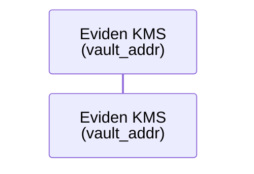

# Mermaid diagram conventions

These rules prevent rendering errors in the mdBook documentation site, VS Code preview,
and GitHub preview. The bundled Mermaid version uses `marked.js` internally to parse
node and edge label content; breaking its constraints silently corrupts diagrams.

## Line breaks

**Use `<br/>`, never `\n`**, for line breaks inside node labels and edge labels.

```mermaid
%%  WRONG — \n is rendered as the literal string "\n" in most Mermaid versions:
flowchart LR
    A["line one\nline two"]

%%  CORRECT — <br/> is interpreted as a line break:
flowchart LR
    A["line one<br/>line two"]
```

This applies to:

- node labels: `["…"]`, `("…")`, `{"…"}`, `(["…"])`, `[/"…"/]`, etc.
- edge labels: `-- "…" -->`, `-. "…" .->`, `== "…" ==>`

## Avoid list markers in node / edge label content

`marked.js` tokenises node label content as Markdown. Any line that starts with a
list marker (`-`, `*`, `+`, `1.`, `2.`, …) produces a `list` token, which
Mermaid's `markdownToHTML` function cannot render and falls back to the error string
`Unsupported markdown: list`.

**Do not start a line (after `<br/>`) with a list marker.**

```mermaid
%%  WRONG — "- item" and "+ item" are list markers:
flowchart LR
    A["Contain<br/>- revoke key<br/>+ stop SPIRE"]

%%  CORRECT — use neutral Unicode prefixes or reword:
flowchart LR
    A["Contain<br/>① revoke key<br/>② stop SPIRE"]
```

Also avoid ordered list markers at the **start** of an edge label:

```mermaid
%%  WRONG — "1. " is an ordered list marker:
flowchart LR
    Admin -- "1. provision AppRoles<br/>+ PKI CA key" --> KMS

%%  CORRECT:
flowchart LR
    Admin -- "① provision AppRoles + PKI CA key" --> KMS
```

## Supported Markdown in node labels

Mermaid's `markdownToHTML` supports only a subset of Markdown tokens in node/edge labels:

| Token | Supported | Example |
|---|---|---|
| Plain text | ✅ | `Node text` |
| Bold | ✅ | `**bold**` |
| Italic | ✅ | `*italic*` |
| HTML (e.g. `<br/>`) | ✅ | Line breaks |
| Paragraph | ✅ | Implicit in multi-token content |
| List (ordered or unordered) | ❌ | Produces `Unsupported markdown: list` |
| Heading (`#`) | ❌ | Produces `Unsupported markdown: heading` |
| Code span (`` ` ``) | ❌ | Produces `Unsupported markdown: code` |
| Blockquote (`>`) | ❌ | Produces `Unsupported markdown: blockquote` |

> **Tip:** keep node labels short and plain. Use sub-headings and prose in the
> surrounding document text to supply detail that cannot fit cleanly in a diagram node.

## Sequence diagram participant aliases

`<br/>` works in participant alias labels:



The same constraints apply: no list markers, no code spans.

## Identifiers must not be Mermaid keywords

Mermaid's lexer matches keywords case-insensitively, so a participant id equal to a
keyword breaks the parse, with an error pointing at a later line. **Always give participants
and nodes a descriptive id (`Online`, `Root`, `Client`) and put the display text in the alias
or label.** Verified to fail as `sequenceDiagram` ids: `Off`, `End`, `Loop`, `Alt`, `Opt`,
`Par`, `Note`, `Rect`, `Box`, `Actor`, `Title`, `Activate`, `Link`, `Over`, `Participant`
(`On` happens to parse, but do not rely on short ids). In `flowchart`, `end` fails as an id.

```mermaid
%%  WRONG — `Off` is the keyword of `autonumber off`: "Parse error on line N":
sequenceDiagram
    participant On as Online KMS
    participant Off as Offline root KMS
    Off->>On: certificate

%%  CORRECT:
sequenceDiagram
    participant Online as Online KMS
    participant Root as Offline root KMS
    Root->>Online: certificate
```

In `flowchart`, an id starting with `o` or `x` right after an edge (`A---oB`) is read as a
circle / cross edge end: put spaces around arrows and use descriptive ids.

## Other syntax pitfalls

- Sequence message text: `;` ends the statement (`A->>B: a; b` fails to parse); write `#59;`
  or reword. `#` starts an entity: write `#35;` for a literal `#`.
- Quote any flowchart node label containing `()`, `[]`, `{}`, `/`, `:`, `,` or `"`:
  `A["Sign (HSM)"]`. Never use a double quote inside a quoted label (use `#quot;` or reword).
- Sequence participant labels need no quotes; `(`, `)` are fine there, but not `;` or `#`.
- One statement per line, no trailing text after a closing bracket, no tabs.
- Do not mix diagram types or put prose / Markdown inside the fence.
- Keep a `%%` comment on its own line.

## Validate every new or edited diagram

A diagram that "looks right" can still fail to parse. After writing or editing one, parse it
with the Mermaid package before finishing (works headless, no browser needed):

```bash
# one diagram saved as /tmp/d.mmd; mermaid-cli ships the parser:
cat > /tmp/p.mjs <<'EOF'
import mermaid from '/opt/homebrew/lib/node_modules/@mermaid-js/mermaid-cli/node_modules/mermaid/dist/mermaid.core.mjs';
import fs from 'fs';
await mermaid.parse(fs.readFileSync('/tmp/d.mmd', 'utf8')); console.log('OK');
EOF
node /tmp/p.mjs   # prints OK, or "Parse error on line N"
```

Adjust the package path to the local `npm root -g`. Limit: headless parsing catches grammar
errors (keywords, `;`, bad arrows) but cannot parse flowchart node labels (`DOMPurify.addHook is
not a function`, an environment error, not a diagram error); for those, follow the label rules
above and say in the final report that rendering was not verified.

## Checking for violations before commit

```bash
# Find literal \n inside Mermaid blocks (should return nothing):
python3 - <<'EOF'
import re, sys
for path in sys.argv[1:]:
    with open(path) as f:
        lines = f.readlines()
    in_mermaid = False
    for i, line in enumerate(lines, 1):
        s = line.rstrip('\n')
        if s.strip() == '```mermaid': in_mermaid = True; continue
        if in_mermaid and s.strip() == '```': in_mermaid = False; continue
        if in_mermaid and r'\n' in s:
            print(f"{path}:{i}: {s}")
EOF documentation/docs/**/*.md
```
