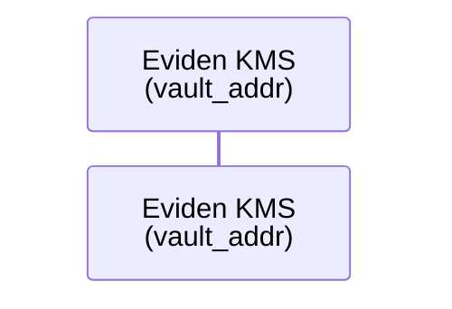

# Mermaid diagram conventions

These rules prevent rendering errors in the mdBook documentation site, VS Code preview,
and GitHub preview. The bundled Mermaid version uses `marked.js` internally to parse
node and edge label content; breaking its constraints silently corrupts diagrams.

## Line breaks

**Use `<br/>`, never `\n`**, for line breaks inside node labels and edge labels.

```mermaid
%%  WRONG — \n is rendered as the literal string "\n" in most Mermaid versions:
flowchart LR
    A["line one\nline two"]

%%  CORRECT — <br/> is interpreted as a line break:
flowchart LR
    A["line one<br/>line two"]
```

This applies to:

- node labels: `["…"]`, `("…")`, `{"…"}`, `(["…"])`, `[/"…"/]`, etc.
- edge labels: `-- "…" -->`, `-. "…" .->`, `== "…" ==>`

## Label width: never let text be cut off on the right

Mermaid measures a label with one font and the viewer draws it with another (GitHub, VS Code,
mdBook, PDF export all differ). A long single line is then clipped on the right edge of its
box, and the clipping is invisible in the source. The fix is to wrap by hand with `<br/>`;
never rely on Mermaid's automatic wrapping.

Hard limits, counted in characters per line (the text between two `<br/>`):

| Where | Max chars per line | Max lines |
|---|---|---|
| Flowchart node label | 26 | 5 |
| Flowchart subgraph title | 30 | 1 |
| Flowchart edge label | 24 | 3 |
| Sequence participant alias | 24 | 3 |
| Sequence message text | 48 | 2 |
| Sequence `Note over` text | 40 | 3 |

Rules:

- Wrap at a word boundary; never split an identifier, a requirement ID (`HSMT-41`) or a
  number with its unit (`136 000 sig/s`).
- A label that still needs more lines than the table allows is too detailed for the diagram:
  move the detail into prose or a table next to it.
- Keep a margin: wide characters (accents, capitals, `W`, `M`) and bold text measure wider than
  the average, so aim 3 to 4 characters under the limit.
- A subgraph title is ONE line. A multi-line title is drawn behind the first node and becomes
  unreadable (seen in a render). Put the description in a node inside the subgraph.
- A label wider than about 200 px (roughly 26 characters) is re-wrapped automatically by
  Mermaid, which breaks the layout you chose: keep every line under the table limit.
- Edge labels that cross, or share a path, overlap each other. Drop the label and say it in a
  node, or reorder the nodes so that the edges do not cross.
- Prefer `flowchart TB` over `LR` when a row would hold more than 3 labelled nodes: wide rows
  are scaled down by the viewer and the text becomes unreadable.

Check before finishing: prints every label over its per-line or line-count limit from the
table above (no output means OK). Fix every hit by re-wrapping, then run it again:

```bash
python3 - path/to/file.md <<'EOF'
import re, sys
EDGE = re.compile(r'(?:--|-\.|==)\s*"([^"]*)"\s*(?:-->|\.->|==>)')
MSG = re.compile(r'\w+\s*-{1,2}(?:>>|>|x|\))[+-]?\s*\w+\s*:\s')  # A->>B: text, A--)B: text
LINES = {'node': 5, 'subgraph': 1, 'edge': 3, 'participant': 3, 'message': 2, 'note': 3}
for path in sys.argv[1:]:
    inside = False
    for n, line in enumerate(open(path, encoding='utf-8'), 1):
        s = line.strip()
        if s.startswith('```mermaid'): inside = True; continue
        if inside and s == '```': inside = False; continue
        if not inside: continue
        items = []  # (kind, max chars per line, text)
        if s.startswith(('participant ', 'actor ')) and ' as ' in s:
            items.append(('participant', 24, s.split(' as ', 1)[1]))
        elif s.startswith('Note ') and ': ' in s:
            items.append(('note', 40, s.split(': ', 1)[1]))
        elif MSG.match(s):
            items.append(('message', 48, s.split(': ', 1)[1]))
        else:
            items += [('edge', 24, t) for t in EDGE.findall(s)]
            kind, lim = ('subgraph', 30) if s.startswith('subgraph') else ('node', 26)
            items += [(kind, lim, t) for t in re.findall(r'"([^"]*)"', EDGE.sub('', s))]
        for kind, lim, t in items:
            parts = re.split(r'<br\s*/?>', t)
            if len(parts) > LINES[kind] or any(len(p) > lim for p in parts):
                print(f"{path}:{n}: {kind} (max {lim}/line): {t}")
EOF
```

The script checks line length, not rendered width: it cannot see a clipped label, so the table
limits are the rule and the script only enforces them.

## Avoid list markers in node / edge label content

`marked.js` tokenises node label content as Markdown. Any line that starts with a
list marker (`-`, `*`, `+`, `1.`, `2.`, …) produces a `list` token, which
Mermaid's `markdownToHTML` function cannot render and falls back to the error string
`Unsupported markdown: list`.

**Do not start a line (after `<br/>`) with a list marker.**

```mermaid
%%  WRONG — "- item" and "+ item" are list markers:
flowchart LR
    A["Contain<br/>- revoke key<br/>+ stop SPIRE"]

%%  CORRECT — use neutral Unicode prefixes or reword:
flowchart LR
    A["Contain<br/>① revoke key<br/>② stop SPIRE"]
```

Also avoid ordered list markers at the **start** of an edge label:

```mermaid
%%  WRONG — "1. " is an ordered list marker:
flowchart LR
    Admin -- "1. provision AppRoles<br/>+ PKI CA key" --> KMS

%%  CORRECT:
flowchart LR
    Admin -- "① provision AppRoles + PKI CA key" --> KMS
```

## Supported Markdown in node labels

Mermaid's `markdownToHTML` supports only a subset of Markdown tokens in node/edge labels:

| Token | Supported | Example |
|---|---|---|
| Plain text | ✅ | `Node text` |
| Bold | ✅ | `**bold**` |
| Italic | ✅ | `*italic*` |
| HTML (e.g. `<br/>`) | ✅ | Line breaks |
| Paragraph | ✅ | Implicit in multi-token content |
| List (ordered or unordered) | ❌ | Produces `Unsupported markdown: list` |
| Heading (`#`) | ❌ | Produces `Unsupported markdown: heading` |
| Code span (`` ` ``) | ❌ | Produces `Unsupported markdown: code` |
| Blockquote (`>`) | ❌ | Produces `Unsupported markdown: blockquote` |

> **Tip:** keep node labels short and plain. Use sub-headings and prose in the
> surrounding document text to supply detail that cannot fit cleanly in a diagram node.

## Sequence diagram participant aliases

`<br/>` works in participant alias labels:



The same constraints apply: no list markers, no code spans.

## Identifiers must not be Mermaid keywords

Mermaid's lexer matches keywords case-insensitively, so a participant id equal to a
keyword breaks the parse, with an error pointing at a later line. **Always give participants
and nodes a descriptive id (`Online`, `Root`, `Client`) and put the display text in the alias
or label.** Verified to fail as `sequenceDiagram` ids: `Off`, `End`, `Loop`, `Alt`, `Opt`,
`Par`, `Note`, `Rect`, `Box`, `Actor`, `Title`, `Activate`, `Link`, `Over`, `Participant`
(`On` happens to parse, but do not rely on short ids). In `flowchart`, `end` fails as an id.

```mermaid
%%  WRONG — `Off` is the keyword of `autonumber off`: "Parse error on line N":
sequenceDiagram
    participant On as Online KMS
    participant Off as Offline root KMS
    Off->>On: certificate

%%  CORRECT:
sequenceDiagram
    participant Online as Online KMS
    participant Root as Offline root KMS
    Root->>Online: certificate
```

In `flowchart`, an id starting with `o` or `x` right after an edge (`A---oB`) is read as a
circle / cross edge end: put spaces around arrows and use descriptive ids.

## Other syntax pitfalls

- Sequence message text: `;` ends the statement (`A->>B: a; b` fails to parse); write `#59;`
  or reword. `#` starts an entity: write `#35;` for a literal `#`.
- Quote any flowchart node label containing `()`, `[]`, `{}`, `/`, `:`, `,` or `"`:
  `A["Sign (HSM)"]`. Never use a double quote inside a quoted label (use `#quot;` or reword).
- Sequence participant labels need no quotes; `(`, `)` are fine there, but not `;` or `#`.
- One statement per line, no trailing text after a closing bracket, no tabs.
- Do not mix diagram types or put prose / Markdown inside the fence.
- Keep a `%%` comment on its own line.

## Validate every new or edited diagram

A diagram that "looks right" can still fail to parse or be clipped. After writing or editing
one, render it and look at the image before finishing. Never report a diagram as verified
without having rendered it.

```bash
# one-time: headless Chrome for mermaid-cli (needs no system Chrome)
npx --yes puppeteer browsers install chrome-headless-shell
CH=$(ls ~/.cache/puppeteer/chrome-headless-shell/*/*/chrome-headless-shell)
echo "{\"executablePath\":\"$CH\",\"args\":[\"--no-sandbox\"]}" > /tmp/pp.json

# render one diagram saved as /tmp/d.mmd (scale 2 for readable text)
mmdc -p /tmp/pp.json -i /tmp/d.mmd -o /tmp/d.png -s 2
```

Then open `/tmp/d.png` and check for: text cut off on the right of a box, a title hidden behind
a node, overlapping edge labels, a label truncated at a `#` (see below), a label re-wrapped
differently from your `<br/>`. Re-wrap and render again until none remains. To pull every
diagram out of a Markdown file, save each ` ```mermaid ` block to its own `.mmd` file.

If `mmdc` cannot run at all, parse the grammar headless instead and say in the final report
that rendering was not verified:

```bash
cat > /tmp/p.mjs <<'EOF'
import mermaid from '/opt/homebrew/lib/node_modules/@mermaid-js/mermaid-cli/node_modules/mermaid/dist/mermaid.core.mjs';
import fs from 'fs';
await mermaid.parse(fs.readFileSync('/tmp/d.mmd', 'utf8')); console.log('OK');
EOF
node /tmp/p.mjs   # prints OK, or "Parse error on line N"
```

Adjust the package path to the local `npm root -g`. Headless parsing catches grammar errors
only; it fails on flowcharts with `DOMPurify.addHook is not a function` (an environment
error, not a diagram error).

## Checking for violations before commit

```bash
# Find literal \n inside Mermaid blocks (should return nothing):
python3 - <<'EOF'
import re, sys
for path in sys.argv[1:]:
    with open(path) as f:
        lines = f.readlines()
    in_mermaid = False
    for i, line in enumerate(lines, 1):
        s = line.rstrip('\n')
        if s.strip() == '```mermaid': in_mermaid = True; continue
        if in_mermaid and s.strip() == '```': in_mermaid = False; continue
        if in_mermaid and r'\n' in s:
            print(f"{path}:{i}: {s}")
EOF documentation/docs/**/*.md
```
