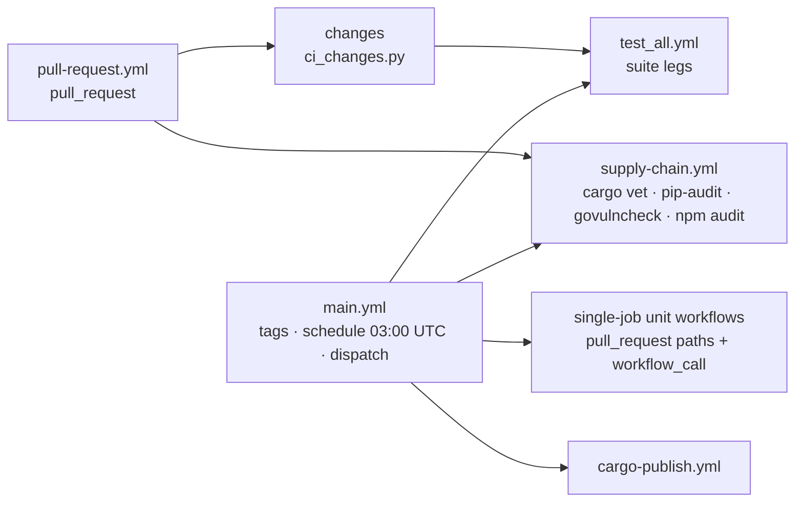
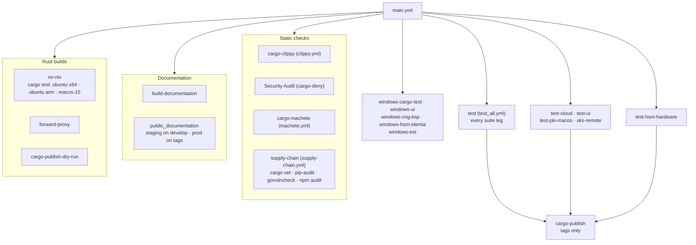
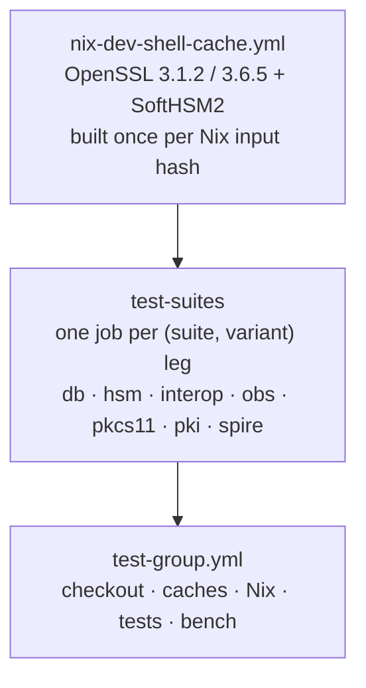

# CI workflows: `pull-request.yml` and `main.yml`

A pull request run shows no skipped row: GitHub lists a job whose `if` is false as skipped, and the only job it never lists is one whose workflow does not run. So each single-job CI unit is its own workflow with a `pull_request: paths:` trigger (it exists on a PR only when a matching file changed) and a `workflow_call` trigger (`main.yml` calls it on tags, nightly and manual runs). The suite legs of `test_all.yml` share one workflow and are selected by `.github/ci-paths.toml` instead.
`pull-request.yml` -> `supply-chain.yml`, `test_all.yml` -> `test-group.yml`; `main.yml` -> every unit workflow, `supply-chain.yml`, `test_all.yml`, `cargo-publish.yml`.
Packaging and releases are described in [README_nightly.md](README_nightly.md).

## Triggers and concurrency

|Workflow|Trigger|Runs|
|---|---|---|
|`pull-request.yml`|`pull_request`|`changes` (the classifier), `cargo-deny`, `supply-chain`, and `test` (`test_all.yml`) unless dependabot or no suite is selected|
|single-job unit workflows (list below)|`pull_request` with `paths:`, and `workflow_call`|on a PR only when a file of their `paths:` changed|
|`main.yml`|tag push (`**`), `schedule` (daily 03:00 UTC, default branch), `workflow_dispatch`|every unit, plus real `cargo publish` and the production documentation deploy on tags|

`workflow_dispatch` also runs `xks-remote` (it waits for its manual approval). A new push to the same PR cancels the runs of `pull-request.yml` (`ci-CI-<head_ref>`) and of every unit workflow (`<file stem>-<head_ref>`, so a caller's group is never shared). Every `main.yml` run gets a unique group and is never cancelled.

Unit workflows (each reads its secrets as `secrets.X` directly; `main.yml` calls them with `secrets: inherit`):

|Workflow|Job|`pull_request` paths|
|---|---|---|
|`clippy.yml`|`clippy`|Rust sources, `Cargo.toml` files, `Cargo.lock`, `rust-toolchain.toml`, `clippy.toml`, `.cargo/config.toml`|
|`machete.yml`|`machete`|Rust sources and `Cargo.toml` files|
|`no-nix.yml`, `windows-cargo-test.yml`, `cargo-publish-dry-run.yml`|`no-nix`, `cargo-test`, `publish`|Rust build inputs: `crate/**` except `*.md`, `kmip`, `test_data`, `Cargo.toml`, `Cargo.lock`, toolchain and cargo config, nextest config, the `install-rust` and `cache-openssl-buildrs` actions (`cargo-publish-dry-run.yml` also `cargo-publish.yml`)|
|`forward_proxy.yml`|`forward-proxy`|Rust build inputs and `.github/scripts/squid/**` (globs cannot express the `server_core` set of `ci-paths.toml`, so this over-approximates it)|
|`build-documentation.yml`|`build-documentation`|`documentation/**`, `AGENTS.md`, `CONTRIBUTING.md`, the AI instruction files and the docs tasks and scripts|
|`xks-remote.yml`|`xks-remote`|the `aws_xks` route and the XKS scripts|
|`test-cloud.yml`|`test-cloud`|the cloud-provider routes, CLI actions, server tests, `.mise/tasks/test/cloud/**` and their scripts|
|`test-ui.yml`|`test-ui`|`ui/**`, `crate/clients/wasm/**`, `ui_auth.rs`, `authentication`, the UI tasks and scripts|
|`test-pki-macos.yml`|`interop-macos` (`Test pki (macOS)`)|the EST, SCEP, OCSP, CRL, CSR and enrollment routes, the certificate core, the PKI tasks and scripts|
|`windows-ui.yml`, `windows-cng-ksp.yml`, `windows-hsm-idemia.yml`, `windows-est.yml`|`test-ui`, `test-cng-ksp`, `test-hsm-idemia`, `test-est-interop`|the Windows build inputs (`vcpkg*.json`, `build-static-openssl`, `windows-vs-ninja`, `common.ps1`, `install_ninja.ps1`) plus the job's own sources and scripts; never on dependabot or fork PRs|
|`nix-dev-shell-cache.yml`|`cache`|`workflow_call` only, from `test_all.yml`, `test-cloud.yml`, `test-ui.yml` and `main.yml`|

The suite legs of `test_all.yml` are the only units that share a workflow, so a `paths:` filter cannot select them. `changes` runs `mise run dev:ci-changes` (`.mise/scripts/dev/ci_changes.py`, rules in `.github/ci-paths.toml`), which outputs `skip` (the units that do not run), `suites-matrix` (the legs of the running units) and `run-test` (false when no suite runs: the `test` job is then one skipped row). Files that only feed a single-job workflow are listed in the `ignore` of `ci-paths.toml`, so they never run every suite.

## Jobs of `main.yml`

## `test_all.yml`

`test_all.yml` only holds the suite legs: `pull-request.yml` passes the legs the PR touches, `main.yml` passes all of them (`ci_changes.py --all`).

Each test job runs one group of `.mise/tasks/test` (`mise run test:<group> --variant <variant>`, i.e. the group's `_default`, which runs its listed leaves through `run_test_leaves` and reports every failing leaf) through the reusable `test-group.yml`, which holds the checkout, caches, Nix setup, Docker Hub login, test and bench steps. A leaf checks its own prerequisites and exits 77 when it cannot run, which counts as a skip (see `.mise/tasks/test/README.md`). `matrix.variant` gives the cells; groups whose leaves are all non-FIPS only (`pkcs11`, `spire`) run `non-fips` only. The `skip` input exports `TEST_SKIP_LEAVES`, a list of `<group>:<leaf>` ids the group must not run. The `k8s` and `pkg` groups run in `packaging-docker.yml`. A leaf no group lists runs locally only.

|Workflow|Job|Group|
|---|---|---|
|`test_all.yml`|`test-suites`|one `test-group.yml` job per leg of the `suites-matrix` that `ci_changes.py` builds from the `variants` of `.github/ci-paths.toml`: the `db` leaves (with the database environment variables), `hsm` without the real HSMs (`skip: hsm:crypt2pay hsm:proteccio`) then the `bench` models, the `interop` leaves (a hang or leftover state in one leaf stays in its own job), `obs`, `pkcs11`, `pki` and `spire`; a suite that does not run has no leg, so no row|
|`test-cloud.yml`|`test-cloud`|`cloud` (upstream only: needs the Google, AWS and Azure secrets)|
|`test-ui.yml`|`test-ui`|`ui`|
|`main.yml`|`test-hsm-hardware`|real HSMs `hsm:proteccio`, `hsm:crypt2pay`, one leaf per cell (never on pull requests)|

`test-suites` is the only job whose secrets depend on the leg (`secrets:` expressions on `matrix.suite`): the Docker Hub login for every leg, the EDB and IRIS tokens for `interop:*` legs, the Splunk password for `obs`. `cloud` and `ui` stay separate jobs so that their secret scope is set by the job, not by an expression.

`test-ui` runs without cloud or test secrets, because it executes `pnpm install`. `test-cloud` skips on forks and fork pull requests, `test-hsm-hardware` never runs on pull requests and only in the upstream repository. In both jobs a task whose required `env:` variables are unset (a deleted or renamed secret, a typo in the mapping) fails instead of skipping, because its upstream gate calls `print_error` when `CI=true`, so a green cell proves its tasks ran. A cell's `lock` (`hsm-proteccio`, `hsm-crypt2pay`) is its concurrency group: the HSMs refuse concurrent runs, and `test-k8s-hsm` in `packaging-docker.yml` (also never on pull requests) shares the groups. A cell's `bench` is the list of HSM models whose benchmarks run after its tests, off pull requests. Pull requests cover the HSM code paths with the software simulators of the `hsm` legs of `test-suites` (`softhsm2`, `utimaco`, `crypt2pay-simulator`, `kryoptic`).

A leaf that fails only when grouped (port, Docker or environment leak) or only in one variant: add its `<group>:<leaf>` id to the `skip` input of its job, with a one-line reason comment.

## PR versus nightly

"Nightly" means any non-PR event (schedule, dispatch, tags).

|Item|PR|Nightly / tags|
|---|---|---|
|Suite legs of `test_all.yml` (job `test`)|only the legs `.github/ci-paths.toml` selects for the changed files; none on a dependabot PR or when no suite is selected|every leg|
|Single-job workflows (clippy, machete, docs, no-nix, windows-*, test-ui, test-cloud, test-pki-macos, xks-remote, forward-proxy, publish dry run)|exist only when a file of their `paths:` changed|every one, called by `main.yml`|
|real HSMs (`test-hsm-hardware`, `test-k8s-hsm`)|not run (the `hsm` suite legs run the software simulators)|run|
|DB jobs other than sqlite|`cosmian_kms_server_database` DB tests plus the lib tests of the six crates that start `test_kms_server`|same|
|sqlite job|whole workspace `--lib --bins` once per variant|same|
|HSM benches (`bench:pkcs11`, `bench:hsm`)|skipped|run|
|Windows `cargo test`|quick: `test_kms_server` and `ckms` lib tests excluded (covered on Linux)|full|
|`cargo publish --dry-run`|`--no-verify` (no compile)|full `--all-features` compile|
|`xks-remote`|runs on upstream PRs that change the XKS route or scripts|dispatch and tags only, not `schedule` (manual approval environment)|
|Linux "No Nix" legs|run when a Rust build input changed|run|

The DB scoping also applies locally: `mise run test:db:psql`, `test:db:mysql`, `test:db:percona`, `test:db:mariadb` and `test:db:redis` no longer run DB-independent server, crypto and KMIP unit tests. Use `test:db:sqlite` for the full workspace suite.

A nightly failure notifies only the GitHub user who last edited the `main.yml` cron line.

## Caches

Produced by the workflows themselves. GitHub's LRU eviction (10 GB per repository) and 7-day inactivity
eviction replace the former `cleanup` job, which deleted every cache after each run.
`github_cache_cleanup.yml` (manual dispatch) remains for manual purges.

|Key prefix|Content|Producer|Approximate size|
|---|---|---|---|
|`nix-dev-shell-<os>-<arch>-<input hash>`|NAR export of the source-built Nix closure (OpenSSL 3.1.2, 3.6.5, FIPS bootstrap, SoftHSM2, Utimaco)|`nix-dev-shell-cache.yml`, called by `test_all.yml`, `test-cloud.yml`, `test-ui.yml` and `main.yml`; consumers use `setup-nix` with `dev-shell-cache: 'true'`|0.2 to 0.6 GB estimated (the job logs the exact size)|
|`openssl-buildrs-<os>-<arch>-<variant>-<hash of crypto/build.rs>`|`target/openssl-*` prefixes installed by `crate/crypto/build.rs`|first job that builds it (`cache-openssl-buildrs`)|23 to 30 MB per prefix|
|`vcpkg-<os>-<image version>-<hash of vcpkg.json>`|vcpkg binary cache of the static OpenSSL port|first Windows job (`build-static-openssl`)|tens of MB|

The Nix key hashes `shell.nix`, `nix/openssl.nix`, `nix/openssl-fips-bootstrap.*`, `nix/softhsm2.nix`, `nix/utimaco.nix` and `.mise/lib/common.sh` (which contains the nixpkgs `PIN_URL`). Keep the three key copies synchronized: restore in `setup-nix/action.yml`, and lookup/save in `nix-dev-shell-cache.yml`.

Not cached on purpose: cargo `target/` (multi-GB, 8 variant sets), Nix outputs of packaging and Docker builds
(vendor hashes must be revalidated on every build).

Cache scope: a run reads the caches of its own branch, of the default branch (`develop`) and, on a PR, of its base
branch. A PR against `main` therefore still reads the `develop` caches; the producer job builds the Nix closure only
when the key (the hash of the Nix inputs) differs from every readable entry. A cache saved by a PR is readable only
from that PR's merge ref.

## Local composite actions

|Action|Inputs|What it does|Callers|
|---|---|---|---|
|`cleanup-runner`|none|Frees 20 to 30 GB on hosted Linux runners|`setup-nix-mise`, `cargo-publish.yml`|
|`setup-nix`|`extra-nix-config`, `dev-shell-cache`|Installs Nix, warms the pinned nixpkgs, optionally imports the cached dev-shell closure|`setup-nix-mise`, `nix-dev-shell-cache`, `benchmark.yml`|
|`install-mise`|none|Installs the pinned, checksum-verified mise binary|`setup-nix-mise`, several jobs|
|`setup-nix-mise`|`cleanup-runner`, `extra-nix-config`, `dev-shell-cache`|Optional cleanup, then Nix, then mise (requires a prior checkout)|`test_all.yml`, packaging workflows, `nix-update-hashes.yml`|
|`cache-openssl-buildrs`|`variant`|Caches `target/openssl-*` built by `crate/crypto/build.rs`|`forward_proxy.yml`, `test_all.yml`, `test-group.yml`, `no-nix.yml`|
|`build-static-openssl`|none|Windows vcpkg static OpenSSL with retries and a vcpkg binary cache|`windows-*.yml`, `build_windows.yml`|
|`windows-vs-ninja`|none|Puts Visual Studio's Ninja on PATH so vcpkg does not download it|`windows-*.yml`|
|`docker-login-ghcr`|`github-token`|Logs in to ghcr.io|`packaging-docker.yml`|
|`import-gpg-key`|`gpg-private-key`, `passphrase`|Imports the package-signing key and lists it|`packaging.yml`, `packaging-apk.yml`, `packaging-kubernetes.yml`|
|`setup-helm-minikube`|none|Installs Helm and starts Minikube (docker driver, Kubernetes v1.32.0)|`packaging-docker.yml`|
|`push-package-cosmian`|`subdir`, `files`, `known-hosts`|Uploads files to `package.cosmian.com` under the branch (or tag) directory; output `remote-dir`|`packaging.yml`, `packaging-apk.yml`, `packaging-kubernetes.yml`, `build_windows.yml`|

Upload callers pass the trusted host key from `vars.PACKAGE_COSMIAN_SSH_KNOWN_HOSTS`. Missing or mismatched keys fail the upload; SSH host-key verification is never disabled by this action.
