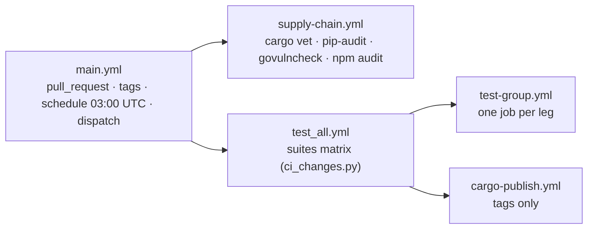
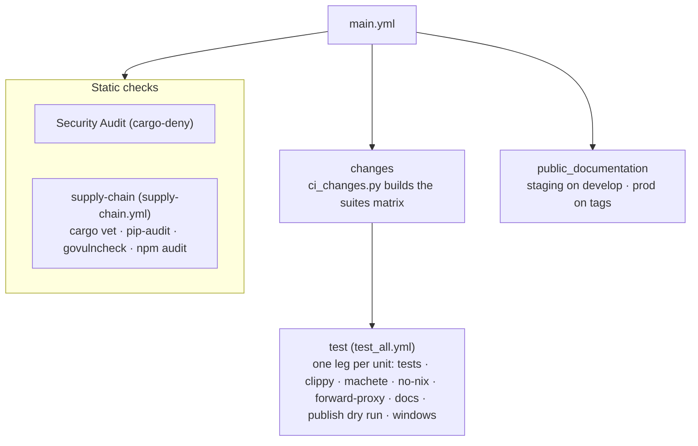
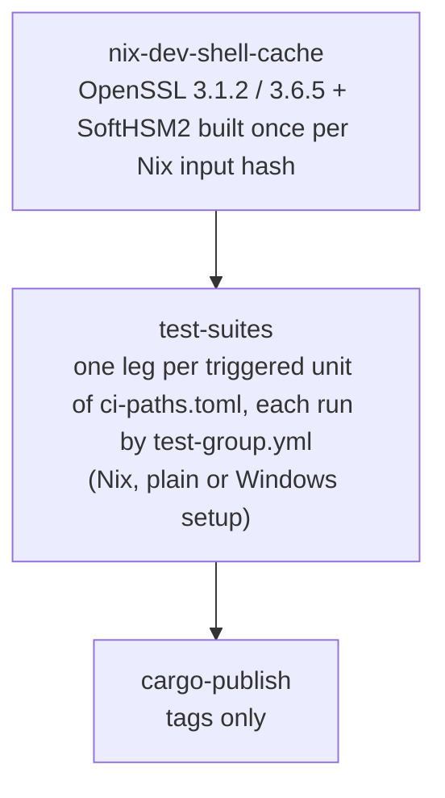

# CI workflows: `main.yml`

`main.yml` is the PR / tag / nightly test pipeline. The `test` job calls `test_all.yml`, which runs every CI unit as a leg of one matrix, each leg through `test-group.yml` (`test / <unit> …` rows):
`main.yml` -> `supply-chain.yml`, `test_all.yml` -> `test-group.yml` / `cargo-publish.yml`. The CLA is enforced by the hosted CLA Assistant GitHub App (`license/cla` status), not by a workflow.
Packaging and releases are described in [README_nightly.md](README_nightly.md).

## Triggers and concurrency

|Trigger|Runs|Cancelled by a newer push|
|---|---|---|
|`pull_request`|everything except the upstream-only jobs on fork PRs|yes, per PR branch|
|tag push (`**`)|everything, plus real `cargo publish` and the production documentation deploy|no|
|`schedule` (daily 03:00 UTC, default branch)|everything the nightly set contains (see below)|no|
|`workflow_dispatch`|same as `schedule`, plus `xks-remote` (waits for its manual approval)|no|

Only PRs share a concurrency group (`ci-CI-<head_ref>`). Every other event gets a unique group.

## Jobs of `main.yml`

## `test_all.yml`

`cargo-publish` (tags only) needs the whole `test-suites` matrix, not a hand-picked list of jobs: any failed or cancelled leg blocks the crates.io publish, and so does the human approval of the `xks-remote-approval` environment that the `xks-remote` leg waits on.

Every leg of `test-suites` waits for `nix-dev-shell-cache`, so a cache miss delays all legs, including the macOS, Windows, clippy and documentation ones, until the Nix closure is built.

Every CI unit that tests something (database, HSM, interop, UI, cloud, clippy, machete, no-nix, forward proxy, documentation build, publish dry run, XKS, PKI on macOS, Windows jobs) is a leg of the single `test-suites` matrix job, run by the reusable `test-group.yml`. `ci_changes.py` builds the matrix from `.github/ci-paths.toml`: a leg is `{suite, variant, runner, setup, bench, timeout, lock, environment}`, one per runner and variant of each running unit, so a unit that does not run has no row. Pull requests keep the units their changed files trigger; schedule, tags and dispatch never read the diff and keep every unit whose `events` list them. `upstream` units (cloud, XKS, real HSMs) are dropped outside `Cosmian/kms` and on fork PRs, `no-fork-pr` units (Windows, publish dry run) on fork PRs only. The only skipped row of a PR run is `cargo-publish`, which really publishes on tags and waits for every leg.

A unit with `setup = "nix"` (the default) runs one group of `.mise/tasks/test` (`mise run test:<group> --variant <variant>`, i.e. the group's `_default`, which runs its listed leaves through `run_test_leaves` and reports every failing leaf) in the Nix dev shell. A leaf checks its own prerequisites and exits 77 when it cannot run, which counts as a skip (see `.mise/tasks/test/README.md`). Groups whose leaves are all non-FIPS only (`pkcs11`, `spire`) declare `non-fips` only. The `skip` input exports `TEST_SKIP_LEAVES`, a list of `<group>:<leaf>` ids the group must not run. The `k8s` and `pkg` groups run in `packaging-docker.yml`. A leaf no group lists runs locally only. The other units (`plain` and `windows` setups, and `xks-remote`) run their own composite action `.github/actions/legs/<unit>/` from `test-group.yml` (the `db:*` units also run `legs/db`). CI wiring triggers no leg except the shared setup (`ci_setup` in `ci-paths.toml`: `test_all.yml`, `test-group.yml` and the toolchain actions), which runs one leg per setup path (`forward-proxy`, `interop:pykmip`, `pki-macos`, `windows-est`).

The `secrets:` expressions of `test-suites` scope each secret to its legs: the Docker Hub login for Nix legs except `ui`, `cloud`, `xks-remote` and the real HSMs, the EDB and IRIS tokens for `interop:*` legs, the Splunk password for `obs`, the Google, AWS and Azure test credentials for `cloud`, the XKS credentials for `xks-remote`, the HSM and VPN credentials for the real HSM legs, `PAT_TOKEN` for `build-documentation` on PRs. `ui` runs without cloud or test secrets, because it executes `pnpm install`.

In the `cloud` and real-HSM legs a task whose required `env:` variables are unset (a deleted or renamed secret, a typo in the mapping) fails instead of skipping, because its upstream gate calls `print_error` when `CI=true`, so a green leg proves its tasks ran. A unit's `lock` (`hsm-proteccio`, `hsm-crypt2pay`, `xks-remote`) is its concurrency group: the HSMs refuse concurrent runs, and `test-k8s-hsm` in `packaging-docker.yml` (also never on pull requests) shares the groups. A leg's `bench` is the list of HSM models whose benchmarks run after its tests, off pull requests. Pull requests cover the HSM code paths with the software simulators of the `hsm` legs (`softhsm2`, `utimaco`, `crypt2pay-simulator`, `kryoptic`).

A leaf that fails only when grouped (port, Docker or environment leak) or only in one variant: add its `<group>:<leaf>` id to the `skip` input of its leg, with a one-line reason comment.

## PR versus nightly

"Nightly" means any non-PR event (schedule, dispatch, tags).

|Item|PR|Nightly / tags|
|---|---|---|
|`test_all.yml` (job `test` of `main.yml`)|the legs the changed files trigger (Dependabot PRs: clippy, machete, no-nix, forward-proxy, docs only)|every unit whose `events` list the event|
|real HSMs (`hsm:crypt2pay`, `hsm:proteccio`, `test-k8s-hsm`)|no legs (software simulators run)|run (upstream repository only)|
|DB jobs other than sqlite|`cosmian_kms_server_database` DB tests plus the lib tests of the six crates that start `test_kms_server`|same|
|sqlite job|whole workspace `--lib --bins` once per variant|same|
|HSM benches (`bench:pkcs11`, `bench:hsm`)|skipped|run|
|Windows `cargo test`|quick: `test_kms_server` and `ckms` lib tests excluded (covered on Linux); no Windows legs on fork PRs|full|
|`cargo-publish-dry-run`|`--no-verify` (no compile); none on fork PRs|full `--all-features` compile, not on tags (the real publish runs there)|
|`xks-remote`|runs (upstream PRs, manual approval environment)|dispatch and tags only, not `schedule`|
|Linux "No Nix" legs|run|run|

The DB scoping also applies locally: `mise run test:db:psql`, `test:db:mysql`, `test:db:percona`, `test:db:mariadb` and `test:db:redis` no longer run DB-independent server, crypto and KMIP unit tests. Use `test:db:sqlite` for the full workspace suite.

A nightly failure notifies only the GitHub user who last edited the `main.yml` cron line.

## Caches

Produced by the workflows themselves. GitHub's LRU eviction (10 GB per repository) and 7-day inactivity
eviction replace the former `cleanup` job, which deleted every cache after each run.
`github_cache_cleanup.yml` (manual dispatch) remains for manual purges.

|Key prefix|Content|Producer|Approximate size|
|---|---|---|---|
|`nix-dev-shell-<os>-<arch>-<input hash>`|NAR export of the source-built Nix closure (OpenSSL 3.1.2, 3.6.5, FIPS bootstrap, SoftHSM2, Utimaco)|`nix-dev-shell-cache` job in `test_all.yml`; consumers use `setup-nix` with `dev-shell-cache: 'true'`|0.2 to 0.6 GB estimated (the job logs the exact size)|
|`openssl-buildrs-<os>-<arch>-<variant>-<hash of crypto/build.rs>`|`target/openssl-*` prefixes installed by `crate/crypto/build.rs`|first job that builds it (`cache-openssl-buildrs`)|23 to 30 MB per prefix|
|`vcpkg-<os>-<image version>-<hash of vcpkg.json>`|vcpkg binary cache of the static OpenSSL port|first Windows job (`build-static-openssl`)|tens of MB|

The Nix key hashes `shell.nix`, `nix/openssl.nix`, `nix/openssl-fips-bootstrap.*`, `nix/softhsm2.nix`, `nix/utimaco.nix` and `.mise/lib/common.sh` (which contains the nixpkgs `PIN_URL`). Keep the three key copies synchronized: restore in `setup-nix/action.yml`, and lookup/save in `test_all.yml`.

Not cached on purpose: cargo `target/` (multi-GB, 8 variant sets), Nix outputs of packaging and Docker builds
(vendor hashes must be revalidated on every build).

Cache scope: a run reads the caches of its own branch, of the default branch (`develop`) and, on a PR, of its base
branch. A PR against `main` therefore still reads the `develop` caches; the producer job builds the Nix closure only
when the key (the hash of the Nix inputs) differs from every readable entry. A cache saved by a PR is readable only
from that PR's merge ref.

## Local composite actions

|Action|Inputs|What it does|Callers|
|---|---|---|---|
|`cleanup-runner`|none|Frees 20 to 30 GB on hosted Linux runners|`setup-nix-mise`, `cargo-publish.yml`, `legs/cargo-publish-dry-run`|
|`setup-nix`|`extra-nix-config`, `dev-shell-cache`|Installs Nix, warms the pinned nixpkgs, optionally imports the cached dev-shell closure|`setup-nix-mise`, `nix-dev-shell-cache`, `benchmark.yml`|
|`install-mise`|none|Installs the pinned, checksum-verified mise binary|`setup-nix-mise`, several jobs|
|`setup-nix-mise`|`cleanup-runner`, `extra-nix-config`, `dev-shell-cache`|Optional cleanup, then Nix, then mise (requires a prior checkout)|`test_all.yml`, packaging workflows, `nix-update-hashes.yml`|
|`cache-openssl-buildrs`|`variant`|Caches `target/openssl-*` built by `crate/crypto/build.rs`|`test_all.yml`, `test-group.yml`|
|`build-static-openssl`|none|Windows vcpkg static OpenSSL with retries and a vcpkg binary cache|`test-group.yml`, `build_windows.yml`|
|`windows-vs-ninja`|none|Puts Visual Studio's Ninja on PATH so vcpkg does not download it|`test-group.yml`|
|`legs/<unit>`|per unit (secrets and `variant`)|The unit's own steps of a `test-group.yml` leg (13 units), plus `legs/db` (database service environment of the `db:*` legs)|`test-group.yml`|
|`docker-login-ghcr`|`github-token`|Logs in to ghcr.io|`packaging-docker.yml`|
|`import-gpg-key`|`gpg-private-key`, `passphrase`|Imports the package-signing key and lists it|`packaging.yml`, `packaging-apk.yml`, `packaging-kubernetes.yml`|
|`setup-helm-minikube`|none|Installs Helm and starts Minikube (docker driver, Kubernetes v1.32.0)|`packaging-docker.yml`|
|`push-package-cosmian`|`subdir`, `files` or `directory`, `version-dir`, `known-hosts`, `ssh-private-key`|Uploads with a write-only restricted rsync key (`.mise/scripts/release/push_package.sh`) to `package.cosmian.com` under the branch (or tag, or `version-dir`) directory; output `remote-dir`|`packaging.yml`, `packaging-apk.yml`, `packaging-kubernetes.yml`, `build_windows.yml`, `benchmark.yml`, `flamegraph.yml`|

Upload callers pass the trusted host key from `vars.PACKAGE_COSMIAN_SSH_KNOWN_HOSTS` and the dedicated key `secrets.PACKAGE_COSMIAN_SSH_PRIVATE_KEY`. Missing or mismatched keys fail the upload; SSH host-key verification is never disabled by this action.

Publish jobs run on fresh `ubuntu-24.04` runners in the `package-publish` environment (no job container, no host-mounted key), download artifacts under `${{ runner.temp }}/package-artifacts` (never over the checkout that holds the uploader) and upload only plain regular files.

### Credential boundaries (release, publish, upload)

|Credential|Held by|Never present in|
|---|---|---|
|`PAT_TOKEN`|`commit-generated.yml` (last step only), `sync-branches`, dispatch/wait steps|jobs that build, generate docs or hashes, or compile (`prepare-build`, `generate-nix-hashes`, `generate-docs`, `retrieve-sbom`)|
|`CRATES_IO`|`cargo-publish.yml` `publish` job (environment `crates-io`, `--no-verify`)|`verify` (the compiling `--dry-run`)|
|`PACKAGE_COSMIAN_SSH_PRIVATE_KEY`|publish jobs in environment `package-publish`|every build, test and Git job|

Builders upload a data-only `changes.patch`; `commit-generated.yml` applies it onto the same commit, takes its helper scripts from the workflow's own commit (never from `base-sha`), requires `base-sha` to be reachable from the target branch or the default branch (`check_base_lineage.sh`), accepts only plain-file changes at the caller's exact paths (`validate_generated_changes.py`), transplants that single commit onto the branch tip and pushes without force. `mise run dev:ci-security` (supply-chain job `release-security`) tests these boundaries, and `.mise/scripts/dev/test_release_security.py --probe` runs in the builders to prove dependency code sees no release credential.

Administrator prerequisites (not creatable from the repository): environments `crates-io` (required reviewers; `CRATES_IO` is stored ONLY as an environment secret: delete it at repository and organization level, otherwise any workflow can read it and the reviewer gate protects nothing) and `package-publish` (secret `PACKAGE_COSMIAN_SSH_PRIVATE_KEY`); on `package.cosmian.com` a dedicated account `kms-ci-upload` (write access to `/mnt/package/kms` only, `/bin/dash` shell) whose authorized key is prefixed with `restrict,command="/usr/bin/rrsync -wo -munge -no-del /mnt/package/kms"` (check the installed rrsync path); `PAT_TOKEN` must be available to the repository.
