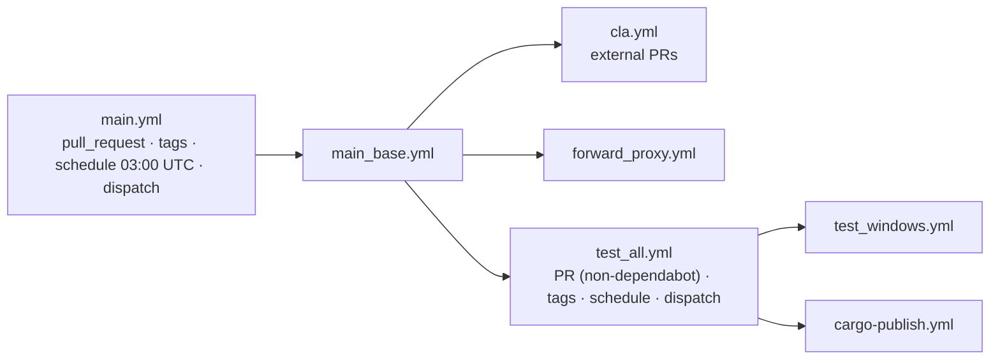
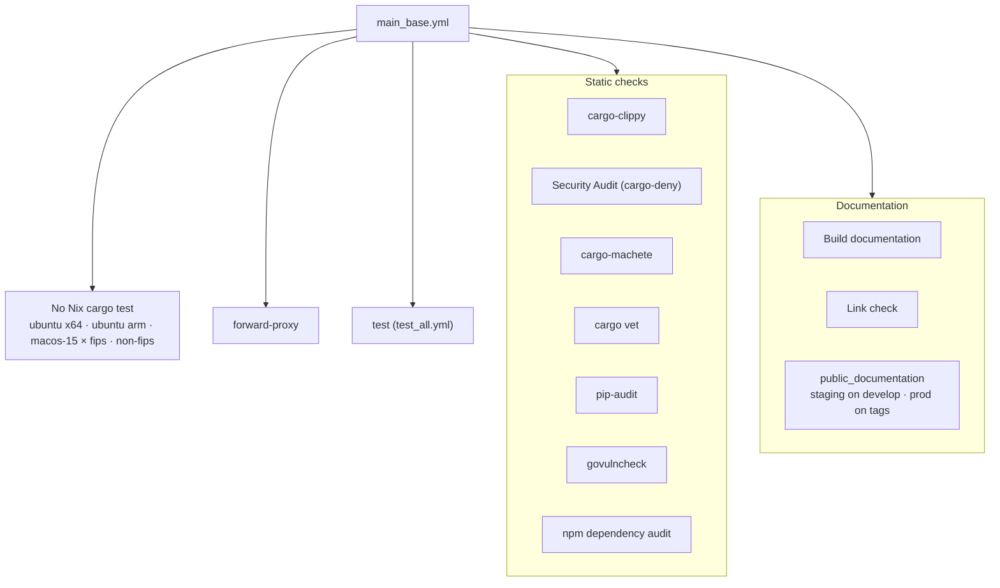
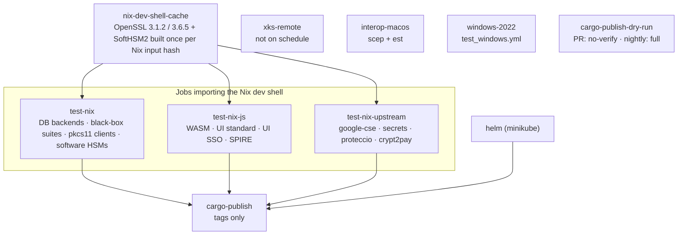

# CI workflows: `main.yml`

`main.yml` is the PR / tag / nightly test pipeline. It only calls other workflows:
`main.yml` -> `main_base.yml` -> `forward_proxy.yml`, `test_all.yml` -> `test_windows.yml`, `cargo-publish.yml`.
Packaging and releases are described in [README_nightly.md](README_nightly.md).

## Triggers and concurrency

|Trigger|Runs|Cancelled by a newer push|
|---|---|---|
|`pull_request`|everything except the upstream-only jobs on fork PRs|yes, per PR branch|
|tag push (`**`)|everything, plus real `cargo publish` and the production documentation deploy|no|
|`schedule` (daily 03:00 UTC, default branch)|everything the nightly set contains (see below)|no|
|`workflow_dispatch`|same as `schedule`, plus `xks-remote` (waits for its manual approval)|no|

Only PRs share a concurrency group (`ci-CI-<head_ref>`). Every other event gets a unique group.

## `main_base.yml`

## `test_all.yml`

Each test job lists its legs explicitly in its `strategy.matrix`: `leg` and `variant` give the cells, `exclude` drops the non-FIPS-only legs (and the FIPS MySQL family on pull requests), and `include` maps each leg to the `test:<id>` tasks it runs (`mise run test:<id> --variant <variant>`, one after the other in a shell loop), plus its `lock` or `bench`. A task missing from every `include` runs locally only. Each task checks its own prerequisites and exits 77 when it cannot run, which the loop reports as a `::warning::` (see `.mise/tasks/test/README.md`).

|Job|Legs|
|---|---|
|`test-nix`|databases (`sqlite`, `psql`, `mysql`, `percona`, `mariadb`, `redis`), software HSMs (`softhsm2`, `utimaco`, `crypt2pay-simulator`, `kryoptic`), `gcp-cmek`, `jose`, `db2`, `ase`, `audit`, `veracrypt` and the grouped legs below|
|`test-nix-js`|`wasm`, `ui`, `ui-sso`, `spire`|
|`test-nix-upstream`|`google-cse`, `secrets`, `proteccio`, `crypt2pay`|

`test-nix-js` runs without cloud or test secrets, because it executes `pnpm install`. It also imports the Nix dev shell. `test-nix-upstream` needs repository secrets and the hardware HSMs: its job-level `if` skips it on forks and fork pull requests. In this job a task whose required `env:` variables are unset (a deleted or renamed secret, a typo in the mapping) fails instead of skipping, because its upstream gate calls `print_error` when `CI=true`, so a green leg proves its tasks ran. A leg's `lock` (`hsm-proteccio`, `hsm-crypt2pay`) is its concurrency group: the HSMs refuse concurrent runs, and `test-k8s-hsm` in `packaging-docker.yml` shares the groups. A leg's `bench` is the HSM model whose benchmarks run after its suites, off pull requests.

### Grouped legs

Suites whose own test time is under two minutes share one runner (one build, then a shell loop runs the `test:<id>` tasks one after the other and reports every failing task). Nix-shell suites are grouped apart from the others (`blackbox-nix`, `pkcs11`, `ui-sso`), because switching `OPENSSL_DIR` recompiles the workspace.

|Leg|Suites|
|---|---|
|`blackbox` fips|`pki:ocsp`, `pki:revocation`, `pki:scep-interop`, `pki:est-interop`, `obs:otel`, `cloud:secret-cosmian-kms`, `hsm:azure-cloud-hsm-build`|
|`blackbox` non-fips|the fips list plus `obs:cef-format`, `obs:cef-syslog`, `obs:cef-tcp-syslog`, `obs:filebeat`, `obs:fluent-bit`, `obs:monitoring`|
|`blackbox-nix` fips|`interop:kmip-go`|
|`blackbox-nix` non-fips|`interop:kmip-go`, `cloud:xks`, `cloud:azure-ekm`, `interop:pykmip`, `interop:iris`|
|`pkcs11` non-fips|`pkcs11:openssh`, `pkcs11:luks`, `pkcs11:gnupg`, `pkcs11:support`, `pkcs11:tool`|
|`audit`|`obs:audit`, `obs:audit-opensearch`, `obs:audit-postgres`, `obs:audit-splunk`|
|`ui-sso` non-fips (in `test-nix-js`)|`ui:auth`, `ui:oidc`, `ui:saml`|
|`secrets` non-fips (in `test-nix-upstream`)|`cloud:secret-vault`, `cloud:secret-aws`, `cloud:secret-azure`|

A suite that fails only when grouped (port, Docker or environment leak) moves to a leg of its own: add the leg to the `matrix.leg` list and the `include` of its job in `test_all.yml`.

## PR versus nightly

"Nightly" means any non-PR event (schedule, dispatch, tags).

|Item|PR|Nightly / tags|
|---|---|---|
|`test_all.yml` (via `main_base.yml` `test`)|yes (not dependabot)|yes|
|fips legs of mysql, percona, mariadb|skipped (sqlite and psql keep fips)|run|
|DB jobs other than sqlite|`cosmian_kms_server_database` DB tests plus the lib tests of the six crates that start `test_kms_server`|same|
|sqlite job|whole workspace `--lib --bins` once per variant|same|
|HSM benches (`bench:pkcs11`, `bench:hsm`)|skipped|run|
|Windows `cargo test`|quick: `test_kms_server` and `ckms` lib tests excluded (covered on Linux)|full|
|`cargo publish --dry-run`|`--no-verify` (no compile)|full `--all-features` compile|
|`xks-remote`|runs (upstream PRs)|dispatch and tags only, not `schedule` (manual approval environment)|
|Linux "No Nix" legs|run|run|

The DB scoping also applies locally: `mise run test:db:psql`, `test:db:mysql`, `test:db:percona`, `test:db:mariadb` and `test:db:redis` no longer run DB-independent server, crypto and KMIP unit tests. Use `test:db:sqlite` for the full workspace suite.

A nightly failure notifies only the GitHub user who last edited the `main.yml` cron line.

## Caches

Produced by the workflows themselves. GitHub's LRU eviction (10 GB per repository) and 7-day inactivity
eviction replace the former `cleanup` job, which deleted every cache after each run.
`github_cache_cleanup.yml` (manual dispatch) remains for manual purges.

|Key prefix|Content|Producer|Approximate size|
|---|---|---|---|
|`nix-dev-shell-<os>-<arch>-<input hash>`|NAR export of the source-built Nix closure (OpenSSL 3.1.2, 3.6.5, FIPS bootstrap, SoftHSM2, Utimaco)|`nix-dev-shell-cache` job in `test_all.yml`; consumers use `setup-nix` with `dev-shell-cache: 'true'`|0.2 to 0.6 GB estimated (the job logs the exact size)|
|`openssl-buildrs-<os>-<arch>-<variant>-<hash of crypto/build.rs>`|`target/openssl-*` prefixes installed by `crate/crypto/build.rs`|first job that builds it (`cache-openssl-buildrs`)|23 to 30 MB per prefix|
|`vcpkg-<os>-<image version>-<hash of vcpkg.json>`|vcpkg binary cache of the static OpenSSL port|first Windows job (`build-static-openssl`)|tens of MB|

The Nix key hashes `shell.nix`, `nix/openssl.nix`, `nix/openssl-fips-bootstrap.*`, `nix/softhsm2.nix`, `nix/utimaco.nix` and `.mise/lib/common.sh` (which contains the nixpkgs `PIN_URL`). Keep the three key copies synchronized: restore in `setup-nix/action.yml`, and lookup/save in `test_all.yml`.

Not cached on purpose: cargo `target/` (multi-GB, 8 variant sets), Nix outputs of packaging and Docker builds
(vendor hashes must be revalidated on every build).

Cache scope: PRs read the base branch's caches. A PR against `main` cannot read the `develop` caches; the producer
job then builds the Nix closure once for that PR.

## Local composite actions

|Action|Inputs|What it does|Callers|
|---|---|---|---|
|`cleanup-runner`|none|Frees 20 to 30 GB on hosted Linux runners|`setup-nix-mise`, `cargo-publish.yml`|
|`setup-nix`|`extra-nix-config`, `dev-shell-cache`|Installs Nix, warms the pinned nixpkgs, optionally imports the cached dev-shell closure|`setup-nix-mise`, `nix-dev-shell-cache`, `benchmark.yml`|
|`install-mise`|none|Installs the pinned, checksum-verified mise binary|`setup-nix-mise`, several jobs|
|`setup-nix-mise`|`cleanup-runner`, `extra-nix-config`, `dev-shell-cache`|Optional cleanup, then Nix, then mise (requires a prior checkout)|`test_all.yml`, packaging workflows, `nix-update-hashes.yml`|
|`cache-openssl-buildrs`|`variant`|Caches `target/openssl-*` built by `crate/crypto/build.rs`|`main_base.yml`, `forward_proxy.yml`, `test_all.yml`|
|`build-static-openssl`|none|Windows vcpkg static OpenSSL with retries and a vcpkg binary cache|`test_windows.yml`, `build_windows.yml`|
|`windows-vs-ninja`|none|Puts Visual Studio's Ninja on PATH so vcpkg does not download it|`test_windows.yml`|
|`docker-login-ghcr`|`github-token`|Logs in to ghcr.io|`packaging-docker.yml`|
|`import-gpg-key`|`gpg-private-key`, `passphrase`|Imports the package-signing key and lists it|`packaging.yml`, `packaging-apk.yml`, `packaging-kubernetes.yml`|
|`setup-helm-minikube`|none|Installs Helm and starts Minikube (docker driver, Kubernetes v1.32.0)|`packaging-docker.yml`|
|`push-package-cosmian`|`subdir`, `files`, `known-hosts`|Uploads files to `package.cosmian.com` under the branch (or tag) directory; output `remote-dir`|`packaging.yml`, `packaging-apk.yml`, `packaging-kubernetes.yml`, `build_windows.yml`|

Upload callers pass the trusted host key from `vars.PACKAGE_COSMIAN_SSH_KNOWN_HOSTS`. Missing or mismatched keys fail the upload; SSH host-key verification is never disabled by this action.
