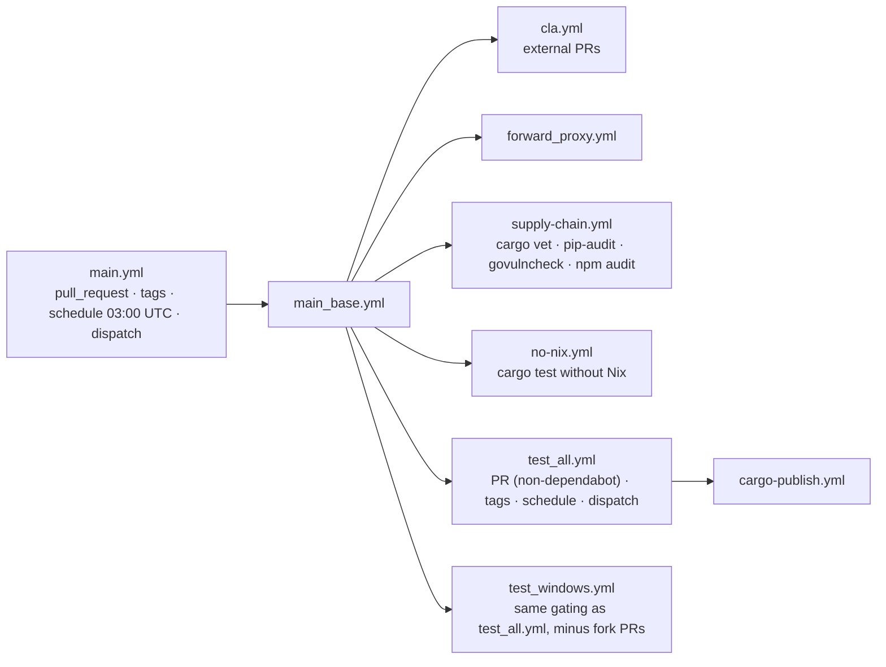
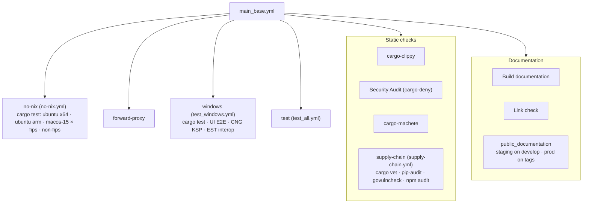
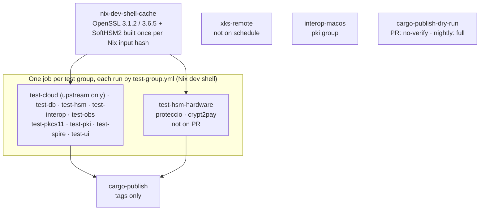

# CI workflows: `main.yml`

`main.yml` is the PR / tag / nightly test pipeline. It only calls other workflows:
`main.yml` -> `main_base.yml` -> `supply-chain.yml`, `no-nix.yml`, `forward_proxy.yml`, `test_windows.yml`, `test_all.yml` -> `cargo-publish.yml`.
Packaging and releases are described in [README_nightly.md](README_nightly.md).

## Triggers and concurrency

|Trigger|Runs|Cancelled by a newer push|
|---|---|---|
|`pull_request`|everything except the upstream-only jobs on fork PRs|yes, per PR branch|
|tag push (`**`)|everything, plus real `cargo publish` and the production documentation deploy|no|
|`schedule` (daily 03:00 UTC, default branch)|everything the nightly set contains (see below)|no|
|`workflow_dispatch`|same as `schedule`, plus `xks-remote` (waits for its manual approval)|no|

Only PRs share a concurrency group (`ci-CI-<head_ref>`). Every other event gets a unique group.

## `main_base.yml`

## `test_all.yml`

Each test job runs one group of `.mise/tasks/test` (`mise run test:<group> --variant <variant>`, i.e. the group's `_default`, which runs its listed leaves through `run_test_leaves` and reports every failing leaf) through the reusable `test-group.yml`, which holds the checkout, caches, Nix setup, Docker Hub login, test and bench steps. A leaf checks its own prerequisites and exits 77 when it cannot run, which counts as a skip (see `.mise/tasks/test/README.md`). `matrix.variant` gives the cells; groups whose leaves are all non-FIPS only (`pkcs11`, `spire`) run `non-fips` only. The `skip` input exports `TEST_SKIP_LEAVES`, a list of `<group>:<leaf>` ids the group must not run. The `k8s` and `pkg` groups run in `packaging-docker.yml`. A leaf no group lists runs locally only.

|Job|Group|
|---|---|
|`test-cloud`|`cloud` (upstream only: needs the Google, AWS and Azure secrets)|
|`test-db`|`test-db.yml`: one `test-group.yml` job per `db` leaf and variant (`sqlite`, `psql`, `mysql`, `mariadb`, `percona`, `redis` non-FIPS only), with the database environment variables|
|`test-hsm`|`hsm` without the real HSMs (`skip: hsm:crypt2pay hsm:proteccio`), then the `bench` models|
|`test-interop`|`test-interop.yml`: one `test-group.yml` job per `interop` leaf (`ase`, `db2`, `edb-tde`, `iris`, `jose`, `kmipkit`, `pykmip` non-FIPS only; `kmip-go` both variants), so a hang or leftover state in one leaf stays in its own job|
|`test-obs`|`obs`|
|`test-pkcs11`|`pkcs11`|
|`test-pki`|`pki`|
|`test-spire`|`spire`|
|`test-ui`|`ui`|
|`test-hsm-hardware`|real HSMs `hsm:proteccio`, `hsm:crypt2pay`, one leaf per cell (never on pull requests)|

`test-ui` runs without cloud or test secrets, because it executes `pnpm install`; `test-spire` receives only the Docker Hub login. Each caller passes `test-group.yml` only the secrets its leaves use. `test-cloud` skips on forks and fork pull requests, `test-hsm-hardware` never runs on pull requests and only in the upstream repository. In both jobs a task whose required `env:` variables are unset (a deleted or renamed secret, a typo in the mapping) fails instead of skipping, because its upstream gate calls `print_error` when `CI=true`, so a green cell proves its tasks ran. A cell's `lock` (`hsm-proteccio`, `hsm-crypt2pay`) is its concurrency group: the HSMs refuse concurrent runs, and `test-k8s-hsm` in `packaging-docker.yml` (also never on pull requests) shares the groups. A cell's `bench` is the list of HSM models whose benchmarks run after its tests, off pull requests. Pull requests cover the HSM code paths with the software simulators of `test-hsm` (`softhsm2`, `utimaco`, `crypt2pay-simulator`, `kryoptic`).

A leaf that fails only when grouped (port, Docker or environment leak) or only in one variant: add its `<group>:<leaf>` id to the `skip` input of its job, with a one-line reason comment.

## PR versus nightly

"Nightly" means any non-PR event (schedule, dispatch, tags).

|Item|PR|Nightly / tags|
|---|---|---|
|`test_all.yml` (via `main_base.yml` `test`)|yes (not dependabot)|yes|
|real HSMs (`test-hsm-hardware`, `test-k8s-hsm`)|skipped (software simulators run)|run|
|DB jobs other than sqlite|`cosmian_kms_server_database` DB tests plus the lib tests of the six crates that start `test_kms_server`|same|
|sqlite job|whole workspace `--lib --bins` once per variant|same|
|HSM benches (`bench:pkcs11`, `bench:hsm`)|skipped|run|
|Windows `cargo test`|quick: `test_kms_server` and `ckms` lib tests excluded (covered on Linux)|full|
|`cargo publish --dry-run`|`--no-verify` (no compile)|full `--all-features` compile|
|`xks-remote`|runs (upstream PRs)|dispatch and tags only, not `schedule` (manual approval environment)|
|Linux "No Nix" legs|run|run|

The DB scoping also applies locally: `mise run test:db:psql`, `test:db:mysql`, `test:db:percona`, `test:db:mariadb` and `test:db:redis` no longer run DB-independent server, crypto and KMIP unit tests. Use `test:db:sqlite` for the full workspace suite.

A nightly failure notifies only the GitHub user who last edited the `main.yml` cron line.

## Caches

Produced by the workflows themselves. GitHub's LRU eviction (10 GB per repository) and 7-day inactivity
eviction replace the former `cleanup` job, which deleted every cache after each run.
`github_cache_cleanup.yml` (manual dispatch) remains for manual purges.

|Key prefix|Content|Producer|Approximate size|
|---|---|---|---|
|`nix-dev-shell-<os>-<arch>-<input hash>`|NAR export of the source-built Nix closure (OpenSSL 3.1.2, 3.6.5, FIPS bootstrap, SoftHSM2, Utimaco)|`nix-dev-shell-cache` job in `test_all.yml`; consumers use `setup-nix` with `dev-shell-cache: 'true'`|0.2 to 0.6 GB estimated (the job logs the exact size)|
|`openssl-buildrs-<os>-<arch>-<variant>-<hash of crypto/build.rs>`|`target/openssl-*` prefixes installed by `crate/crypto/build.rs`|first job that builds it (`cache-openssl-buildrs`)|23 to 30 MB per prefix|
|`vcpkg-<os>-<image version>-<hash of vcpkg.json>`|vcpkg binary cache of the static OpenSSL port|first Windows job (`build-static-openssl`)|tens of MB|

The Nix key hashes `shell.nix`, `nix/openssl.nix`, `nix/openssl-fips-bootstrap.*`, `nix/softhsm2.nix`, `nix/utimaco.nix` and `.mise/lib/common.sh` (which contains the nixpkgs `PIN_URL`). Keep the three key copies synchronized: restore in `setup-nix/action.yml`, and lookup/save in `test_all.yml`.

Not cached on purpose: cargo `target/` (multi-GB, 8 variant sets), Nix outputs of packaging and Docker builds
(vendor hashes must be revalidated on every build).

Cache scope: a run reads the caches of its own branch, of the default branch (`develop`) and, on a PR, of its base
branch. A PR against `main` therefore still reads the `develop` caches; the producer job builds the Nix closure only
when the key (the hash of the Nix inputs) differs from every readable entry. A cache saved by a PR is readable only
from that PR's merge ref.

## Local composite actions

|Action|Inputs|What it does|Callers|
|---|---|---|---|
|`cleanup-runner`|none|Frees 20 to 30 GB on hosted Linux runners|`setup-nix-mise`, `cargo-publish.yml`|
|`setup-nix`|`extra-nix-config`, `dev-shell-cache`|Installs Nix, warms the pinned nixpkgs, optionally imports the cached dev-shell closure|`setup-nix-mise`, `nix-dev-shell-cache`, `benchmark.yml`|
|`install-mise`|none|Installs the pinned, checksum-verified mise binary|`setup-nix-mise`, several jobs|
|`setup-nix-mise`|`cleanup-runner`, `extra-nix-config`, `dev-shell-cache`|Optional cleanup, then Nix, then mise (requires a prior checkout)|`test_all.yml`, packaging workflows, `nix-update-hashes.yml`|
|`cache-openssl-buildrs`|`variant`|Caches `target/openssl-*` built by `crate/crypto/build.rs`|`main_base.yml`, `forward_proxy.yml`, `test_all.yml`|
|`build-static-openssl`|none|Windows vcpkg static OpenSSL with retries and a vcpkg binary cache|`test_windows.yml`, `build_windows.yml`|
|`windows-vs-ninja`|none|Puts Visual Studio's Ninja on PATH so vcpkg does not download it|`test_windows.yml`|
|`docker-login-ghcr`|`github-token`|Logs in to ghcr.io|`packaging-docker.yml`|
|`import-gpg-key`|`gpg-private-key`, `passphrase`|Imports the package-signing key and lists it|`packaging.yml`, `packaging-apk.yml`, `packaging-kubernetes.yml`|
|`setup-helm-minikube`|none|Installs Helm and starts Minikube (docker driver, Kubernetes v1.32.0)|`packaging-docker.yml`|
|`push-package-cosmian`|`subdir`, `files`, `known-hosts`|Uploads files to `package.cosmian.com` under the branch (or tag) directory; output `remote-dir`|`packaging.yml`, `packaging-apk.yml`, `packaging-kubernetes.yml`, `build_windows.yml`|

Upload callers pass the trusted host key from `vars.PACKAGE_COSMIAN_SSH_KNOWN_HOSTS`. Missing or mismatched keys fail the upload; SSH host-key verification is never disabled by this action.
