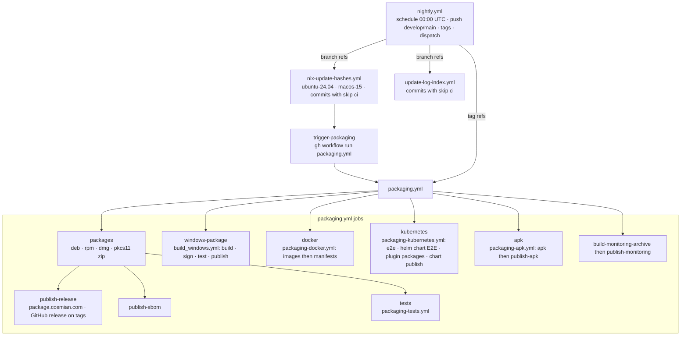

# CI workflows: nightly packaging

`nightly.yml` builds, signs, tests and publishes the packages. The test pipeline of
`main.yml` is described in [README_main.md](README_main.md).

## Triggers

`nightly.yml` runs on the schedule (daily 00:00 UTC), on pushes to `develop` and `main`, on tags and on manual
dispatch. Bot commits from `nix-update-hashes.yml` and `update-log-index.yml` carry `[skip ci]`, so they do not
re-trigger it. All jobs are restricted to `Cosmian/kms`: they need secrets that forks do not have.

`main.yml` runs the full nightly test set at 03:00 UTC, three hours after the packaging cron (see "PR versus nightly" in `README_main.md`). The two workflows are independent.

## Matrices

|Job|Matrix|
|---|---|
|`packages`|3 runners (ubuntu-24.04, ubuntu-24.04-arm, macos-15) × fips / non-fips × static / dynamic|
|`packaging-tests`|7 distributions × 2 architectures|
|docker images|fips / non-fips × amd64 / arm64|
|apk|fips / non-fips × 2 architectures|

## Builds and caches

The deb/rpm server and CLI builds (`.mise/scripts/package/package_common.sh`) and the PKCS#11 ZIP CLI build (`package_pkcs11_zip.sh`) disable Nix substituters to revalidate vendor hashes from source. APK, macOS DMG, UI and Kubernetes builds retain their existing substituter behavior. Packaging does not import the dev-shell cache from `main.yml`.

SBOMs (`mise run sbom:generate --target server|ckms`) describe the packaged build: they reuse the
`result-server-<variant>-<link>` and `result-cli-<variant>-<link>` links that packaging created in the same
job instead of rebuilding the server and CLI.
