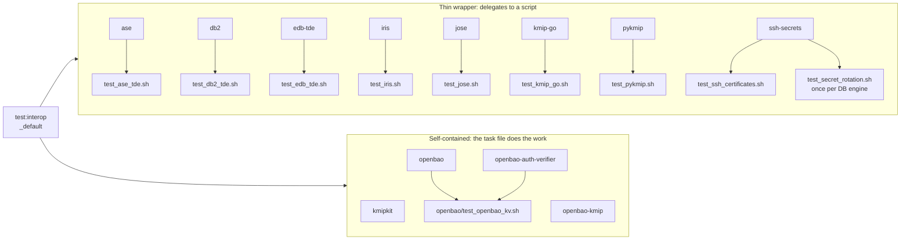
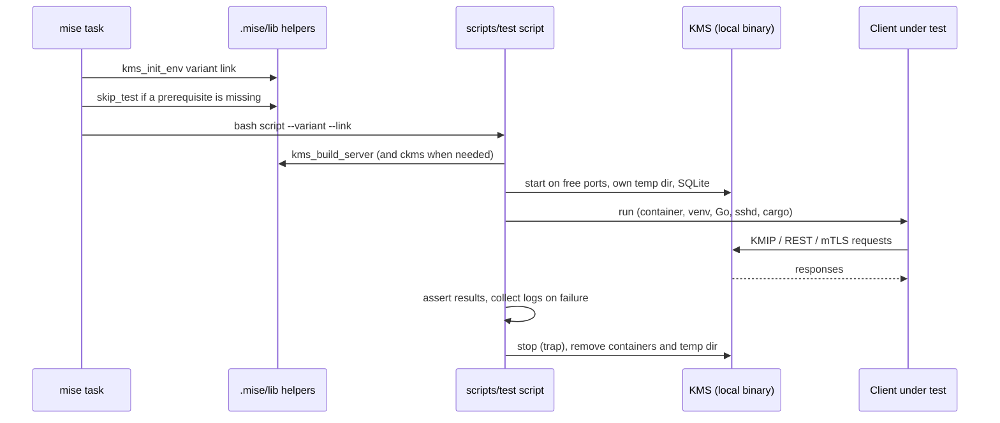
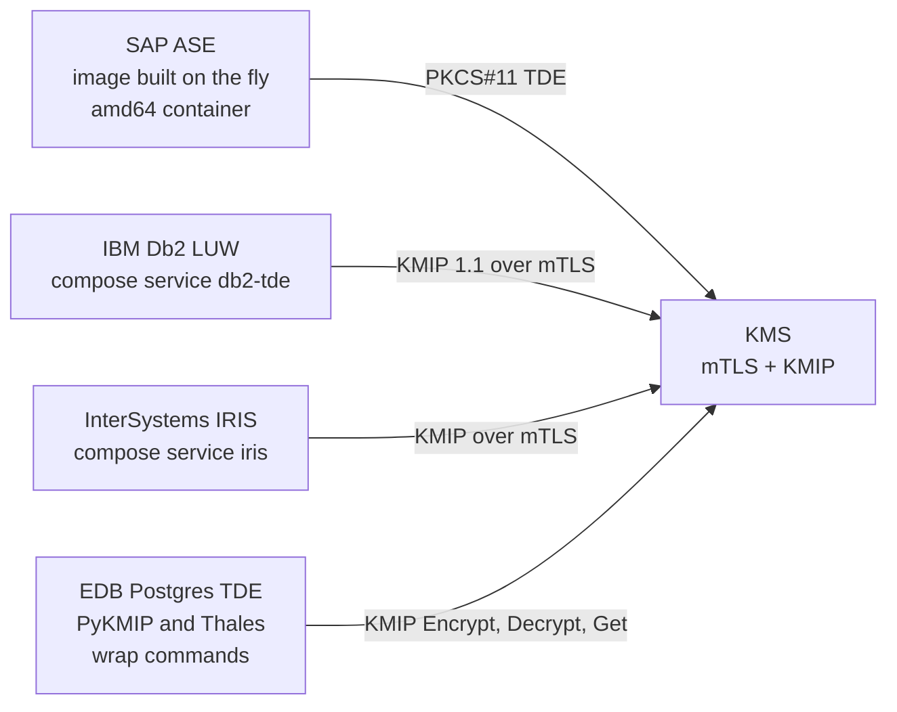
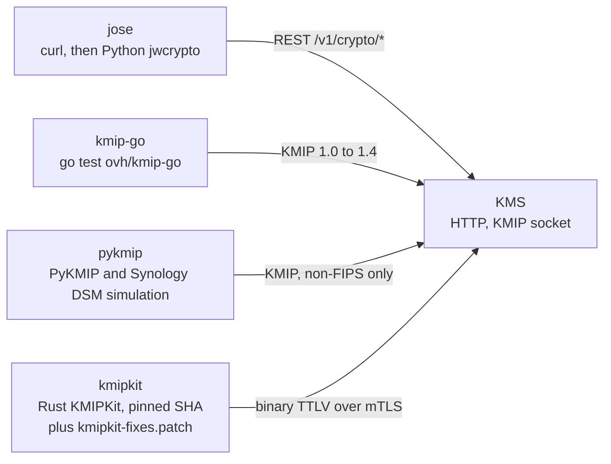
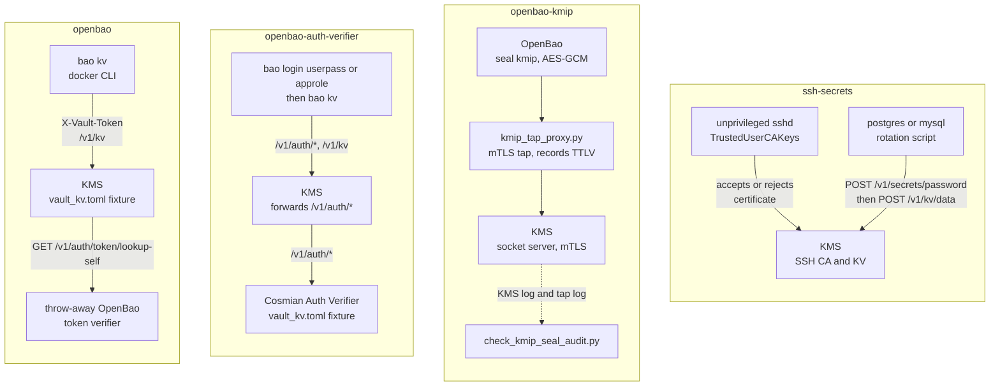

# Interop tests: `.mise/tasks/test/interop/`

Each file here is a mise task. Its id is `test:interop:<file>`. The tasks run a **third-party client,
database or tool** against a KMS started from the local build, so they prove compatibility with
software outside this repository. The shared architecture of every test task is in
[`../README.md`](../README.md). This page covers only this folder.

All tasks accept `--variant fips|non-fips` and `--link static|dynamic`. The default variant is
`non-fips`, except `openbao`, `openbao-auth-verifier`, `openbao-kmip` and `ssh-secrets`, which default to `fips`. A task that
cannot run on the current machine calls `skip_test "<reason>"` and prints why.

## 1. Task topology

`test:interop` (the `_default` leaf) calls `run_test_leaves`, which runs every leaf in turn. A leaf is
either a **thin wrapper** around one script in `.mise/scripts/test/`, or **self-contained** (the
script work is inside the task file).

## 2. Common lifecycle

Every leaf follows the same steps. Only the "client under test" differs.

## 3. Database encryption (TDE) and mTLS clients

`ase`, `db2`, `edb-tde` and `iris` make a real database use the KMS as its key store.

- `db2` and `iris` first check the **sad path** (a connection with no client certificate is
  rejected), then the **happy path** (create and activate a key, encrypt a database).
- `ase` needs the SAP installer (`ASE_INSTALLER_URL`) because SAP ships no public image.
- `edb-tde` is currently skipped: the EDB registry rejects the CI token (401). It needs
  `EDB_SUBSCRIPTION_TOKEN` and `nix-shell`.

## 4. Protocol and library interop

`jose`, `kmip-go`, `pykmip` and `kmipkit` check the KMS wire protocols with independent
implementations.

`kmipkit` runs a fast gate by default (`cosmian_kms_` and `lifecycle::` filters). `--full` runs every
KMIPKit family (about two hours).

## 5. OpenBao and secret management

These four tasks cover the Vault-compatible KV store (with OpenBao or the Cosmian Auth Verifier as
token issuer), the KMIP seal and the SSH certificate and rotation features. One column per task.

## 6. Scripts called from `.mise/scripts/test/`

"Called by" is the task that runs the file. A helper is also listed under the script that loads it.

| Script | Called by | What it does | External needs |
|---|---|---|---|
| `test_ase_tde.sh` | `ase` | Builds the `cosmian-ase-kmip` image, starts SAP ASE, checks TDE against the KMS through PKCS#11 | Docker, `linux/amd64`, SAP installer |
| `test_db2_tde.sh` | `db2` | Starts compose service `db2-tde`; rejects a client with no certificate, then creates a master key over KMIP 1.1 and encrypts a database | Docker compose, Db2 image |
| `test_edb_tde.sh` | `edb-tde` | PyKMIP variant (server-side wrap) and Thales variant (local AES-256-GCM wrap) with an EDB Postgres cluster | `EDB_SUBSCRIPTION_TOKEN`, `nix-shell`, Docker |
| `test_iris.sh` | `iris` | Starts compose service `iris`; sad path without a certificate, then key creation and database encryption over mTLS | Docker compose, IRIS image |
| `test_jose.sh` | `jose` | Phase 1: curl against every `/v1/crypto/*` endpoint. Phase 2: validates KMS output with Python `jwcrypto` | `curl`, Python 3.9+, `pip` |
| `jose_interop_helper.py` | `test_jose.sh` | Python helper for the jwcrypto checks | `requirements-jose.txt` (hash-pinned) |
| `test_kmip_go.sh` | `kmip-go` | Builds the KMS, waits for the KMIP socket, runs `go test -v -count=1 ./...` in the ovh/kmip-go module | Go |
| `test_pykmip.sh` | `pykmip` | PyKMIP operation tests and a Synology DSM end-to-end simulation (non-FIPS only) | Python 3, `virtualenv`, `nix-shell` |
| `test_ssh_certificates.sh` | `ssh-secrets` | Issues SSH certificates with the KMS CA and checks a real `sshd` accepts, expires and rejects them | `sshd`, `ssh`, `ssh-keygen`, `ckms` |
| `test_secret_rotation.sh` | `ssh-secrets` (`--db postgres`, then `--db mysql`) | Generates a password, rotates it in the database, publishes it to KV, checks the old one is refused and a failed KV write keeps the pending value | Docker (`postgres-rotation`, `mysql-rotation`, OpenBao image) |
| `openbao/bao_verifier.sh` | `openbao`, `test_secret_rotation.sh` | Starts the throw-away OpenBao used directly as the KMS token verifier; provides `bao_verifier_start`, `bao_verifier_login`, `bao_verifier_stop` | Docker, Python 3 |
| `openbao/bao_cli.sh` | `openbao/test_openbao_kv.sh`, `openbao-auth-verifier` | Sourced library: the `bao()` function running the OpenBao CLI in a throw-away container | Docker |
| `openbao/test_openbao_kv.sh` | `openbao`, `openbao-auth-verifier` | Runs the `bao kv` scenario: put/get, versions, list, metadata, soft and hard delete, TTL, concurrency, authorization | Docker, `curl`, Python 3 |
| `openbao/kmip_tap_proxy.py` | `openbao-kmip` | mTLS tap that records raw TTLV requests and forwards them with the OpenBao client certificate | Python 3 with TLS 1.3 |
| `openbao/check_kmip_seal_audit.py` | `openbao-kmip` | Asserts Encrypt and Decrypt were served for the `openbao-seal` identity only, as KMIP 1.4 AES-GCM | Python 3 |

Not in `.mise/scripts/test/`, but used by this folder: `kmipkit` applies `.mise/scripts/kmipkit-fixes.patch`
to the pinned KMIPKit checkout, and `edb-tde` runs `.mise/scripts/edb_tde/create_master_key.py`.

Shared libraries sourced by the scripts above (all in `.mise/lib/` or `.mise/scripts/common.sh`):
`common.sh` (logging, `skip_test`, `run_test_leaves`, `compose_image`), `kms_build.sh`,
`kms_server.sh` (start, stop, free ports), `nix_helpers.sh` (`ensure_nix_shell`), `test_slots.sh`.

## 7. Keeping this page current

When a task here, or a script it calls, is added, renamed, removed or changes behaviour, update
this page in the same change. The rule is in
[`.github/instructions/test-task-readme.instructions.md`](../../../../.github/instructions/test-task-readme.instructions.md).
