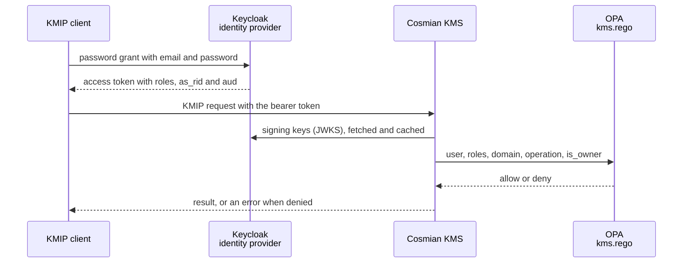

# RBAC demo: Keycloak, OPA and Cosmian KMS

A Docker Compose stack that shows the role-based access control (RBAC) of the Cosmian KMS at work. You manage users and groups in an identity provider ([Keycloak](https://www.keycloak.org/)), the KMS asks an [Open Policy Agent](https://www.openpolicyagent.org/) (OPA) server to authorize each KMIP operation, and the Rego file `test_data/opa/kms.rego` defines what every role may do.

The KMS runs in `exclusive` OPA mode: OPA, not the native KMS grants, decides the operations it is consulted on (see [Known limitations](#known-limitations) for the exceptions). The role model, the claims and the OPA input document are described in the [authorization documentation](../../documentation/docs/configuration/authorization/index.md); this page is about running them.

> **Warning:** the passwords, the test CA and the sample users of this stack are public demo values. Never reuse them outside a local machine.

## How it works



1. Keycloak authenticates the user and issues an access token. The realm `kms` copies the **groups** of the user into the flat `roles` claim, copies the **`domain` attribute** of the user into the `as_rid` claim and sets the audience `cosmian-kms`.
2. The KMS checks the signature, the issuer and the audience of the token, and identifies the caller by its `email` claim.
3. For each KMIP operation the KMS sends OPA the caller, its roles and domain, the operation, the domain of the target object and whether the caller owns it. OPA answers allow or deny.
4. A denied `Get` on someone else's key comes back as `Object_Not_Found`.

| Service | Image | Published on | Purpose |
| ------- | ----- | ------------ | ------- |
| `keycloak` | `quay.io/keycloak/keycloak` | `https://keycloak.localhost:8443` | Identity provider. The realm `kms` is imported from `keycloak/kms-realm.json` |
| `opa` | `openpolicyagent/opa` (`static-debug`) | `http://localhost:8181` | Evaluates `test_data/opa/kms.rego`, logs every decision on the console |
| `kms` | `${KMS_IMAGE}` | `https://localhost:9998` | Cosmian KMS configured by `test_data/configs/server/rbac/keycloak_opa.toml` |

All ports are published on the loopback interface only. The third-party images are pinned by digest in `docker-compose.yml`.

## Prerequisites

- Docker Compose v2 and the `test_data` submodule (`git submodule update --init test_data`).
- `bash` 4 or later, `curl` and `jq` on the host, for `verify.sh` and the examples below.
- `keycloak.localhost` must resolve to the loopback address, because the token issuer is `https://keycloak.localhost:8443/realms/kms` for the host and for the KMS container alike. Most systems resolve `*.localhost` on their own; otherwise add `127.0.0.1 keycloak.localhost` to `/etc/hosts`.
- A KMS image. The Compose file does not build one.

## Quick start

From this directory:

```bash
cp .env.example .env
# Build the FIPS image once, from the repository root. It is tagged cosmian-kms:<version>-fips:
#   mise run build:docker --variant fips --load
# then put that name in KMS_IMAGE (.env.example already holds the current version).
docker compose up -d --wait
./verify.sh
```

`--wait` returns when OPA is running and Keycloak and the KMS are healthy. `verify.sh` ends with this line when everything agrees:

```text
OK: 53 checks, the KMS, the expected role matrix and OPA agree.
```

Tear everything down, including the KMS data volume, with `docker compose down -v`.

## Sample users

Keycloak imports the realm `kms` with five groups, named exactly like the KMS roles (`SuperAdmin`, `DomainAdmin`, `CryptoOfficer`, `Auditor` and `User`), and eight users. They all log in with their e-mail address and the password `DEMO_USER_PASSWORD` of your `.env`.

| User | Group (role) | Domain (`as_rid` claim) |
| ---- | ------------ | ----------------------- |
| `superadmin@acme.com` | `SuperAdmin` | `acme.com` |
| `admin@acme.com` | `DomainAdmin` | `acme.com` |
| `officer@acme.com` | `CryptoOfficer` | `acme.com` |
| `auditor@acme.com` | `Auditor` | `acme.com` |
| `user@acme.com` | `User` | `acme.com` |
| `norole@acme.com` | none | `acme.com` |
| `officer@globex.com` | `CryptoOfficer` | `globex.com` |
| `user@globex.com` | `User` | `globex.com` |

## What each role may do

`verify.sh` sends real KMIP requests with the token of each user and compares the outcome with the expected decision below and with a direct query to OPA. The first table is for a caller that does **not** own the key and acts in the **same domain** as the key (the owner of a key is always allowed, whatever its role):

| Role | Create | Get | GetAttributes | Activate |
| ---- | ------ | --- | ------------- | -------- |
| `SuperAdmin` | allow | allow | allow | allow |
| `DomainAdmin` | allow | allow | allow | allow |
| `CryptoOfficer` | allow | allow | allow | allow |
| `Auditor` | deny | allow | allow | deny |
| `User` | deny | deny | allow | deny |
| no role | deny | deny | deny | deny |

Across domains, only `SuperAdmin` is allowed: `superadmin@acme.com` can `Get` and `GetAttributes` a key of `globex.com`, while every other user, `officer@globex.com` and `user@globex.com` on an `acme.com` key included, is denied.

Encrypt and Revoke on a key owned by someone else are not decided by OPA in the current server (see [Known limitations](#known-limitations)), so `verify.sh` asks OPA directly what the policy says:

| Role | Encrypt | Revoke |
| ---- | ------- | ------ |
| `SuperAdmin` | allow | allow |
| `DomainAdmin` | allow | allow |
| `CryptoOfficer` | deny | allow |
| `Auditor` | deny | deny |
| `User` | allow | deny |
| no role | deny | deny |

The exact operation lists of each role are in `test_data/opa/kms.rego`.

## Try it by hand

Load the demo password and define two helpers: `token` gets an access token from Keycloak and `kmip` sends one KMIP 2.1 request (JSON TTLV) to the KMS and prints the result. The test CA signed both server certificates, hence `--cacert`.

```bash
set -a; . ./.env; set +a
CA=../../test_data/certificates/client_server/ca/ca.crt

token() {
  curl -fsS --cacert "$CA" https://keycloak.localhost:8443/realms/kms/protocol/openid-connect/token \
    -d grant_type=password -d client_id=kms-demo \
    --data-urlencode "username=$1" --data-urlencode "password=$DEMO_USER_PASSWORD" |
    jq -r .access_token
}

# kmip <token> <Operation> <payload>
kmip() {
  jq -cn --arg op "$2" --argjson payload "$3" '{tag: "RequestMessage", type: "Structure", value: [
    {tag: "RequestHeader", type: "Structure", value: [
      {tag: "ProtocolVersion", type: "Structure", value: [
        {tag: "ProtocolVersionMajor", type: "Integer", value: 2},
        {tag: "ProtocolVersionMinor", type: "Integer", value: 1}]},
      {tag: "BatchCount", type: "Integer", value: 1}]},
    {tag: "BatchItem", type: "Structure", value: [
      {tag: "Operation", type: "Enumeration", value: $op},
      {tag: "RequestPayload", type: "Structure", value: $payload}]}]}' |
    curl -fsS --cacert "$CA" https://localhost:9998/kmip/2_1 \
      -H "Authorization: Bearer $1" -H 'Content-Type: application/json' --data-binary @- |
    jq -c '[.. | objects | select(.tag == "ResultStatus" or .tag == "ResultReason" or .tag == "UniqueIdentifier") | {(.tag): .value}] | add'
}
```

Read the claims the KMS relies on in the token of the crypto officer of `acme.com`:

```bash
OFFICER=$(token officer@acme.com)
jq -R 'split(".")[1] | gsub("-"; "+") | gsub("_"; "/") | @base64d | fromjson | {iss, aud, azp, email, roles, as_rid}' <<<"$OFFICER"
```

```json
{
  "iss": "https://keycloak.localhost:8443/realms/kms",
  "aud": "cosmian-kms",
  "azp": "kms-demo",
  "email": "officer@acme.com",
  "roles": [
    "CryptoOfficer"
  ],
  "as_rid": "acme.com"
}
```

The officer creates an AES-256 key and reads it back as its owner, then a user of the same domain tries to read it:

```bash
KEY=$(kmip "$OFFICER" Create '[
  {"tag": "ObjectType", "type": "Enumeration", "value": "SymmetricKey"},
  {"tag": "Attributes", "type": "Structure", "value": [
    {"tag": "CryptographicAlgorithm", "type": "Enumeration", "value": "AES"},
    {"tag": "CryptographicLength", "type": "Integer", "value": 256},
    {"tag": "CryptographicUsageMask", "type": "Integer", "value": 2108}]}]' | jq -r .UniqueIdentifier)
GET=$(jq -cn --arg uid "$KEY" '[{tag: "UniqueIdentifier", type: "TextString", value: $uid}]')

kmip "$OFFICER" Get "$GET"
kmip "$(token user@acme.com)" Get "$GET"
```

```json
{"ResultStatus":"Success","UniqueIdentifier":"c68f8715-ceaf-41ec-adbd-ba8118a2d223"}
{"ResultStatus":"OperationFailed","ResultReason":"Object_Not_Found"}
```

The first request succeeds because the officer owns the key. The second is denied because the role `User` has no `get` operation in the policy.

## See why OPA allowed or denied a request

OPA logs one JSON line per question the KMS asks, with the exact input it received. The `sed` drops whatever is printed before the JSON object, such as the terminal control sequence that some Compose versions emit:

```bash
docker compose logs --no-log-prefix opa | grep 'Decision Log' | tail -1 | sed 's/^[^{]*//' | jq -c '{path, result, input}'
```

```json
{"path":"kms/allow","result":false,"input":{"is_owner":false,"object_domain":"acme.com","object_uid":"c68f8715-ceaf-41ec-adbd-ba8118a2d223","operation":"get","roles":["User"],"user":"user@acme.com","user_domain":"acme.com"}}
```

To know which rule matched, send the same input to the `reasons` debug rule of the policy:

```bash
curl -s http://localhost:8181/v1/data/kms/reasons -d '{"input": {"user": "user@acme.com", "user_domain": "acme.com", "roles": ["User"], "operation": "get", "object_uid": "k1", "object_domain": "acme.com", "is_owner": false}}' | jq -c .result
```

```json
["denied"]
```

The same query with `"roles": ["Auditor"]` answers `["auditor"]`. The KMS server log (`docker compose logs kms`) also reports denials, for example `Access denied: User does not have create access-right.`

## Add users and groups

Open the Keycloak admin console at `https://keycloak.localhost:8443/admin` and log in with `KC_BOOTSTRAP_ADMIN_USERNAME` and `KC_BOOTSTRAP_ADMIN_PASSWORD` of your `.env`. Select the realm **kms**, then:

1. **Users** > **Add user**: enter the e-mail address (use it as the username too, the KMS identifies the caller by the `email` claim) and fill in **KMS domain (as_rid claim)**, which is mandatory (see "Known limitations"). This attribute is visible and editable by administrators only, so users cannot change their own domain.
2. **Groups** > **Join group**: pick the group named like the role. A user in several groups gets several roles and the policy grants the union of their permissions, so do not combine roles that must stay separate, such as `Auditor` and `CryptoOfficer`.
3. **Credentials** > **Set password**, with **Temporary** off.
4. Get a token with the `token` helper above and read its claims. A user in no group gets no role, and therefore no access except to the keys it owns.

A new group only has an effect when its name matches a role the policy knows. Keycloak keeps its data inside its container: `docker compose down` discards the changes made in the console, and the next `docker compose up` imports `keycloak/kms-realm.json` again. To keep a new user, add it to that file. Keycloak skips the import while the realm exists, so run `docker compose down` (not `stop`) before `up` to apply an edit of the file.

## Change the policy

Edit `test_data/opa/kms.rego` and run `./verify.sh` again. OPA runs with `--watch`, so it reloads the policy in about two seconds, without a restart. Check `docker compose logs opa` after an edit.

- The file must stay world-readable (mode 644): OPA runs as a non-root user in its container. With a `600` file OPA exits with `permission denied`; fix the mode and run `docker compose start opa`.
- The same policy file serves the KMS test vectors. Restore it with `git -C ../../test_data checkout opa/kms.rego` when you are done.
- The expected matrix of `verify.sh` is the one of the unmodified policy, so it reports the differences your edit creates.

## Try the enforcing mode

In `test_data/configs/server/rbac/keycloak_opa.toml`, change `opa_mode = "exclusive"` to `opa_mode = "enforcing"` and run `docker compose restart kms`. [Mode 3](../../documentation/docs/configuration/authorization/mode3.md) explains the difference: OPA stays authoritative, and the native KMS permissions still apply to native Crypto Officers and to HSM-backed objects. Revert the file when you are done.

## Known limitations

- **Several operations on someone else's key use the native KMS grants, not OPA.** Even in `exclusive` mode, the server does not ask OPA when a non-owner calls Encrypt or Revoke: an OPA-allowed caller that has no native grant gets `Item_Not_Found`. The server code applies the same native-only check to Decrypt, Sign, SignatureVerify, MAC, MACVerify, Destroy and Rekey, which `verify.sh` does not exercise. Get, GetAttributes and Activate do go through OPA. This is why the last table above is checked against OPA only.
- **The Web UI is not part of this stack.** Its plain OIDC login stores no `roles` or domain in the session, so OPA would see a user without a role. Roles reach the KMS through bearer tokens, as in this stack.
- **A user without a domain has an empty domain.** Its token carries no `as_rid` claim, so the KMS sends OPA an empty `user_domain`. `same_domain` in `kms.rego` is a plain equality test, so a user with a role but no domain is treated as a member of the empty domain and reaches every object whose domain is empty. The realm therefore makes the `domain` attribute mandatory when an administrator creates a user; give a `domain` attribute to every user you add to `keycloak/kms-realm.json` as well.
- **Demo security posture.** Direct access grants (the password grant) are enabled on the public client `kms-demo` to keep the scripts simple, Keycloak runs with its embedded development database, and the certificates come from the public test CA of `test_data`. A production deployment uses the authorization code flow, a production database and its own PKI.

## Files

| Path | Purpose |
| ---- | ------- |
| `docker-compose.yml` | The three services, their network alias, healthchecks and volumes |
| `.env.example` | Demo credentials and the KMS image name. Copy it to `.env` |
| `keycloak/kms-realm.json` | Realm `kms`: groups, sample users and the token mappers (`roles`, `as_rid`, audience, e-mail) |
| `verify.sh` | The end-to-end and policy checks described above |
| `../../test_data/configs/server/rbac/keycloak_opa.toml` | Complete KMS configuration: issuer, JWKS URI and audience of Keycloak, OPA URL and mode |
| `../../test_data/opa/kms.rego` | The RBAC policy |
| `../../test_data/certificates/client_server/` | The test CA, and the `keycloak.localhost` certificate that `generate_idp_server_cert.sh` issues for Keycloak and for the KMS HTTPS listener |

The documentation page [Try RBAC with Keycloak and OPA](../../documentation/docs/configuration/authorization/rbac-keycloak-opa-demo.md) gives the short version of this guide.
