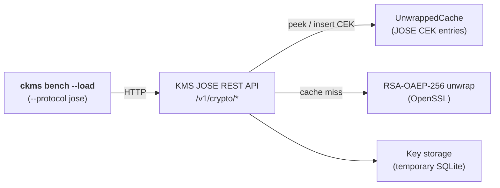

# JOSE CEK Cache Benchmark — cache ON

**Versions**: `v5.29.0`
**Generated**: 2026-11-10

---

## Benchmark Environment

| Field | Value |
|---|---|
| Date | 2026-11-10 13:35:12 UTC |
| HSM backend | None (Software) |
| Command | `mise run bench:jose-cache (unwrapped cache on)` |
| Build | release / non-fips |
| Database | SQLite (temporary, single benchmark run) |
| CPU | Intel(R) Core(TM) i9-14900T @ 970 MHz |
| CPU cores | 24 physical / 32 logical (HT) |
| RAM | 31.1 GB |
| OS | Ubuntu 24.04.5 LTS |
| Kernel | 6.8.0-147-generic |

### Load test parameters

| Parameter | Value |
|---|---|
| Mode | encrypt |
| Protocols | jose |
| Measurement window | 20 s per concurrency level |
| Concurrency levels | 1,2,4,8,16 |
| Warm-up | 5 s |
| Cooldown between levels | 2 s |

### CPU detail (`lscpu`)

```text
Architecture:                            x86_64
CPU op-mode(s):                          32-bit, 64-bit
Address sizes:                           46 bits physical, 48 bits virtual
Byte Order:                              Little Endian
CPU(s):                                  32
On-line CPU(s) list:                     0-31
Vendor ID:                               GenuineIntel
Model name:                              Intel(R) Core(TM) i9-14900T
CPU family:                              6
Model:                                   183
Thread(s) per core:                      2
Core(s) per socket:                      24
Socket(s):                               1
Stepping:                                1
CPU(s) scaling MHz:                      86%
CPU max MHz:                             1100.0000
CPU min MHz:                             800.0000
BogoMIPS:                                2227.20
Flags:                                   fpu vme de pse tsc msr pae mce cx8 apic sep mtrr pge mca cmov pat pse36 clflush dts acpi mmx fxsr sse sse2 ss ht tm pbe syscall nx pdpe1gb rdtscp lm constant_tsc art arch_perfmon pebs bts rep_good nopl xtopology nonstop_tsc cpuid aperfmperf tsc_known_freq pni pclmulqdq dtes64 monitor ds_cpl vmx smx est tm2 ssse3 sdbg fma cx16 xtpr pdcm pcid sse4_1 sse4_2 x2apic movbe popcnt tsc_deadline_timer aes xsave avx f16c rdrand lahf_lm abm 3dnowprefetch cpuid_fault epb ssbd ibrs ibpb stibp ibrs_enhanced tpr_shadow flexpriority ept vpid ept_ad fsgsbase tsc_adjust bmi1 avx2 smep bmi2 erms invpcid rdseed adx smap clflushopt clwb intel_pt sha_ni xsaveopt xsavec xgetbv1 xsaves split_lock_detect user_shstk avx_vnni dtherm arat pln pts hwp hwp_notify hwp_act_window hwp_epp hwp_pkg_req hfi vnmi umip pku ospke waitpkg gfni vaes vpclmulqdq tme rdpid movdiri movdir64b fsrm md_clear serialize pconfig arch_lbr ibt flush_l1d arch_capabilities ibpb_exit_to_user
Virtualization:                          VT-x
L1d cache:                               896 KiB (24 instances)
L1i cache:                               1.3 MiB (24 instances)
L2 cache:                                32 MiB (12 instances)
L3 cache:                                36 MiB (1 instance)
NUMA node(s):                            1
NUMA node0 CPU(s):                       0-31
Vulnerability Gather data sampling:      Not affected
Vulnerability Indirect target selection: Not affected
Vulnerability Itlb multihit:             Not affected
Vulnerability L1tf:                      Not affected
Vulnerability Mds:                       Not affected
Vulnerability Meltdown:                  Not affected
Vulnerability Mmio stale data:           Not affected
Vulnerability Reg file data sampling:    Mitigation; Clear Register File
Vulnerability Retbleed:                  Not affected
Vulnerability Spec rstack overflow:      Not affected
Vulnerability Spec store bypass:         Mitigation; Speculative Store Bypass disabled via prctl
Vulnerability Spectre v1:                Mitigation; usercopy/swapgs barriers and __user pointer sanitization
Vulnerability Spectre v2:                Mitigation; Enhanced / Automatic IBRS; IBPB conditional; PBRSB-eIBRS SW sequence; BHI BHI_DIS_S
Vulnerability Srbds:                     Not affected
Vulnerability Tsa:                       Not affected
Vulnerability Tsx async abort:           Not affected
Vulnerability Vmscape:                   Mitigation; IBPB before exit to userspace
```

---

## Architecture



- **ckms**: concurrent load driver sending JWE requests to the JOSE endpoints
- **JOSE REST API**: `POST /v1/crypto/encrypt` and `POST /v1/crypto/decrypt`
- **UnwrappedCache**: holds unwrapped CEKs keyed by SHA-256(private key uid || 0x00 || encrypted_key); enabled in this run (`disable_unwrapped_cache = false`)
- **RSA-OAEP-256 unwrap**: private-key operation run only on a cache miss
- **Key storage**: temporary SQLite database, discarded after the run

---

## Protocols

Only the **jose** protocol is exercised; KMIP is not used by this benchmark.

| Protocol | Transport | Encoding | Endpoints |
|---|---|---|---|
| **jose** | HTTP/1.1 (plain, loopback) | JWE JSON (RFC 7516) | `POST /v1/crypto/encrypt`, `POST /v1/crypto/decrypt` |

**JOSE** (JSON Object Signing and Encryption, RFC 7516 / RFC 7515) exposes KMS key material through `/v1/crypto/` REST endpoints. It is used by cloud integrations (Google CSE, Microsoft DKE, Azure EKM) and any workload that speaks JWA algorithm identifiers (A256GCM, RS256, ES384 …) rather than KMIP semantics.

---

## Benchmark Methodology

### Operations and payload sizes

Every request carries a **4,096-byte** plaintext (`ckms bench --load-plaintext-size 4096`).

| Operation | JWE construction | Plaintext | What it measures |
|---|---|---|---|
| `encrypt/aes-gcm` | `dir` + A256GCM, 256-bit AES key held by the KMS | 4,096 bytes | Server-side JWE encryption; does not use the CEK cache |
| `decrypt/rsa-oaep-cached` | RSA-OAEP-256 + A256GCM, RSA-2048 key pair; one JWE built once by the client and replayed | 4,096 bytes | Repeated decryption of the same token: a CEK cache hit after the first request when the cache is on |
| `decrypt/rsa-oaep-fresh` | Same algorithms; a new JWE (new CEK, new `encrypted_key`) built client-side for every request | 4,096 bytes | Always a CEK cache miss: full RSA private-key unwrap; latency includes the client-side JWE build (RSA public wrap + AES-GCM) |

The decrypt requests set `kid` to the RSA **public** key id; the server resolves the private key through its `PrivateKeyLink`.

### Cache state in this run

`disable_unwrapped_cache = false`: decrypted CEKs are cached, so `decrypt/rsa-oaep-cached` skips the RSA private-key operation and the private-key load.

Compare with the [cache ON](../ckms_bench_jose_cache_on/report.md) and [cache OFF](../ckms_bench_jose_cache_off/report.md) reports.

### Load test (`mise run bench:jose-cache (unwrapped cache on)`)

The load test sweeps a configurable list of concurrency levels. At each level *N* concurrent async tasks send pre-serialised requests in tight loops for a fixed **measurement window** (default: 20 s), preceded by a **warm-up phase** (default: 5 s) that is excluded from measurements. Pre-serialisation happens once at setup time and the same bytes are reused on every iteration, isolating server-side KMS latency from client-side encoding overhead. Exception: `decrypt/rsa-oaep-fresh` builds its request on every iteration (see above).
Recorded metrics per *(protocol, operation, concurrency)* triple:

- **Throughput** — requests per second (req/s)
- **p50 / p95 / p99** — round-trip latency percentiles (ms)

> **Infrastructure note:** each cache state runs against its own freshly started server with a temporary SQLite database; both runs use the same binaries, machine and sweep parameters.

---

## Load Tests

### encrypt/aes-gcm

| Concurrency | jose (req/s) |
|---|---|
| 1 | 5,940 |
| 2 | 11,256 |
| 4 | 21,859 |
| 8 | 31,409 |
| 16 | 47,313 |


---

### decrypt/rsa-oaep-cached

| Concurrency | jose (req/s) |
|---|---|
| 1 | 4,008 |
| 2 | 7,777 |
| 4 | 15,329 |
| 8 | 23,155 |
| 16 | 36,827 |


---

### decrypt/rsa-oaep-fresh

| Concurrency | jose (req/s) |
|---|---|
| 1 | 9 |
| 2 | 18 |
| 4 | 36 |
| 8 | 68 |
| 16 | 91 |


---
