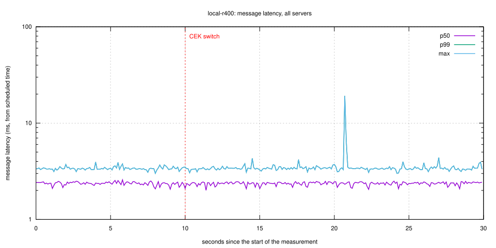
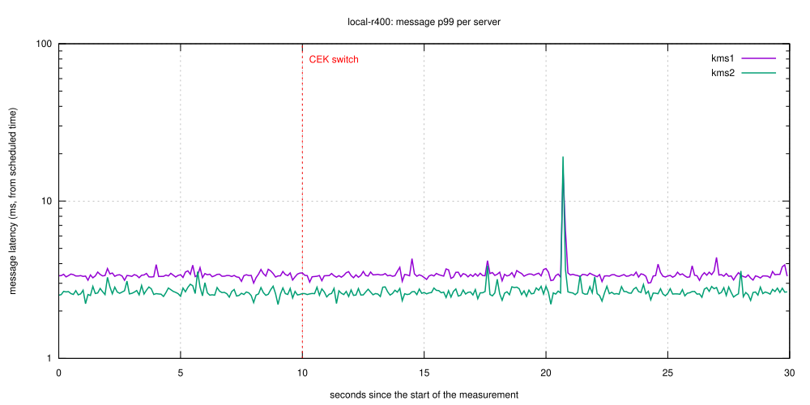
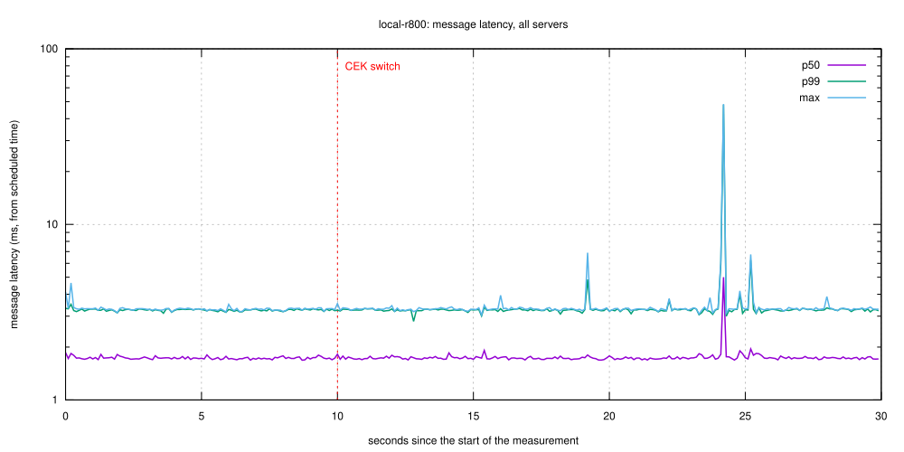
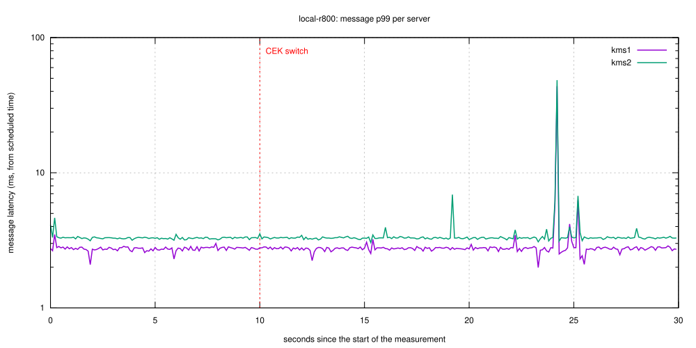
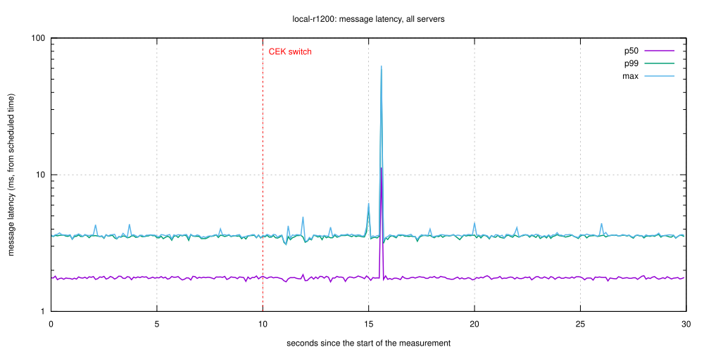
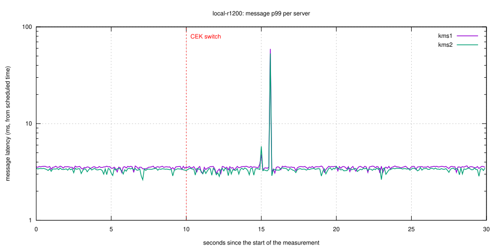
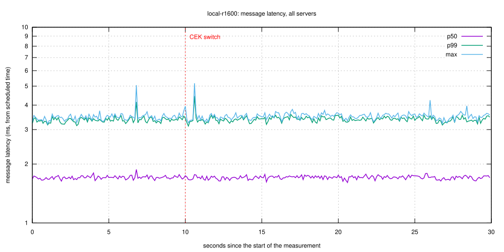
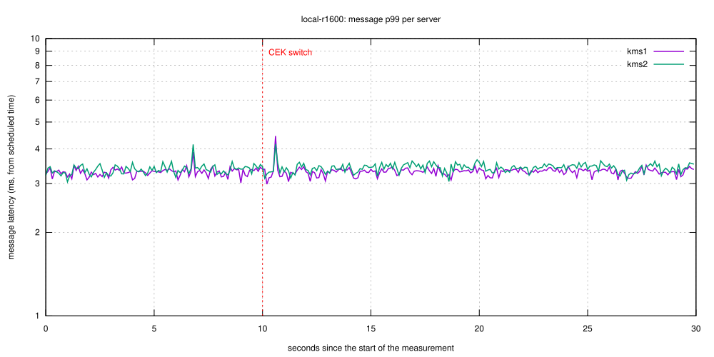
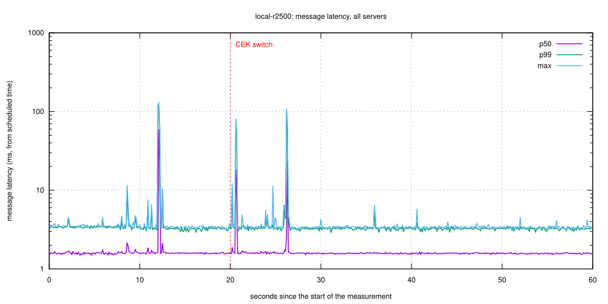
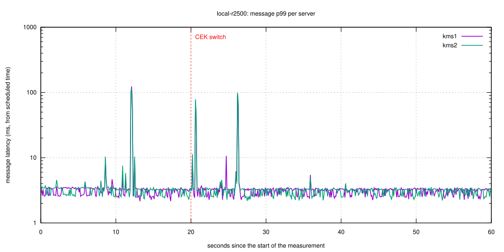

# JOSE CEK switch under load — kryoptic

| Setting | Value |
|---|---|
| KMS servers | 2 |
| Target rate | 400, 800, 1200, 1600, 2500 msg/s (one message = one decrypt + one re-encrypt) |
| Achieved rate | local-r400: 400 msg/s, local-r800: 800 msg/s, local-r1200: 1200 msg/s, local-r1600: 1600 msg/s, local-r2500: 2500 msg/s |
| Senders | 256 |
| JWE algorithm | RSA-OAEP + A256GCM |
| Plaintext | 256 bytes |
| Warmup / measurement / CEK switch | 10 s / 30, 60 s / +10, 20 s |
| HSM | kryoptic |
| KMS version | 5.29.0 (OpenSSL 3.6.5 29 Sep 2026-non-FIPS) |
| CPU | Apple M3 (8 logical cores) |
| Command | `mise run bench:jose-cek-switch` |

## Scenario

A relay service receives JWEs from a producer application and sends each to the KMS: `POST /v1/crypto/decrypt` (RSA-OAEP unwrap of the CEK with the HSM private key), then `POST /v1/crypto/encrypt` (`dir` + A256GCM under a target AES key). The producer keeps one AES CEK for an hour, then switches to a new one. It must wrap each CEK once: all messages of a CEK then carry the same `encrypted_key`. RSA-OAEP is randomized, so re-wrapping the same CEK for every message would unwrap on the HSM every time. Each KMS process caches the unwrapped CEK under `sha256(key uid ‖ encrypted_key)`; there is no cross-node sharing, so every KMS unwraps the new CEK on its own. The cache entry expires after `unwrapped_cache_max_age` (default 15 min idle), and `unwrapped_cache_max_ttl`, when set below 60 min, forces a re-unwrap in the middle of the hour. The load generator, all KMS processes and the HSM token run on one host, so absolute latencies include CPU contention. `cek_cache` debug logging is enabled (one log line per cache hit and per unwrap); the HSM unwrap counts come from those lines. Latency is measured from the scheduled send time (open loop), so queueing behind a slow request is included.

## Runs

**Columns of the per-run tables.** Latencies are per message (one decrypt + one re-encrypt), in ms, measured from the scheduled send time. `all` is every server together; `kms1`, `kms2`... are one server each.

| Column | Meaning |
|---|---|
| pre p50 ms / pre p99 ms | Median and 99th-percentile latency in the up-to-10 s just before the CEK switch: the normal latency, used as the baseline. |
| first 1 s p99 ms / max ms | 99th percentile and maximum latency of messages scheduled in the first second after the switch. |
| peak ms | Highest latency of any message scheduled after the switch. |
| recovery ms | Time after the switch until latency stays at most 2x the pre p99 for 1 s. `-` when it never does, or when there is no baseline. |
| slow messages | Number of messages after the switch slower than 2x the pre p99. |
| errors | Messages that failed: decrypt or encrypt not 2xx, or not answered before the end of the drain period. |
| HSM unwraps cek0 / cek1 | RSA-OAEP unwraps of the first and second CEK performed by that server (counted from `JOSE CEK cached` log lines). One per server and CEK is the ideal. `cek1` is 0 when the run never reached the switch. |

### Run `local-r400`

Target 400 msg/s, 256 senders, warmup 10 s, measurement 30 s, CEK switch at +10 s; achieved 400 msg/s (0 messages unsent).

Performance gate (≥ 95 % of target rate completed, 0 errors, recovery within the window): **PASS**

| server | pre p50 ms | pre p99 ms | first 1 s p99 ms | first 1 s max ms | peak ms | recovery ms | slow messages | errors | HSM unwraps cek0 | HSM unwraps cek1 |
|---|---|---|---|---|---|---|---|---|---|---|
| all | 2.4 | 3.4 | 3.3 | 3.5 | 19.2 | 0 | 5 | 0 |  |  |
| kms1 | 2.7 | 3.5 | 3.4 | 3.5 | 15.7 | 0 | 2 | 0 | 1 | 1 |
| kms2 | 2.0 | 2.8 | 2.6 | 2.8 | 19.2 | 0 | 3 | 0 | 1 | 1 |

### Run `local-r800`

Target 800 msg/s, 256 senders, warmup 10 s, measurement 30 s, CEK switch at +10 s; achieved 800 msg/s (0 messages unsent).

Performance gate (≥ 95 % of target rate completed, 0 errors, recovery within the window): **PASS**

| server | pre p50 ms | pre p99 ms | first 1 s p99 ms | first 1 s max ms | peak ms | recovery ms | slow messages | errors | HSM unwraps cek0 | HSM unwraps cek1 |
|---|---|---|---|---|---|---|---|---|---|---|
| all | 1.7 | 3.3 | 3.3 | 3.5 | 48.4 | 0 | 40 | 0 |  |  |
| kms1 | 1.7 | 2.8 | 2.8 | 2.8 | 43.7 | 0 | 20 | 0 | 1 | 1 |
| kms2 | 1.8 | 3.3 | 3.3 | 3.5 | 48.4 | 0 | 22 | 0 | 1 | 1 |

### Run `local-r1200`

Target 1200 msg/s, 256 senders, warmup 10 s, measurement 30 s, CEK switch at +10 s; achieved 1200 msg/s (0 messages unsent).

Performance gate (≥ 95 % of target rate completed, 0 errors, recovery within the window): **PASS**

| server | pre p50 ms | pre p99 ms | first 1 s p99 ms | first 1 s max ms | peak ms | recovery ms | slow messages | errors | HSM unwraps cek0 | HSM unwraps cek1 |
|---|---|---|---|---|---|---|---|---|---|---|
| all | 1.8 | 3.6 | 3.6 | 3.7 | 62.8 | 0 | 66 | 0 |  |  |
| kms1 | 1.8 | 3.6 | 3.6 | 3.7 | 62.8 | 0 | 34 | 0 | 1 | 1 |
| kms2 | 1.7 | 3.4 | 3.4 | 3.5 | 55.7 | 0 | 32 | 0 | 1 | 1 |

### Run `local-r1600`

Target 1600 msg/s, 256 senders, warmup 10 s, measurement 30 s, CEK switch at +10 s; achieved 1600 msg/s (0 messages unsent).

Performance gate (≥ 95 % of target rate completed, 0 errors, recovery within the window): **PASS**

| server | pre p50 ms | pre p99 ms | first 1 s p99 ms | first 1 s max ms | peak ms | recovery ms | slow messages | errors | HSM unwraps cek0 | HSM unwraps cek1 |
|---|---|---|---|---|---|---|---|---|---|---|
| all | 1.7 | 3.4 | 3.4 | 5.2 | 5.2 | 0 | 0 | 0 |  |  |
| kms1 | 1.6 | 3.4 | 3.4 | 5.2 | 5.2 | 0 | 0 | 0 | 1 | 1 |
| kms2 | 1.8 | 3.5 | 3.4 | 4.5 | 4.5 | 0 | 0 | 0 | 1 | 1 |

### Run `local-r2500`

Target 2500 msg/s, 256 senders, warmup 10 s, measurement 60 s, CEK switch at +20 s; achieved 2500 msg/s (0 messages unsent).

Performance gate (≥ 95 % of target rate completed, 0 errors, recovery within the window): **PASS**

| server | pre p50 ms | pre p99 ms | first 1 s p99 ms | first 1 s max ms | peak ms | recovery ms | slow messages | errors | HSM unwraps cek0 | HSM unwraps cek1 |
|---|---|---|---|---|---|---|---|---|---|---|
| all | 1.6 | 39.2 | 61.8 | 81.4 | 109.2 | 700 | 22 | 0 |  |  |
| kms1 | 1.6 | 40.6 | 61.8 | 78.8 | 102.7 | 0 | 6 | 0 | 1 | 1 |
| kms2 | 1.6 | 38.1 | 62.0 | 81.4 | 109.2 | 700 | 15 | 0 | 1 | 1 |

## Comparison

| | local-r400 | local-r800 | local-r1200 | local-r1600 | local-r2500 |
|---|---|---|---|---|---|
| achieved msg/s | 400 | 800 | 1200 | 1600 | 2500 |
| gate | PASS | PASS | PASS | PASS | PASS |
| peak message ms (all) | 19.2 | 48.4 | 62.8 | 5.2 | 109.2 |
| recovery ms (all) | 0 | 0 | 0 | 0 | 700 |
| measurement s / switch at s | 30 / +10 | 30 / +10 | 30 / +10 | 30 / +10 | 60 / +20 |
| HSM unwraps of cek0, kms1 | 1 | 1 | 1 | 1 | 1 |
| HSM unwraps of cek1, kms1 | 1 | 1 | 1 | 1 | 1 |
| HSM unwraps of cek0, kms2 | 1 | 1 | 1 | 1 | 1 |
| HSM unwraps of cek1, kms2 | 1 | 1 | 1 | 1 | 1 |

n/a: peak is n/a when the run never reached the CEK switch (no cek1 unwrap: none); recovery is n/a there and when the run could not sustain 95 % of its target rate (latency was already growing before the switch, so "back to normal" is undefined: none). Runs may use different measurement lengths and switch times (see the table row).
