# JOSE CEK switch under load — kryoptic

| Setting | Value |
|---|---|
| KMS servers | 2 |
| Target rate | 2500, 400, 800, 1200, 1600 msg/s (one message = one decrypt + one re-encrypt) |
| Achieved rate | before: 259 msg/s, after: 232 msg/s, after-r400: 400 msg/s, after-r800: 514 msg/s, after-r1200: 382 msg/s, after-r1600: 237 msg/s, before-r400: 400 msg/s, before-r800: 484 msg/s, before-r1200: 330 msg/s, before-r1600: 219 msg/s |
| Senders | 256 |
| JWE algorithm | RSA-OAEP + A256GCM |
| Plaintext | 256 bytes |
| Warmup / measurement / CEK switch | 10 s / 60, 30 s / +20, 10 s |
| HSM | kryoptic |
| KMS version | 5.29.0 (OpenSSL 3.6.5 29 Sep 2026-non-FIPS) |
| CPU | AMD EPYC 7R13 Processor (4 logical cores) |
| Command | `mise run bench:jose-cek-switch` |

## Scenario

Metacrypt receives JWEs from Estreem and sends each to the KMS: `POST /v1/crypto/decrypt` (RSA-OAEP unwrap of the CEK with the HSM private key), then `POST /v1/crypto/encrypt` (`dir` + A256GCM under Ksymbank). Estreem keeps one AES CEK for an hour, then switches to a new one. It must wrap each CEK once: all messages of a CEK then carry the same `encrypted_key`. RSA-OAEP is randomized, so re-wrapping the same CEK for every message would unwrap on the HSM every time. Each KMS process caches the unwrapped CEK under `sha256(key uid ‖ encrypted_key)`; there is no cross-node sharing, so every KMS unwraps the new CEK on its own. The cache entry expires after `unwrapped_cache_max_age` (default 15 min idle), and `unwrapped_cache_max_ttl`, when set below 60 min, forces a re-unwrap in the middle of the hour. The load generator, all KMS processes and the HSM token run on one host, so absolute latencies include CPU contention. `cek_cache` debug logging is enabled (one log line per cache hit and per unwrap); the HSM unwrap counts come from those lines. Latency is measured from the scheduled send time (open loop), so queueing behind a slow request is included.

## Runs

### Run `before`

Target 2500 msg/s, 256 senders, warmup 10 s, measurement 60 s, CEK switch at +20 s; achieved 259 msg/s (131253 messages unsent).

Performance gate (≥ 95 % of target rate completed, 0 errors, recovery within the window): **FAIL** — achieved 259 msg/s < 95% of target 2500 msg/s (131253 unsent)

| server | pre p50 ms | pre p99 ms | first 1 s p99 ms | first 1 s max ms | peak ms | recovery ms | slow messages | errors | HSM unwraps cek0 | HSM unwraps cek1 |
|---|---|---|---|---|---|---|---|---|---|---|
| all | 0.0 | 0.0 | 0.0 | 0.0 | 0.0 | 0 | 0 | 0 |  |  |
| kms1 | 0.0 | 0.0 | 0.0 | 0.0 | 0.0 | 0 | 0 | 0 | 128 | 0 |
| kms2 | 0.0 | 0.0 | 0.0 | 0.0 | 0.0 | 0 | 0 | 0 | 115 | 0 |

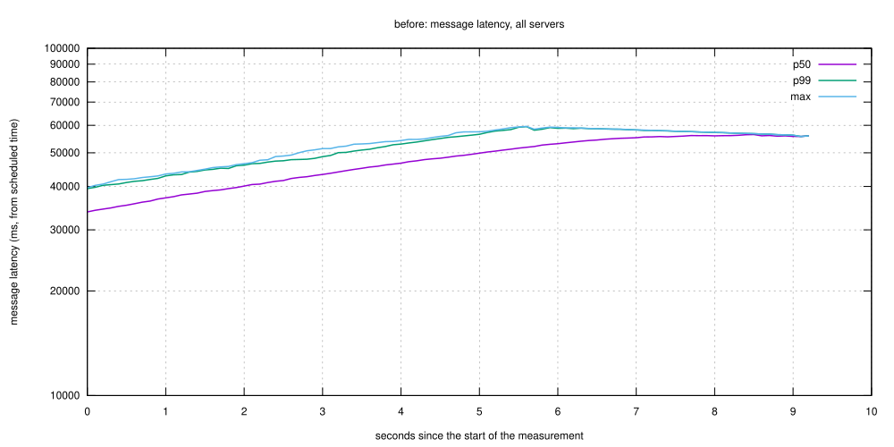
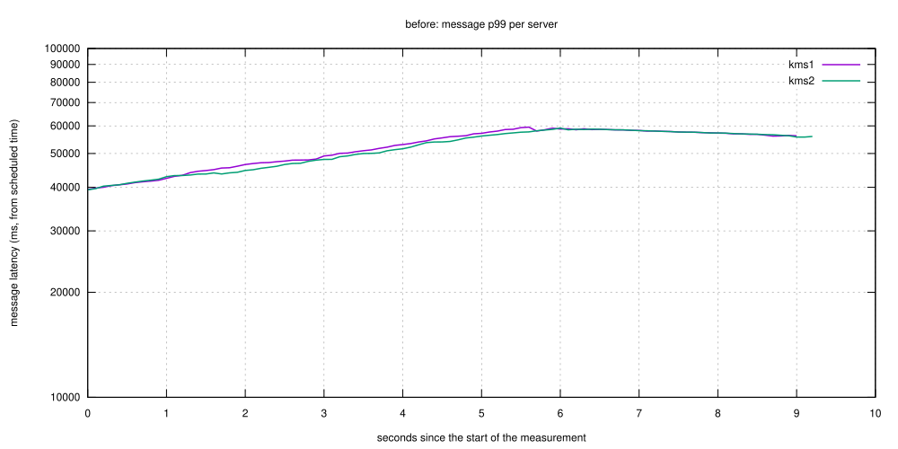

### Run `after`

Target 2500 msg/s, 256 senders, warmup 10 s, measurement 60 s, CEK switch at +20 s; achieved 232 msg/s (133050 messages unsent).

Performance gate (≥ 95 % of target rate completed, 0 errors, recovery within the window): **FAIL** — achieved 231 msg/s < 95% of target 2500 msg/s (133050 unsent)

| server | pre p50 ms | pre p99 ms | first 1 s p99 ms | first 1 s max ms | peak ms | recovery ms | slow messages | errors | HSM unwraps cek0 | HSM unwraps cek1 |
|---|---|---|---|---|---|---|---|---|---|---|
| all | 0.0 | 0.0 | 0.0 | 0.0 | 0.0 | 0 | 0 | 0 |  |  |
| kms1 | 0.0 | 0.0 | 0.0 | 0.0 | 0.0 | 0 | 0 | 0 | 1 | 0 |
| kms2 | 0.0 | 0.0 | 0.0 | 0.0 | 0.0 | 0 | 0 | 0 | 1 | 0 |

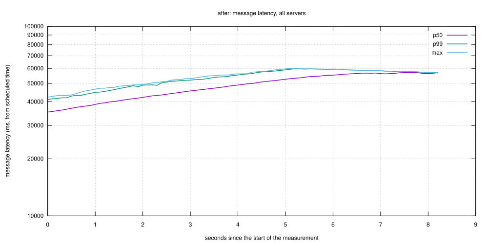
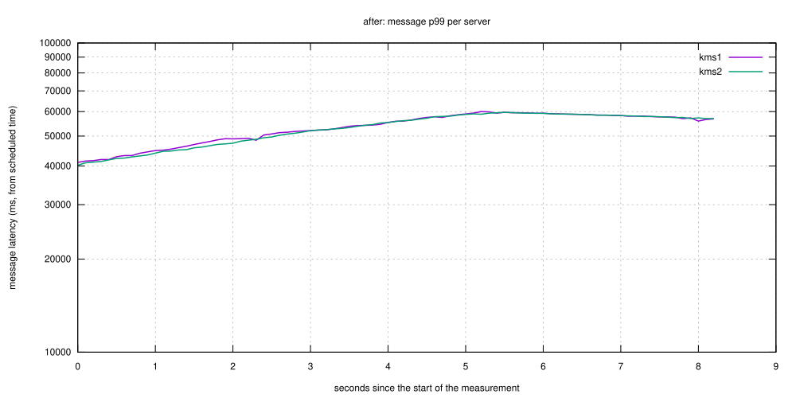

### Run `after-r400`

Target 400 msg/s, 256 senders, warmup 10 s, measurement 30 s, CEK switch at +10 s; achieved 400 msg/s (0 messages unsent).

Performance gate (≥ 95 % of target rate completed, 0 errors, recovery within the window): **PASS**

| server | pre p50 ms | pre p99 ms | first 1 s p99 ms | first 1 s max ms | peak ms | recovery ms | slow messages | errors | HSM unwraps cek0 | HSM unwraps cek1 |
|---|---|---|---|---|---|---|---|---|---|---|
| all | 6.6 | 9.4 | 10.4 | 15.0 | 15.0 | 0 | 0 | 0 |  |  |
| kms1 | 6.2 | 8.9 | 9.4 | 11.1 | 13.0 | 0 | 0 | 0 | 1 | 1 |
| kms2 | 6.9 | 9.7 | 10.5 | 15.0 | 15.0 | 0 | 0 | 0 | 1 | 1 |

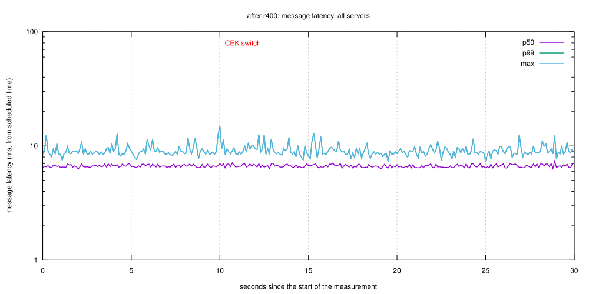
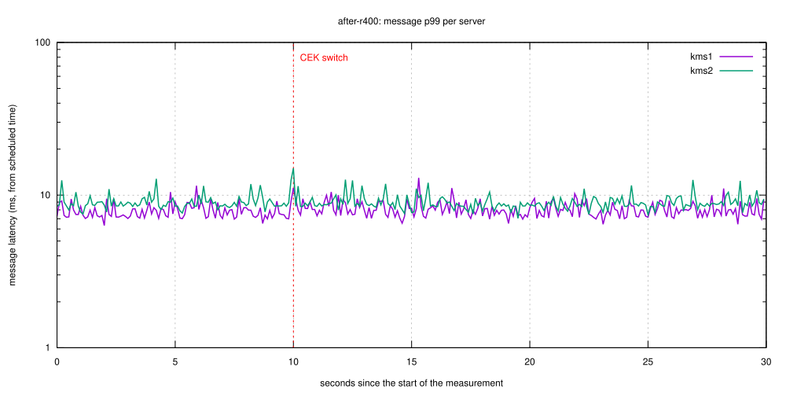

### Run `after-r800`

Target 800 msg/s, 256 senders, warmup 10 s, measurement 30 s, CEK switch at +10 s; achieved 514 msg/s (5429 messages unsent).

Performance gate (≥ 95 % of target rate completed, 0 errors, recovery within the window): **FAIL** — achieved 513 msg/s < 95% of target 800 msg/s (5429 unsent)

| server | pre p50 ms | pre p99 ms | first 1 s p99 ms | first 1 s max ms | peak ms | recovery ms | slow messages | errors | HSM unwraps cek0 | HSM unwraps cek1 |
|---|---|---|---|---|---|---|---|---|---|---|
| all | 5717.0 | 10623.5 | 12751.2 | 13414.8 | 16459.9 | 0 | 0 | 0 |  |  |
| kms1 | 5897.2 | 11055.8 | 12856.0 | 13414.8 | 16459.9 | 0 | 0 | 0 | 1 | 1 |
| kms2 | 5503.1 | 10162.1 | 12074.5 | 13062.5 | 15305.0 | 0 | 0 | 0 | 1 | 1 |

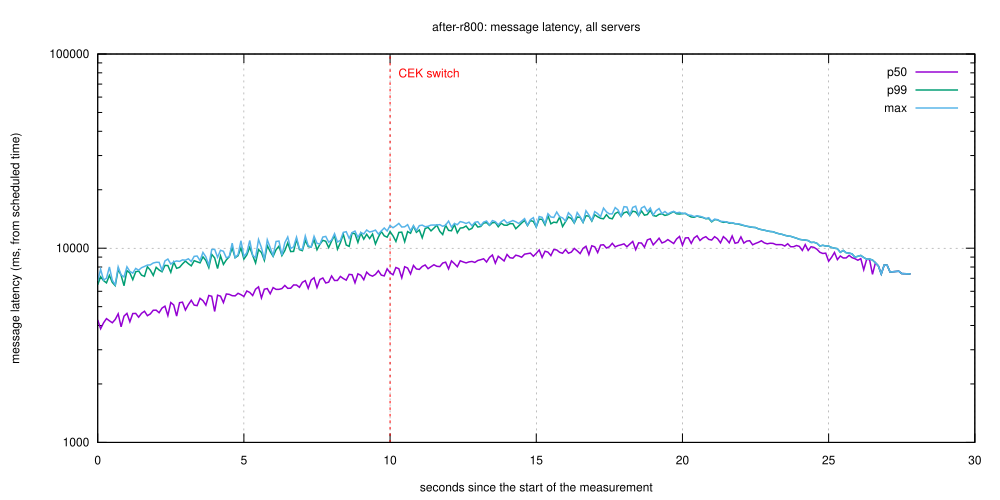
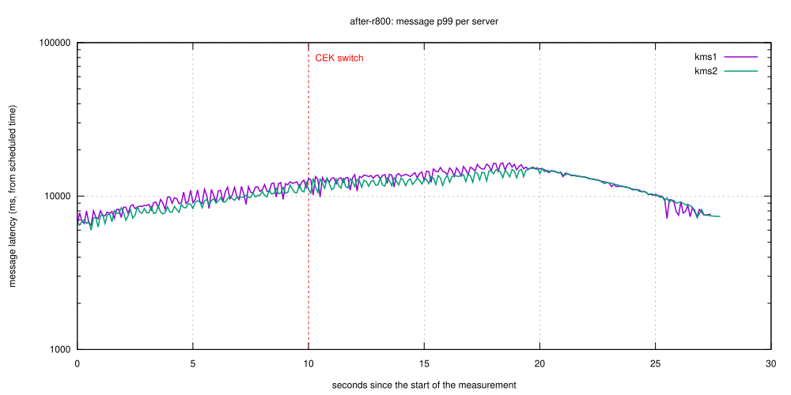

### Run `after-r1200`

Target 1200 msg/s, 256 senders, warmup 10 s, measurement 30 s, CEK switch at +10 s; achieved 382 msg/s (21275 messages unsent).

Performance gate (≥ 95 % of target rate completed, 0 errors, recovery within the window): **FAIL** — achieved 382 msg/s < 95% of target 1200 msg/s (21275 unsent)

| server | pre p50 ms | pre p99 ms | first 1 s p99 ms | first 1 s max ms | peak ms | recovery ms | slow messages | errors | HSM unwraps cek0 | HSM unwraps cek1 |
|---|---|---|---|---|---|---|---|---|---|---|
| all | 15756.2 | 23615.0 | 24630.6 | 25192.0 | 25192.0 | 0 | 0 | 0 |  |  |
| kms1 | 15486.5 | 23293.0 | 24550.8 | 25046.4 | 25046.4 | 0 | 0 | 0 | 1 | 1 |
| kms2 | 16049.5 | 23755.3 | 24756.2 | 25192.0 | 25192.0 | 0 | 0 | 0 | 1 | 1 |

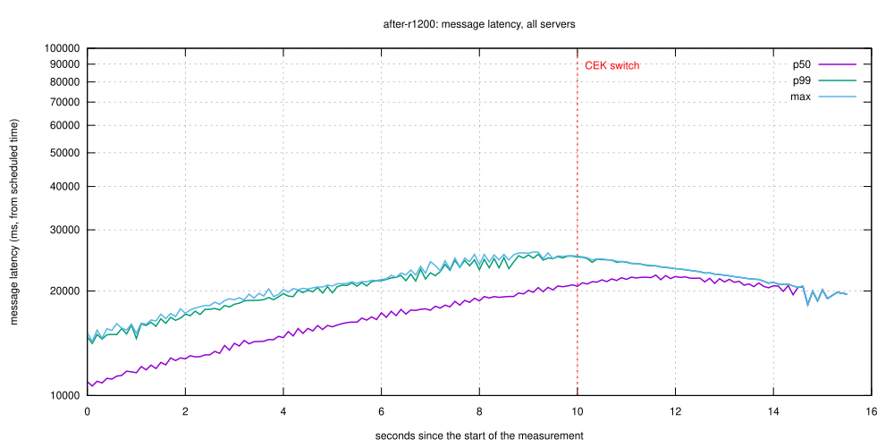
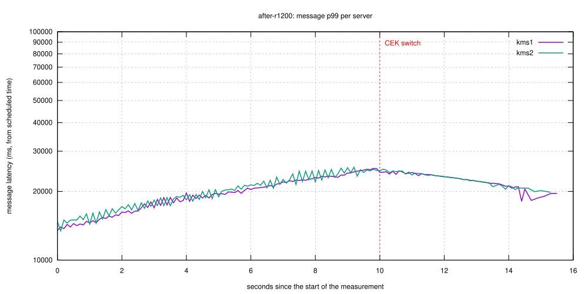

### Run `after-r1600`

Target 1600 msg/s, 256 senders, warmup 10 s, measurement 30 s, CEK switch at +10 s; achieved 237 msg/s (37629 messages unsent).

Performance gate (≥ 95 % of target rate completed, 0 errors, recovery within the window): **FAIL** — achieved 237 msg/s < 95% of target 1600 msg/s (37629 unsent)

| server | pre p50 ms | pre p99 ms | first 1 s p99 ms | first 1 s max ms | peak ms | recovery ms | slow messages | errors | HSM unwraps cek0 | HSM unwraps cek1 |
|---|---|---|---|---|---|---|---|---|---|---|
| all | 23356.7 | 29529.7 | 0.0 | 0.0 | 0.0 | 0 | 0 | 0 |  |  |
| kms1 | 23169.9 | 29453.1 | 0.0 | 0.0 | 0.0 | 0 | 0 | 0 | 1 | 0 |
| kms2 | 23573.3 | 29571.3 | 0.0 | 0.0 | 0.0 | 0 | 0 | 0 | 1 | 0 |

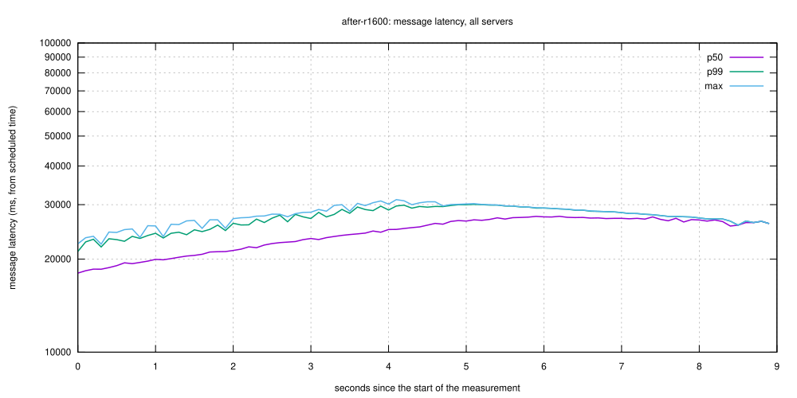
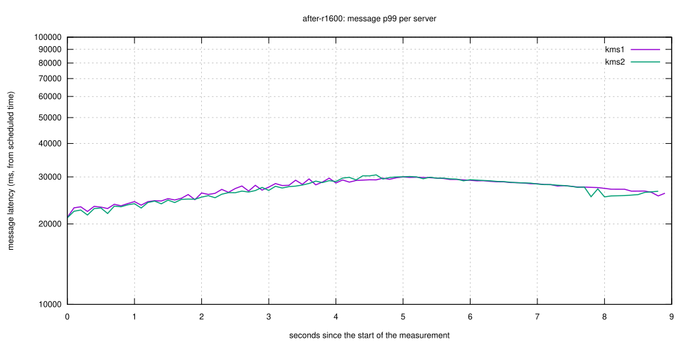

### Run `before-r400`

Target 400 msg/s, 256 senders, warmup 10 s, measurement 30 s, CEK switch at +10 s; achieved 400 msg/s (0 messages unsent).

Performance gate (≥ 95 % of target rate completed, 0 errors, recovery within the window): **PASS**

| server | pre p50 ms | pre p99 ms | first 1 s p99 ms | first 1 s max ms | peak ms | recovery ms | slow messages | errors | HSM unwraps cek0 | HSM unwraps cek1 |
|---|---|---|---|---|---|---|---|---|---|---|
| all | 6.7 | 9.0 | 9.3 | 10.7 | 12.4 | 0 | 0 | 0 |  |  |
| kms1 | 6.5 | 8.9 | 9.0 | 10.7 | 12.1 | 0 | 0 | 0 | 41 | 1 |
| kms2 | 7.0 | 9.0 | 9.3 | 10.1 | 12.4 | 0 | 0 | 0 | 27 | 1 |

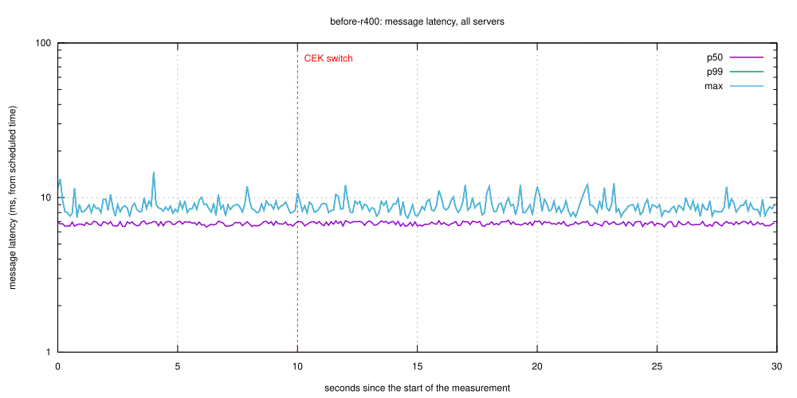
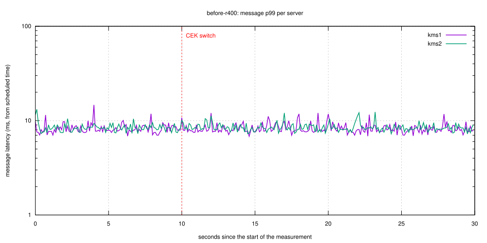

### Run `before-r800`

Target 800 msg/s, 256 senders, warmup 10 s, measurement 30 s, CEK switch at +10 s; achieved 484 msg/s (6368 messages unsent).

Performance gate (≥ 95 % of target rate completed, 0 errors, recovery within the window): **FAIL** — achieved 484 msg/s < 95% of target 800 msg/s (6368 unsent)

| server | pre p50 ms | pre p99 ms | first 1 s p99 ms | first 1 s max ms | peak ms | recovery ms | slow messages | errors | HSM unwraps cek0 | HSM unwraps cek1 |
|---|---|---|---|---|---|---|---|---|---|---|
| all | 6293.6 | 11728.8 | 13417.4 | 14108.9 | 17814.6 | 0 | 0 | 0 |  |  |
| kms1 | 6259.9 | 11846.3 | 13291.8 | 14108.9 | 17210.1 | 0 | 0 | 0 | 42 | 1 |
| kms2 | 6320.7 | 11459.2 | 13630.2 | 14054.2 | 17814.6 | 0 | 0 | 0 | 113 | 1 |

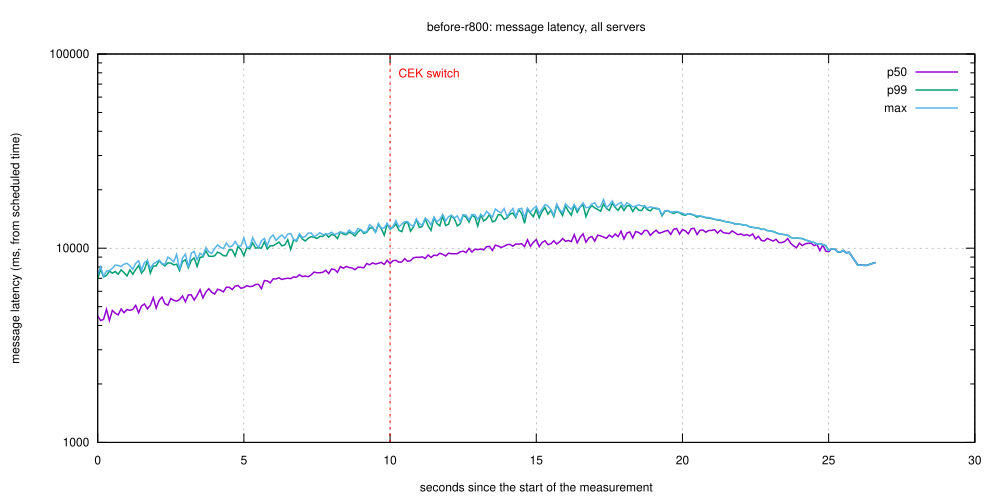
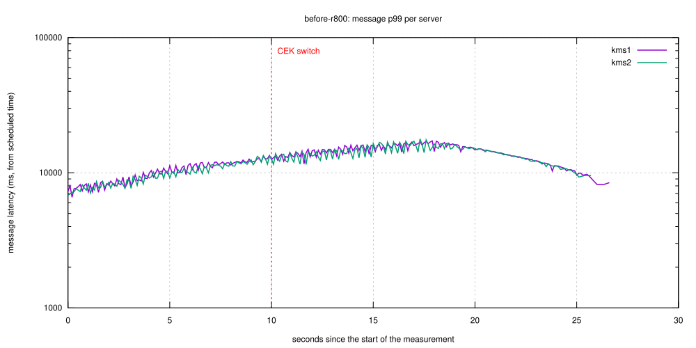

### Run `before-r1200`

Target 1200 msg/s, 256 senders, warmup 10 s, measurement 30 s, CEK switch at +10 s; achieved 330 msg/s (23024 messages unsent).

Performance gate (≥ 95 % of target rate completed, 0 errors, recovery within the window): **FAIL** — achieved 330 msg/s < 95% of target 1200 msg/s (23024 unsent)

| server | pre p50 ms | pre p99 ms | first 1 s p99 ms | first 1 s max ms | peak ms | recovery ms | slow messages | errors | HSM unwraps cek0 | HSM unwraps cek1 |
|---|---|---|---|---|---|---|---|---|---|---|
| all | 17838.0 | 25621.8 | 25085.3 | 25324.8 | 25324.8 | 0 | 0 | 0 |  |  |
| kms1 | 17936.9 | 25637.4 | 25208.3 | 25324.8 | 25324.8 | 0 | 0 | 0 | 79 | 1 |
| kms2 | 17724.5 | 25593.6 | 24954.2 | 25239.0 | 25239.0 | 0 | 0 | 0 | 105 | 1 |

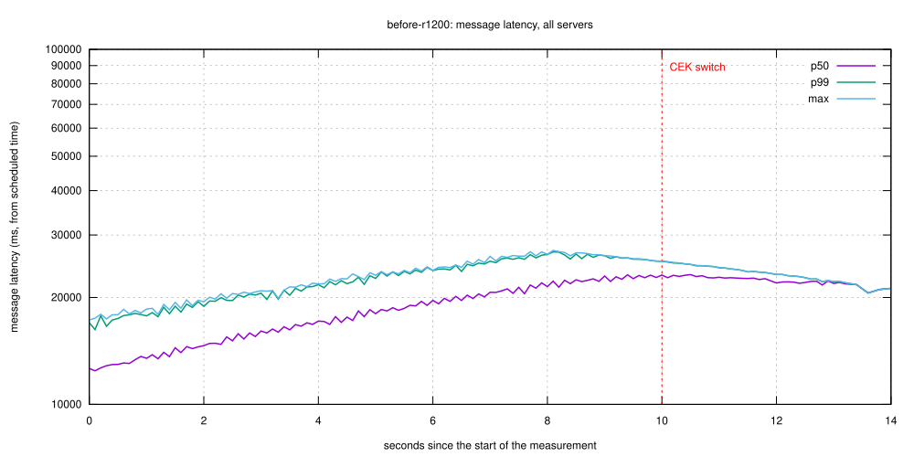
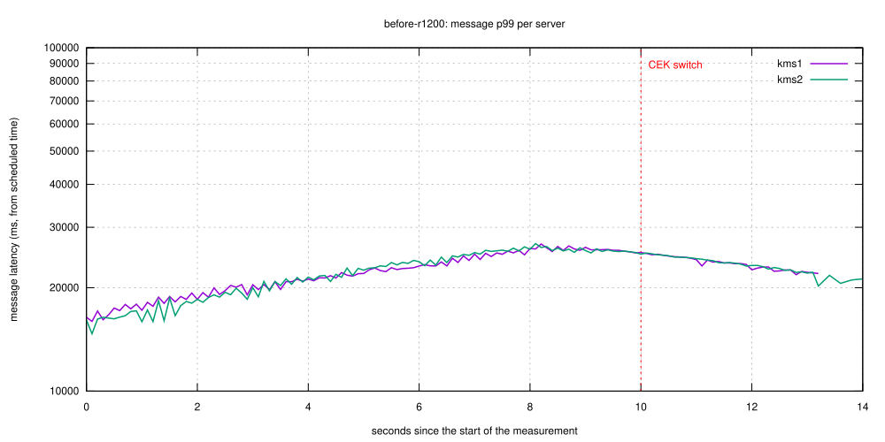

### Run `before-r1600`

Target 1600 msg/s, 256 senders, warmup 10 s, measurement 30 s, CEK switch at +10 s; achieved 219 msg/s (38336 messages unsent).

Performance gate (≥ 95 % of target rate completed, 0 errors, recovery within the window): **FAIL** — achieved 218 msg/s < 95% of target 1600 msg/s (38336 unsent)

| server | pre p50 ms | pre p99 ms | first 1 s p99 ms | first 1 s max ms | peak ms | recovery ms | slow messages | errors | HSM unwraps cek0 | HSM unwraps cek1 |
|---|---|---|---|---|---|---|---|---|---|---|
| all | 23935.8 | 29908.3 | 0.0 | 0.0 | 0.0 | 0 | 0 | 0 |  |  |
| kms1 | 23936.8 | 29898.3 | 0.0 | 0.0 | 0.0 | 0 | 0 | 0 | 128 | 0 |
| kms2 | 23935.0 | 29927.4 | 0.0 | 0.0 | 0.0 | 0 | 0 | 0 | 91 | 0 |

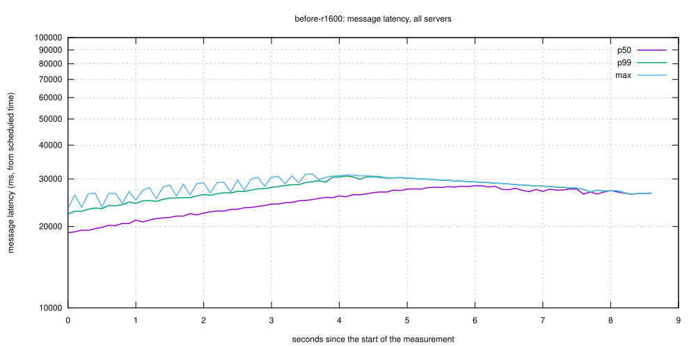
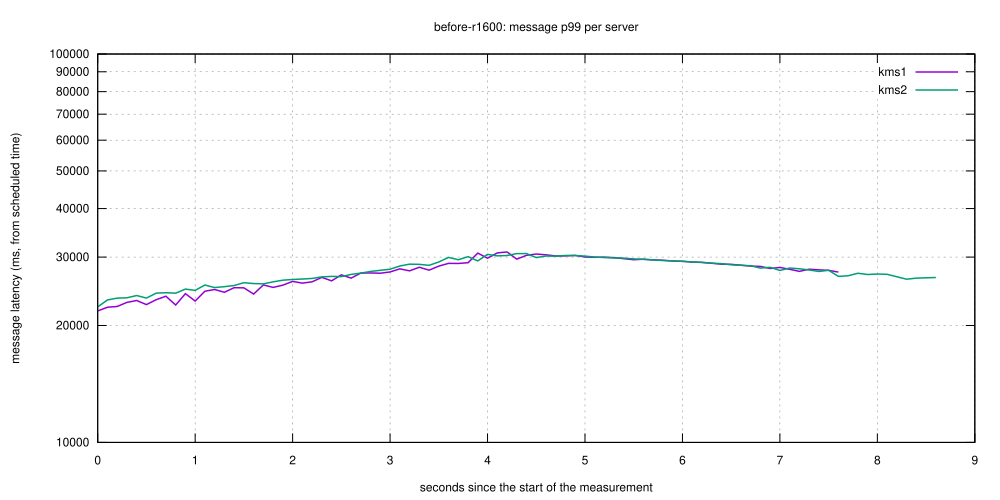

## Comparison

| | before | after | after-r400 | after-r800 | after-r1200 | after-r1600 | before-r400 | before-r800 | before-r1200 | before-r1600 |
|---|---|---|---|---|---|---|---|---|---|---|
| achieved msg/s | 259 | 232 | 400 | 514 | 382 | 237 | 400 | 484 | 330 | 219 |
| gate | FAIL | FAIL | PASS | FAIL | FAIL | FAIL | PASS | FAIL | FAIL | FAIL |
| peak message ms (all) | 0.0 | 0.0 | 15.0 | 16459.9 | 25192.0 | 0.0 | 12.4 | 17814.6 | 25324.8 | 0.0 |
| recovery ms (all) | 0 | 0 | 0 | 0 | 0 | 0 | 0 | 0 | 0 | 0 |
| HSM unwraps of cek1, kms1 | 0 | 0 | 1 | 1 | 1 | 0 | 1 | 1 | 1 | 0 |
| HSM unwraps of cek1, kms2 | 0 | 0 | 1 | 1 | 1 | 0 | 1 | 1 | 1 | 0 |
