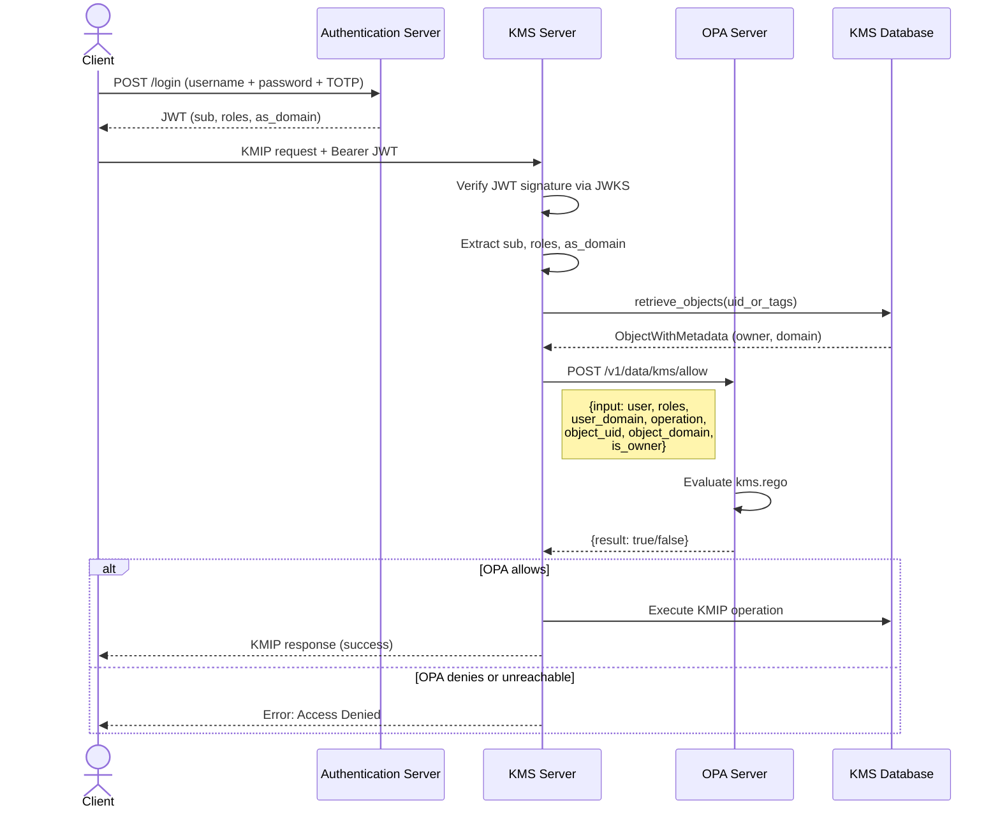
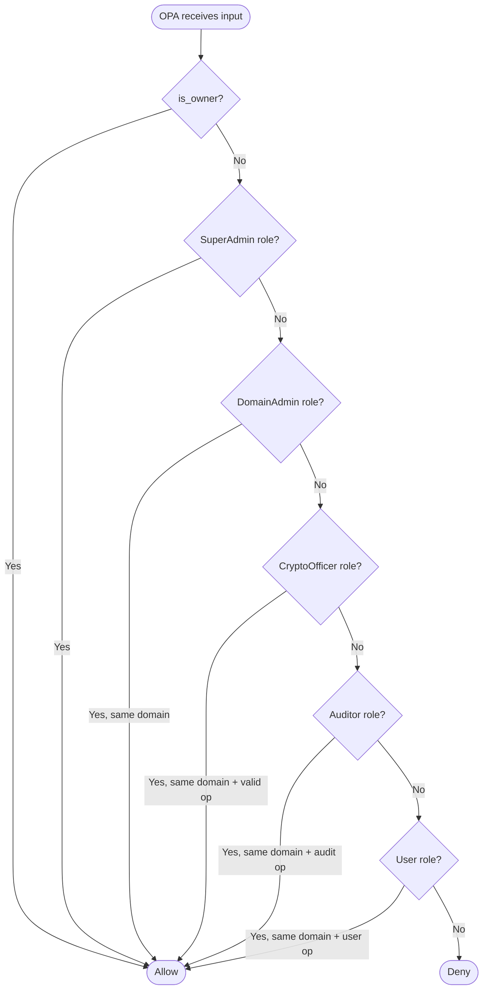
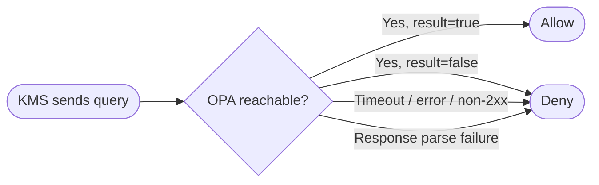

# Mode 2 — Exclusive OPA (RBAC)

When the OPA server is configured with `opa_mode = "exclusive"`, OPA is the **sole
authorization decision maker** for the requests it is asked about. The native KMS permission system
(ownership, grants) is bypassed for them. Several operations are never sent to OPA and keep using the
native KMS permission system (see the note below the table).

```toml
# kms.toml — Mode 2
[opa]
opa_url  = "http://localhost:8181"
opa_mode = "exclusive"
```

| Environment variable | Example |
| -------------------- | ------- |
| `KMS_OPA_URL`        | `http://localhost:8181` |
| `KMS_OPA_MODE`       | `exclusive` |

!!! note "Operations that never reach OPA"
    In the current server, several operations are authorized from the native KMS ownership and grants only, and OPA is not queried for them. They include Encrypt, Decrypt, Sign, SignatureVerify, MAC, MACVerify, Revoke, Destroy and Rekey. A caller that the policy would allow but that has no native grant is refused (Encrypt and Revoke return `Item_Not_Found`), and a native grant is honored even where the policy would deny. Create, Get, GetAttributes, Activate and the other operations that the server routes through OPA (for example attribute changes, Check, Validate and DeriveKey) are decided by OPA. [Try RBAC with Keycloak and OPA](rbac-keycloak-opa-demo.md) shows Encrypt and Revoke; the other operations are listed from the server code and the demo does not exercise them.

---

## Prerequisites

- **JWT authentication required** — all users must authenticate via JWT issued by the
  Eviden Authentication Server. The JWT must contain the `roles` and `as_domain` claims
  (`as_rid` is accepted as an alias of `as_domain`).
- **Non-JWT auth is fail-closed** — mTLS and API token users receive `roles: []` in the
  OPA input, causing all role-based rules to evaluate to `false`.
- **Native KMS grants are ignored** — even if a user has explicit grants in the KMS
  database, they are not consulted for the operations OPA decides. The exception is the
  operations listed in the note above, which are authorized from the native grants only.

---

## Sequence diagram



---

## OPA decision flowchart

The Rego policy evaluates rules top-to-bottom. The first matching rule grants access:



---

## Fail-closed behaviour



If OPA is configured but unreachable, **all requests are denied**. This is
intentional: a crashed sidecar does not degrade the KMS to open access.

---

## What is NOT evaluated in Mode 2

| Native KMS concept | Evaluated? | Reason |
| ------------------ | :--------: | ------ |
| Object ownership grants | No | OPA handles `is_owner` directly |
| Per-user operation grants | No | Replaced by role-based rules |
| `Get` super-privilege | No | OPA does not implement this shortcut |
| Privileged users (creation rights) | Yes, for `Create` | The default username and the `crypto_officer_users` keep the `Create` right without OPA being queried; OPA decides for everyone else |
| HSM admin bypass | No | OPA handles all HSM key decisions |
| Ceremony super-admin | No | Native KMS gate is not consulted |

Apart from the `Create` shortcut of privileged users, the table describes the operations that OPA decides. For the operations in the note at the top of this page, ownership and per-user grants are the only check (for the cryptographic operations on non-HSM keys, a `Get` grant is also enough).

---

## Deploying the OPA sidecar

Minimal start:

```bash
opa run --server --addr :8181 kms.rego
```

Production (hot-reloadable via bundles):

```bash
opa run --server --addr :8181 \
  --set bundles.kms.service=policy-service \
  --set bundles.kms.resource=kms/bundle.tar.gz \
  --set services.policy-service.url=https://policy.example.com
```

The policy can be updated at runtime without restarting KMS or OPA.

---

## Debugging denied requests

Query the debug endpoint to see which rules matched:

```bash
curl -s -X POST http://localhost:8181/v1/data/kms/reasons \
  -H "Content-Type: application/json" \
  -d '{
    "input": {
      "user": "alice@acme.com",
      "user_domain": "acme.com",
      "roles": ["CryptoOfficer"],
      "operation": "destroy",
      "object_uid": "key-123",
      "object_domain": "acme.com",
      "is_owner": false
    }
  }'
```

Response: `{"result": ["crypto_officer"]}` — the `CryptoOfficer` role allows `destroy`.

If the response contains `"denied"`, no rule matched.

---

## See also

- [Authorization overview](index.md) — role model, JWT claims, OPA input document
- [Mode 3 — Enforcing](mode3.md) — OPA stays authoritative; native Crypto Officers and HSM-backed objects also use the native KMS check
- [Try RBAC with Keycloak and OPA](rbac-keycloak-opa-demo.md) — run the roles end to end with a Keycloak, OPA and KMS Docker Compose stack
- Rego policy source: `test_data/opa/kms.rego`
