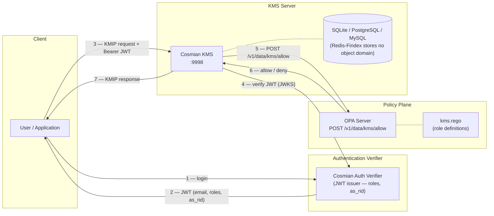
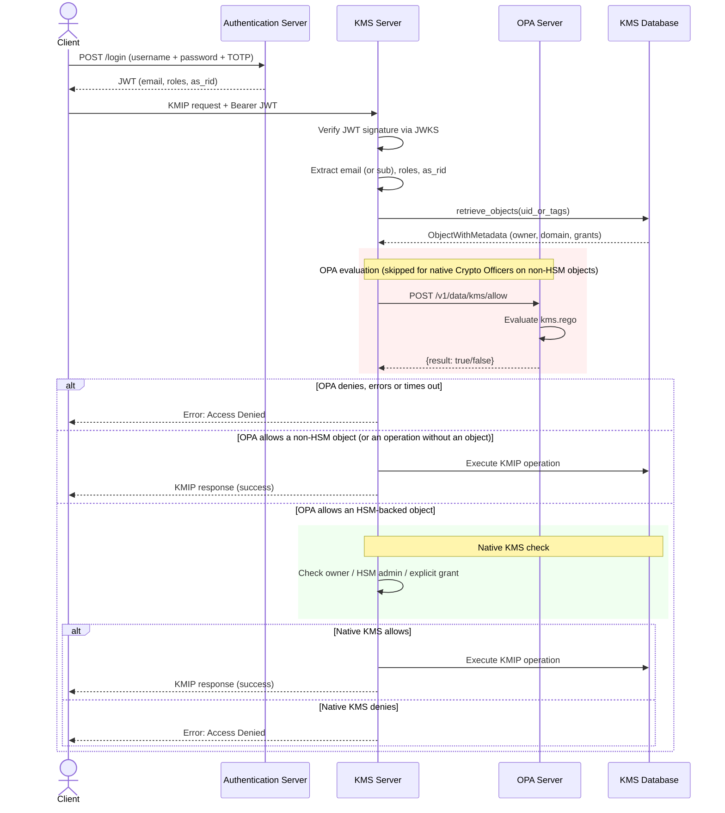
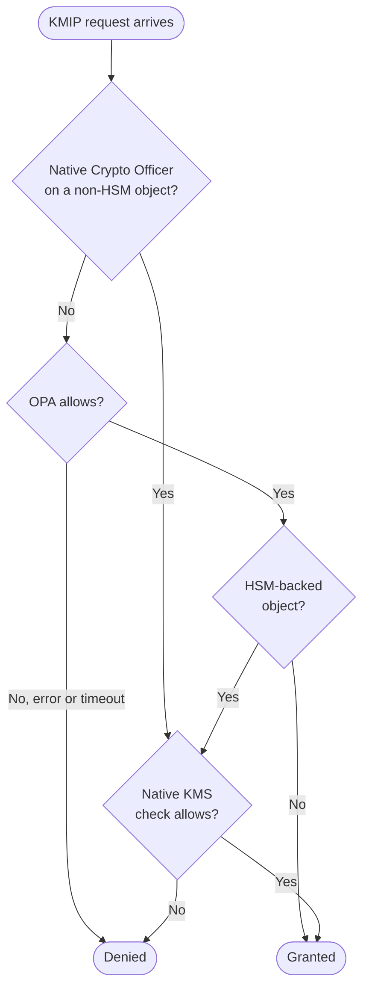

# Mode 3 — Enforcing (OPA + Native KMS)

When the OPA server is configured with `opa_mode = "enforcing"`, **OPA is the authoritative
policy engine** for the requests it is asked about. A denial, an error or a timeout is final, and for most of them an allow is
sufficient: the native KMS permission system (ownership, grants) is **not** consulted afterwards.
It still applies in two cases:

- **Native Crypto Officers** (activated officers and the ceremony candidates listed in
  `crypto_officer_users`) acting on non-HSM objects skip OPA and are evaluated by the native KMS
  permission system only, so the [key ceremony](key_ceremony.md) keeps working without JWT roles.
- **HSM-backed objects** must also pass the native KMS permission system (owner, HSM admin or
  explicit grant) after OPA has allowed the request.

Several operations never reach OPA, in Mode 3 as in [Mode 2](mode2.md): Locate, Encrypt, Decrypt, Sign, SignatureVerify, MAC, MACVerify, Revoke, Destroy and Rekey are authorized from the native KMS ownership and grants only (see the second warning below).

```toml
# kms.toml — Mode 3
[opa]
opa_url  = "http://localhost:8181"
opa_mode = "enforcing"
```

| Environment variable | Example |
| -------------------- | ------- |
| `KMS_OPA_URL`        | `http://localhost:8181` |
| `KMS_OPA_MODE`       | `enforcing` |

→ **[Full setup guide: OPA + Authentication Verifier](opa-authverifier-setup.md)**

---

## Architecture overview



---

## When to use Mode 3

Mode 3 behaves like [Mode 2](mode2.md) for external (JWT) users acting on non-HSM objects. Choose it
over Mode 2 when:

- **Native Crypto Officers must keep working** — the Crypto Officer role and the split-key ceremony are
  configured in the KMS (`crypto_officer_users`), not through JWT roles, so they must not depend on the
  OPA policy.
- **HSM-backed keys are in use** — OPA gates access first, and the HSM-admin and explicit-grant rules
  still apply to the keys stored in an HSM.

!!! warning "Per-object grants do not restrict OPA-allowed access"
    For the operations that query OPA, an OPA allow on a non-HSM object is final: ownership and the grants created with
    `ckms access-rights grant` are not checked afterwards, and a grant never overrides an OPA denial.
    To restrict access per object, express the rule in the Rego policy (for example with
    `input.is_owner`).

!!! warning "The policy does not control every operation"
    Locate, Encrypt, Decrypt, Sign, SignatureVerify, MAC, MACVerify, Revoke, Destroy and Rekey on a key owned by someone else are authorized from the native KMS ownership and grants only. OPA is not queried for them: a caller that the policy would allow but that has no native grant is refused (Locate returns it nothing), and a native grant is honored even where the policy would deny. Restrict these operations with native grants, not with the Rego policy.

!!! warning "An activated Crypto Officer is outside the policy"
    An activated Crypto Officer skips OPA on every non-HSM object and is granted every operation on it, **across domains** and whatever the ownership or grants (each use is logged as `CRYPTO_OFFICER_ACCESS` on the `audit` log target). `Locate` returns it every matching object of the database. Keep `crypto_officer.users` small and trusted, since the Rego policy cannot restrict these users.

---

## Who decides what

*Native Crypto Officer* means a user listed in `crypto_officer_users`, whether already activated or
still waiting for the ceremony to complete. The table covers the operations that query OPA: Locate, Encrypt, Decrypt, Sign, SignatureVerify, MAC, MACVerify, Revoke, Destroy and Rekey are decided by the native KMS only (see the warnings above).

| Caller | Object | Decided by |
| ------ | ------ | ---------- |
| Activated Crypto Officer | non-HSM | Native KMS only: OPA is skipped, ownership bypass |
| Ceremony candidate, not yet activated | non-HSM | Native KMS only: OPA is skipped, owner or explicit grant |
| Any other caller | non-HSM, or no object (for example `Create`) | OPA only: an allow is sufficient |
| Any caller, including Crypto Officers | HSM-backed | OPA first; the native KMS check (owner, HSM admin or explicit grant) must also allow |

---

## Sequence diagram

The diagrams of this page describe the operations that query OPA, not Locate, Encrypt, Decrypt, Sign, SignatureVerify, MAC, MACVerify, Revoke, Destroy and Rekey.



Native Crypto Officers acting on a non-HSM object skip the OPA step and go straight to the native
KMS check, as the decision flowchart below shows.

---

## Decision flowchart



### OPA evaluation

Same as [Mode 2](mode2.md): role hierarchy, domain scoping, owner override. The decision is final and
fail-closed: an error or a 5-second timeout is a denial.

### Native KMS evaluation

Same as [Mode 1](mode1.md): owner → activated Crypto Officer (non-HSM objects) → HSM admin (HSM-backed
objects) → explicit grant → Get wildcard (non-HSM objects).

The ceremony super-admin (the activated Crypto Officer of the XOR split-key [key ceremony](key_ceremony.md)) is evaluated by the native KMS check only and is invisible to OPA. It is a cross-domain super-admin for every non-HSM object.

---

## Interaction scenarios

*Other caller* means anyone who is not a native Crypto Officer. All rows but the last one describe operations that query OPA.

| Caller and object | OPA decision | Native KMS decision | Final result | Explanation |
| ----------------- | :----------: | :-----------------: | :----------: | ----------- |
| Other caller, non-HSM object | Allow | *(not evaluated)* | **Granted** | An OPA allow is sufficient: no ownership or grant check |
| Other caller, non-HSM object | Deny | *(not evaluated)* | **Denied** | OPA veto |
| Any request that reaches OPA | Unreachable, error or timeout | *(not evaluated)* | **Denied** | Fail-closed: OPA down |
| Activated Crypto Officer, non-HSM object | *(skipped)* | Allow (ownership bypass) | **Granted** | Native Crypto Officers do not depend on OPA |
| Ceremony candidate, not yet activated, non-HSM object | *(skipped)* | Allow (owner or grant) | **Granted** | The ceremony keeps working without JWT roles |
| Ceremony candidate, not yet activated, non-HSM object | *(skipped)* | Deny | **Denied** | Neither owner nor explicit grant |
| Any caller, HSM-backed object | Allow | Allow (owner, HSM admin or grant) | **Granted** | Both must allow |
| Any caller, HSM-backed object | Allow | Deny | **Denied** | The native KMS check vetoes the OPA allow |
| Any caller, HSM-backed object | Deny | *(not evaluated)* | **Denied** | OPA veto |
| Any caller, Locate, Encrypt, Decrypt, Sign, SignatureVerify, MAC, MACVerify, Revoke, Destroy or Rekey | *(not queried)* | Allow (owner or explicit grant) or deny | **Native decision** | The policy cannot allow or deny these operations |

---

## Practical example

Alice's JWT carries the `CryptoOfficer` role and the domain `acme.com`, and she is not listed in
`crypto_officer_users`. `key-123` belongs to Bob, is in the domain `acme.com`, is not HSM-backed, and
Alice holds no grant on it. The examples use the reference `kms.rego` policy.

Alice gets `key-123`:

```text
OPA:        CryptoOfficer + same domain + "get" in crypto_officer_ops → Allow ✓
Native KMS: not evaluated (non-HSM object, Alice is not a native Crypto Officer)
Final:      Granted
```

Alice is neither the owner nor a grantee, yet the request is granted: in Mode 3 an OPA allow on a
non-HSM object is final.

Carol's JWT carries the `Auditor` role and the domain `acme.com`. Carol activates `key-123`:

```text
OPA:        Auditor + same domain, but "activate" is not in auditor_ops → Deny ✗
Native KMS: not evaluated
Final:      Denied
```

An `activate` grant on `key-123` would not change the result, because a grant never overrides an OPA
denial. Carol would need the `CryptoOfficer` role (`activate` belongs to `crypto_officer_ops` in the
reference policy), or the policy would have to be extended.

Alice destroys `key-123`, or encrypts with it:

```text
OPA:        not queried (Destroy and Encrypt are authorized from the native KMS only)
Native KMS: Alice is not the owner, holds no grant and is not a native Crypto Officer → Deny ✗
Final:      Denied
```

The policy would allow Alice to destroy `key-123` (`destroy` is in `crypto_officer_ops`), but it is not
asked, so the request is still refused. Conversely, an `encrypt` grant on `key-123` would let Alice
encrypt with it although the policy does not allow `encrypt` for her role.

---

## Comparison with Mode 2

| Aspect | Mode 2 (Exclusive) | Mode 3 (Enforcing) |
| ------ | :----------------: | :----------------: |
| OPA consulted | Yes, except for Locate, Encrypt, Decrypt, Sign, SignatureVerify, MAC, MACVerify, Revoke, Destroy and Rekey | Yes, except for the same operations and for native Crypto Officers on non-HSM objects |
| OPA deny = final deny | Yes | Yes |
| OPA allow sufficient | Yes | Yes, except on HSM-backed objects |
| Native KMS consulted | No | Only for native Crypto Officers (non-HSM objects) and HSM-backed objects |
| Native KMS can veto an OPA allow | N/A | Only on HSM-backed objects |
| Ceremony super-admin | Active only for the operations that never reach OPA | Active (native Crypto Officers skip OPA) |
| Per-object grants used | Only for the operations that never reach OPA | Only for those operations, native Crypto Officers and HSM-backed objects |
| HSM admin bypass | No | **Yes** (HSM-backed objects, after OPA allows) |

---

## See also

- [Authorization overview](index.md) — role model, JWT claims, OPA input document
- [Mode 1 — Native KMS permissions](mode1.md) — details on the native KMS evaluation
- [Mode 2 — Exclusive OPA](mode2.md) — details on the OPA evaluation
