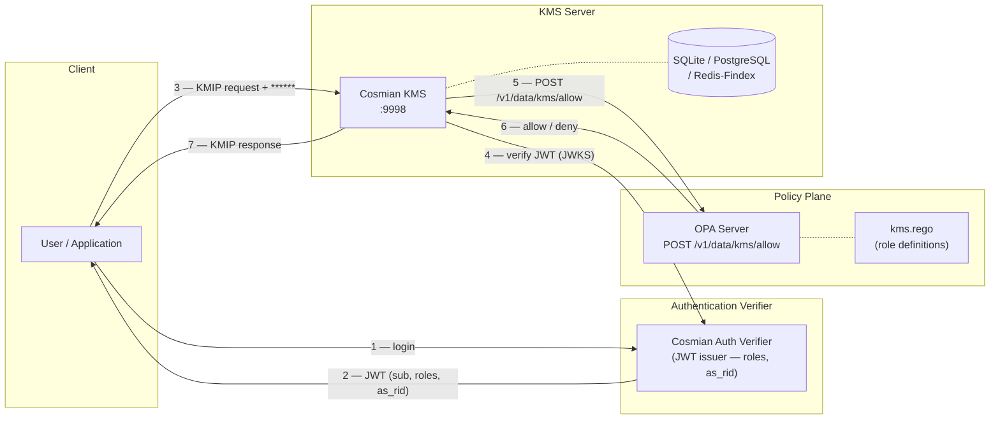
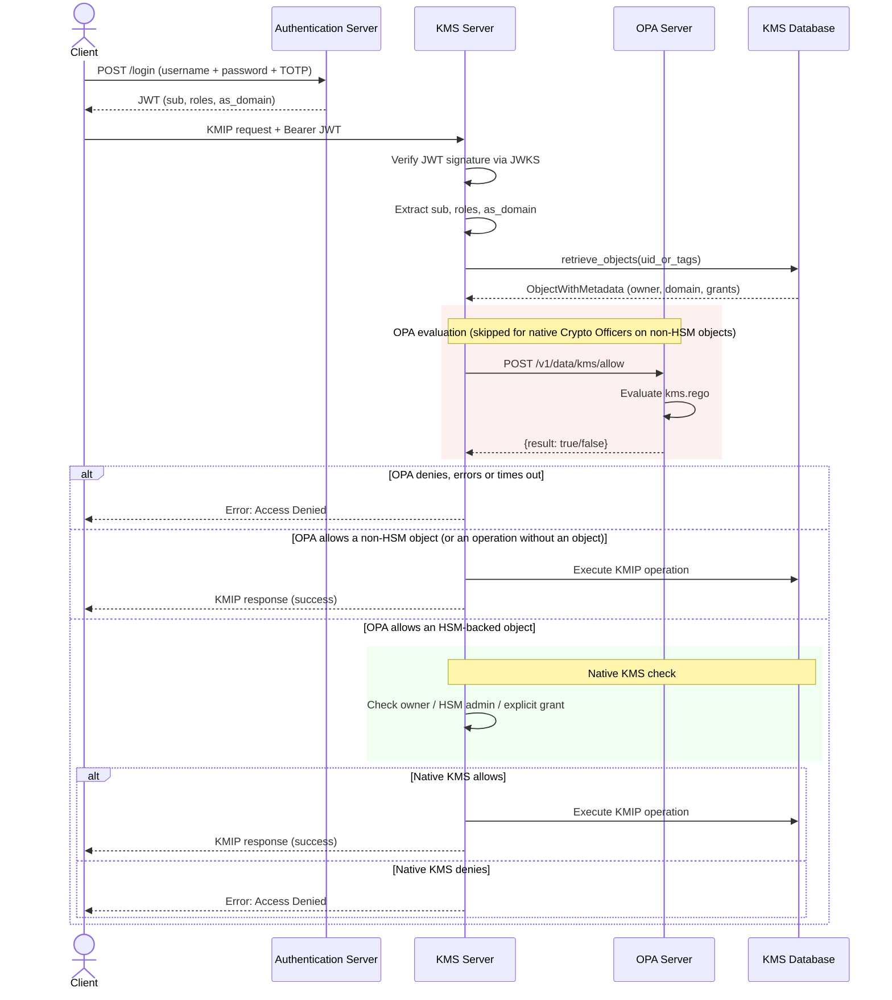
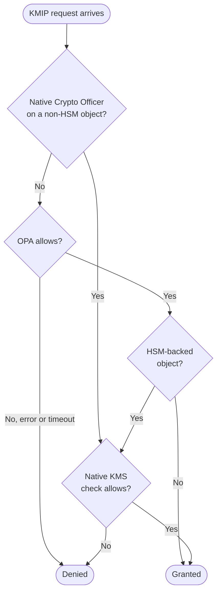

# Mode 3 — Enforcing (OPA + Native KMS)

When the OPA server is configured with `opa_mode = "enforcing"`, **OPA is the authoritative
policy engine**. A denial, an error or a timeout is final, and for most requests an allow is
sufficient: the native KMS permission system (ownership, grants) is **not** consulted afterwards.
It still applies in two cases:

- **Native Crypto Officers** (activated officers and the ceremony candidates listed in
  `crypto_officer_users`) acting on non-HSM objects skip OPA and are evaluated by the native KMS
  permission system only, so the [key ceremony](key_ceremony.md) keeps working without JWT roles.
- **HSM-backed objects** must also pass the native KMS permission system (owner, HSM admin or
  explicit grant) after OPA has allowed the request.

```toml
# kms.toml — Mode 3
[opa]
opa_url  = "http://localhost:8181"
opa_mode = "enforcing"
```

| Environment variable | Example |
| -------------------- | ------- |
| `KMS_OPA_URL`        | `http://localhost:8181` |
| `KMS_OPA_MODE`       | `enforcing` |

→ **[Full setup guide: OPA + Authentication Verifier](opa-authverifier-setup.md)**

---

## Architecture overview



---

## When to use Mode 3

Mode 3 behaves like [Mode 2](mode2.md) for external (JWT) users acting on non-HSM objects. Choose it
over Mode 2 when:

- **Native Crypto Officers must keep working** — the Crypto Officer role and the split-key ceremony are
  configured in the KMS (`crypto_officer_users`), not through JWT roles, so they must not depend on the
  OPA policy.
- **HSM-backed keys are in use** — OPA gates access first, and the HSM-admin and explicit-grant rules
  still apply to the keys stored in an HSM.

!!! warning "Per-object grants do not restrict OPA-allowed access"
    On non-HSM objects an OPA allow is final: ownership and the grants created with
    `ckms access-rights grant` are not checked afterwards, and a grant never overrides an OPA denial.
    To restrict access per object, express the rule in the Rego policy (for example with
    `input.is_owner`).

---

## Who decides what

*Native Crypto Officer* means a user listed in `crypto_officer_users`, whether already activated or
still waiting for the ceremony to complete.

| Caller | Object | Decided by |
| ------ | ------ | ---------- |
| Activated Crypto Officer | non-HSM | Native KMS only: OPA is skipped, ownership bypass |
| Ceremony candidate, not yet activated | non-HSM | Native KMS only: OPA is skipped, owner or explicit grant |
| Any other caller | non-HSM, or no object (for example `Create`) | OPA only: an allow is sufficient |
| Any caller, including Crypto Officers | HSM-backed | OPA first; the native KMS check (owner, HSM admin or explicit grant) must also allow |

---

## Sequence diagram



Native Crypto Officers acting on a non-HSM object skip the OPA step and go straight to the native
KMS check, as the decision flowchart below shows.

---

## Decision flowchart



### OPA evaluation

Same as [Mode 2](mode2.md): role hierarchy, domain scoping, owner override. The decision is final and
fail-closed: an error or a 5-second timeout is a denial.

### Native KMS evaluation

Same as [Mode 1](mode1.md): owner → activated Crypto Officer (non-HSM objects) → HSM admin (HSM-backed
objects) → explicit grant → Get wildcard (non-HSM objects).

The ceremony super-admin (Shamir split-key) operates exclusively within the native KMS check and is
invisible to OPA.

---

## Interaction scenarios

*Other caller* means anyone who is not a native Crypto Officer.

| Caller and object | OPA decision | Native KMS decision | Final result | Explanation |
| ----------------- | :----------: | :-----------------: | :----------: | ----------- |
| Other caller, non-HSM object | Allow | *(not evaluated)* | **Granted** | An OPA allow is sufficient: no ownership or grant check |
| Other caller, non-HSM object | Deny | *(not evaluated)* | **Denied** | OPA veto |
| Any request that reaches OPA | Unreachable, error or timeout | *(not evaluated)* | **Denied** | Fail-closed: OPA down |
| Activated Crypto Officer, non-HSM object | *(skipped)* | Allow (ownership bypass) | **Granted** | Native Crypto Officers do not depend on OPA |
| Ceremony candidate, not yet activated, non-HSM object | *(skipped)* | Allow (owner or grant) | **Granted** | The ceremony keeps working without JWT roles |
| Ceremony candidate, not yet activated, non-HSM object | *(skipped)* | Deny | **Denied** | Neither owner nor explicit grant |
| Any caller, HSM-backed object | Allow | Allow (owner, HSM admin or grant) | **Granted** | Both must allow |
| Any caller, HSM-backed object | Allow | Deny | **Denied** | The native KMS check vetoes the OPA allow |
| Any caller, HSM-backed object | Deny | *(not evaluated)* | **Denied** | OPA veto |

---

## Practical example

Alice's JWT carries the `CryptoOfficer` role and the domain `acme.com`, and she is not listed in
`crypto_officer_users`. `key-123` belongs to Bob, is in the domain `acme.com`, is not HSM-backed, and
Alice holds no grant on it. The examples use the reference `kms.rego` policy.

Alice destroys `key-123`:

```text
OPA:        CryptoOfficer + same domain + "destroy" in crypto_officer_ops → Allow ✓
Native KMS: not evaluated (non-HSM object, Alice is not a native Crypto Officer)
Final:      Granted
```

Alice is neither the owner nor a grantee, yet the request is granted: in Mode 3 an OPA allow on a
non-HSM object is final.

Alice encrypts with `key-123`:

```text
OPA:        CryptoOfficer + same domain, but "encrypt" is not in crypto_officer_ops → Deny ✗
Native KMS: not evaluated
Final:      Denied
```

An `encrypt` grant on `key-123` would not change the result, because a grant never overrides an OPA
denial. Alice would need the `User` role (`encrypt` belongs to `user_ops` in the reference policy), or
the policy would have to be extended.

---

## Comparison with Mode 2

| Aspect | Mode 2 (Exclusive) | Mode 3 (Enforcing) |
| ------ | :----------------: | :----------------: |
| OPA consulted | Yes, for every request | Yes, except for native Crypto Officers on non-HSM objects |
| OPA deny = final deny | Yes | Yes |
| OPA allow sufficient | Yes | Yes, except on HSM-backed objects |
| Native KMS consulted | No | Only for native Crypto Officers (non-HSM objects) and HSM-backed objects |
| Native KMS can veto an OPA allow | N/A | Only on HSM-backed objects |
| Ceremony super-admin | Suspended | Active (native Crypto Officers skip OPA) |
| Per-object grants used | No | Only for native Crypto Officers and HSM-backed objects |
| HSM admin bypass | No | **Yes** (HSM-backed objects, after OPA allows) |

---

## See also

- [Authorization overview](index.md) — role model, JWT claims, OPA input document
- [Mode 1 — Native KMS permissions](mode1.md) — details on the native KMS evaluation
- [Mode 2 — Exclusive OPA](mode2.md) — details on the OPA evaluation
