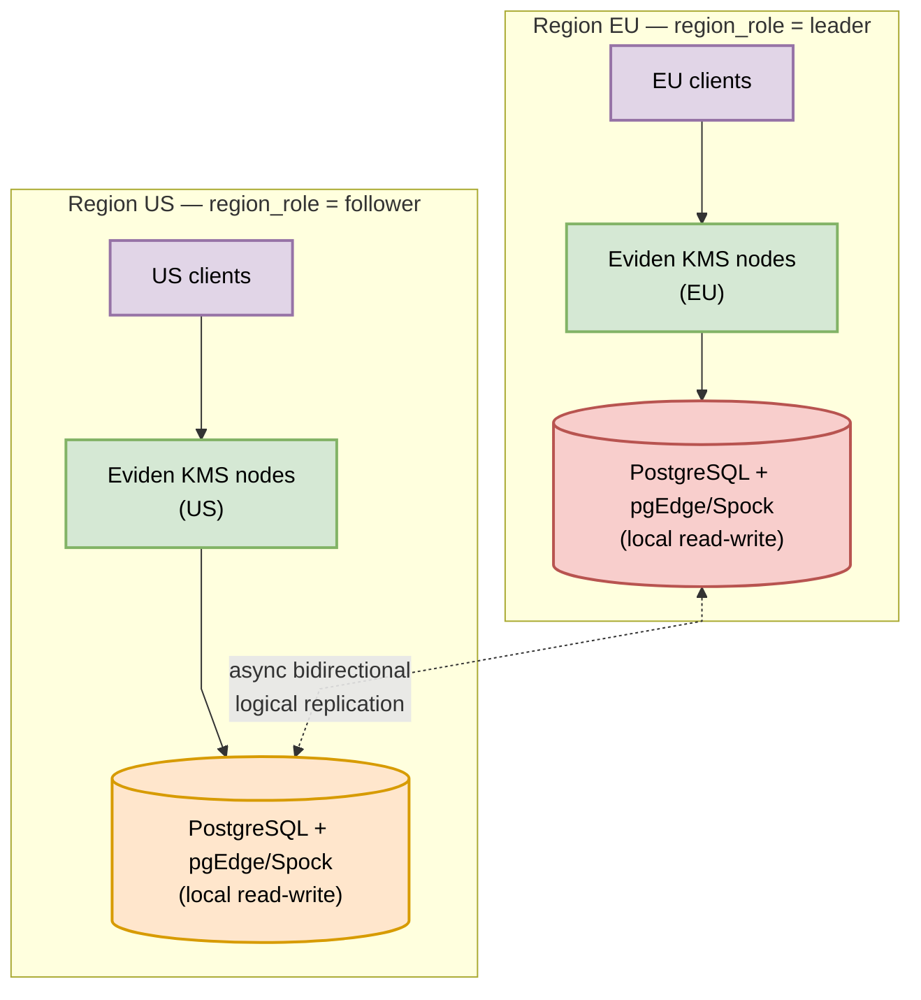
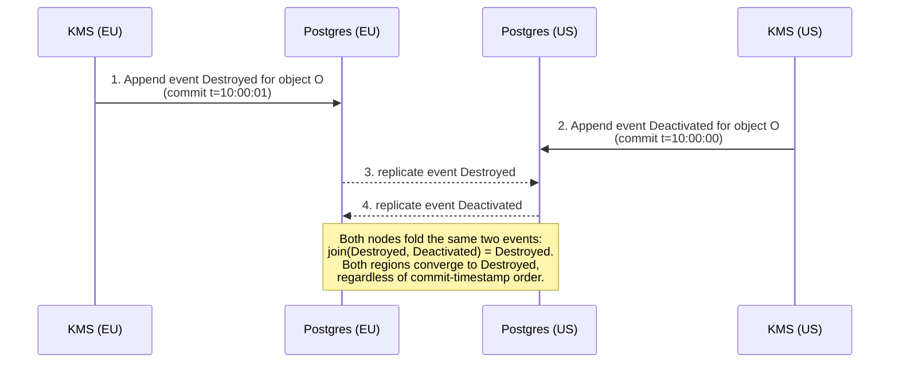
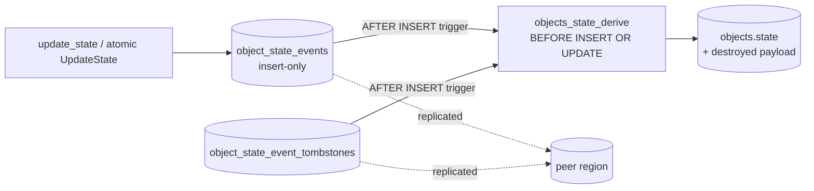

# Multi-region active-active deployment

This page explains how Eviden KMS runs **active-active** across regions on PostgreSQL logical
multi-master replication: what the topology looks like, what is replicated, how conflicting
writes converge, and what the limits are. Operator settings are summarized here;
the full reference stays in
[Multi-region active-active PostgreSQL](./configuration.md#multi-region-active-active-postgresql-spock-pgedge-bdr).

## Why active-active

A single-writer PostgreSQL (primary plus hot standbys) forces every region to write to one
place. In an active-active deployment each region runs its own KMS instance group and its own
local PostgreSQL node: reads and writes are served locally for low latency, and the nodes converge
asynchronously. The implementation is generic and is validated against pgEdge Community (Spock)
as the reference; other logical multi-master extensions (EDB Postgres Distributed, Postgres-BDR)
are expected to behave the same way but are not part of the CI validation.

## Global architecture

Three rules shape everything else:

- **Every region writes locally.** There is no proxying between regions.
- **One global leader.** `region_role = "leader"` (the default) or `"follower"`; exactly one region is
  the leader. There is no election: the role changes only when an operator changes the topology.
- **Only data that cannot be merged is leader-gated.** CRL generation and Crypto Officer ceremony
  activation/revocation are accepted on the leader only; a follower rejects them with an HTTP 422 telling the
  client to retry against the leader region. Everything else is written in any region.

## What converges, and how

| Data | Written by | Convergence |
| ---- | ---------- | ----------- |
| Object payload, attributes, tags | any region | Whole-row last-update-wins (Spock `last_update_wins`) |
| Object lifecycle `State` | any region | Deterministic join over an insert-only event log (see below) |
| Grants (`read_access`) | any region | Whole-row last-update-wins; a concurrent grant and revoke on the same object and user can drop one side |
| CRLs (`crls`) | leader only | Replicated to followers, which serve it from the public CDP endpoint |
| Ceremony activations | leader only | Replicated; a mismatched `ceremony_secret` fails secure |

The replicated tables carry real primary keys, created automatically and idempotently at startup
(see [Internals: Database Tables](./tables.md)).

## Object-state conflict merge

Two regions can change the state of the same object at nearly the same time, for example
one region destroys a key while another deactivates it. Whatever the commit order,
a `Destroyed` or `Compromised` object must never be silently moved back to a less restrictive state.

### Why not a column on `objects`

Spock's `last_update_wins` compares commit timestamps and discards an incoming row older than
the local row *before* any trigger runs. A state column guarded by a trigger therefore cannot
converge: the older `Destroyed` row is simply dropped on the node that wrote `Deactivated` later.

### The event log

On PostgreSQL every state change is **appended** to `object_state_events` and never updated, so two
regions never write the same row and nothing can conflict. Triggers marked `ENABLE ALWAYS`
(so they also fire in replication apply sessions) derive `objects.state` from the events:

The derived state is the join of all live events:

$$\text{PreActive} < \text{Active} < \text{Deactivated} \;/\; \text{Compromised} < \text{Destroyed}$$

with a sticky *compromised* flag, so `Compromised` joined with `Destroyed` yields
`Destroyed_Compromised`.

The `Destroyed` event also carries the zeroized object written by the Destroy operation, in the same
transaction. A concurrent payload write from another region therefore cannot bring key material back
on a destroyed object.

### Backward transitions

A few operations legitimately move the state backwards (KMIP batch Undo, import with replace). They
tombstone only the events **their region has observed** and append a new one. A higher transition
made concurrently in another region and not yet received still wins when it arrives.

## Operating notes

- Set `region_role` once per region (`--region-role` or `KMS_REGION_ROLE`); never configure two leaders.
- Do not enable `clear_database` on a multi-region node: the deletes replicate to every region.
- Use identical `ceremony_secret` values in every region.
- The validated topology is **two nodes**. In a three-node or larger full mesh, an `objects` update
  that reaches a node before its insert is discarded together with its whole transaction
  (Spock `transdiscard`), which can drop that transaction's lifecycle events on that node.
- Lifecycle events are never compacted; compaction would need cross-region coordination.
- SQLite, MySQL and Redis keep plain state writes: they are single-writer backends and are not
  multi-region targets.
- To check a deployment, run `mise run test:db:multi-region-guards`: it verifies the primary keys,
  the `ENABLE ALWAYS` triggers, the Spock wiring and the operator configuration
  (exactly one leader, PostgreSQL backend, identical ceremony secret).

!!! warning
    Grants use whole-row last-write-wins. Re-check the effective permissions of an object after a
    concurrent grant and revoke in two regions.
