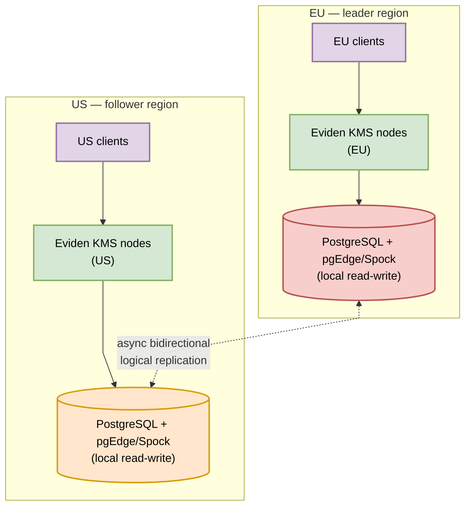
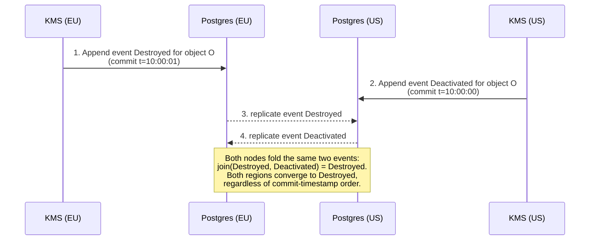
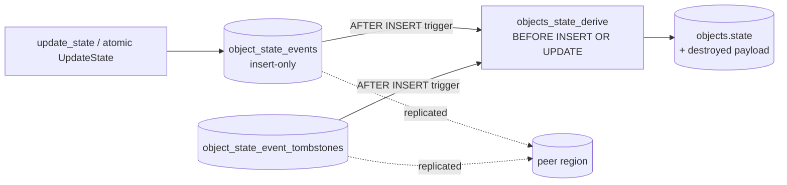
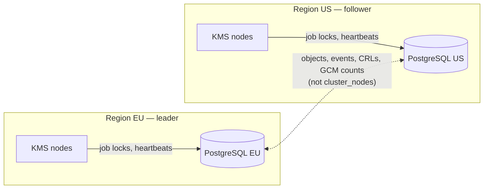

# Multi-region active-active deployment

This page explains how Eviden KMS runs **active-active** across regions on PostgreSQL logical
multi-master replication: what the topology looks like, what is replicated, how conflicting
writes converge, and what the limits are. Operator settings are summarized here;
the full reference stays in
[Multi-region active-active PostgreSQL](./configuration.md#multi-region-active-active-postgresql-spock--pgedge--bdr);
the MySQL variant is [below](#mysql-with-galera).

## Why active-active

A single-writer PostgreSQL (primary plus hot standbys) forces every region to write to one
place. In an active-active deployment each region runs its own KMS instance group and its own
local PostgreSQL node: reads and writes are served locally for low latency, and the nodes converge
asynchronously. The implementation is generic and is validated against pgEdge Community (Spock)
as the reference; other logical multi-master extensions (EDB Postgres Distributed, Postgres-BDR)
are expected to behave the same way but are not part of the CI validation.

## What is Spock

Spock is a PostgreSQL extension, developed by pgEdge, for multi-master replication: every node accepts writes and
replicates them to the others. Native PostgreSQL logical replication can already run in both directions, but it has
no conflict resolution: two regions changing the same row make replication fail or the nodes diverge. Spock adds
conflict resolution and conflict-free counters (delta-apply). Eviden KMS does not embed or call Spock: it relies on
the guarantees below, and the operator installs and wires the extension. Spock needs `wal_level = logical`,
`track_commit_timestamp = on` (conflict resolution compares commit timestamps) and
`shared_preload_libraries = 'spock'`; the validated image is `pgedge/pgedge-postgres` with Spock 5 on PostgreSQL 16.
See the [Spock documentation](https://docs.pgedge.com/spock-v5/v5-0-12/conflicts) and its
[configuration guide](https://github.com/pgEdge/spock/blob/main/docs/configuring.md).

| Spock concept | Meaning | Where it matters for the KMS |
| ------------- | ------- | ---------------------------- |
| Node | One PostgreSQL database taking part in the group | One per region |
| Subscription | A one-way logical replication link from a provider node to a subscriber node | One in each direction makes a two-region group (a full mesh with more regions) |
| Replication set | The list of tables a node publishes | Every `public` table except `cluster_nodes` (see [Scheduled jobs and cluster coordination](#scheduled-jobs-and-cluster-coordination)) |
| Conflict resolution (`last_update_wins`) | When two regions change the same row, the version with the latest commit timestamp is kept | Object payload, attributes and tags; lifecycle states need another mechanism (see [Object-state conflict merge](#object-state-conflict-merge)) |
| Delta-apply | A numeric column is replicated as an increment instead of a new value | `gcm_invocations.count`, so the AES-GCM counts of the regions add up |

Replication is **asynchronous**: a commit succeeds locally and reaches the other regions after the replication lag.
The KMS creates its lifecycle triggers as `ENABLE ALWAYS` so that they also fire on rows applied by replication.
`mise run test:db:multi-region-guards` checks the extension, the node, the subscriptions and these settings on every
node.

MySQL has no Spock: the Galera alternative is described [below](#mysql-with-galera).

## Global architecture



Three rules shape everything else:

- **Every region writes locally.** There is no proxying between regions.
- **One global leader.** `region_role = "leader"` (the default) or `"follower"`; exactly one region is
  the leader. There is no election: the role changes only when an operator changes the topology.
- **Only data that cannot be merged is leader-gated.** CRL generation and Crypto Officer ceremony
  activation/revocation are accepted on the leader only; a follower rejects them with an HTTP 422 telling the
  client to retry against the leader region. Background key auto-rotation runs on the leader only, a follower
  skips it. Everything else is written in any region.

## What converges, and how

| Data | Written by | Convergence |
| ---- | ---------- | ----------- |
| Object payload, attributes, tags | any region | Whole-row last-update-wins (Spock `last_update_wins`) |
| Object lifecycle `State` | any region | Deterministic join over an insert-only event log (see below) |
| Grants (`read_access`) | any region | Whole-row last-update-wins; a concurrent grant and revoke on the same object and user can drop one side |
| CRLs (`crls`) | leader only | Replicated to followers, which serve it from the public CDP endpoint |
| Ceremony activations | leader only | Replicated; a mismatched `ceremony_secret` fails secure |
| AES-GCM invocation counts (`gcm_invocations`) | any region | Replicated and merged by delta-apply, so the counts of the regions add up |
| Node heartbeats (`cluster_nodes`) | every region, for its own nodes | **Not replicated**: each region lists its own nodes only |

The replicated tables carry real primary keys, created automatically and idempotently at startup
(see [Internals: Database Tables](./tables.md)).

## Object-state conflict merge

Two regions can change the state of the same object at nearly the same time, for example
one region destroys a key while another deactivates it. Whatever the commit order,
a `Destroyed` or `Compromised` object must never be silently moved back to a less restrictive state.



### Why not a column on `objects`

Spock's `last_update_wins` compares commit timestamps and discards an incoming row older than
the local row *before* any trigger runs. A state column guarded by a trigger therefore cannot
converge: the older `Destroyed` row is simply dropped on the node that wrote `Deactivated` later.

### The event log

On PostgreSQL every state change is **appended** to `object_state_events` and never updated, so two
regions never write the same row and nothing can conflict. Triggers marked `ENABLE ALWAYS`
(so they also fire in replication apply sessions) derive `objects.state` from the events:



The derived state is the join of all live events:

$$\text{PreActive} < \text{Active} < \text{Deactivated} \;/\; \text{Compromised} < \text{Destroyed}$$

with a sticky *compromised* flag, so `Compromised` joined with `Destroyed` yields
`Destroyed_Compromised`.

The `Destroyed` event also carries the zeroized object written by the Destroy operation, in the same
transaction. A concurrent payload write from another region therefore cannot bring key material back
on a destroyed object.

### Backward transitions

A few operations legitimately move the state backwards (KMIP batch Undo, import with replace). They
tombstone only the events **their region has observed** and append a new one. A higher transition
made concurrently in another region and not yet received still wins when it arrives.

## Scheduled jobs and cluster coordination

The nodes of a region coordinate through their local database (see [Cluster coordination](../../installation/cluster_coordination.md)):
job locks and heartbeats never cross a region. This has three consequences.



Which region runs each job, and which features the leader region keeps to itself:

| Job or feature | Lock name | Runs on, in a multi-region deployment |
| -------------- | --------- | ------------------------------------- |
| Key auto-rotation and renewal warnings | `auto-rotation` | one node at a time, **leader region only** |
| CRL refresh | `crl-refresh` | one node at a time, **leader region only** |
| CRL generation (`generate-crl`) | none | **leader region only**; a follower answers HTTP 422 |
| Crypto Officer ceremony activation and revocation | none | **leader region only**; a follower answers HTTP 422 |
| Object counter reconciliation | `metrics-reconcile` | one node at a time, in every region |
| Metrics gauges refresh (`kms.keys.active.count`, `kms.objects.total`) | none | every node of every region (each node exports its own gauges) |
| KV secret TTL expiry | `kv-ttl` | one node at a time, in every region (repeating it converges) |
| Every other KMIP operation and REST route | none | every region, locally; except that a follower's KV v2 and SSH CA/role requests return a retry error until the leader's `kv_metadata_uid_key` has replicated (see [Operating notes](#operating-notes)) |

- **A job lock excludes a job in its own region only.** Two regions would run the same job at the same time, so a
  job that must run once runs on the leader region only: key auto-rotation and its renewal warnings (a follower
  skips them, like the CRL refresh). Enable `auto_rotation_check_interval_secs` on the leader region; it has no effect
  on a follower. A job that is safe to repeat runs in every region: KV secret TTL expiry (destroying a version twice
  converges through the lifecycle event log) and the metrics refresh.
- **`GET /cluster/status` and `kms.cluster.nodes` show the local region.** The `cluster_nodes` table is excluded from
  replication and each region elects its own display leader. Replicated, the heartbeat rows of the regions would
  overwrite each other every time a leader is elected (the election rewrites every row).
- **AES-GCM invocation counts add up across regions.** The count kept per key against the cap of NIST SP 800-38D §8.3
  is a counter updated in every region. With whole-row last-update-wins the regions would overwrite each other's
  increments, and the counts would be too low. Spock delta-apply on `gcm_invocations.count` applies each region's
  *increment* instead. The cap is still checked against the local value: with replication lag, a key can exceed the
  cap by what the other regions reserved during the lag.
  Each node leases invocations from the store in blocks of 4,096 and records the whole block when it leases it, so
  the overshoot during the lag is counted in whole blocks, and the unused part of a block counts as used.
- **Read-modify-write on an object is regional.** KMIP Usage Limits counters and Vault KV v2 check-and-set versions
  are updated with a version check on the object row. Two regions both pass their local check and last-update-wins
  keeps one row: a key with Usage Limits can be used up to its limit in each region, and a check-and-set write can
  succeed in two regions.

Configure these two tables on every node, after adding the `public` tables to the replication set:

```sql
SELECT spock.repset_add_all_tables('default', ARRAY['public']);
SELECT spock.repset_remove_table('default', 'cluster_nodes');
ALTER TABLE gcm_invocations ALTER COLUMN count
  SET (log_old_value = true, delta_apply_function = spock.delta_apply);
```

`mise run test:db:multi-region-guards` checks both settings.

## Operating notes

- Set `region_role` once per region (`--region-role` or `KMS_REGION_ROLE`); never configure two leaders.
- Do not enable `clear_database` on a multi-region node: the deletes replicate to every region.
- Use identical `ceremony_secret` values in every region.
- The leader initializes the shared KV/SSH identifier key (`kv_metadata_uid_key` in `parameters`) at startup.
  Followers only read the replicated value; until it arrives, KV and SSH CA/role requests return a retry error
  instead of creating a competing key. No leader-side API request is needed to bootstrap it. Existing deployments
  that already generated different keys in separate regions require operator reconciliation before enabling traffic;
  startup does not rewrite existing records.
- Check `GET /health?strict=true` of each region separately: a region's health is its own database, HSMs and KMIP
  socket server.
- The validated topology is **two nodes**. In a three-node or larger full mesh, an `objects` update
  that reaches a node before its insert is discarded together with its whole transaction
  (Spock `transdiscard`), which can drop that transaction's lifecycle events on that node.
- Lifecycle events are never compacted; compaction would need cross-region coordination.
- SQLite and Redis-with-Findex are not multi-region targets: a `region_role = "follower"` on them is rejected
  at startup.
- Objects stored in an HSM do not replicate, including HSM-backed sub-CA keys: a region that signs CRLs or OCSP
  responses with such a key needs the same HSM keys.
- Auto-rotation of HSM-resident keys runs on the leader region only, like every auto-rotation: the new key is created
  in the leader region's HSM, which does not replicate. The other regions' HSMs are not rotated by the job, and a
  rotated `hsm::` identifier replicated with the object metadata must be provisioned in each region's HSM before that
  region uses it.
- A certificate revoked on a follower does not regenerate the CRL (the follower's automatic regeneration is refused).
  The leader republishes it at the next run of its CRL refresh scheduler (every `crl_refresh_check_hours`, default
  1 h, when `kms_public_url` is set), which regenerates a stored CRL near its `nextUpdate`
  (`crl_refresh_overlap_hours`, default 24 h) or whose revoked certificates changed. To publish a revocation at once,
  revoke on the leader region, or run `ckms certificates generate-crl` on the leader after revoking on a follower.
- The OCSP response cache is per KMS process: a revocation evicts the cached response of the node that served it
  only, and the other nodes of every region answer nonce-less requests from their cache until `ocsp_cache_ttl_secs`
  (default 86400 s) elapses. Keep `ocsp_cache_ttl_secs` low in a multi-region deployment.
- Upgrade one region first, then the others in the same window: the recorded database version replicates with
  `parameters`, so once one region runs the new release, a node of the previous release in any region refuses to
  restart. On Galera, start the first node alone before the others.
- To check a deployment, run `mise run test:db:multi-region-guards`: it verifies the primary keys,
  the `ENABLE ALWAYS` triggers, the Spock wiring (PostgreSQL), the Galera wiring (MySQL) and the operator
  configuration (exactly one leader, PostgreSQL or MySQL backend identical across regions, identical ceremony secret).

## MySQL with Galera

A region can instead run on a **MySQL Galera cluster** spanning the regions (Percona XtraDB Cluster is the validated
flavor, tested with two nodes; MariaDB Galera and MySQL Group Replication in multi-primary mode are expected to work
but are not validated). Galera certifies each transaction on every node and aborts a conflicting commit (error 1213),
which the KMS already retries, so there is no last-update-wins merge to guard against:

| Data | Convergence on Galera |
| ---- | --------------------- |
| Object payload, attributes, tags | Certification: a conflicting commit is retried |
| Object lifecycle `State` | The KMS joins the stored state with the new one in the writing transaction (`Destroyed` and `Compromised` never regress); a batch Undo writes the state explicitly |
| Key material of a `Destroyed` object | An update of the payload leaves the zeroized payload in place |
| AES-GCM invocation counts | Exact: the counter row is locked, no delta-apply is needed |
| Grants | Read-modify-write: a concurrent grant and revoke can drop one side, as on PostgreSQL |
| Usage Limits counters, KV v2 check-and-set | Exact: certification aborts the concurrent commit, which retries on the fresh row |
| Node heartbeats (`cluster_nodes`) | **Replicated**: Galera cannot exclude a table, so `GET /cluster/status` lists the nodes of every region |

Operating notes:

- Point all the KMS nodes of a region at the **same** database node, and run an arbitrator (`garbd`) in a third site.
- Scheduled jobs: Percona XtraDB Cluster in strict mode (and MariaDB Galera) refuses `GET_LOCK`. The KMS then locks a
  row of `kms_cron_locks`, which excludes only the KMS nodes connected to the same database node. Key auto-rotation
  is leader-region only anyway.
- `region_role = "follower"` is accepted on PostgreSQL and MySQL only.
- A node still running the previous release keeps plain state writes until every region is upgraded.

!!! warning
    Grants use whole-row last-write-wins. Re-check the effective permissions of an object after a
    concurrent grant and revoke in two regions.
