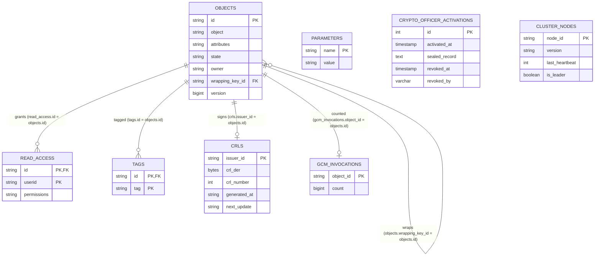

# Database tables

This page describes the tables used by the KMS server to persist its data, and the links between them.
It applies to the SQL backends: **SQLite**, **PostgreSQL**, **MySQL**, **MariaDB**, and **Percona XtraDB Cluster**.

The Redis-with-Findex backend does not use relational tables; see [Redis with Findex](./redis.md).

## Overview

The KMS object-store schema has eight tables shared by all SQL backends, plus `kms_migration_lock` on MySQL, MariaDB, and Percona XtraDB Cluster. The optional [PostgreSQL audit backend](#postgresql-audit-database) adds `kms_audit_events` and `kms_audit_control` in its own separate database.

| Table | Purpose |
| ----- | ------- |
| `parameters` | Internal key/value store (migration state, database version, one-time markers) |
| `objects` | KMIP objects (keys, certificates, secrets, and so on) |
| `read_access` | Per-user read permissions granted on objects |
| `tags` | Tags attached to objects, used by `Locate` |
| `crypto_officer_activations` | Records of the Crypto Officer activation ceremony |
| `crls` | Most recently signed CRL per issuer CA (RFC 5280 §5), for CDP serving after restart |
| `gcm_invocations` | Number of AES-GCM invocations with a random IV made with each key (NIST SP 800-38D §8.3) |
| `cluster_nodes` | Recent node heartbeats, KMS version, and elected leader |
| `kms_migration_lock` | Startup migration coordination row (MySQL, MariaDB, and Percona XtraDB Cluster only) |

PostgreSQL deployments used in multi-region active-active topologies additionally keep the lifecycle state of objects in two insert-only tables, `object_state_events` and `object_state_event_tombstones`, from which `ENABLE ALWAYS` triggers derive `objects.state` (see [Multi-region active-active PostgreSQL](./configuration.md#multi-region-active-active-postgresql-spock--pgedge--bdr)).
The links between tables are **logical** relationships (enforced by the application, not by SQL foreign-key constraints).

## objects

The central table. One row per KMIP object.

| Column | Type | Description |
| ------ | ---- | ----------- |
| `id` | `VARCHAR(128)` | Primary key. The object's unique identifier (UID). |
| `object` | `VARCHAR` (PG/SQLite) / `LONGTEXT` (MySQL) | The serialized KMIP object (JSON). |
| `attributes` | `jsonb` (PG) / `json` (MySQL) | The KMIP attributes attached to the object. |
| `state` | `VARCHAR(32)` | The KMIP lifecycle state of the object (for example `Active`, `Destroyed`). |
| `owner` | `VARCHAR(255)` | The user identifier of the object's owner. |
| `wrapping_key_id` | `VARCHAR(128)` | The UID of the key that wraps this object. Self-reference to `objects.id`. |
| `version` | `BIGINT NOT NULL DEFAULT 0` (PG/MySQL) / `INTEGER NOT NULL DEFAULT 0` (SQLite) | Optimistic-lock counter, incremented on every write; key rotation commits only if the version it read is still current. |

The following secondary indexes are created on `objects`:

| Index | Columns | Backends |
| ----- | ------- | -------- |
| `idx_objects_owner` | `owner` | all |
| `idx_objects_state` | `state` | all |
| `idx_objects_wrapping_key_id` | `wrapping_key_id` | all |
| `idx_objects_rotate_name` | `RotateName` attribute, `owner` (partial: `RotateName` present) | PostgreSQL, SQLite |
| `idx_objects_rotate_auto` | `state` (partial: `RotateAutomatic` = true) | PostgreSQL, SQLite |
| `idx_objects_type_state` | `ObjectType` attribute, `state` | PostgreSQL, SQLite |

Indexes are created at server startup. On an existing large database, the first start after an upgrade takes proportionally longer, and PostgreSQL blocks writes to `objects` while each new index builds.

**Downgrade (Usage Limits).** The current release consumes the KMIP `Usage Limits` budget of an object by decrementing `UsageLimitsCount` and never changes `UsageLimitsTotal`, the configured budget; both are stored in the `attributes` column and in the key block attributes. The remaining budget is the smaller of the Count and the Total, or the Total when the Count is absent. Releases before it ignore the Count and decrement and enforce the Total only. After an upgrade, objects written by such a release therefore keep their remaining budget, including those carrying a stale Count above their decremented Total. The downgrade verdict is DEGRADED:

- An earlier release grants every usage-limited object its full Total again, including objects the current release has exhausted, unless the procedure below runs first.
- Mixed-version operation (an earlier release and the current release serving the same database, for example during a rolling restart) is not supported for usage-limited objects: the two releases cannot share one representation of the budget, and the earlier release ignores the consumption recorded by the current release.

To downgrade without restoring spent budgets:

1. Quiesce all writers: stop client traffic and every server instance except one current-release instance, reachable only by the administrator.
2. For each object that carries a `UsageLimits` attribute, read it with `ckms attributes get --id <UID> --attribute UsageLimits` and compute the remaining budget: the smaller of `UsageLimitsCount` and `UsageLimitsTotal`, or `UsageLimitsTotal` when the Count is absent.
3. As the object owner, or a user granted `ModifyAttribute` on the object, send a KMIP `ModifyAttribute` request whose `NewAttribute` is `UsageLimits` with the same `UsageLimitsUnit` and `UsageLimitsTotal` set to the remaining budget, as JSON TTLV to the `/kmip/2_1` endpoint (see [The JSON TTLV KMIP API](../../kmip_support/json_ttlv_api.md)). The server sets the Count to the new Total. `ckms attributes set` and `ckms attributes modify` cannot set `Usage Limits`.
4. Verify with `ckms attributes get --id <UID> --attribute UsageLimits` that `UsageLimitsTotal` and `UsageLimitsCount` both equal the remaining budget, back up the database, stop the last current-release instance, then start the earlier release.

After upgrading again, the Total the earlier release decremented caps the remaining budget, so its consumption is kept.

## read_access

Stores the operations that a given user is allowed to perform on a given object.

| Column | Type | Description |
| ------ | ---- | ----------- |
| `id` | `VARCHAR(128)` | The object UID. References `objects.id`. |
| `userid` | `VARCHAR(255)` | The user identifier granted access. |
| `permissions` | `json` | The operations granted to the user, serialized as JSON. |

The pair (`id`, `userid`) is unique.
In PostgreSQL (converted at startup) and MySQL (since 5.14.0), it is the composite `PRIMARY KEY (id, userid)` (providing valid `REPLICA IDENTITY` for logical replication); in SQLite it is declared `UNIQUE (id, userid)`.

A secondary index `idx_read_access_userid` is created on `userid`.

## tags

Stores the tags attached to objects. Tags are used to locate objects by tag.

| Column | Type | Description |
| ------ | ---- | ----------- |
| `id` | `VARCHAR(128)` | The object UID. References `objects.id`. |
| `tag` | `VARCHAR(255)` | A single tag. |

The pair (`id`, `tag`) is unique.
In PostgreSQL (converted at startup) and MySQL (since 5.14.0), it is the composite `PRIMARY KEY (id, tag)` (providing valid `REPLICA IDENTITY` for logical replication); in SQLite it is declared `UNIQUE (id, tag)`.

A secondary index `idx_tags_tag_id` on (`tag`, `id`) supports Locate-by-tags lookups.

## parameters

A generic key/value store used internally by the KMS for database metadata.

| Column | Type | Description |
| ------ | ---- | ----------- |
| `name` | `VARCHAR(128)` | Primary key. The parameter name. |
| `value` | `VARCHAR(256)` | The parameter value. |

Known parameters:

| `name` | Meaning |
| ------ | ------- |
| `db_state` | Database migration state (`"ready"` or `"upgrading"`). |
| `db_version` | KMS version the database was last migrated to. |
| `attributes_jsonb_converted` | PostgreSQL-only marker recording that `objects.attributes` was converted to `jsonb`. |
| `wrapping_key_id_backfilled` | One-time marker recording that the `objects.wrapping_key_id` backfill completed. |
| `certificate_serial_tag_backfilled` | One-time marker recording that the `_serial=<HEX>` tag backfill for existing certificates completed. |
| `kv_metadata_uid_key` | Hex-encoded 32-byte key initialized by the leader region at startup; followers only read it after replication. It derives internal identifiers for the [KV secret store](../secret_backends.md#internal-record-identifiers) and SSH CA/role records. On Redis-Findex it is stored AES-256-GCM encrypted under `kms::parameter::kv_metadata_uid_key`. |
| `object_state_events_backfilled` | (PostgreSQL) A one-time marker recording that one lifecycle event was created for each pre-existing object. |

## `kms_migration_lock`

Used on MySQL, MariaDB, and Percona XtraDB Cluster to serialize startup migrations across concurrently starting KMS instances.

| Column | Type | Description |
| ------ | ---- | ----------- |
| `id` | `TINYINT` | Primary key (contains a single coordination row `id = 1`). |

## crypto_officer_activations

Records the Crypto Officer activation ceremony.
One row is added each time the Crypto Officer role is activated via a split-key ceremony.

| Column | Type | Description |
| ------ | ---- | ----------- |
| `activated_at` | `TIMESTAMP` | When the activation was created (defaults to `CURRENT_TIMESTAMP`). |
| `sealed_record` | `TEXT` | The sealed record produced by the activation ceremony (AES-256-GCM encrypted). |
| `revoked_at` | `TIMESTAMP` | When the activation was revoked, or `NULL` while still active. |
| `revoked_by` | `VARCHAR(255)` | The user who revoked the activation. |

In MySQL, an additional `id INTEGER PRIMARY KEY AUTO_INCREMENT` column is added.
In PostgreSQL, an `id BIGINT GENERATED BY DEFAULT AS IDENTITY PRIMARY KEY` column is added to provide valid `REPLICA IDENTITY` for logical replication.
In SQLite there is no explicit `id` column; the active activation is the latest row where `revoked_at IS NULL`.

## `object_state_events` and `object_state_event_tombstones`

PostgreSQL only. Insert-only lifecycle log from which `objects.state` is derived by `ENABLE ALWAYS` triggers (see [State conflict resolution](./configuration.md#multi-region-active-active-postgresql-spock--pgedge--bdr)). Both tables have a UUID primary key and are never updated.

| Column | Type | Description |
| ------ | ---- | ----------- |
| `event_id` | `UUID` | Primary key of the event. |
| `object_id` | `VARCHAR(128)` | The `objects.id` the event applies to. |
| `state` | `VARCHAR(32)` | The lifecycle state recorded. |
| `object` | `VARCHAR` | For `Destroyed` events, the zeroized object JSON snapshot; otherwise `NULL`. |
| `wrapping_key_id` | `VARCHAR(128)` | For `Destroyed` events, the wrapping key id snapshot; otherwise `NULL`. |
| `recorded_at` | `TIMESTAMPTZ` | When the event was recorded. |

`object_state_event_tombstones` holds only `event_id UUID PRIMARY KEY`: an event listed there no longer counts (used by backward transitions such as batch UNDO).

Applying a lifecycle event or a tombstone also advances `objects.version`. Conditional writes using a snapshot from before that transition fail with a conflict, including when the event arrived through replication.

## `crls`

Stores the most recently generated CRL for each issuer CA, persisted so that the
public CDP endpoint (`GET /public/certificates/{issuer_id}/crl`) can serve the
last signed CRL immediately after a server restart without requiring a manual
`generate-crl` call.

One row per CA certificate. The row is replaced atomically on every CRL regeneration
(upsert on `issuer_id`).

| Column | Type | Description |
| ------ | ---- | ----------- |
| `issuer_id` | `VARCHAR(128)` | Primary key. The UID of the issuer CA certificate in the `objects` table. |
| `crl_der` | `BYTEA` (PG) / `BLOB` (SQLite) / `LONGBLOB` (MySQL) | DER-encoded signed CRL bytes. |
| `crl_number` | `BIGINT` | Monotonically increasing CRL sequence number (RFC 5280 §5.2.3). |
| `generated_at` | `VARCHAR(32)` | ISO-8601 UTC timestamp of when this CRL was signed. |
| `next_update` | `VARCHAR(32)` | ISO-8601 UTC timestamp of CRL expiry (= `generated_at` + validity days). |

The Redis-with-Findex backend stores each CRL as a JSON value under the key
`crl:<issuer_id>`.

## `gcm_invocations`

NIST SP 800-38D §8.3 allows at most 2^32 AES-GCM invocations with a random IV under one key.
The server reserves each invocation in this table **before** encrypting, so a crash wastes an
invocation and never lets one be used twice. It counts one per single-part `Encrypt`, one per
multi-part `Encrypt` stream, one per item of a bulk `Encrypt`, one per AES-GCM `MAC` (GMAC) and
one per software AES-GCM key wrap. Decryption is not counted.

| Column | Type | Description |
| ------ | ---- | ----------- |
| `object_id` | `VARCHAR(128)` | Primary key. The UID of the AES key in the `objects` table. |
| `count` | `BIGINT` | Invocations made so far, at most 4294967296 (2^32). |

The row is independent of the object: counting does not change the object version, so it never
conflicts with a `ReKey` or any other write to the key, and it is not visible through KMIP
attributes. Once the cap is reached, `Encrypt`, `MAC` and wrapping with that key fail with
`Permission_Denied`: rekey. Destroying or deleting the key deletes the row; a new key starts at 0.

The count is per UID, not per key material: exporting a key and importing it again under another
UID restarts the count. Keeping a key fresh is the operator's responsibility (SP 800-38D §8.1).
Keys held in an HSM are not counted here: the HSM module enforces the cap under its Security
Policy. The Redis-with-Findex backend (non-FIPS builds only) keeps the count in
`gcm_invocations::<uid>` keys instead of a table.

**Multi-region.** Every region increments the count of a key, so the table is replicated with Spock delta-apply on
`count` (each region's increment is added, not overwritten): see
[Scheduled jobs and cluster coordination](./multi_region.md#scheduled-jobs-and-cluster-coordination).

**Downgrade.** An older KMS ignores this table (and the Redis keys). It does not count its own
AES-GCM invocations, so after upgrading again the count under-reports those invocations: rekey
AES-GCM keys that were used heavily while downgraded. An older KMS also deletes keys without
deleting their counters; the upgraded server removes counters whose object no longer exists at
every startup. To remove the counters manually, run `DROP TABLE gcm_invocations;` (SQL) or
`redis-cli --scan --pattern 'gcm_invocations::*' | xargs -r redis-cli DEL` (Redis).

## `cluster_nodes`

Stores one heartbeat per running KMS process. Each node refreshes its row every five seconds;
rows older than fifteen seconds are pruned. One node is marked as leader for display; no work
depends on it. Node IDs are regenerated on process restart, and stale rows are removed by the
next heartbeat.

| Column | Type | Description |
| ------ | ---- | ----------- |
| `node_id` | `VARCHAR(64)` (PG/MySQL) / `TEXT` (SQLite) | Process-specific UUID and primary key. |
| `version` | `VARCHAR(64)` (PG/MySQL) / `TEXT` (SQLite) | KMS package version reported by the process. |
| `last_heartbeat` | `BIGINT` (PG/MySQL) / `INTEGER` (SQLite) | Last heartbeat as Unix seconds. |
| `is_leader` | `BOOLEAN` (PG/MySQL) / `INTEGER` (SQLite, 0 or 1) | Whether this node is the displayed cluster leader. |

In a multi-region active-active deployment each region keeps its own rows: remove the table from the replication set
(see [Scheduled jobs and cluster coordination](./multi_region.md#scheduled-jobs-and-cluster-coordination)).

## Links between tables

- `objects.id` is referenced by `read_access.id` and `tags.id`: one object can have many access rows and many tags.
- `objects.wrapping_key_id` points to `objects.id`: a wrapping key is itself an object, and many objects can be wrapped by the same key.
- `crls.issuer_id` logically references `objects.id` (the CA certificate): one CA has at most one current CRL row.
- `gcm_invocations.object_id` logically references `objects.id` (an AES key): one key has at most one counter row.
- `objects.owner` and `read_access.userid` hold user identifiers.
  Users are authenticated identities and are **not** stored in a dedicated table.
- `parameters` and `crypto_officer_activations` are standalone and do not reference `objects`.
- `cluster_nodes` is a standalone, ephemeral registry; it does not reference `objects`.

These relationships are managed by the application layer (`crate/server_database/`) rather than database foreign-key constraints.

## PostgreSQL audit database

Used only by the [PostgreSQL audit backend](../audit-postgresql-backend.md)
(`--audit-postgres-url`), in a database distinct from the object store. Its schema is defined in
[`audit.sql`](https://github.com/Cosmian/kms/blob/develop/crate/server_database/src/stores/audit/audit.sql).

### `kms_audit_events`

Append-only, hash-chained audit events. One row per event.

| Column | Type | Description |
| ------ | ---- | ----------- |
| `instance_id` | `TEXT` | KMS instance owning the chain (1 to 255 characters). |
| `chain_generation` | `BIGINT` | Chain generation (≥ 0); a new one starts after a seal-and-roll. |
| `id` | `BIGINT` | Position of the event in its generation (≥ 0). |
| `timestamp` | `TIMESTAMPTZ` | When the event was recorded (microsecond precision). |
| `operation` | `TEXT` | KMIP operation or `audit:*` system event. |
| `username` | `TEXT` | Authenticated user. |
| `object_uid` | `TEXT` | UID of the object concerned, or `NULL`. |
| `algorithm` | `TEXT` | Algorithm used, or `NULL`. |
| `client_ip` | `TEXT` | Client IP address, or `NULL`. |
| `result` | `TEXT` | Outcome of the operation. |
| `duration_ms` | `BIGINT` | Duration of the operation in milliseconds (≥ 0). |
| `request_id` | `UUID` | Request correlation ID, or `NULL`. |
| `details` | `TEXT` | Event-specific JSON details, or `NULL`. |
| `prev_hash` | `BYTEA` | SHA-256 `row_hash` of the previous event (32 bytes; zeros for the first event). |
| `row_hash` | `BYTEA` | SHA-256 of this row's fields and `prev_hash` (32 bytes). |

The primary key is (`instance_id`, `chain_generation`, `id`). A secondary index
`idx_kms_audit_events_timestamp` on `timestamp` serves auditors' time-range queries; the KMS
does not use it.

These triggers keep the table append-only:

| Trigger | Fires | Effect |
| ------- | ----- | ------ |
| `kms_audit_no_update` | `BEFORE UPDATE`, per row | Rejects the update (`kms_audit_reject_mutation()`). |
| `kms_audit_no_delete` | `BEFORE DELETE`, per row | Rejects the delete (`kms_audit_reject_mutation()`). |
| `kms_audit_no_truncate` | `BEFORE TRUNCATE`, per statement | Rejects the truncate (`kms_audit_reject_mutation()`). |
| `kms_audit_no_insert_sealed` | `BEFORE INSERT`, per row | When the instance has a `kms_audit_control` row, rejects an insert into any generation other than its `active_generation` (`kms_audit_reject_sealed_insert()`). |

`UPDATE`, `DELETE` and `TRUNCATE` are also revoked from `PUBLIC`.

### `kms_audit_control`

The generation currently accepting writes, per instance.

| Column | Type | Description |
| ------ | ---- | ----------- |
| `instance_id` | `TEXT` | Primary key. KMS instance (1 to 255 characters). |
| `active_generation` | `BIGINT` | Generation currently accepting writes (≥ 0). |
| `updated_at` | `TIMESTAMPTZ` | When `active_generation` last changed (defaults to `now()`). |

`kms_audit_events.instance_id` logically references `kms_audit_control.instance_id`; as for the
object-store tables, there is no foreign-key constraint.
