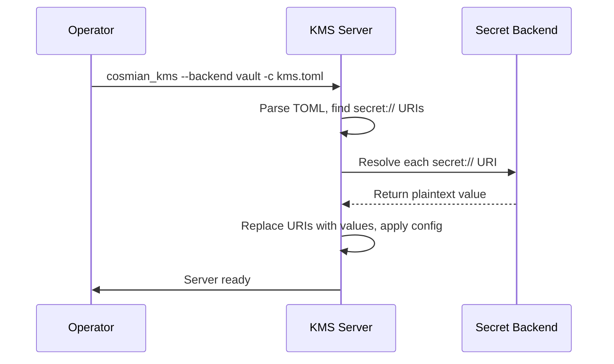

# Secret backends

Store sensitive configuration values — database passwords, API keys, tokens — in
an external secret manager instead of plain text in the KMS TOML config file.

## How it works



1. In your `kms.toml`, replace any sensitive value with a `secret://...` URI.
2. Start the KMS with `--backend <backend>` (or set `KMS_SECRET_BACKEND` env var).
3. At startup the KMS resolves every `secret://` URI **once**, then applies the config normally.

The config file never contains actual secrets — only references.

---

## Supported backends

| Backend | `--backend` | URI format | Required env vars |
|---------|-------------------|-----------|-------------------|
| HashiCorp Vault | `vault` | `secret://<mount>/<path>[#<field>]` | `VAULT_ADDR`, `VAULT_TOKEN` |
| AWS SSM Parameter Store | `aws-ssm` | `secret://<region>/<parameter-name>` | `AWS_ACCESS_KEY_ID`, `AWS_SECRET_ACCESS_KEY` |
| Azure Key Vault | `azure-kv` | `secret://<vault>/secrets/<name>[/<version>]` | `AZURE_TENANT_ID`, `AZURE_CLIENT_ID`, `AZURE_CLIENT_SECRET` |
| Eviden KMS | `cosmian-kms` | `secret://<host>[:<port>]/<object-id>` | _(optional)_ `COSMIAN_KMS_SECRET_TOKEN` |

---

## HashiCorp Vault

Uses the **KV-v2** secrets engine. The URI fragment `#field` selects a specific
key in the secret's JSON data; defaults to `value` if omitted.

### 1. Store a secret in Vault

```bash
vault kv put secret/kms/db password=my-db-password
```

### 2. Reference it in `kms.toml`

```toml
[db]
database_type = "postgresql"
postgres_url = "postgresql://kms:secret://secret/kms/db#password@db.internal:5432/kms"
```

Or for a standalone field:

```toml
[db]
database_type = "postgresql"
postgres_url = "secret://secret/kms/postgres-url#value"
```

### 3. Start the KMS

```bash
export VAULT_ADDR=http://vault.internal:8200
export VAULT_TOKEN=s.xxxxxxxx
cosmian_kms --backend vault -c /etc/cosmian/kms.toml
```

---

## AWS SSM Parameter Store

Fetches a **SecureString** parameter. The leading `/` is prepended automatically — do not include it in the URI.

### 1. Store a secret in SSM

```bash
aws ssm put-parameter \
  --name /kms/db-password \
  --value "my-db-password" \
  --type SecureString \
  --region eu-west-1
```

### 2. Reference it in `kms.toml`

```toml
[db]
postgres_url = "secret://eu-west-1/kms/db-password"
```

### 3. Start the KMS

```bash
export AWS_ACCESS_KEY_ID=AKIA...
export AWS_SECRET_ACCESS_KEY=...
# Optional: export AWS_SESSION_TOKEN=...
cosmian_kms --backend aws-ssm -c /etc/cosmian/kms.toml
```

---

## Azure Key Vault

Uses **service-principal client credentials** (OAuth2) to authenticate to
Azure AD, then fetches the secret from the Key Vault REST API (v7.4).

### 1. Store a secret

```bash
az keyvault secret set \
  --vault-name myvault \
  --name db-password \
  --value "my-db-password"
```

### 2. Reference it in `kms.toml`

```toml
[db]
postgres_url = "secret://myvault/secrets/db-password"
```

To pin a specific version:

```toml
postgres_url = "secret://myvault/secrets/db-password/abc123def456"
```

### 3. Start the KMS

```bash
export AZURE_TENANT_ID=...
export AZURE_CLIENT_ID=...
export AZURE_CLIENT_SECRET=...
cosmian_kms --backend azure-kv -c /etc/cosmian/kms.toml
```

---

## Eviden KMS (self-referencing)

Use another Eviden KMS instance as the secret store. The secret must be stored
as a **SecretData** or **OpaqueObject** whose raw bytes are the UTF-8 value.

This is useful for hierarchical deployments where a "vault KMS" holds
credentials used by downstream KMS instances.

### 1. Import a secret into the vault KMS

```bash
ckms secret-data create --value "my-db-password" --type password
# → UniqueIdentifier: 550e8400-e29b-41d4-a716-446655440000
```

### 2. Reference it in `kms.toml`

```toml
[db]
postgres_url = "secret://vault-kms.internal:9998/550e8400-e29b-41d4-a716-446655440000"
```

For localhost (uses `http` automatically):

```toml
postgres_url = "secret://localhost:9998/550e8400-e29b-41d4-a716-446655440000"
```

### 3. Start the KMS

```bash
# Optional token if the vault KMS requires authentication:
export COSMIAN_KMS_SECRET_TOKEN=eyJhbGciOi...
# Accept self-signed certs (dev only):
export COSMIAN_KMS_INSECURE_CERTS=true
cosmian_kms --backend cosmian-kms -c /etc/cosmian/kms.toml
```

---

## Vault-compatible KV Secret Store

The KMS can expose a Vault KV v2-compatible secret store backed by KMIP
`SecretData` objects. Enable it in the server configuration:

```toml
[kv]
kv_enabled = true
kv_mount = "kv"
kv_ttl_check_interval_secs = 30
```

The API is available below `/<kv_mount>/data/*` and
`/<kv_mount>/metadata/*`, and also below `/v1/<kv_mount>/...` because the `vault` and `bao` CLIs always send the `/v1` prefix. Writes are accepted with `POST` or `PUT`. The `kv_mount` name must be a single path segment that does not collide with another scope (`v1`, `sys`, `auth`, `crypto`, `kmip`, `ui`, `aws`, `ms_dke`, `google_cse`, `tokenize`, `vault_transit_mount`, `vault_pki_mount`); the server refuses to start otherwise. An empty value means `kv`. A write creates a new version, while reads return
the latest version unless `?version=<number>` is provided. All versions are
retained indefinitely. Metadata listing uses `GET /<kv_mount>/metadata/<prefix>?list=true`.
Paths and listing prefixes are limited to 219 characters so generated tags fit the SQL backends.

KV operations use the metadata object's access rights:

| KV operation | Required KMIP access right |
|--------------|----------------------------|
| Write a secret | `Import` |
| Read a secret | `Get` |
| Read metadata or list paths | `Locate` |
| Soft-delete or hard-delete | `Destroy` |

The first writer owns the path. Other identities must receive the matching
access right on the metadata object through the normal access-grant API. A
`DELETE` on `data/<path>` soft-deletes the current version; a `DELETE` on
`metadata/<path>` destroys all versions and the metadata object.
Hard-deleted paths no longer appear in metadata listings.

Concurrent writes to the same path use a metadata compare-and-swap. If another
write wins first, the request returns `409 Conflict` and can be retried. Version
object IDs are recorded in metadata so hard-delete does not depend on a current
tag-index listing; metadata created by older server versions remains supported
through the legacy tag lookup.

An optional write TTL can be supplied with the Vault KV v2 request body. The
background sweep marks expired versions as destroyed at the configured
`kv_ttl_check_interval_secs` interval. Set the interval to `0` to disable the
sweep.

When the Vault-compatible authentication API is enabled and an auth-verifier
URL is configured, requests may authenticate with the `X-Vault-Token` header.
Native KMS authentication methods remain available on the same scope.

Use the OpenBao CLI with the supported KV v2 operations by pointing it at the KMS and using the `kv` mount:

```bash
export BAO_ADDR=https://kms.example.com:9998
export BAO_TOKEN=<token issued by the auth-verifier>
bao kv put kv/myapp/config api_key=xyz
bao kv get kv/myapp/config
bao kv get -version=1 kv/myapp/config
bao kv list kv/myapp
```

The OpenBao CLI integration test runs in CI with both FIPS and non-FIPS builds. It covers the operations listed above, but does not claim full Vault KV v2 API parity. Compare-and-set (`cas`), partial updates (`kv patch`), and version-targeted delete/undelete/destroy operations are not implemented.

## Security considerations

| Concern | Mitigation |
|---------|-----------|
| Secret exposure in config files | Only `secret://` references are stored on disk — never plaintext values. |
| Secret lifetime | URIs are resolved **once at startup**. Resolved values live only in process memory. |
| Backend credentials | Always inject via environment variables, never in the TOML file. |
| Network security | Use TLS for all backend communication. For Vault and Eviden KMS, ensure `VAULT_ADDR` uses `https://` in production. |
| Rotation | Restart the KMS to pick up rotated secrets. There is no hot-reload. |

!!! warning "Do not mix backends"
    Only one `--backend` can be active at a time. All `secret://` URIs
    in the config must be resolvable by the selected backend.
