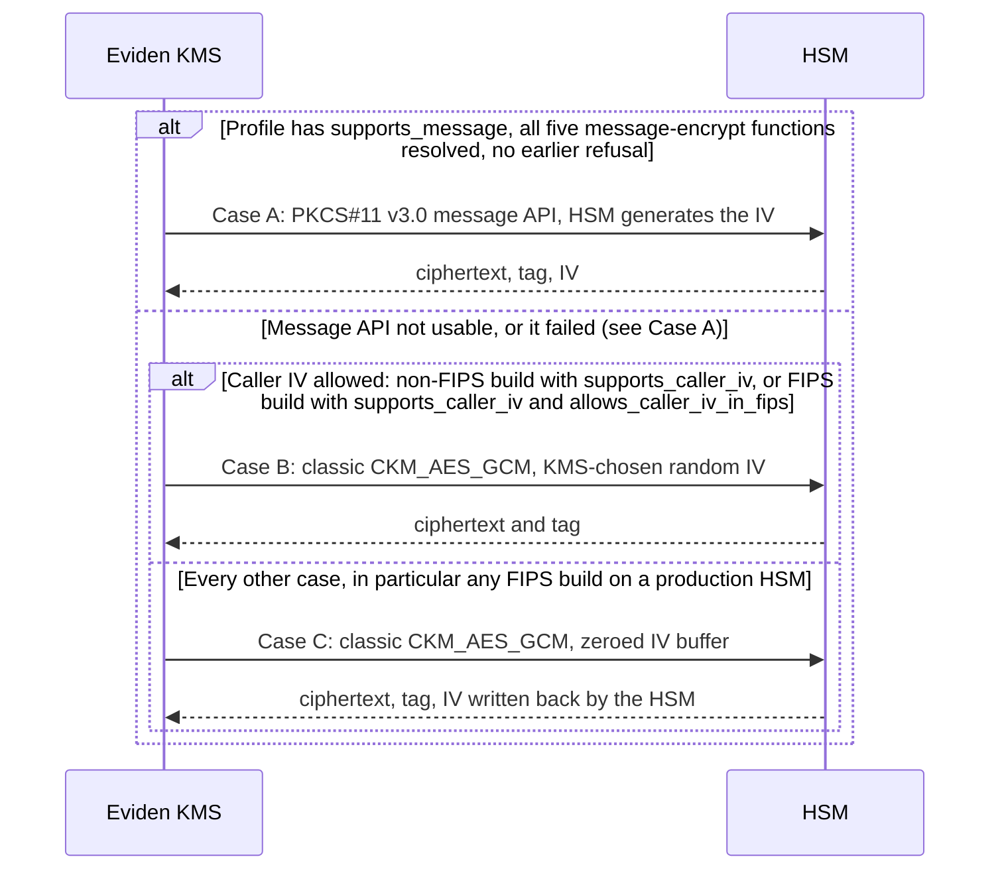
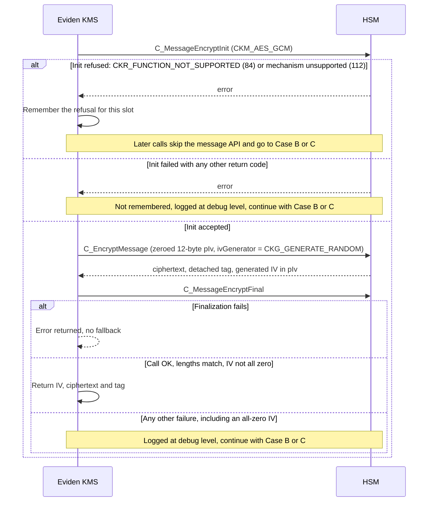
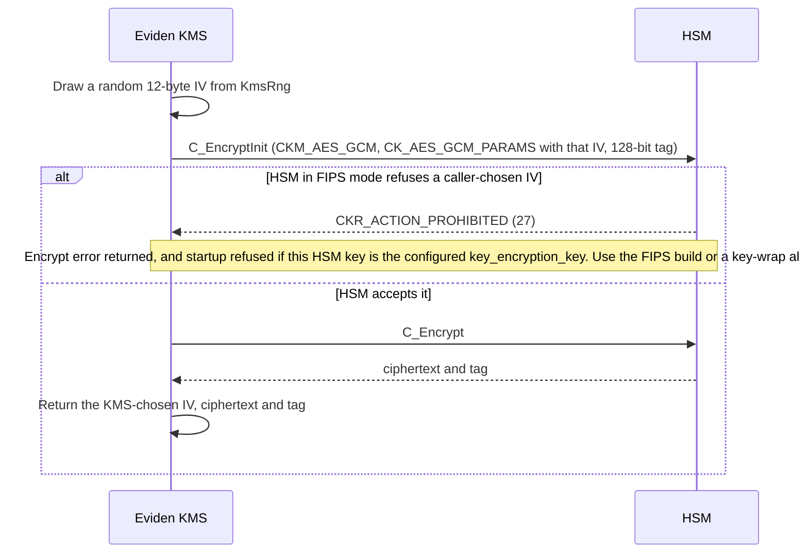
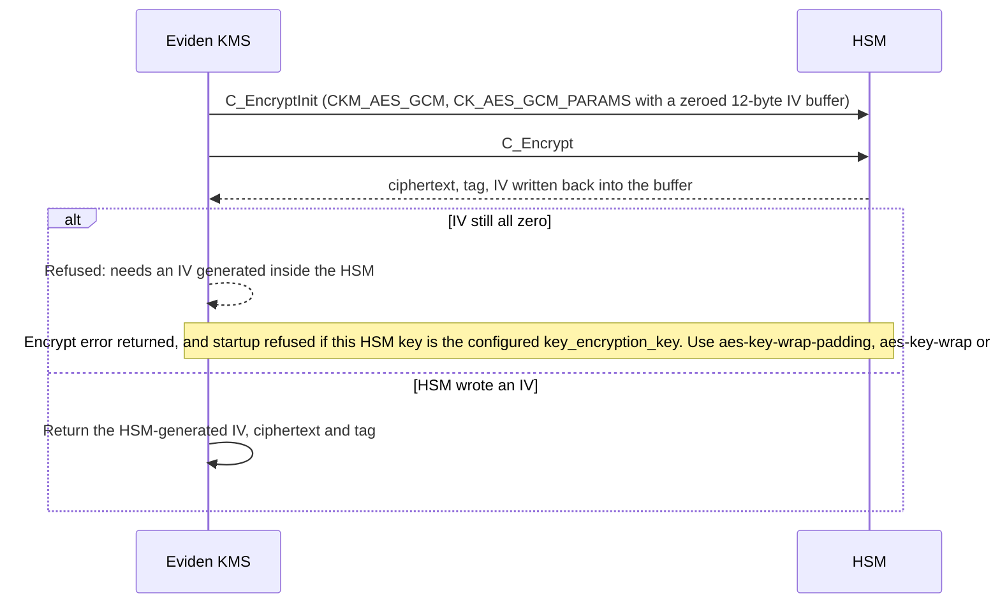
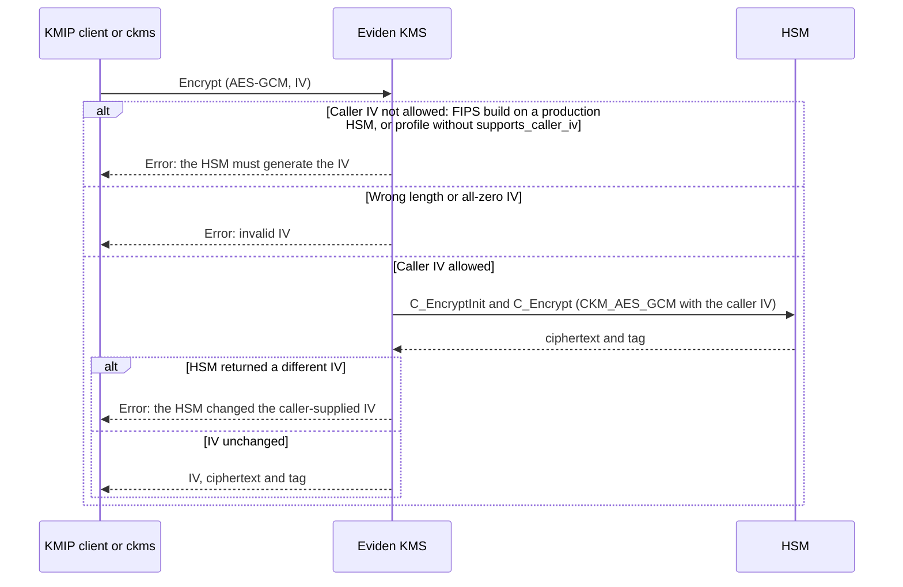
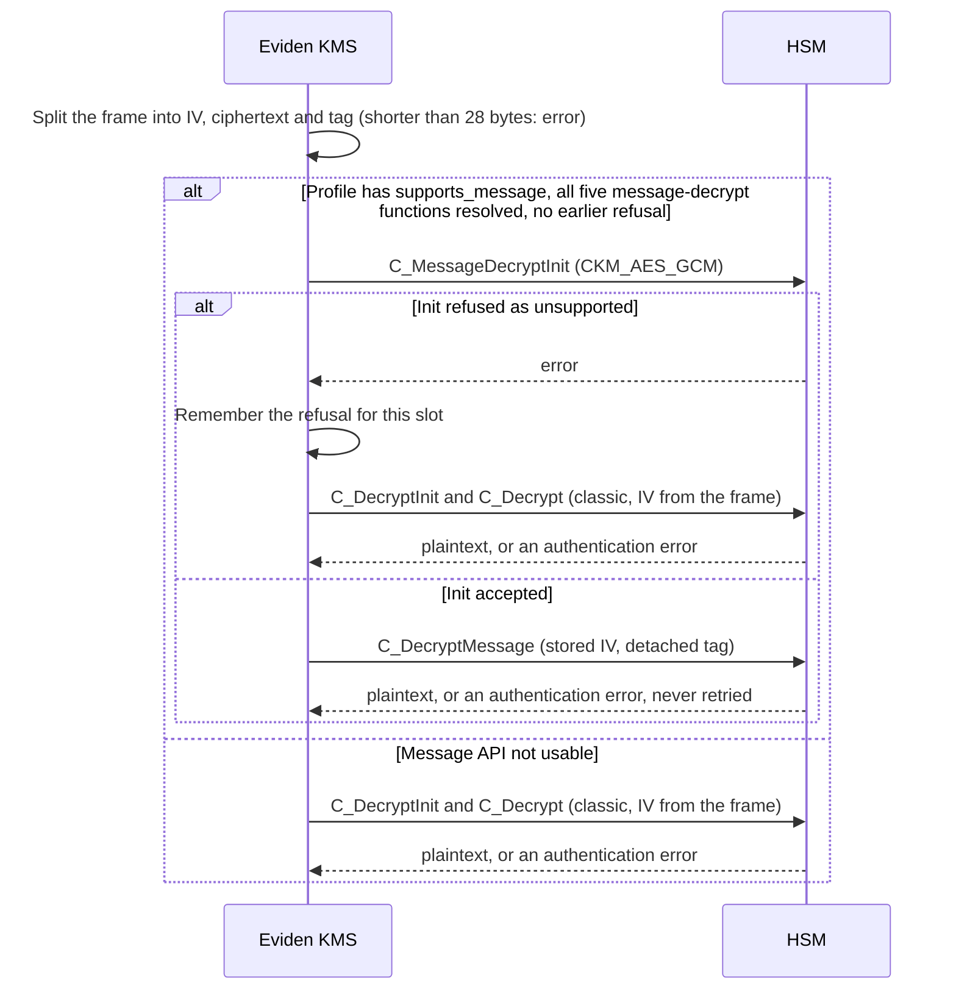

# AES-GCM IVs, PKCS#11 versions and HSM FIPS mode

This page explains how the KMS obtains AES-GCM IVs from an HSM key. It applies when
`key_encryption_key_wrapping_algorithm = "aes-gcm"` (see
[Choosing the wrapping algorithm](hsm_operations.md#choosing-the-wrapping-algorithm)).

Who generates the AES-GCM IV is decided by the **KMS build** and the HSM **capability profile**, never by
the PKCS#11 version the library announces. For an HSM AES key and no caller-supplied IV, the KMS tries, in
order:

1. **PKCS#11 v3.0 message API** (the HSM generates the IV), when the profile has `supports_message` and the
   library offers all five message-encrypt functions. The KMS looks each function up as an exported symbol
   first, then in the v3.0 interface table, so a v2.40 library that exports these names (even as stubs
   answering `CKR_FUNCTION_NOT_SUPPORTED`) is treated as v3-capable. If the call fails, the KMS continues
   with step 2 or 3 (versions without this fallback abort startup).
2. **Classic `CKM_AES_GCM`, KMS-chosen random IV**: non-FIPS build with a profile that has
   `supports_caller_iv`; FIPS build only for development-token profiles (`allows_caller_iv_in_fips`, SoftHSM2
   and Kryoptic).
3. **Classic `CKM_AES_GCM`, HSM-generated IV** (every other case, in particular the FIPS build): the KMS
   passes a zeroed IV buffer and the HSM must write the IV it generated back into it. An IV left at zero is
   refused, never used.

A caller-supplied 12-byte IV (KMIP or CLI) never uses the message API and is accepted only where step 2 is
allowed. Decryption reads the IV from the stored value and uses the message API when available, falling back
to classic AES-GCM when its initialization is refused as unsupported (other errors, including authentication
failures, are not retried).

| KMS build | HSM library | HSM in FIPS mode | Result |
| --- | --- | --- | --- |
| FIPS | message API works | any | works, HSM-generated IV |
| FIPS | no usable message API, classic returns the IV | any | works, HSM-generated IV (SoftHSM2 and Kryoptic development tokens: KMS-chosen IV) |
| FIPS | no usable message API, classic returns no IV | any | startup refused: `needs an IV generated inside the HSM`; use `aes-key-wrap-padding`, `aes-key-wrap` or `rsa-oaep` |
| non-FIPS | message API works | any | works, HSM-generated IV |
| non-FIPS | no usable message API, profile with `supports_caller_iv` | no | works, KMS-chosen IV |
| non-FIPS | no usable message API, profile with `supports_caller_iv` | yes | the HSM refuses the KMS-chosen IV (for example `CKR_ACTION_PROHIBITED`, 27); use the FIPS build or a key-wrap algorithm |
| non-FIPS | no usable message API, profile without `supports_caller_iv` (GCP, AWS CloudHSM and Azure Cloud HSM profiles) | any | same as the FIPS build: HSM-generated IV, or startup refused |

The HSM's FIPS mode does not change what the KMS sends, only whether the HSM accepts it. HSM
key-wrap support is HSM-dependent: validate the chosen algorithm on your HSM. AES-KW/KWP of a KMS key goes
through `C_WrapKey` on an ephemeral imported key, which some HSMs refuse with `CKR_KEY_HANDLE_INVALID`
(observed on Crypt2Pay: only HSM-generated keys can be wrapped). On such an HSM use an RSA key encryption
key with `rsa-oaep`.

## Sequence diagrams

The diagrams below follow `encrypt_aes_gcm` and `decrypt_aes_gcm`
(`crate/hsm/base_hsm/src/session/session_impl.rs`). Stored AES-GCM data is always the frame
`IV (12 bytes) || ciphertext || tag (16 bytes)`, whichever path produced it.

**Overview: encryption without a caller-supplied IV.** Each case is detailed below.

**Case A: PKCS#11 v3.0 message API (FIPS and non-FIPS builds, any HSM FIPS mode).**
The KMS requests `CKG_GENERATE_RANDOM`, so the IV is generated inside the HSM.

**Case B: classic `CKM_AES_GCM`, KMS-chosen IV.** Non-FIPS build with a `supports_caller_iv` profile, or FIPS
build on a development token (SoftHSM2, Kryoptic).

**Case C: classic `CKM_AES_GCM`, HSM-generated IV.** FIPS build on a production HSM, or non-FIPS build with a
profile without `supports_caller_iv` (GCP, AWS CloudHSM and Azure Cloud HSM profiles), when the message API is
not usable.

**Case D: caller-supplied 12-byte IV (KMIP or CLI).** The message API is never used, since it generates its own IV.

**Decryption (all builds, any HSM FIPS mode).** The IV is read from the stored frame, so the encryption policy
does not matter.

To diagnose a failed startup, read the server error:

- `Failed to initialize message-based encryption. Return code: 84` (`CKR_FUNCTION_NOT_SUPPORTED`) or `112`
  (`CKR_MECHANISM_INVALID`): the library exports message functions it does not implement. Upgrade to a version
  that includes the message-API fallback.
- `needs an IV generated inside the HSM … provided none`: step 3 failed; change the wrapping algorithm.
- `CKR_ACTION_PROHIBITED` (27) from `C_Encrypt`: step 2 against an HSM in FIPS mode.

List the exports of the library the server actually loads with
`nm -D --defined-only <lib> | grep -E 'C_(Message|EncryptMessage|DecryptMessage|GetInterface)'`.
To test an HSM's AES-GCM IV behaviour without the KMS, run the standalone probe `.mise/scripts/test/pkcs11_gcm_iv_probe.py`
(`PKCS11_PIN=<pin> python3 pkcs11_gcm_iv_probe.py <library.so> <slot-id>`; a C twin, `pkcs11_gcm_iv_probe.c`, is
provided for hosts without Python) on the library the server loads. It replays the KMS calls (zeroed IV buffer with
and without the length query, caller-chosen IV, NULL IV), reports whether the HSM returns a generated IV, and lists the
exported v3.0 message symbols; it only creates a temporary session key.
`ckms pkcs11 capabilities` does not diagnose this: it checks Cosmian's own PKCS#11 provider against a
running KMS, not the HSM driver the server loads.
