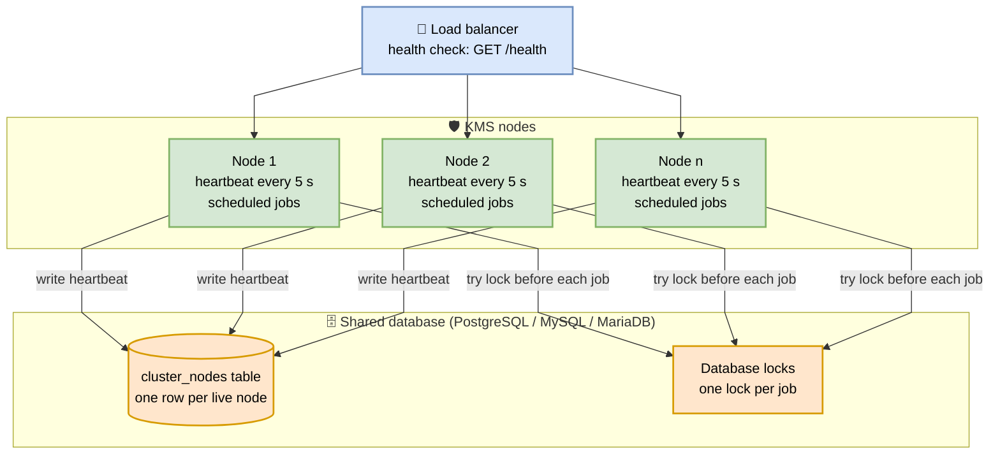
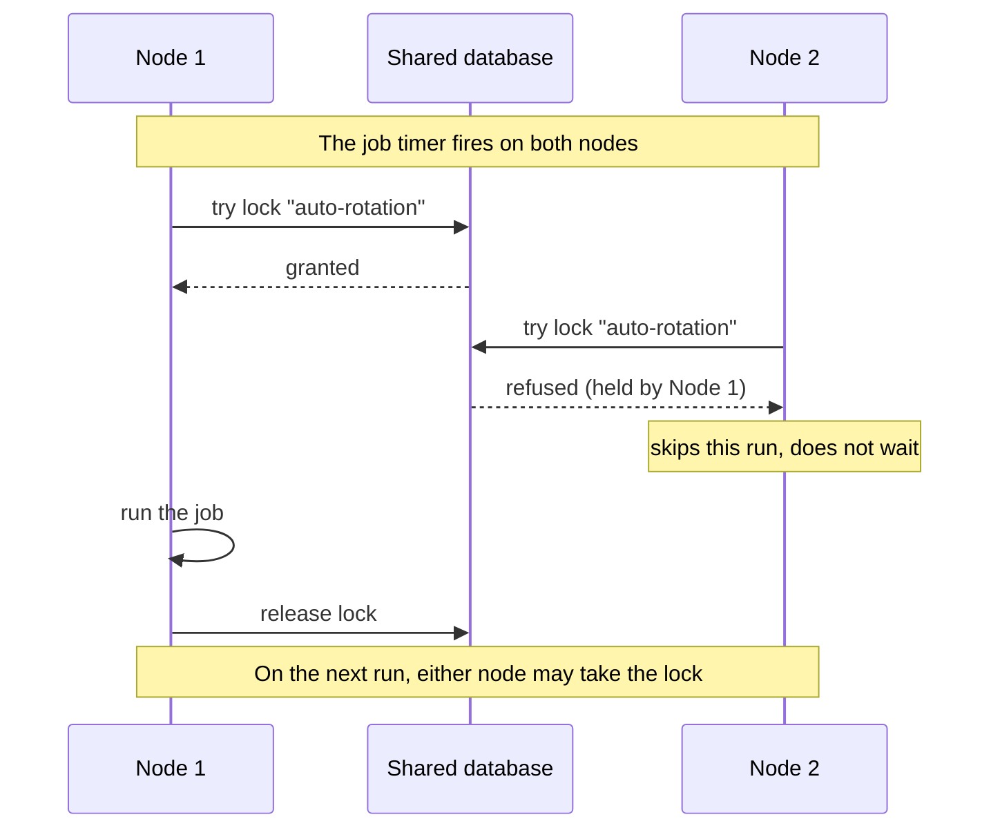
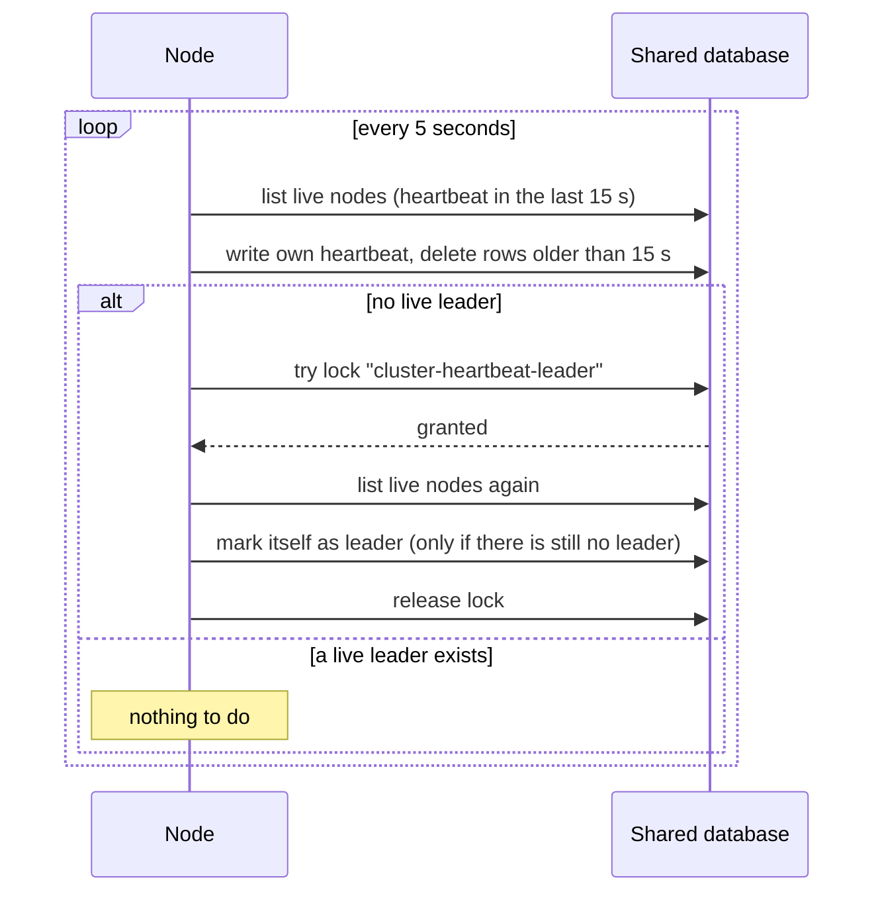

# Cluster coordination

When several KMS nodes share one PostgreSQL or MySQL/MariaDB database (see
[High-availability](./high_availability_mode.md)), they coordinate through that database:

- each background job runs on **one node at a time**;
- each node publishes a **heartbeat**, so the cluster can list its live nodes;
- `GET /cluster/status` shows the live nodes and `GET /health` reports the state of the database and of each HSM.

No configuration is needed: coordination starts as soon as two nodes use the same database.

## How the nodes coordinate



The nodes never talk to each other: everything goes through the shared database.

## Scheduled jobs

Each node runs the same background jobs on a timer. For the jobs that change shared data, a node first tries to take
a database lock named after the job:

| Job | Lock name | Runs on |
| --- | --------- | ------- |
| Key auto-rotation and renewal warnings | `auto-rotation` | one node per run |
| CRL refresh | `crl-refresh` | one node per run |
| Object counter reconciliation | `metrics-reconcile` | one node per run |
| Metrics gauges refresh (`kms.keys.active.count`, `kms.objects.total`) | none | every node (each node exports its own gauges) |
| KV secret TTL expiry | `kv-ttl` | one node per run |



How the locks work:

- **PostgreSQL** uses a session-level advisory lock (`pg_try_advisory_lock`); **MySQL/MariaDB** uses a named lock
  (`GET_LOCK` with a zero timeout). Neither blocks: a node that does not get the lock skips the run.
- The lock name includes the database name, so KMS deployments that use different databases on the same server do
  not block each other.
- If a node process stops during a job, its database connection closes and the database releases the lock. If the
  node's machine or network fails instead, the lock is released once the database detects the dead connection.
- Each node keeps a small dedicated pool of database connections for these locks, so a long job never delays the
  heartbeat.

## Heartbeat and leader

Every 5 seconds, each node writes its row in the [`cluster_nodes`](../configuration/database/tables.md#cluster_nodes)
table: a node ID generated when the process starts, its KMS version, and the time of the heartbeat. Rows older than
15 seconds are deleted.

One node is marked as **leader**. The leader is for display only: no job and no request depends on it.



What to expect:

- **A node stops:** its row expires after 15 seconds and it disappears from `/cluster/status`. If it was the leader,
  another node becomes leader at its next heartbeat, so about 15 to 20 seconds later. Client requests are not affected
  during this time.
- **A node restarts:** it gets a new node ID, so it appears as a new node and does not take the leader role back from
  the current leader.
- **Clocks:** heartbeat times come from each node's own clock. Keep the node clocks synchronized (for example with NTP):
  a node whose clock is about 10 seconds or more behind the others can be shown as gone, or appear and disappear from
  the list. This only affects the status display.

## Supported databases

| Database | Job locks | Heartbeat and `/cluster/status` |
| -------- | --------- | ------------------------------- |
| PostgreSQL | yes | yes |
| MySQL / MariaDB | yes | yes |
| SQLite | not needed (single node) | yes, shows one node |
| Redis with Findex (non-FIPS only) | **no**: every node runs every job | **no**: `/cluster/status` returns an empty node list |

## Monitoring

### `GET /health`

This endpoint is public (no authentication), so a load balancer can use it as a health check. It reports a global
status and the state and latency of each dependency:

| Global status | HTTP code | Meaning |
| ------------- | --------- | ------- |
| `UP` | 200 | The database and every configured HSM answer. |
| `DEGRADED` | 200 | The database answers, but at least one HSM does not. |
| `DOWN` | 503 | The database does not answer. |

Example response from a node with one HSM:

```json
{"status":"UP","latency_ms":3,"dependencies":{"database":{"name":"postgres","status":"UP","latency_ms":2},"hsm":[{"name":"hsm","status":"UP","latency_ms":0}]}}
```

With the HAProxy configuration of the [High-availability](./high_availability_mode.md) page (`http-check expect
status 200`), a `DEGRADED` node stays in the load-balancing pool, so it keeps serving the requests that do not use
the failing HSM.

!!! note "HSM status depends on the PKCS#11 library"
    The HSM check asks each configured slot for its list of mechanisms. Some PKCS#11 libraries (for example
    Crypt2pay) answer from local data and do not report an HSM that has become unreachable: such a failure then only
    shows when a cryptographic operation fails.

### `GET /cluster/status`

This endpoint lists the live nodes. It requires authentication, like the other KMS API endpoints (without credentials
the server answers `401`). For example, with a TLS client certificate:

```bash
curl --cacert <CA_CERT_FILE> --cert <CLIENT_CERT_AND_KEY_PEM> https://<KMS_HOST>:9998/cluster/status
```

Example response from a two-node cluster:

```json
{"nodes":[{"node_id":"b5f214cf-49d2-48db-8237-8d570db10143","version":"5.29.0","last_heartbeat":1794931360,"leader":false},{"node_id":"e73bb874-75c9-404e-a579-f1145ee9bce2","version":"5.29.0","last_heartbeat":1794931357,"leader":true}],"leader":"e73bb874-75c9-404e-a579-f1145ee9bce2"}
```

| Field | Description |
| ----- | ----------- |
| `nodes[].node_id` | Node ID, generated when the KMS process starts. |
| `nodes[].version` | KMS version of the node. |
| `nodes[].last_heartbeat` | Time of the last heartbeat, in Unix seconds. |
| `nodes[].leader` | Whether this node is the leader shown for the cluster. |
| `leader` | Node ID of the leader, or `null` when there is none yet (just after start-up, or in the seconds after the leader stopped). |

### Metric

Each node exports the OpenTelemetry gauge `kms.cluster.nodes`: the number of live nodes, refreshed every 5 seconds.
