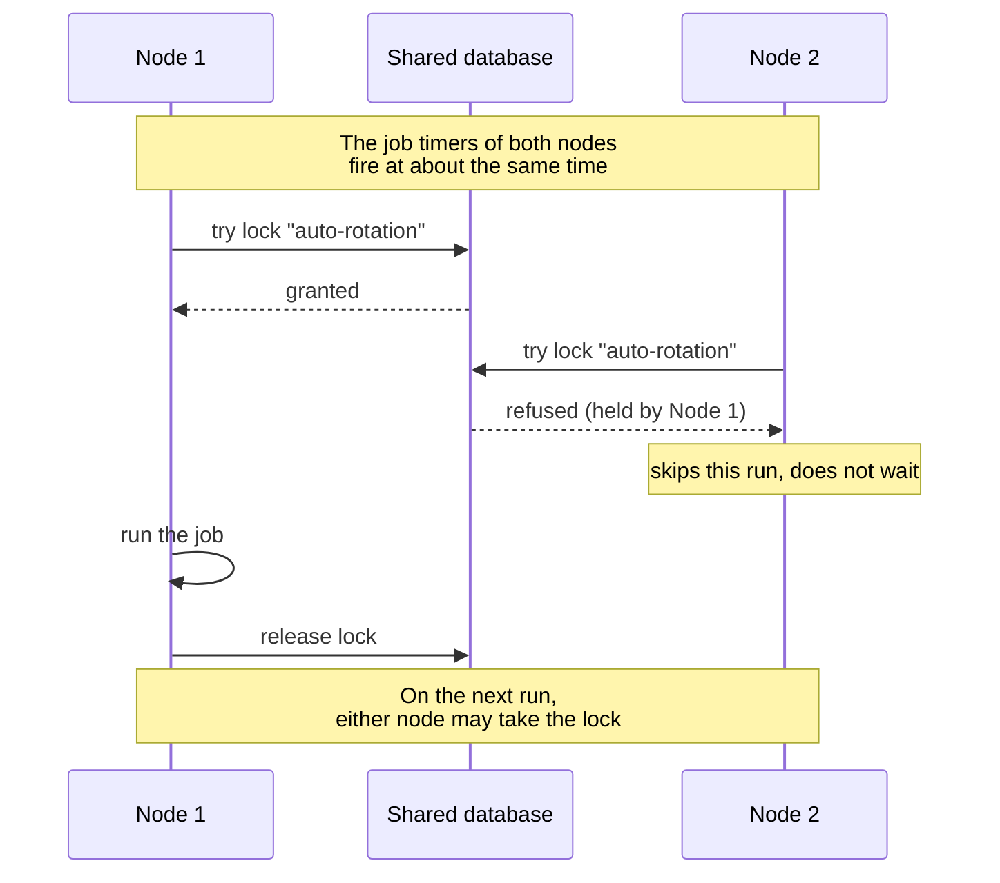
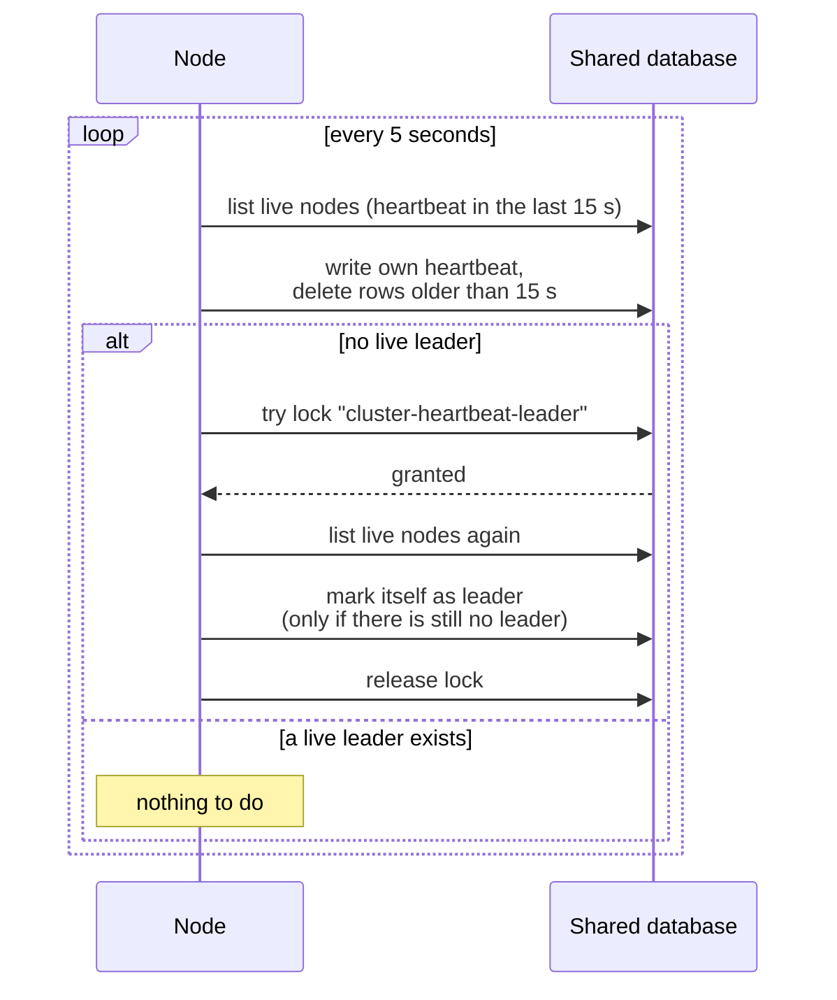

# Cluster coordination

When several KMS nodes share one PostgreSQL or MySQL/MariaDB database (see
[High availability and deployment profiles](./high_availability_mode.md)), they coordinate through that database:

- each background job runs on **one node at a time**;
- each node publishes a **heartbeat**, so the cluster can list its live nodes;
- `GET /cluster/status` shows the live nodes and `GET /health` reports the state of the database, of each HSM and of the
  KMIP socket server.

No configuration is needed: coordination starts as soon as two nodes use the same database.

## How the nodes coordinate


The nodes never talk to each other: everything goes through the shared database.

## Scheduled jobs

Each node runs the same background jobs on a timer. For the jobs that change shared data, a node first tries to take
a database lock named after the job:

| Job | Lock name | Runs on |
| --- | --------- | ------- |
| Key auto-rotation and renewal warnings | `auto-rotation` | one node at a time |
| CRL refresh | `crl-refresh` | one node at a time |
| Object counter reconciliation | `metrics-reconcile` | one node at a time |
| Metrics gauges refresh (`kms.keys.active.count`, `kms.objects.total`) | none | every node (each node exports its own gauges) |
| KV secret TTL expiry | `kv-ttl` | one node at a time |



The lock prevents **overlapping** runs, not repeated ones: each node keeps its own timer, so over time every node
runs each job, one after the other. This is harmless for jobs that find nothing to do the second time (rotation, CRL
refresh, counter reconciliation, TTL expiry). Key-renewal warnings are de-duplicated in each node's memory, so with
several nodes the same warning can be emitted once per node.

How the locks work:

- **PostgreSQL** uses a session-level advisory lock (`pg_try_advisory_lock`); **MySQL/MariaDB** uses a named lock
  (`GET_LOCK` with a zero timeout). Neither blocks: a node that does not get the lock skips the run.
- The lock name includes the database name, so KMS deployments that use different databases on the same server do
  not block each other.
- If a node process stops during a job, its database connection closes and the database releases the lock. If the
  node's machine or network fails instead, the lock is released once the database detects the dead connection.
- Each node keeps a small dedicated pool of database connections for these locks, so a long job never delays the
  heartbeat.

## Heartbeat and leader

Every 5 seconds, each node writes its row in the [`cluster_nodes`](../configuration/database/tables.md#cluster_nodes)
table: a node ID generated when the process starts, its KMS version, and the time of the heartbeat. Rows older than
15 seconds are deleted.

One node is marked as **leader**. The leader is for display only: no job and no request depends on it.



What to expect:

- **A node stops:** its row expires after 15 seconds and it disappears from `/cluster/status`. If it was the leader,
  another node becomes leader at its next heartbeat, so about 15 to 20 seconds later. Client requests are not affected
  during this time.
- **A node restarts:** it gets a new node ID, so it appears as a new node and does not take the leader role back from
  the current leader.
- **Clocks:** heartbeat times come from each node's own clock. Keep the node clocks synchronized (for example with NTP):
  a node whose clock is about 10 seconds or more behind the others can be shown as gone, or appear and disappear from
  the list. This only affects the status display.

## Supported databases

| Database | Job locks | Heartbeat and `/cluster/status` |
| -------- | --------- | ------------------------------- |
| PostgreSQL | yes | yes |
| MySQL / MariaDB | yes | yes |
| Percona XtraDB Cluster (default `pxc_strict_mode=ENFORCING`) | **no**: the server refuses `GET_LOCK`, so every node runs every job | yes |
| SQLite | not needed (single node) | yes, shows one node |
| Redis with Findex (non-FIPS only) | **no**: every node runs every job | **no**: `/cluster/status` returns an empty node list |

When the database refuses `GET_LOCK` (Percona XtraDB Cluster), the server logs one warning and runs the scheduled jobs
on every node, as it did before job locks existed.

## Monitoring

### `GET /health`

This endpoint is public (no authentication), so a load balancer can use it as a health check. It reports a global
status and the state and latency of each dependency:

| Global status | HTTP code | Meaning |
| ------------- | --------- | ------- |
| `UP` | 200 | The database, every configured HSM and the KMIP socket server (when enabled) are fine. |
| `DEGRADED` | 200, or 503 with `?strict=true` | The database answers, but at least one HSM does not, or the KMIP socket server has stopped. |
| `DOWN` | 503 | The database check fails, or does not answer within 2 seconds. |

Example response from a node with one HSM and the KMIP socket server enabled:

```json
{"status":"UP","latency_ms":3,"dependencies":{"database":{"name":"postgres","status":"UP","latency_ms":2},"hsm":[{"name":"hsm","status":"UP","latency_ms":0}],"kmip":{"name":"kmip","status":"UP","latency_ms":0}}}
```

By default a `DEGRADED` node answers `200`, so with the HAProxy configuration of the
[HAProxy and Keepalived](./haproxy_keepalived.md) page (`http-check expect status 200`) it stays in the load-balancing
pool and keeps serving the requests that do not use the failing HSM. To take such a node out of the pool, check
`GET /health?strict=true` instead: it answers `503` for a `DEGRADED` node as well as for a `DOWN` one. The body is the
same, so the failing dependency is still visible. In a test with HAProxy (`inter 1s fall 2 rise 2`), a node whose HSM
returned an error answered `200` (`DEGRADED`) and stayed in the pool when HAProxy checked `GET /health`; when HAProxy
checked `GET /health?strict=true`, the node was taken out of the pool about 2 seconds later, and the same happened to a
node whose database stopped answering. A node came back in the pool about 2 seconds after its dependency answered
again. During the database test, key creations through HAProxy kept succeeding.

The `kmip` entry only appears when the KMIP socket server is enabled. It reports whether the socket server is still
running: it does not open a connection to the KMIP port, so it does not detect a firewall or network problem in front
of the port.

Each HSM slot is probed with a bounded wait: a slot that does not answer within 2 seconds is reported `DOWN` (with the
message `no answer within 2000 ms`), so `/health` never hangs and the node is `DEGRADED`. The answer of a slot is reused
for 2 seconds, and at most one probe per slot runs at a time: while a probe is still waiting for the HSM, later
`/health` calls report the slot `DOWN` without starting another one, so repeated health checks cannot exhaust the
server's threads.

The `message` of a `DOWN` dependency never carries the detail of the error (database driver text, host, user, PKCS#11
return code): the public endpoint could otherwise show it to anyone who can reach the port, and the detail is written
to the server log instead. The message is one of these fixed texts, and an HSM message is prefixed with `slot <id>:`:

| Message | Meaning |
| ------- | ------- |
| `database check failed (details in the server log)` | the database check returned an error |
| `the HSM returned an error (details in the server log)` | an HSM call returned an error |
| `no answer within 2000 ms` | the database or the HSM slot did not answer in time |
| `the previous probe is still waiting for the HSM` | an earlier probe of the slot has not ended yet |
| `the KMIP socket server is not running (details in the server log)` | the socket server task has ended |

Look for log lines containing `health check:` to see the detail.

!!! note "HSM status depends on the PKCS#11 library"
    The HSM check asks each configured slot for its list of mechanisms. Some PKCS#11 libraries (for example
    Crypt2pay) answer from local data and do not report an HSM that has become unreachable: such a failure then only
    shows when a cryptographic operation fails.

### `GET /cluster/status`

This endpoint lists the live nodes. It requires authentication, like the other KMS API endpoints (without credentials
the server answers `401`). For example, with a TLS client certificate:

```bash
curl --cacert <CA_CERT_FILE> --cert <CLIENT_CERT_AND_KEY_PEM> https://<KMS_HOST>:9998/cluster/status
```

Example response from a two-node cluster:

```json
{"nodes":[{"node_id":"b5f214cf-49d2-48db-8237-8d570db10143","version":"5.29.0","last_heartbeat":1794931360,"leader":false},{"node_id":"e73bb874-75c9-404e-a579-f1145ee9bce2","version":"5.29.0","last_heartbeat":1794931357,"leader":true}],"leader":"e73bb874-75c9-404e-a579-f1145ee9bce2"}
```

| Field | Description |
| ----- | ----------- |
| `nodes[].node_id` | Node ID, generated when the KMS process starts. |
| `nodes[].version` | KMS version of the node. |
| `nodes[].last_heartbeat` | Time of the last heartbeat, in Unix seconds. |
| `nodes[].leader` | Whether this node is the leader shown for the cluster. |
| `leader` | Node ID of the leader, or `null` when there is none yet (just after start-up, or in the seconds after the leader stopped). |

### Metric

When OpenTelemetry metrics are enabled, each node exports the gauge `kms.cluster.nodes`: the number of live nodes,
refreshed every 5 seconds. It is always 0 with Redis with Findex, which has no heartbeat.
