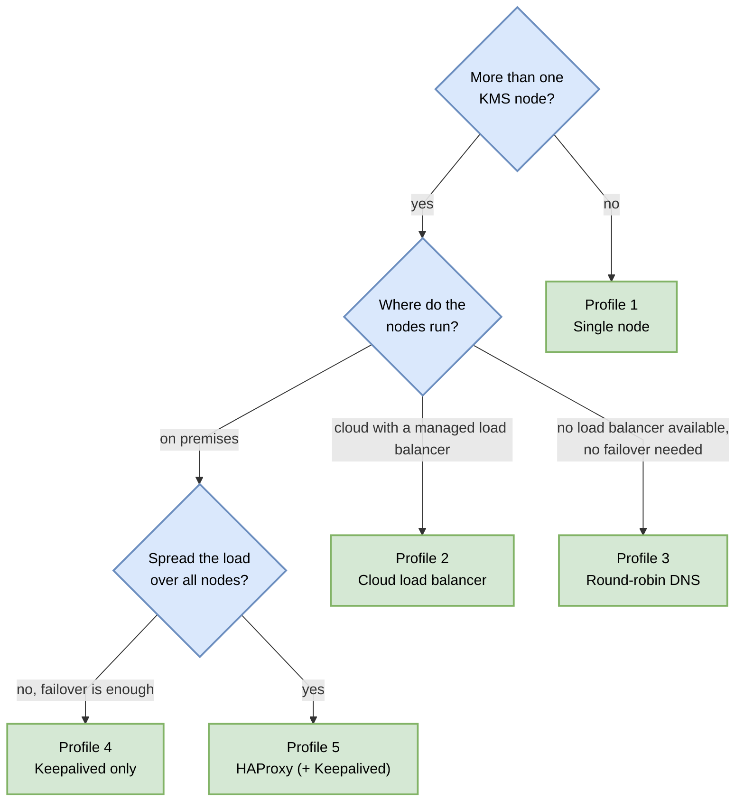
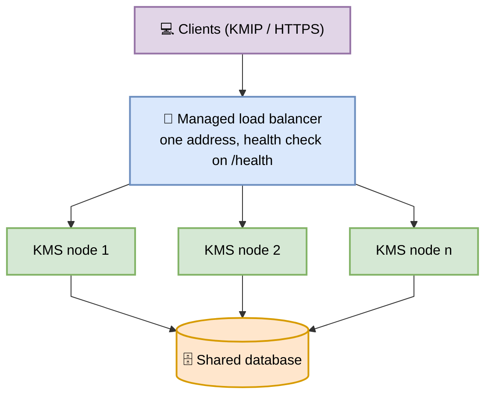
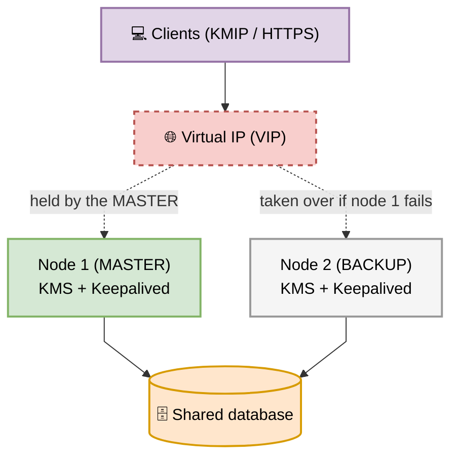

# Deployment profiles

KMS nodes are stateless: all data lives in the database. A deployment is therefore two choices: **which database**, and
**how clients reach the nodes**. This page lists the usual profiles, from the simplest to the most available, and what
each one gives and does not give.

## Choosing a profile

| # | Profile | Nodes | Clients reach the KMS through | When a node fails | Typical use |
| - | ------- | ----- | ----------------------------- | ----------------- | ----------- |
| 1 | [Single node](#profile-1-single-node) | 1 | the address of the node | the service stops | development, tests, small sites |
| 2 | [Cloud load balancer](#profile-2-cloud-load-balancer) | 2+ | a managed load balancer | the balancer stops sending requests to it | cloud |
| 3 | [Round-robin DNS](#profile-3-round-robin-dns) | 2+ | a DNS name with one record per node | nothing automatic: requests keep going to it until it leaves the DNS | simple load spreading |
| 4 | [Keepalived only](#profile-4-keepalived-only) | 2+ | a virtual IP (VIP) shared by the nodes | the VIP moves to another node in a few seconds | on premises, nodes on one network |
| 5 | [HAProxy, with or without Keepalived](#profile-5-haproxy) | 2+, plus 1 or 2+ load balancers | one HAProxy, or a VIP over several HAProxy | HAProxy stops sending requests to it | on premises, load spread over all nodes |

Profiles 2 to 5 need a PostgreSQL or MySQL/MariaDB database shared by all the nodes (see
[Rules common to profiles 2 to 5](#rules-common-to-profiles-2-to-5)). The availability of the database itself is a
separate choice, described in [Database availability](#database-availability).



## Rules common to profiles 2 to 5

- All the nodes use the **same database**: PostgreSQL or MySQL/MariaDB. SQLite supports one node only. Redis with Findex
  accepts several nodes, but then every node runs every scheduled job (see
  [Cluster coordination](./cluster_coordination.md#supported-databases)).
- All the nodes expose the **same server certificate**, and its name is the name clients use: the DNS name of the load
  balancer, of the VIP, or of the DNS record.
- The nodes must listen on an address reachable from the clients. The HTTPS server listens on `0.0.0.0` by default (on
  Linux and macOS). The KMIP socket server listens on `127.0.0.1` by default: set `socket_server_hostname` to
  `0.0.0.0` if clients use KMIP on port 5696.
- If audit logging to a file is enabled, each node writes its own file (see the warning in
  [High-availability](./high_availability_mode.md#file-based-audit-logging)).
- The nodes share their scheduled jobs and report their state through the database: see
  [Cluster coordination](./cluster_coordination.md).

### What `/health` tells a load balancer today

Every profile except the first uses `GET /health` on the HTTP(S) port (`9998` by default) to decide whether a node is usable:

| Situation on the node | `/health` answers | Effect |
| --------------------- | ----------------- | ------ |
| The database is down, or silent for more than 2 seconds | `503` (`DOWN`) | the node leaves the pool |
| An HSM does not answer | `200` (`DEGRADED`) | the node stays in the pool; requests that need the HSM fail on it |
| The KMIP socket server is down, the HTTPS server answers | `200` (`UP`) | the node stays in the pool; KMIP clients fail on it |

## Profile 1: single node

One KMS and one database, SQLite included. Clients connect to the address of the node. There is no failover: restore
the node or its database from a backup. See [Getting started](./installation_getting_started.md).

## Profile 2: cloud load balancer



Use a managed load balancer of your cloud provider, in front of the nodes:

- forward the KMIP port (`5696`) and the HTTPS port (`9998`) as plain TCP, so that TLS ends on the nodes and every node
  presents the same certificate;
- check the nodes with `GET /health` and keep a node in the pool only on `200`.

Adding or removing a node does not change the address clients use.

## Profile 3: round-robin DNS

Publish one DNS record per node under a single name, with a short TTL. Clients resolve the name and spread over the
nodes.

This profile has **no failover**: DNS does not know that a node is down. The failed node keeps receiving requests until
it is removed from the DNS and the TTL has expired, unless the client library tries the next address by itself, which
depends on the client. Use it for load spreading in a lab or when a failure of a node is acceptable, or add health
checks at the DNS provider.

## Profile 4: Keepalived only



The Keepalived instances of the nodes talk to each other with VRRP to agree on which node holds the VIP.

Keepalived runs **on the KMS nodes themselves**, with no HAProxy. The nodes share a VIP: the MASTER node holds it and
answers the clients, the other nodes wait. Each Keepalived checks the KMS of its own node with `GET /health`; when the
check fails, that node gives up the VIP and another node takes it.

Requirements:

- the nodes are on the same network (layer 2), and VRRP traffic (IP protocol 112) is allowed between them;
- Keepalived is installed on every node, and the VIP is free on that network;
- the KMS listens on all addresses (see [Rules common to profiles 2 to 5](#rules-common-to-profiles-2-to-5)), and the
  server certificate carries the DNS name of the VIP.

The same configuration is used on every node. Change only `priority` and the two unicast addresses on each node (the
highest `priority` starts as MASTER):

```keepalived
global_defs {
    enable_script_security
    script_user keepalived_script       # An unprivileged user, created beforehand
}

vrrp_script chk_kms {
    script "/usr/bin/curl -skf -m 2 -o /dev/null https://127.0.0.1:9998/health"
    interval 2
    fall 2                              # 2 failed checks: the node leaves the VIP
    rise 2                              # 2 good checks: the node can hold the VIP again
}

vrrp_instance KMS {
    state BACKUP                        # BACKUP on every node: the priority decides
    interface eth0                      # Adapt to your network interface name
    virtual_router_id 51                # Identical on all nodes
    priority 101                        # 101 on node 1, 100 on node 2, ...
    advert_int 1
    unicast_src_ip 192.168.1.11         # Address of this node
    unicast_peer {
        192.168.1.12                    # Addresses of the other nodes
    }
    virtual_ipaddress {
        192.168.1.100/24                # VIP: the address clients use
    }
    track_script {
        chk_kms
    }
}
```

!!! note "Behaviour seen in a test"
    In a lab with two nodes and one PostgreSQL database, the VIP moved to the other node about 3 seconds after the KMS
    process of the MASTER stopped, and about 3 seconds after the MASTER lost its network. When the first node came
    back, it took the VIP again, without failed requests on a client that opens a new connection for each request. Add
    Keepalived's `nopreempt` option if you prefer that the VIP stays where it is.
    When the database stopped, `/health` stopped answering `200` on both nodes, both gave up the VIP, and the VIP came
    back by itself when the database was back.

Limits of this profile:

- **Active/passive**: only the node holding the VIP serves clients; the others are spare. To spread the load, use
  profile 2 or 5.
- An open KMIP connection is cut when the VIP moves: the client has to reconnect.
- The check follows what [`/health` tells a load balancer today](#what-health-tells-a-load-balancer-today): a node whose
  HSM fails, or whose KMIP socket server is down, keeps the VIP.
- It does not work on AWS: in a test, an address added to an instance's network interface was not reachable from the
  other instances of the same subnet. Use profile 2 there. Other public clouds were not tested.

## Profile 5: HAProxy

HAProxy spreads the requests over all the nodes and stops sending requests to a node that fails its health check:

- **one HAProxy** in front of the nodes: load spreading and failover between nodes, but HAProxy is a single point of
  failure;
- **two or more HAProxy with Keepalived**: the same, with a VIP over the HAProxy nodes, so that no component is a single
  point of failure.

The configuration of both is described in [HAProxy and Keepalived](./haproxy_keepalived.md).

## Database availability

Whatever the profile, all the nodes depend on one database: if it is down, no node can serve requests. Make it highly
available with the tools of your database:

- PostgreSQL: streaming replication with an HA manager such as Patroni or pg_auto_failover, or a managed multi-zone
  service;
- MySQL / MariaDB: the replication or cluster solution of your platform.

Point `database_url` of all the nodes to the address that follows the primary (a VIP or the endpoint of the managed
service). The details and the constraints of each engine are in
[Database configuration](../configuration/database/configuration.md). Back up the database regularly and test the
restores: it is the source of truth of the whole cluster.
