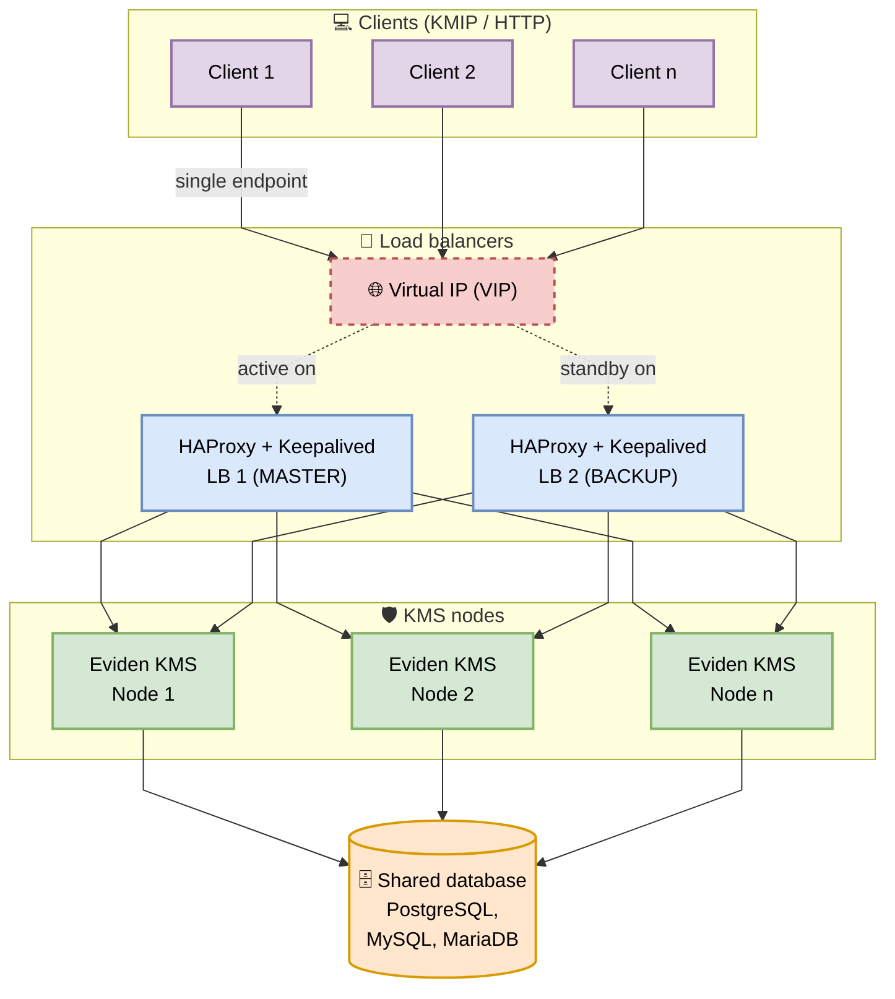

# HAProxy and Keepalived

HAProxy spreads the client requests over the KMS nodes and stops sending requests to a node that fails its health
check. Keepalived gives HAProxy a single, stable address, a **virtual IP (VIP)**, that moves to another HAProxy node
when one fails. This page describes how to set both up in front of several KMS nodes that share one database (see
[High availability and deployment profiles](./high_availability_mode.md), which also helps you choose between this
setup and the other ways to reach the nodes).

## One HAProxy, or HAProxy with Keepalived

- **One HAProxy** (similar to using Nginx as a reverse proxy) in front of the KMS nodes: load balancing and failover
  between the KMS nodes, but a **single point of failure (SPOF)**: if that HAProxy server goes down, clients cannot
  reach the KMS.
- **At least two HAProxy with Keepalived**: the same, without the SPOF, thanks to a floating VIP. This is the setup
  described below.

## Architecture



In a typical two-node setup, HAProxy and Keepalived are installed on two dedicated load balancer nodes. Each load
balancer node:

- runs HAProxy (load-balances requests to all KMS nodes)
- runs Keepalived (shares the VIP between the HAProxy instances so clients have a single endpoint)

All KMS clients (backup software, applications) connect exclusively to the **VIP**. Individual KMS node IPs are never
exposed to clients.

The number of KMS nodes can be adjusted at any time without reconfiguring clients: add a new node to the database and
to the HAProxy backend, and it will start receiving traffic immediately.

## Requirements

- Since the KMS servers are stateless, any load-balancing strategy may be selected, such as a simple round-robin.
- When the Eviden KMS servers are configured to export an HTTPS port (as is the case when running inside a
  confidential VM):
    - all the Eviden KMS servers should expose the same server certificate on their HTTPS port
    - and the load balancer should be configured as an SSL load balancer (HAProxy is a good example of a
      high-performance SSL load balancer)

## HAProxy configuration

Use the **same configuration on all HAProxy nodes** — Keepalived handles which one is active.

Typical configuration file path (may vary by distribution):

- HAProxy: `/etc/haproxy/haproxy.cfg`

On systemd-based distributions, after updating the configuration you can restart HAProxy with:

```bash
sudo systemctl restart haproxy
```

Health checks use the Eviden KMS `/health` endpoint on the HTTP port (`9998`), while KMIP traffic is forwarded to
port `5696`. Add or remove `server` lines in the backend to match your number of KMS nodes.

```haproxy
global
    log /dev/log local0
    maxconn 2000
    user haproxy
    group haproxy

defaults
    log     global
    mode    tcp                 # TCP mode: required for TLS/KMIP passthrough
    option  tcplog
    timeout connect 5000ms
    timeout client  50000ms
    timeout server  50000ms

# Frontend for KMIP traffic (standard KMIP port)
frontend kmip_frontend
    bind *:5696
    default_backend kmip_backend

backend kmip_backend
    mode tcp
    balance roundrobin

    # Health check via Eviden KMS /health endpoint (HTTP port 9998)
    # Use GET /health?strict=true to also take out nodes reported DEGRADED
    # (an HSM or the KMIP socket server is down): see "Cluster coordination".
    option httpchk GET /health
    http-check expect status 200

    # Check every 3s; mark DOWN after 3 failures, mark UP after 2 successes
    default-server inter 3s fall 3 rise 2

    # Add one line per KMS node.
    # Traffic goes to port 5696; health is checked on port 9998.
    server kms1 <kms1-ip>:5696 check port 9998
    server kms2 <kms2-ip>:5696 check port 9998
    # server kms3 <kms3-ip>:5696 check port 9998
    # …
```

If the KMS port `9998` serves TLS, the health check must speak TLS too: add `check-ssl verify none` to the `server`
lines (for example `server kms1 <kms1-ip>:5696 check port 9998 check-ssl verify none`).

## Keepalived configuration

Keepalived manages the VIP across the load balancer nodes. You must define a **VIP** that will be shared by the nodes:
Keepalived ensures that **only the current MASTER node responds to the VIP**, so clients always connect to a single
stable address. Use the same configuration on all load balancer nodes, adjusting only `state` and `priority` per node.

Typical configuration file path (may vary by distribution):

- Keepalived: `/etc/keepalived/keepalived.conf`

On systemd-based distributions, after updating the configuration you can restart Keepalived with:

```bash
sudo systemctl restart keepalived
```

| Load balancer node | `state`  | `priority`                       |
| ------------------ | -------- | -------------------------------- |
| Primary            | `MASTER` | highest value (e.g. `101`)       |
| Secondary          | `BACKUP` | lower value (e.g. `100`)         |
| Additional         | `BACKUP` | lower still (e.g. `99`, `98`, …) |

```keepalived
vrrp_script chk_haproxy {
    script "killall -0 haproxy"   # Checks that the HAProxy process is running
    interval 2
    weight 2
}

vrrp_instance VI_1 {
    state MASTER                  # → BACKUP on all non-primary nodes
    interface eth0                # Adapt to your network interface name
    virtual_router_id 51          # Must be identical on all load balancer nodes
    priority 101                  # → Decrease by 1 for each additional node
    advert_int 1

    authentication {
        auth_type PASS
        auth_pass SecretPassword  # Strong shared secret; must be identical on all nodes
    }

    virtual_ipaddress {
        192.168.1.100             # VIP — configure this address in all KMS clients
    }

    track_script {
        chk_haproxy
    }
}
```

## Failover behavior

| Event                         | Result                                                                                                                       |
| ----------------------------- | ---------------------------------------------------------------------------------------------------------------------------- |
| Active HAProxy node goes down | Keepalived promotes the next highest-priority HAProxy; VIP moves within ~2s                                                  |
| A KMS node goes down          | HAProxy detects failure via `/health` within `inter × fall` ≈ 9s and stops routing to it; remaining nodes absorb the traffic |
| A KMS node recovers           | HAProxy re-adds it after 2 successful checks (~6s)                                                                           |
| A new KMS node is added       | Add a `server` line to the HAProxy backend and reload HAProxy; no client reconfiguration needed                              |
