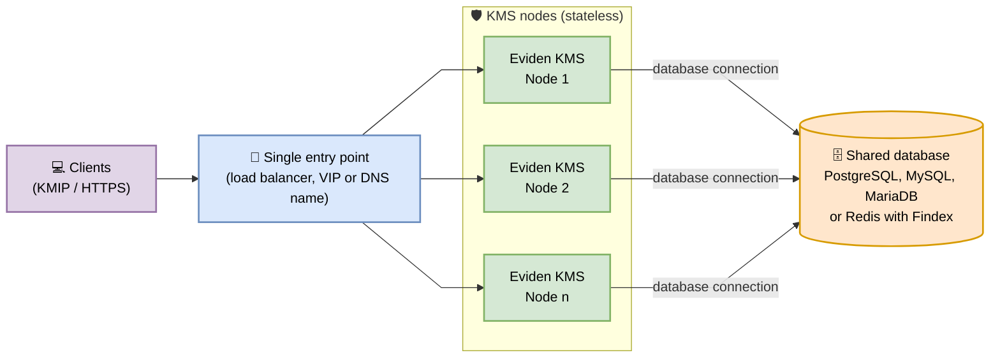

# High-availability

This mode offers high availability through redundancy and load-balancing.

The KMS servers are stateless, so they can be scaled horizontally from a single node up to any number of nodes,
simply by connecting them all to the same database and putting a single entry point in front of them.

The connection from the nodes to PostgreSQL and MySQL/MariaDB can be secured with TLS: see
[Securing database connections](../configuration/database/configuration.md#securing-database-connections-with-tls--mtls).

## What the nodes share

Because the KMS nodes are stateless, the **shared database is the source of truth**: ensure you have **regular database backups**
(and periodically test restores) using your database engine's recommended procedures.
In-memory object caches validate lifecycle state and security-sensitive attributes against the shared database using a short bounded revalidation interval (2 seconds by default). This preserves hot-path cache performance while bounding cross-node propagation lag when keys are revoked, deactivated, or destroyed on any node.

How the nodes share background jobs and report their state (`/health`, `/cluster/status`) is described in
[Cluster coordination](./cluster_coordination.md).

## Reaching the nodes

Clients need one address in front of the nodes. There are several ways to provide it, from a cloud load balancer to
Keepalived alone: the [Deployment profiles](./deployment_profiles.md) page compares them and helps you choose.

The usual on-premises setup, with a load balancer that spreads the requests and a floating address that survives the
failure of a load balancer, is described in [HAProxy and Keepalived](./haproxy_keepalived.md).

## File-based audit logging

!!! warning "File-based audit logging is not multi-instance safe"
    If audit logging is enabled (`--audit-enable`), each KMS node must write to its **own**
    audit file, not a shared/network volume. The file backend uses a local lock to serialize
    writes; it only prevents corruption on a single node (e.g. during a rolling restart), not
    across nodes. Pointing several replicas at the same audit file means only one of them will
    ever actually write to it — the others sit idle, so you silently lose their events.
    A centrally consolidated, multi-writer-safe audit trail requires the
    [PostgreSQL audit backend](../configuration/audit-postgresql-backend.md) instead.
