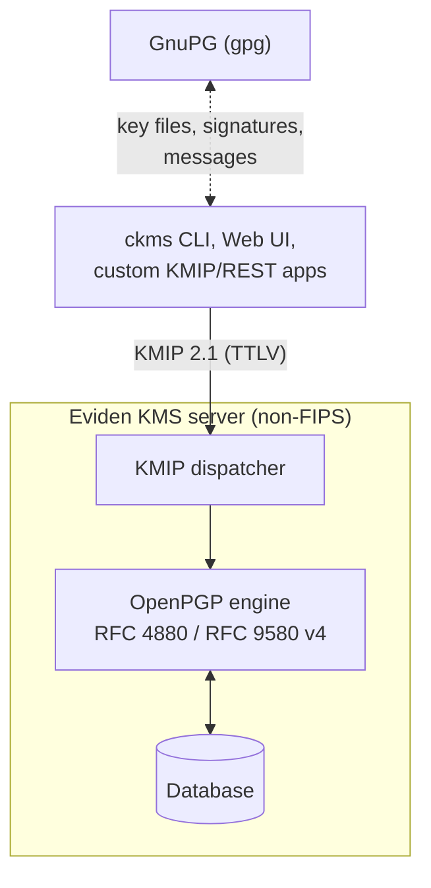
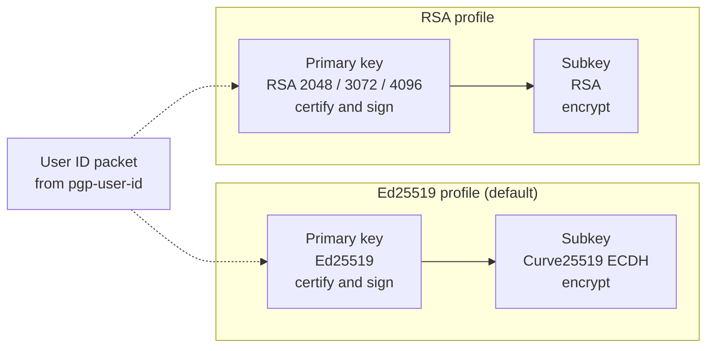
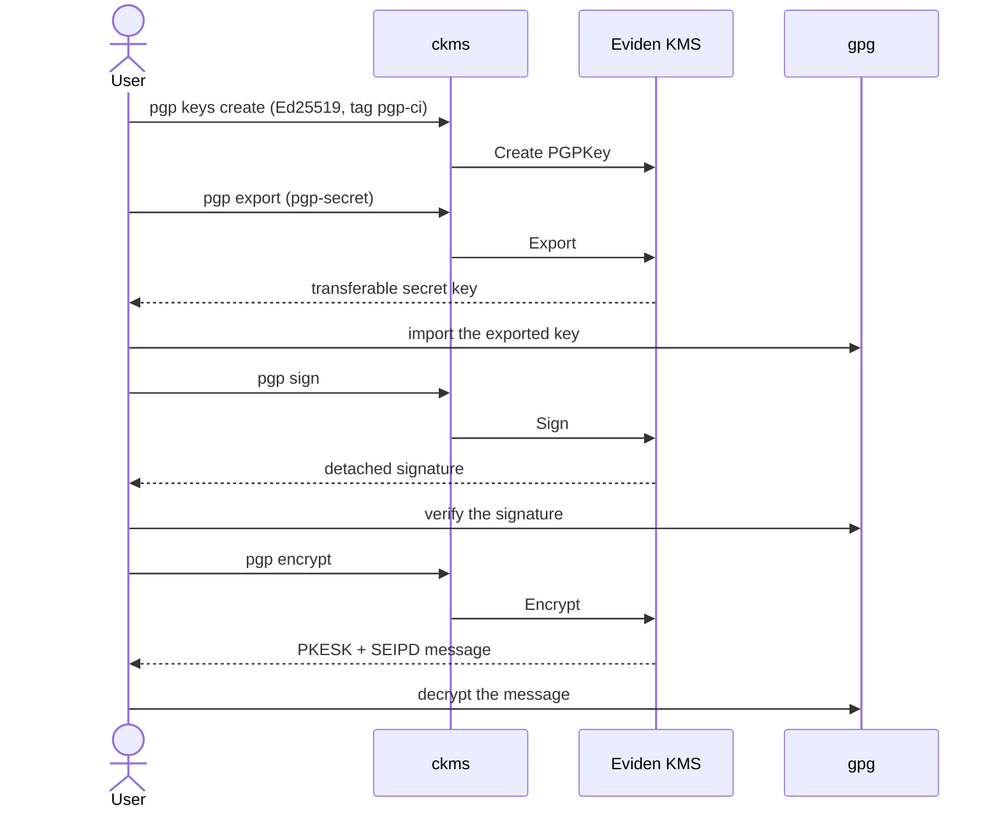
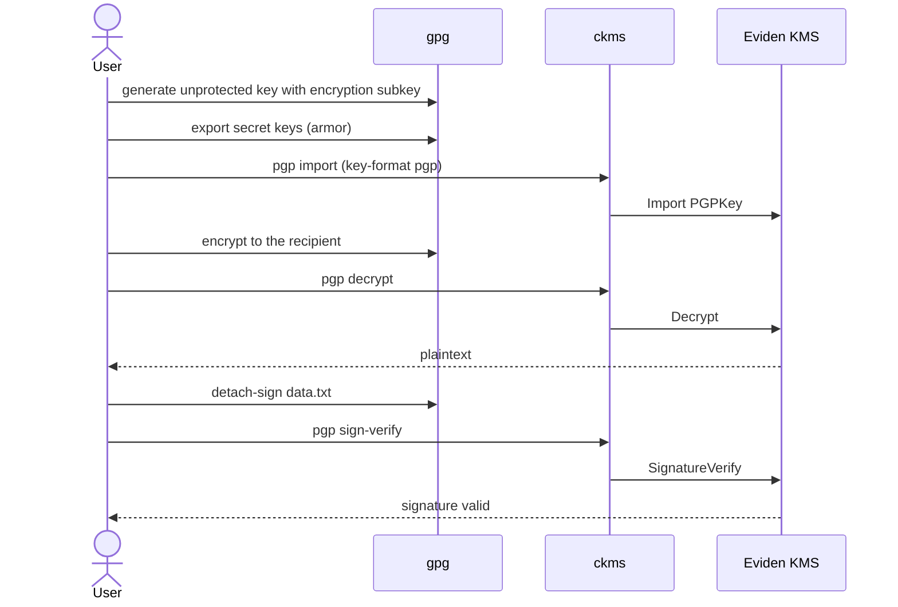
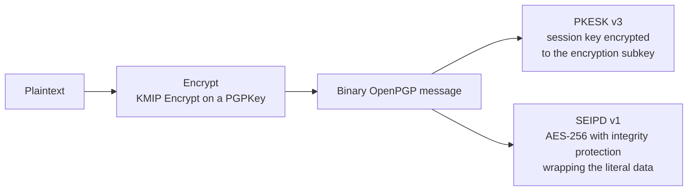

# OpenPGP Key Support

Eviden KMS supports OpenPGP transferable secret and public keys (`ObjectType::PGPKey`) in **non-FIPS builds only**.
OpenPGP keys can be created, imported, exported, and used for the KMIP `Encrypt`, `Decrypt`, `Sign`, and
`SignatureVerify` operations. See the [supported objects](../../kmip_support/objects.md) and
[supported formats](../../kmip_support/formats.md) pages for the KMIP-level summary. To use KMS-managed
RSA keys as a GnuPG smartcard instead, see [GnuPG smartcard](smartcard.md).



The OpenPGP engine creates keys and runs `Encrypt` (SEIPD v1, AES-256), `Decrypt` (binary or armor),
`Sign` (detached, SHA-256) and `SignatureVerify` (primary key and subkeys). GnuPG never talks to the
server directly: key files, signatures and messages move between `gpg` and the clients.

!!! warning Non-FIPS only
    OpenPGP algorithms (Ed25519, Curve25519, RSA key profiles) are not FIPS 140-3 approved.
    `PGPKey` support is compiled out of FIPS builds; creating or importing an OpenPGP key on a
    FIPS server returns a `NotSupported` error.

## Supported versions and formats

### GnuPG

| Item | Support |
|------|---------|
| Interoperability suite | The `pgp_gnupg_tests` suite (24 tests) and `.mise/scripts/test/test_gnupg.sh` run against the `gpg` found in `PATH`. The repository does **not** pin or install a GnuPG version for it. |
| Last verified version | **GnuPG 2.5.18** (libgcrypt 1.12.1): all 24 tests pass. |
| Minimum version | Not tested below the version above. Ed25519/Curve25519 keys (`eddsa`/`ecdh cv25519`) and `--pinentry-mode loopback`, which the commands on this page use, are GnuPG 2.1+ features, so older releases cannot follow them. |
| `gnupg-pkcs11-scd` smartcard | Separate integration, see [GnuPG smartcard](smartcard.md). |

### Standards

| Standard | Role in Eviden KMS |
|----------|--------------------|
| [RFC 4880](https://www.rfc-editor.org/rfc/rfc4880) (OpenPGP Message Format) | Packet formats read and written: v4 transferable keys, v3 PKESK, v1 SEIPD. |
| [RFC 9580](https://www.rfc-editor.org/rfc/rfc9580) (OpenPGP, obsoletes RFC 4880) | Same v4 structures (§10.1, §10.2), ASCII armor (§6), detached signatures. v6 keys and v2 SEIPD (AEAD) are **not** produced or decrypted. |
| [RFC 3156](https://www.rfc-editor.org/rfc/rfc3156) (PGP/MIME) | Encrypted and signed MIME bodies produced by GnuPG are decrypted/verified by the KMS (covered by the interoperability suite). The KMS does not build MIME messages. |
| RFC 2440 | Historic, not targeted. |

### Formats and packet versions

| Object | Format | Version | Direction |
|--------|--------|---------|-----------|
| Transferable public / secret key | ASCII armor (`-----BEGIN PGP PUBLIC KEY BLOCK-----` / `PRIVATE KEY BLOCK`) | v4 | Import, export (`pgp-public`, `pgp-secret`) |
| Transferable public / secret key | Binary packets | v4 | Import, export (`pgp-public-binary`, `pgp-secret-binary`) |
| Encrypted message | Binary: PKESK v3 + SEIPD v1 (AES-256) | RFC 4880 / RFC 9580 §5.13.1 | `Encrypt` output |
| Encrypted message | Binary or ASCII armor | PKESK + SEIPD v1 (compressed payloads are decompressed, up to 64 MiB of plaintext) | `Decrypt` input |
| Detached signature | Binary (SHA-256, made with the primary key) | v4 signature | `Sign` output |
| Detached signature | Binary or ASCII armor | v4 signature, primary key or a bound signing subkey | `SignatureVerify` input |
| Inline, cleartext signatures | not supported | n/a | rejected |
| SEIPD v2 / AEAD (packet tag 20), passphrase-protected secret keys | not supported | n/a | rejected |

Imported keys of another packet version are parsed by the underlying
[`pgp`](https://crates.io/crates/pgp) crate (0.21), which reports the version in the `pgp_key_version`
attribute; only v4 is generated and exercised by the test suites, so v3, v5 and v6 keys are not supported.

## Key profiles

OpenPGP keys are created via KMIP `Create` with `ObjectType::PGPKey`, or the `ckms pgp keys create`
command. Two algorithm profiles are supported:

- **Ed25519** (default): an Ed25519 primary key (certify and sign) with a Curve25519/cv25519 ECDH
  encryption subkey.
- **RSA**: an RSA primary key (certify and sign) with an RSA encryption subkey. Supported modulus
  sizes are **2048**, **3072**, or **4096** bits.

RSA private-key operations on OpenPGP keys (key generation and self-signatures, `Decrypt` of the
session key, `Sign`) run in OpenSSL, which blinds them and applies implicit rejection to
PKCS#1 v1.5 decryption. The `pgp` crate is used for packet handling and RSA public-key operations
only.

Keys are generated **unprotected** inside the KMS protection boundary.



## Import and export formats

`ckms` and the Web UI accept both ASCII-armored and binary OpenPGP transferable keys for import.
Secret-key imports must be unprotected.

### `ckms` CLI

- **Import:** `--key-format pgp` accepts armored or binary transferable public keys and
  unprotected secret keys.
- **Export:** `--key-format pgp-secret` and `pgp-public` produce ASCII-armored keys.
  `pgp-secret-binary` and `pgp-public-binary` produce binary packet keys.

### Web UI

- **Import:** **OpenPGP > Keys > Import** accepts ASCII-armored (`.asc`) or binary key files.
- **Export:** **OpenPGP > Keys > Export** offers **OpenPGP Secret Key (.asc)**,
  **OpenPGP Public Key (.asc)**, **OpenPGP Secret Key (binary .pgp)**, and
  **OpenPGP Public Key (binary .pgp)**.

## Identification and tags

- **System tag** — the KMS automatically attaches the `_pgp` system tag to every created or imported
  OpenPGP key, alongside the user-supplied tags.
- **User ID** — the `pgp-user-id` vendor attribute (`VENDOR_ATTR_PGP_USER_ID`) holds the OpenPGP
  User ID packet, e.g. `Alice <alice@example.com>`. It is set from `--user-id` on `ckms pgp keys create`,
  and is carried back out as the User ID when the key is exported to GnuPG.

## Interoperability with GnuPG

The KMS interoperates directly with GnuPG (`gpg`); see [Supported versions](#supported-versions-and-formats) for the
versions covered. The commands below are the exact commands
exercised by the `.mise/scripts/test/test_gnupg.sh` end-to-end suite.

### KMS → GnuPG

Create an Ed25519 key, export it, and let `gpg` verify a KMS signature and decrypt a KMS-encrypted
message:



```bash
# Create the key and export the secret armor so gpg can decrypt
ckms pgp keys create --algorithm ed25519 --user-id "CI <ci@example.com>" --tag pgp-ci
ckms pgp export --tag pgp-ci --key-format pgp-secret sec.asc
gpg --batch --import sec.asc
ckms pgp export --tag pgp-ci --key-format pgp-secret-binary sec.pgp
gpg --batch --import sec.pgp

# KMS signs, gpg verifies
ckms pgp sign --tag pgp-ci -o data.sig data.txt
gpg --verify data.sig data.txt

# KMS encrypts, gpg decrypts
ckms pgp encrypt --tag pgp-ci -o msg.bin data.txt
gpg --decrypt msg.bin > out.txt
```

### GnuPG → KMS

Generate an unprotected key in GnuPG with an explicit encryption subkey, import it into the KMS, and
let the KMS decrypt a GnuPG-encrypted message and verify a GnuPG-produced detached signature:

```bash
# 1. Generate an unprotected key with an encryption subkey (non-AEAD preferences)
cat << 'EOF' | gpg --batch --yes --no-tty --pinentry-mode loopback --passphrase "" --generate-key
Key-Type: eddsa
Key-Curve: ed25519
Key-Usage: sign,cert
Subkey-Type: ecdh
Subkey-Curve: cv25519
Subkey-Usage: encrypt
Preferences: AES256 AES192 AES SHA512 SHA384 SHA256 ZLIB BZIP2 ZIP Uncompressed
Name-Real: GPG User
Name-Email: gpg@example.com
Expire-Date: 0
%no-protection
%commit
EOF

# 2. Export the secret armor and import it into the KMS under a fresh ID
gpg --batch --armor --export-secret-keys "gpg@example.com" > gpg-sec.asc
ckms pgp import --key-format pgp gpg-sec.asc gpg-imported

# 3. GnuPG encrypts, KMS decrypts
gpg --batch --trust-model always --recipient "gpg@example.com" --output msg.gpg --encrypt data.txt
ckms pgp decrypt -k gpg-imported -o out.txt msg.gpg
diff data.txt out.txt

# 4. GnuPG signs (binary and ASCII-armored detached), KMS verifies
gpg --batch --local-user "gpg@example.com" --detach-sign --output gpg.sig data.txt
ckms pgp sign-verify -k gpg-imported data.txt gpg.sig
gpg --batch --local-user "gpg@example.com" --armor --detach-sign --output gpg.asc data.txt
ckms pgp sign-verify -k gpg-imported data.txt gpg.asc
```



!!! note Generating GnuPG keys for the KMS
    `gpg --quick-generate-key` does **not** create an encryption subkey by default, and batch-generated
    keys default to SEIPDv2/AEAD packets the KMS cannot decrypt. Use the explicit `--generate-key`
    parameter file above, which adds an `ecdh`/`cv25519` encryption subkey and pins non-AEAD
    preferences. GnuPG keys imported into the KMS must be unprotected (`%no-protection` / empty
    passphrase), because the KMS cannot use passphrase-protected secret keys.

!!! note Trust model
    `gpg --encrypt` to a freshly imported key requires `--trust-model always`; without it GnuPG
    refuses with *"There is no assurance this key belongs to the named user"*.

## Applicable standards and format adoption

OpenPGP has evolved through the IETF standards track:

- **RFC 2440** (Historic) — initial IETF OpenPGP specification (obsoleted by RFC 4880).
- **RFC 4880** (Standards Track) — defines version 4 (v4) Transferable Secret and Public Keys and
  Symmetrically Encrypted Integrity Protected Data (v1 SEIPD).
- **RFC 9580** (Standards Track, July 2024, obsoletes RFC 4880, 5581, 6637) — current IETF standard
  defining version 6 (v6) keys and v2 SEIPD with AEAD, while formally preserving and specifying
  version 4 key format and packet structures (§10.1 *Transferable Public Keys*, §10.2 *Transferable Secret Keys*).

### Format adoption in Eviden KMS

Eviden KMS strictly adopts the **IETF OpenPGP Transferable Key format** (RFC 4880 and RFC 9580 §10.1 & §10.2, v4 packets)
and v1 SEIPD (AES-256) encryption:

- **Key encapsulation**: managed objects are stored and transferred using standard v4 Key packets.
  In KMIP, these are represented by vendor extensions `KeyFormatType::OpenPgpSecretKey` (`0x88800007`)
  and `KeyFormatType::OpenPgpPublicKey` (`0x88800008`).
- **Message encryption**: produces standard v3 PKESK packets followed by a v1 SEIPD container (RFC 9580 §5.1.1, §5.13.1, §10.3.2.1).
- **Interoperability**: because Eviden KMS generates and expects standard RFC 4880 / RFC 9580 v4 structures,
  it interoperates out-of-the-box with any standard OpenPGP implementation, including GnuPG and commercial
  OpenPGP-compliant tooling. Non-standard extensions, such as experimental AEAD packet types (packet tag 20),
  are rejected by the server parser.



## Limitations

The server pins the following constraints for OpenPGP keys. Each is asserted by the
`pgp_gnupg_tests` interoperability suite in `crate/test_kms_server/src/pgp_gnupg_tests.rs`.

!!! warning No passphrase-protected keys
    OpenPGP secret keys stored in the KMS cannot be passphrase-protected. `Decrypt` and `Sign`
    return `OpenPGP secret key is passphrase-protected; Decrypt/Sign are not supported`. Import
    unprotected secret keys only.

!!! warning Binary output, detached signatures only
    - `Encrypt` and `Sign` always emit **binary** OpenPGP packets (PKESK + SEIPDv1/AES-256; detached
      binary signatures). Callers needing ASCII armor must armor the output themselves.
    - `SignatureVerify` accepts only **detached** signatures (`gpg --detach-sign`). Inline
      (`gpg --sign`) and cleartext (`gpg --clearsign`) signatures are rejected.
    - `Decrypt` and `SignatureVerify` accept both binary and ASCII-armored inputs.
    - The KMS verifies against the primary key first, then every signing subkey bound to it: the
      subkey's binding signature must verify against the primary key and carry a valid embedded
      back-signature (RFC 9580 §5.2.1.8). A signing-subkey signature therefore validates against the
      published certificate, while subkeys added to a certificate by a third party are ignored.

!!! warning Only bound, unrevoked, unexpired keys are used
    `Encrypt` selects the first encryption subkey whose binding signature verifies against the
    primary key; Key Flags are read from verified signatures only, from the newest binding of each
    subkey. A subkey is skipped when the primary key issued a subkey revocation signature for it
    (RFC 9580 §5.2.1.12) or when the Key Expiration Time of its newest binding has passed (RFC 9580
    §5.2.3.13). A certificate without such a subkey (and whose primary key is not flagged for
    encryption by a verified self-signature) is rejected with
    `OpenPGP certificate has no encryption-capable key`.

    A certificate carrying a key revocation signature made by its primary key (RFC 9580 §5.2.1.11),
    or whose primary key is past the Key Expiration Time of its newest self-signature, is refused as
    a whole: `Encrypt` fails with `OpenPGP certificate is revoked` or
    `OpenPGP certificate is expired`, and `SignatureVerify` returns `Invalid`. A signature made by a
    revoked or expired signing subkey is also `Invalid`, whatever the signature's creation time.
    Import the up-to-date certificate (`gpg --export`) to have a revocation or expiry take effect.

!!! warning Plaintext size limit
    `Decrypt` fails with `decrypted OpenPGP plaintext exceeds the 67108864-byte limit` when the
    decrypted (decompressed) plaintext is larger than 64 MiB, the server request-body limit.

!!! warning No streaming or pre-hashed data
    - Supplying `DigestedData` to `Sign` or `SignatureVerify` returns an error: OpenPGP signatures
      require the full message.
    - Supplying `InitIndicator` or `CorrelationValue` (streaming / multi-part) returns an error:
      streaming is not supported for OpenPGP keys.

!!! warning Wrap-on-create and wrap-on-export unsupported
    OpenPGP keys cannot be wrapped at `Create` time using `wrapping_key_id`: the server's at-rest
    wrap path does not support the `PGPKey` encoding. A wrapped OpenPGP key cannot be unwrapped on
    export either; requesting an explicit `KeyFormatType` on a wrapped key returns an error.
    `Export`/`Get` with a `KeyWrappingSpecification` is refused (`Key_Wrap_Type_Not_Supported`);
    for a `Sensitive` OpenPGP key it returns `Sensitive`, so a Sensitive secret key never leaves
    the server.

## Glossary

| Term | Definition |
|------|------------|
| AEAD | Authenticated Encryption with Associated Data. In OpenPGP, the mode used by SEIPD v2 (packet tag 20), which the KMS rejects. |
| AES | Advanced Encryption Standard. The KMS encrypts OpenPGP messages with AES-256 (256-bit key). |
| API | Application Programming Interface. |
| ASCII armor | Text encoding of binary OpenPGP packets between `-----BEGIN PGP …-----` and `-----END PGP …-----` lines (RFC 9580 §6). |
| CI | Continuous Integration. |
| CLI | Command-Line Interface; here the `ckms` tool. |
| ECDH | Elliptic Curve Diffie-Hellman. Algorithm of the OpenPGP encryption subkey on Curve25519. |
| Ed25519 | Edwards-curve Digital Signature Algorithm (EdDSA) on Curve25519. Algorithm of the signing primary key in the default profile. |
| FIPS | Federal Information Processing Standards; here FIPS 140-3, the NIST cryptographic-module standard. |
| HTTP | Hypertext Transfer Protocol. |
| IETF | Internet Engineering Task Force, publisher of the RFCs. |
| KMIP | Key Management Interoperability Protocol (OASIS standard); the KMS speaks KMIP 2.1. |
| KMS | Key Management System; here Eviden KMS. |
| MIME | Multipurpose Internet Mail Extensions. |
| NIST | National Institute of Standards and Technology. |
| OpenPGP | The IETF standard for encrypting and signing data and for managing keys, defined by RFC 4880 and RFC 9580. GnuPG is an implementation. |
| PGP | Pretty Good Privacy, the original software from which OpenPGP derives; also the label in armor headers and in `ObjectType::PGPKey`. |
| PGP/MIME | Encrypted and signed email using MIME, defined by RFC 3156. |
| PKCS#11 | Public-Key Cryptography Standards #11, the Cryptoki token API used by the GnuPG smartcard integration. |
| PKESK | Public-Key Encrypted Session Key packet: the message's session key encrypted to a recipient's public key. The KMS emits v3. |
| REST | Representational State Transfer; the HTTP interface of the KMS. |
| RFC | Request for Comments, an IETF specification document. |
| RSA | Rivest-Shamir-Adleman public-key algorithm. Supported sizes: 2048, 3072, 4096 bits. |
| SEIPD | Symmetrically Encrypted and Integrity Protected Data packet: the encrypted payload of a message. The KMS emits and reads v1 only. |
| SHA-256 | Secure Hash Algorithm with a 256-bit digest, used for detached signatures. |
| Subkey | Key bound to a primary key and used for one purpose, for example encryption. |
| TPK | Transferable Public Key (or Transferable Secret Key): a key with its User ID, subkeys and binding signatures, in the RFC 4880 §11 / RFC 9580 §10 format. |
| TTLV | Tag-Type-Length-Value, the KMIP binary encoding. |
| UI | User Interface; here the Web UI of the KMS. |
| User ID | OpenPGP packet naming the key owner, for example `Alice <alice@example.com>`. |
| WASM | WebAssembly; the Web UI uses it to build KMIP requests in the browser. |
