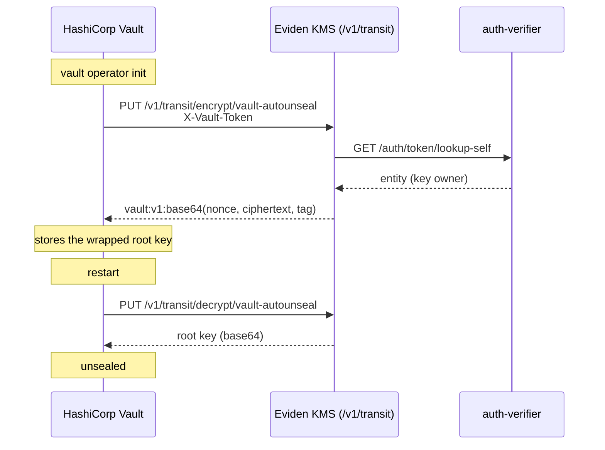

# HashiCorp Vault auto-unseal with the Eviden KMS

HashiCorp Vault starts **sealed**: its root key is encrypted and Vault cannot serve secrets until
the root key is decrypted. With *auto-unseal*, Vault delegates the protection of its root key to an
external key manager and unseals itself at every start, without operators typing unseal shares.

The Eviden KMS exposes a Vault-compatible **Transit** engine. Vault's built-in
[`seal "transit"`](https://developer.hashicorp.com/vault/docs/configuration/seal/transit) uses it to
encrypt and decrypt its root key with an AES-256-GCM key that never leaves the KMS (and lives in
the HSM when the KMS key-encryption key is HSM-backed).

> OpenBao can also be unsealed by the KMS through its `seal "kmip"`, which talks KMIP directly
> to the KMS; this page covers HashiCorp Vault and its `seal "transit"`.

## How it works



| Endpoint | Purpose |
|---|---|
| `POST`/`PUT /v1/{mount}/keys/{name}` | Create the key. Type `aes256-gcm96` (the default when `type` is omitted). |
| `POST`/`PUT /v1/{mount}/encrypt/{name}` | Encrypt base64 `plaintext`; returns `vault:vN:<base64>`. |
| `POST`/`PUT /v1/{mount}/decrypt/{name}` | Decrypt a `vault:vN:` ciphertext with key version `N`. |
| `POST`/`PUT /v1/{mount}/keys/{name}/rotate` | Add a key version; older ciphertexts stay decryptable. |
| `GET /v1/{mount}/keys/{name}` | Key metadata (`latest_version`, version → creation time). |
| `DELETE /v1/{mount}/keys/{name}` | Destroy every version of the key. |

The ciphertext body is `nonce (12 bytes) || ciphertext || tag (16 bytes)`, as in Vault. Each key
version is a separate, non-exportable (`sensitive`) KMS symmetric key tagged
`vault_transit:{name}` and `vault_transit_version:{N}`, owned by the identity of the Vault token.
Only the owner can use or rotate the key. Optional `associated_data` (AEAD) and `key_version` are
supported; derived keys (`context`), convergent encryption and `batch_input` are not and are
rejected with `400`. A malformed ciphertext, an unknown key version and an authentication
failure all return the same `400` (`cipher: message authentication failed`).

The full request and response schemas are in the [OpenAPI reference](openapi.md).

## Prerequisites

- An Eviden KMS reachable over TLS with the Vault-compatible API enabled and an auth-verifier
  (Cosmian Authentication Server) issuing AppRole tokens — see
  [SPIRE / SPIFFE Vault-compatible integration](spire_spiffe.md) for the KMS `[vault]` settings
  and the auth-verifier deployment:

```toml
[vault]
vault_api_enabled       = true
vault_auth_verifier_url = "https://auth.example.com:8443"
vault_transit_mount     = "transit"
```

- The `ckms` CLI, configured as an administrator of the auth-verifier.

## Configure the auto-unseal

### 1. Create an AppRole for Vault

The AppRole name becomes the owner of the unseal key in the KMS.

```bash
ckms vault approle create-role vault-seal --token-ttl 768h --token-policies default \
  --auth-verifier-url https://auth.example.com:8443 --admin-user admin --admin-password '***'
ROLE_ID=$(ckms vault approle get-role-id vault-seal --auth-verifier-url ... )
SECRET_ID=$(ckms vault approle generate-secret-id vault-seal --auth-verifier-url ... \
  | awk '/^secret_id:/{print $2}')
```

### 2. Log in and create the transit key

```bash
export KMS=https://kms.example.com:9998
TOKEN=$(curl -s -X POST -d "{\"role_id\":\"$ROLE_ID\",\"secret_id\":\"$SECRET_ID\"}" \
  "$KMS/v1/auth/approle/login" | jq -r .auth.client_token)

curl -s -X POST -H "X-Vault-Token: $TOKEN" -d '{"type":"aes256-gcm96"}' \
  "$KMS/v1/transit/keys/vault-autounseal"
```

### 3. Configure Vault

Add a `seal "transit"` stanza to the Vault server configuration:

```hcl
seal "transit" {
  address         = "https://kms.example.com:9998"
  token           = "<TOKEN>"
  key_name        = "vault-autounseal"
  mount_path      = "transit/"
  tls_ca_cert     = "/etc/vault/kms-ca.crt"
  # disable_renewal = "true"
}
```

- `token` may instead come from the `VAULT_TOKEN` environment variable of the Vault process.
- By default Vault renews the token through `POST /v1/auth/token/renew-self`, which the KMS
  forwards to the auth-verifier. Set `disable_renewal = "true"` when the token is managed
  externally; the token must then stay valid for as long as Vault may restart.

### 4. Initialise Vault

With an auto-unseal seal, Vault issues *recovery keys* instead of unseal keys:

```bash
vault operator init -recovery-shares=5 -recovery-threshold=3
vault status   # Seal Type: transit, Sealed: false
```

From now on, every restart of Vault unseals automatically while the KMS key is available.
To migrate an existing Shamir-sealed Vault, add the stanza and run
`vault operator unseal -migrate` (see the Vault seal migration documentation).

## Operations

- **Rotation**: `POST /v1/transit/keys/vault-autounseal/rotate` adds version `N+1`. New
  encryptions use the newest version. At its next start Vault decrypts its stored keys with the
  version recorded in their ciphertext, then re-wraps them with the newest version
  (`core.autoseal: upgrading stored keys` in the Vault log). Older versions stay usable for
  decryption; they are only removed when the whole key is deleted. Concurrent `rotate` calls on
  the same key may produce a single new version instead of one per call.
- **Deletion**: deleting the key, or revoking the AppRole token, prevents Vault from starting
  unsealed.
  Keep KMS backups of the key: without it the Vault data cannot be recovered.
- **High availability**: run the KMS in HA mode (see
  [High-availability](../installation/high_availability_mode.md)); Vault needs the KMS at every
  start.

## Vault Enterprise: `seal "pkcs11"`

Vault Enterprise can also use the Cosmian [PKCS#11 provider](pkcs11_provider.md)
(`libcosmian_pkcs11`) as an HSM with its
[`seal "pkcs11"`](https://developer.hashicorp.com/vault/docs/configuration/seal/pkcs11), using the
provider's `CKM_AES_GCM` support. The provider reads `ckms.toml` to reach the KMS:

```hcl
seal "pkcs11" {
  lib         = "/usr/local/lib/libcosmian_pkcs11.so"
  slot        = "0"
  pin         = "unused" # ignored unless the provider uses the PIN as access token
  key_label   = "vault-hsm-key"
  mechanism   = "0x1087" # CKM_AES_GCM
}
```

> This configuration requires a Vault Enterprise licence and is not exercised by the KMS CI;
> only the `seal "transit"` path above is tested end to end.

## Testing

The CI task `mise run test:spire:vault-transit-seal` (non-FIPS, also run by `mise run test:spire`)
starts the auth-verifier, the KMS and Vault OSS 1.21 in Docker, then checks that Vault:

1. initialises with `seal "transit"` and is unsealed;
2. auto-unseals after a restart and serves a KV secret written before the restart;
3. still auto-unseals after the KMS key is rotated;
4. cannot unseal once the KMS key is deleted (Vault refuses to start: its seal check gets a `404`).
