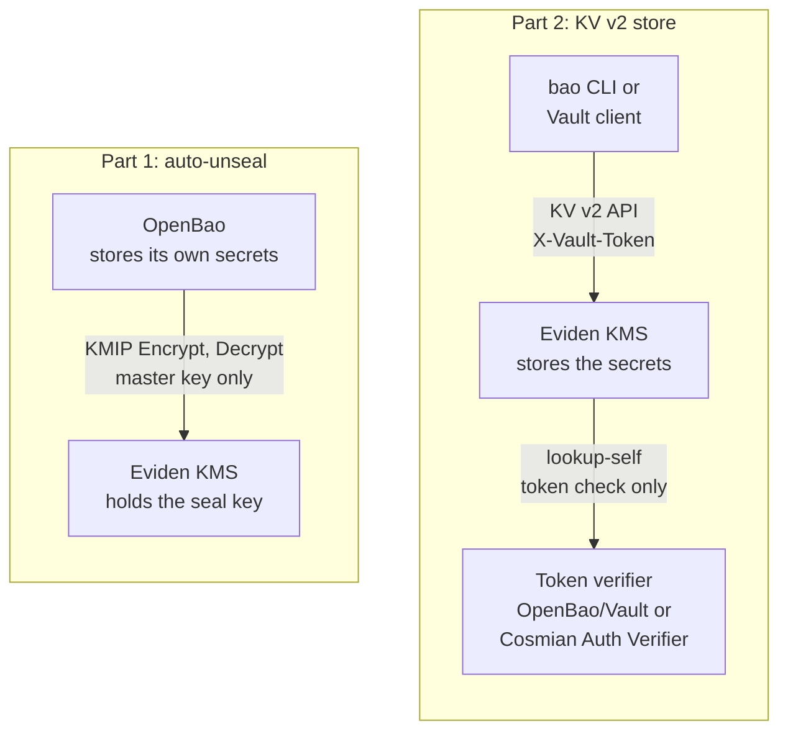
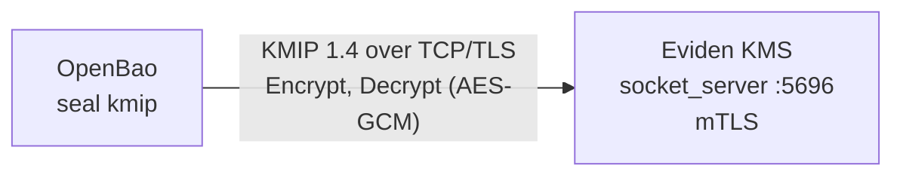
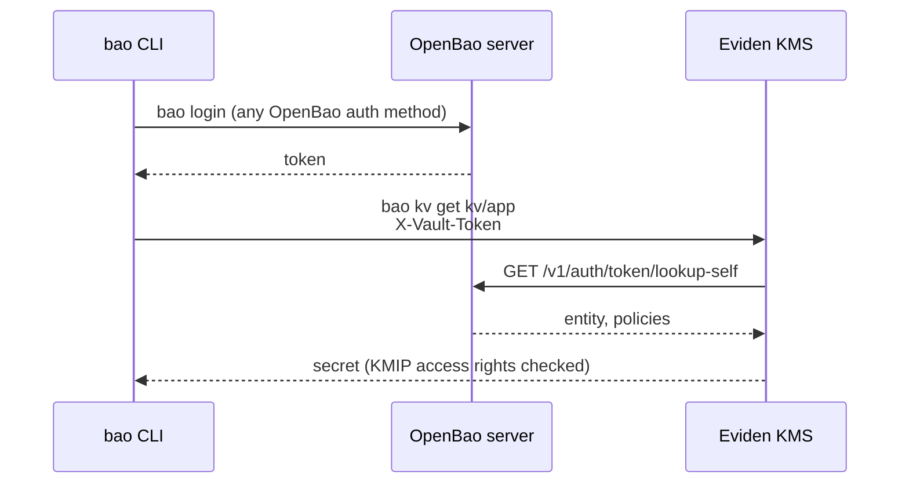
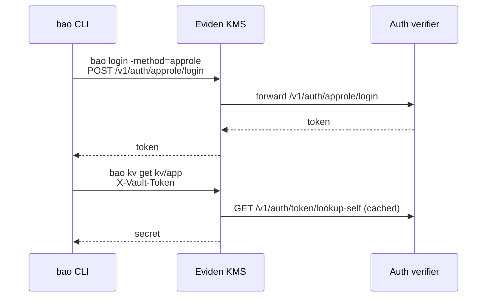

# OpenBao and Eviden KMS

## Does the KMS replace OpenBao?

**No.** Eviden KMS is a KMIP key-management server. [OpenBao](https://openbao.org/) is a secrets manager with its own storage, policies, auth methods and dynamic secrets. The KMS does not run OpenBao and does not implement the whole OpenBao or Vault API. The two products work together in two independent ways:

|Integration|What the KMS does|What OpenBao does|Section|
|---|---|---|---|
|**Auto-unseal (seal/unseal)**|Holds the AES seal key that encrypts OpenBao's root key. Answers KMIP Encrypt and Decrypt.|Keeps running as your secrets manager and stores its secrets itself. Calls the KMS at every start to unseal.|[Part 1](#part-1--auto-unseal-openbao-with-the-kms)|
|**KV v2 secret store for `bao` clients**|Stores the secrets itself, as KMIP objects, and serves a Vault KV v2-compatible API.|Nothing is stored in OpenBao. At most it issues and validates the login tokens (the token verifier); the Cosmian Auth Verifier can do the same without OpenBao. See [Authenticating the bao CLI](../configuration/secret_backends.md#authenticating-the-bao-cli).|[Part 2](#part-2--use-the-kms-as-a-kv-v2-secret-store)|

Enabling the Vault-compatible API (`vault_api_enabled = true`, needed for Part 2 token validation) also exposes a minimal, SPIRE-oriented subset of two OpenBao engines, see [SPIRE and SPIFFE](spire_spiffe.md): `/v1/transit/` with key create, read, list, delete, config and `sign/{name}/{hash_alg}` only (no encrypt, decrypt, rewrap, verify or HMAC), and `/v1/<vault_pki_mount>/` with `root/sign-intermediate` only. This is not a general replacement for those engines.

Part 1 is about **protecting OpenBao**. Part 2 is about **replacing OpenBao's KV storage with the KMS for your clients**. They do not depend on each other, and you can use both: an OpenBao unsealed by the KMS can also be the token verifier for the KMS KV store.

<div style="display: flex; gap: 1rem; align-items: center">

<div style="flex: 1 1 0; min-width: 0">



</div>

<div style="flex: 1 1 0; min-width: 0">



</div>

</div>

## What is OpenBao

[OpenBao](https://openbao.org/) is an open-source secrets manager: it stores secrets, issues short-lived credentials and encrypts data for applications, behind a Vault-compatible HTTP API. It is a community fork of HashiCorp Vault 1.14, the last release line under the Mozilla Public License 2.0, created after HashiCorp moved Vault to the Business Source License in 2023. OpenBao is MPL 2.0, a Linux Foundation project that joined the OpenSSF in 2025, and keeps API compatibility with Vault, so Vault clients and the `bao` CLI (the counterpart of `vault`) work against it. Sources: [openbao.org](https://openbao.org/), the [OpenSSF announcement](https://openssf.org/blog/2025/06/17/openbao-joins-the-openssf-to-advance-secure-secrets-management-in-open-source/) and the [LF Edge fork FAQ](https://lf-edge.atlassian.net/wiki/display/OH/OpenBao+%28Hashicorp+Vault+Fork+effort%29+FAQ).

## Part 1 — Auto-unseal OpenBao with the KMS

OpenBao encrypts everything it stores with a barrier key, itself protected by a root key. By default an operator unseals OpenBao by hand with key shares. With the `seal "kmip"` stanza, OpenBao instead asks Eviden KMS to encrypt and decrypt that root key over KMIP: the root key stays in OpenBao's own storage, encrypted under an AES seal key that never leaves the KMS, and is decrypted into OpenBao's memory at every start, so OpenBao unseals itself.

Only this one key is handled by the KMS. All your secrets, policies and auth methods stay in OpenBao, and you keep operating OpenBao as before.

OpenBao requires a KMIP server that speaks KMIP 1.2 to 1.4 and supports Encrypt and Decrypt with an AES key (`AES_GCM`) or an RSA key (`RSA_OAEP_*`, addressed by its private key identifier). Eviden KMS supports `AES_GCM` on its binary KMIP listener, in the non-FIPS build only. It does not support the `RSA_OAEP_*` modes: `Encrypt` with a private key identifier is rejected.

!!! warning "FIPS build"
    OpenBao's KMIP seal chooses the AES-GCM IV itself and sends it with `Encrypt`. A FIPS build of Eviden KMS generates the IV inside the FIPS module and refuses one supplied by the client (see [FIPS](../certifications_and_compliance/fips.md)), so the auto-unseal needs the non-FIPS build.

### KMS endpoints used by Part 1

OpenBao only talks to the **binary KMIP socket**, KMIP over TCP with mutual TLS (`[socket_server]`, port `5696` here). No HTTP route is involved at runtime.

|Interface|Used by|Operations|
|---|---|---|
|KMIP socket, `kms.example.com:5696`|OpenBao `seal "kmip"`|`Encrypt` and `Decrypt` of the root key with the AES seal key (KMIP 1.4, `AES_GCM`)|
|HTTP `POST /kmip/2_1` (or `ckms`)|you, once, at setup|`Create` and `Activate` of the AES-256 wrapping key as the OpenBao identity (step 2)|

### 1. Start the KMS with the KMIP listener and mTLS

The binary KMIP listener requires a client CA, and the OpenBao client certificate must be signed by it. The certificate common name becomes the identity seen by the KMS.

```toml
[tls]
tls_cert_file = "kms.crt"
tls_key_file = "kms.key"
clients_ca_cert_file = "ca.crt"

[socket_server]
socket_server_start = true
socket_server_port = 5696
socket_server_hostname = "0.0.0.0"
```

### 2. Create and activate an AES-256 wrapping key

Create the key with the OpenBao client certificate so that its identity owns the key, then activate it. The key needs the Encrypt and Decrypt usage masks (`0x0000000C`). Use the unique identifier returned by `Create` as `kms_key_id`.

### 3. Configure OpenBao

```hcl
seal "kmip" {
  endpoint    = "kms.example.com:5696"
  kms_key_id  = "<KMS_KEY_UID>"
  client_cert = "/openbao/tls/client.crt"
  client_key  = "/openbao/tls/client.key"
  ca_cert     = "/openbao/tls/ca.crt"
  server_name = "kms.example.com"
  encrypt_alg = "AES_GCM"
}
```

`server_name` must match a subject alternative name of the KMS certificate. Initialize with `bao operator init`: OpenBao then returns recovery keys instead of unseal keys and unseals itself at every start by calling the KMS.

### HashiCorp Vault is not supported for auto-unseal

`seal "kmip"` exists only in OpenBao. HashiCorp Vault has no KMIP seal: its seal types are the cloud KMS ones (AliCloud, AWS, Azure, GCP, OCI), `transit`, and `pkcs11` (Vault Enterprise only). Vault's KMIP support is an Enterprise secrets engine, which makes Vault a KMIP server, not a client of one. Pointing Vault at the KMS KMIP socket therefore cannot work, and `test:interop:openbao-kmip` runs OpenBao only.

Unsealing Vault with the KMS needs a different integration, not yet implemented:

- **`seal "transit"`** (all Vault editions): the KMS Vault-compatible Transit emulation would need `encrypt/{name}` and `decrypt/{name}` routes and a symmetric key type. Today it only creates asymmetric keys and signs (see [SPIRE and SPIFFE](spire_spiffe.md)).
- **`seal "pkcs11"`** (Vault Enterprise): requires a PKCS#11 library in front of the KMS and a Vault Enterprise image.

### Automated test

`mise run test:interop:openbao-kmip --variant fips|non-fips` runs the whole scenario with the pinned image `ghcr.io/openbao/openbao:2.7.1` (override with `BAO_IMAGE`) and needs only Docker. It generates the CA, server and client certificates, starts the KMS, creates the wrapping key, initializes OpenBao, restarts it, and checks that:

- OpenBao reports the `kmip` seal type, is initialized and unsealed, and unseals again after a restart;
- the KMS served KMIP `Encrypt` and `Decrypt` for the OpenBao client certificate identity only;
- the requests are KMIP 1.4, target the wrapping key, and use AES in GCM mode. The KMS records this in its debug log (`cosmian_kms_server=debug`): for every operation, the protocol version, the key identifier, the algorithm and the block cipher mode, never the data, the IV or any key material.

These checks apply to the non-FIPS variant. In the FIPS variant the test instead checks that `bao operator init` fails and that the KMS log shows the refusal of OpenBao's caller-supplied AES-GCM IV.

## Part 2 — Use the KMS as a KV v2 secret store

Here the KMS **is** the secret store. `bao` and Vault clients read and write secrets on the KMS KV v2 API, and the secrets are stored as KMIP `SecretData` objects, with KMIP access rights. No secret is stored in an OpenBao server. The supported operations, mount and access-right rules are described in [Vault-compatible KV Secret Store](../configuration/secret_backends.md#vault-compatible-kv-secret-store). Partial updates (`kv patch`) and version-targeted delete/undelete/destroy are not implemented.

Enable the store in the KMS configuration:

```toml
[kv]
kv_enabled = true
kv_mount = "kv"
```

The `bao` CLI always sends a token in the `X-Vault-Token` header, so the KMS needs something to validate it: a **token verifier**. This is an OpenBao/Vault server, or the Cosmian Auth Verifier: both answer `GET /v1/auth/token/lookup-self`. The KMS maps the validated identity to the owner and the access rights of the secrets. The two cases below differ only in where the user logs in to get the token.

|Case|Where the user logs in|`BAO_ADDR` for `bao login`|KMS configuration|
|---|---|---|---|
|A|On an OpenBao server|`https://bao.example.com:8200`|In `[vault]`: `vault_api_enabled = true`, `vault_auth_verifier_url` points to the OpenBao server (see the [note](#case-a--log-in-on-the-openbao-server))|
|B|On the KMS|`https://kms.example.com:9998`|Same `[vault]` keys, with a verifier that serves `/v1/auth/*` (OpenBao/Vault, or the Cosmian Auth Verifier). The KMS forwards `/v1/auth/*` to it. Non-`bao` clients can also use native KMS authentication (JWT, mTLS, API token)|

### KMS endpoints used by Part 2

All routes are served on `/<kv_mount>` and on `/v1/<kv_mount>` (`bao` always sends `/v1/`); the table uses `kv` and `/v1`. KV calls from `bao` carry `X-Vault-Token`; `bao login` requests carry no token, the credential is in the body. Non-`bao` clients can use native KMS authentication on the same KV routes.

|Endpoint|Used by|Purpose|
|---|---|---|
|`GET /v1/sys/internal/ui/mounts/<path>`|`bao kv` (first call)|KV v2 detection: tells the CLI the mount is a version 2 store|
|`PUT`/`POST /v1/kv/data/<path>`|`bao kv put`|Write a new version of a secret (optional `options.ttl` and `options.cas`)|
|`GET /v1/kv/data/<path>` (`?version=N`)|`bao kv get`|Read the latest or a given version|
|`DELETE /v1/kv/data/<path>`|`bao kv delete`|Soft delete: hides the latest version|
|`GET /v1/kv/metadata/<path>`|`bao kv metadata get`|Version bookkeeping of a path|
|`LIST` or `GET ?list=true /v1/kv/metadata/<prefix>`|`bao kv list`|Child keys under a prefix|
|`DELETE /v1/kv/metadata/<path>`|`bao kv metadata delete`|Hard delete of every version|
|`GET /v1/auth/token/lookup-self` (on the verifier)|the KMS itself|Validate `X-Vault-Token` and read `entity_id` (cached)|
|`/v1/auth/*` (forwarded to the verifier)|`bao login`|Login requests, such as `userpass` or `approle`|

Other methods on these paths are refused as unsupported, and the routes for `kv patch` and version-targeted `undelete` and `destroy` are not implemented. The secrets are stored as KMIP `SecretData` objects.

### Case A — log in on the OpenBao server

OpenBao only issues and validates tokens. The user logs in to OpenBao with any of its auth methods, then sends the token to the KMS. The KMS validates it against OpenBao, caches the result for `vault_token_cache_ttl_secs` (30 s by default), and reads or writes the secret in its own database.



```toml
[vault]
vault_api_enabled = true
# The OpenBao/Vault server itself (a base path is kept, no /v1 suffix).
vault_auth_verifier_url = "https://bao.example.com:8200"
vault_auth_verifier_ca_cert = "bao-ca.pem"
```

!!! note
    `vault_auth_verifier_url` is the base URL of the OpenBao server, with no `/v1` suffix: the KMS calls `GET <url>/v1/auth/token/lookup-self` and forwards `/v1/auth/*` unchanged. No proxy is needed.

### Case B — log in on the KMS

The user logs in through the KMS address. The KMS forwards `/v1/auth/*` requests unchanged to `<vault_auth_verifier_url>/v1/auth/*` and returns the verifier response unchanged. The verifier must serve the Vault `/v1/auth/*` paths: an OpenBao/Vault server does (any auth method it has enabled works), and so does the Cosmian Auth Verifier, which adds a Vault-compatible `userpass` login and AppRole. The KMS configuration is the same keys as in case A. See [Authenticating the bao CLI](../configuration/secret_backends.md#authenticating-the-bao-cli) for the Auth Verifier setup.

```bash
export BAO_ADDR=https://kms.example.com:9998
# Machines (AppRole)
bao login -method=approle role_id=<ROLE_ID> secret_id=<SECRET_ID>
# Humans, with the Cosmian Auth Verifier (userpass realm set by vault_userpass_realm)
bao login -method=userpass username=<USER>
bao kv get kv/app
```



Clients that are not `bao` or `vault` can skip the token and use native KMS authentication (JWT, mTLS, API token) on the same routes.
