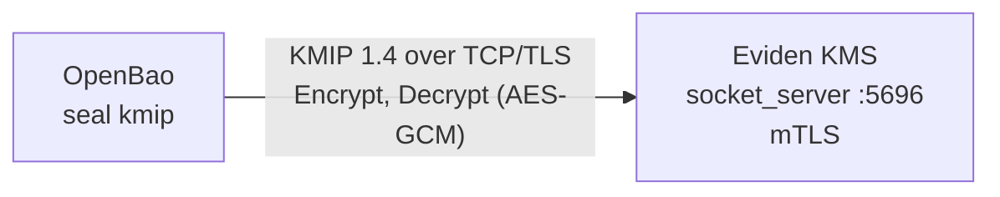

# OpenBao — auto-unseal with the KMS (KMIP seal)

[OpenBao](https://openbao.org/) can keep its master key in an external KMS: with the
`seal "kmip"` stanza, OpenBao asks Eviden KMS to encrypt and decrypt its barrier key over KMIP,
so the unseal key never leaves the KMS. This page is the OpenBao-as-KMIP-consumer integration.
For the opposite direction, where OpenBao and Vault clients use the KMS as a KV v2 secret
store, see [Vault-compatible KV Secret Store](../configuration/secret_backends.md#vault-compatible-kv-secret-store).

OpenBao requires a KMIP server that speaks KMIP 1.2 to 1.4 and supports Encrypt and Decrypt with
an AES key (`AES_GCM`) or an RSA key. Eviden KMS satisfies this on its binary KMIP listener.



## 1. Start the KMS with the KMIP listener and mTLS

The binary KMIP listener requires a client CA, and the OpenBao client certificate must be signed
by it. The certificate common name becomes the identity seen by the KMS.

```toml
[tls]
tls_cert_file = "kms.crt"
tls_key_file = "kms.key"
clients_ca_cert_file = "ca.crt"

[socket_server]
socket_server_start = true
socket_server_port = 5696
socket_server_hostname = "0.0.0.0"
```

## 2. Create and activate an AES-256 wrapping key

Create the key with the OpenBao client certificate so that its identity owns the key, then
activate it. The key needs the Encrypt and Decrypt usage masks (`0x0000000C`). Use the
unique identifier returned by `Create` as `kms_key_id`.

## 3. Configure OpenBao

```hcl
seal "kmip" {
  endpoint    = "kms.example.com:5696"
  kms_key_id  = "<KMS_KEY_UID>"
  client_cert = "/openbao/tls/client.crt"
  client_key  = "/openbao/tls/client.key"
  ca_cert     = "/openbao/tls/ca.crt"
  server_name = "kms.example.com"
  encrypt_alg = "AES_GCM"
}
```

`server_name` must match a subject alternative name of the KMS certificate. Initialize with
`bao operator init`: OpenBao then returns recovery keys instead of unseal keys and unseals
itself at every start by calling the KMS.

## Automated test

`mise run test:openbao-kmip --variant fips|non-fips` runs the whole scenario with the pinned
image `ghcr.io/openbao/openbao:2.7.1` (override with `BAO_IMAGE`) and needs only Docker. It
generates the CA, server and client certificates, starts the KMS, creates the wrapping key,
initializes OpenBao, restarts it, and checks that:

- OpenBao reports the `kmip` seal type, is initialized and unsealed, and unseals again after a
  restart;
- the KMS served KMIP `Encrypt` and `Decrypt` for the OpenBao client certificate identity only;
- the raw requests are KMIP 1.4, target the wrapping key, and use AES in GCM mode.
