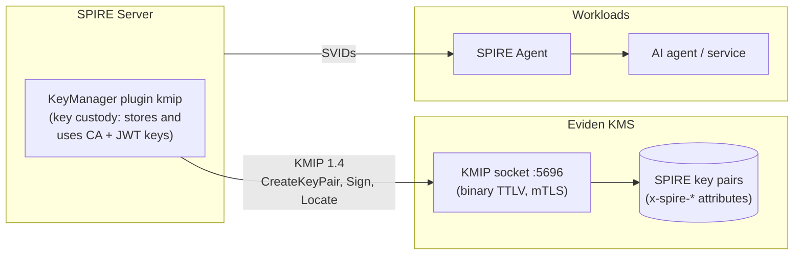
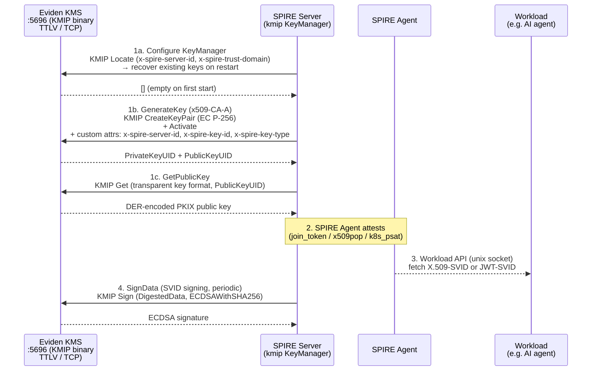
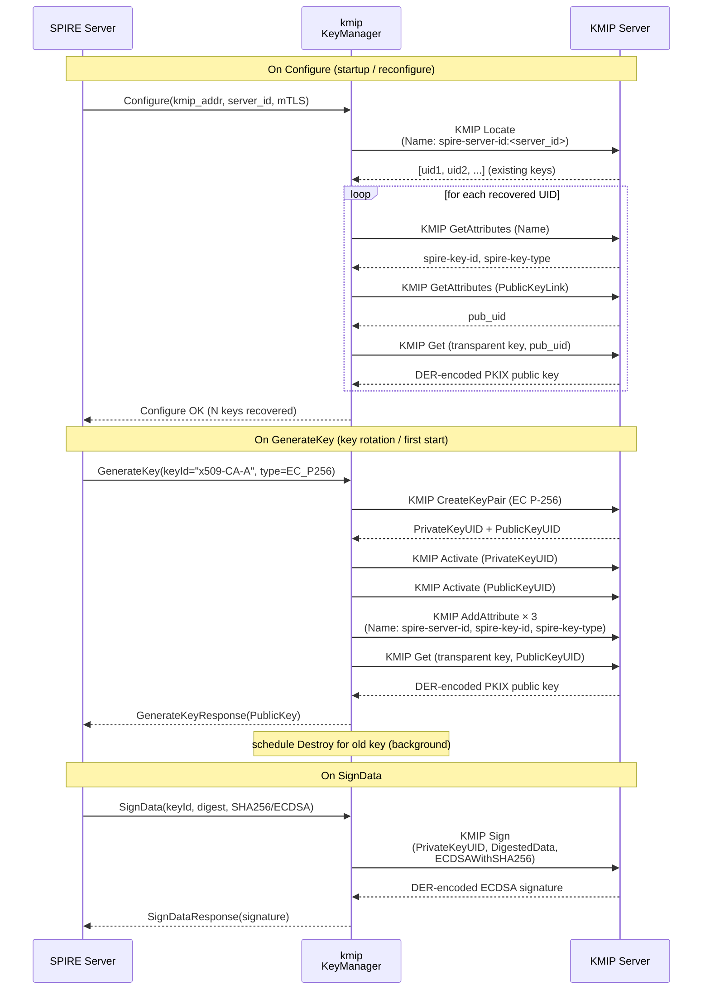
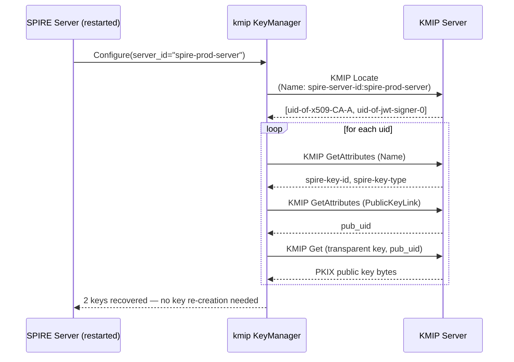

# SPIRE / SPIFFE — Native KMIP Integration

> The `kmip` built-in **KeyManager** plugin lets SPIRE speak **KMIP directly** to a KMIP
> server — such as Eviden KMS — over the standard **binary TTLV / TCP/TLS** transport
> (port 5696). No Vault-compatible layer, no auth-verifier proxy, no AppRole tokens.
> SPIRE's own signing keys (X.509 CA key and JWT signing keys) are stored and used
> exclusively inside the KMIP server, which executes all cryptographic operations using
> FIPS-approved algorithms.
>
> **Plugin status in SPIRE**: KeyManager `kmip` (KMIP 1.4) — merged upstream in
> [spiffe/spire#7235](https://github.com/spiffe/spire/pull/7235), not yet in a tagged
> SPIRE release.
>
> The plugin uses [`ovh/kmip-go`](https://github.com/ovh/kmip-go) as the Go KMIP client
> library.
>
> **E2E test**: the KMS repo contains `mise run test:spire-kmip-key-manager` which builds
> spire-server from the SPIRE fork, starts KMS with the binary KMIP TCP socket,
> and validates the SPIRE + KMS stack end-to-end with mTLS.

## Architecture overview

SPIRE delegates one role to the KMIP server:

- **`KeyManager "kmip"`** — key custody. It creates SPIRE's signing key pairs (X.509 CA key
  and JWT signing keys) on the KMIP server and asks the server to sign with them
  (`CreateKeyPair`, `Activate`, `Get` public key, `Sign`, `Locate` on restart). The private
  keys never leave the KMIP server.

SPIRE's X.509 CA certificate is self-signed with the KMIP-held CA key.

The plugin authenticates with a **mTLS client certificate**, which Eviden KMS requires on
its KMIP socket.



## End-to-end flow



Step 1 happens automatically every time the SPIRE server starts or rotates a key.
Steps 2–4 are the ongoing SVID issuance lifecycle.

## What it is

[SPIFFE](https://spiffe.io/) defines a standard for issuing cryptographic identities —
**SVIDs** (SPIFFE Verifiable Identity Documents) — to software workloads. **SPIRE** is
the reference runtime that issues and rotates these identities.

SPIRE requires an external capability from a backend to protect its signing keys:

- A **`KeyManager`** that stores and uses the signing keys SPIRE uses internally.

The `kmip` plugin provides it, speaking **KMIP binary TTLV over TCP/TLS** (port 5696)
directly to the KMIP server. No Vault-compatible API layer, no separate
authentication service, no AppRole tokens.

## Why use it?

| Need | How this integration addresses it |
|---|---|
| **Private-key custody** | SPIRE's CA and signing keys are generated, stored, and used exclusively inside the KMIP server — never on the SPIRE server's local disk |
| **Compliance-ready crypto** | All signing operations use FIPS-approved algorithms (EC P-256/P-384, RSA-2048/4096, SHA-256/384) |
| **Minimal infrastructure** | Only a KMIP 1.4 server is required — no auth-verifier, no separate secrets management cluster, no proxy |
| **Native protocol** | Speaks KMIP binary TTLV over TCP/TLS — the canonical KMIP transport — rather than a compatibility shim |
| **Vendor-neutral key custody** | Uses only standard KMIP 1.4 operations and custom attributes (`x-spire-*`) for key metadata |
| **Centralized audit trail** | Every `Sign` and `CreateKeyPair` call is a KMIP operation logged by the server with identity, timestamp, and key identifier |
| **Key recovery** | On SPIRE server restart, the `kmip` KeyManager recovers all existing keys via a KMIP `Locate` on its `x-spire-server-id` and `x-spire-trust-domain` attributes — no local state needed |

## Comparison with the Vault-compatible integration

| Aspect | `kmip` KeyManager (native KMIP) | `vault` plugins via KMS Vault API |
|---|---|---|
| KMS API used | KMIP binary TTLV over TCP/TLS (`:5696`), KMIP 1.4 | Vault-compatible REST (`/v1/transit/`, `/v1/pki/`) |
| Authentication | mTLS client certificate | AppRole (role_id + secret_id) via auth-verifier |
| Additional services | None | auth-verifier required |
| SPIRE config namespace | `KeyManager "kmip"` | SPIRE built-in Vault plugins |
| Key discovery on restart | KMIP `Locate` by `x-spire-server-id` and `x-spire-trust-domain` custom attributes | Key identifier file on disk |
| Compatible KMIP servers | Any KMIP 1.4 server | Eviden KMS only |
| SPIRE version required | SPIRE `main` ([#7235](https://github.com/spiffe/spire/pull/7235), merged) | Built-in to SPIRE ≥ 1.9 |

Choose the `kmip` KeyManager when you want a direct, minimal, vendor-neutral integration.
Choose the `vault` plugins with the KMS Vault-compatible API when you need
AppRole-based multi-tenant isolation or Vault token lifecycle features.

---

## Prerequisites

### KMS configuration

The KMIP server must expose a **binary TTLV TCP socket** in addition to (or instead of)
the HTTPS endpoint. For Eviden KMS, enable the `[socket_server]` section in `kms.toml`:

```toml
# kms.toml
default_username = "spire-server"

[http]
port = 9998

# Binary KMIP TCP socket — required for the kmip SPIRE plugin.
[socket_server]
socket_server_start    = true
socket_server_port     = 5696
socket_server_hostname = "0.0.0.0"

# mTLS: trust client certificates signed by this CA.
[tls]
tls_cert_file        = "/etc/kms/certs/kms.crt"
tls_key_file         = "/etc/kms/certs/kms.key"
clients_ca_cert_file = "/etc/kms/certs/ca.crt"
```

The `socket_server` enables the standard KMIP TCP port (5696) alongside the HTTPS
endpoint. The SPIRE plugin connects to this TCP socket using binary TTLV encoding.

---

## SPIRE server configuration

Add the `kmip` KeyManager plugin to `server.conf`.

```hcl
server {
  bind_address = "0.0.0.0"
  bind_port    = "8081"
  trust_domain = "example.org"
  data_dir     = "/var/lib/spire/server"
  log_level    = "INFO"

  ca_ttl               = "24h"
  default_x509_svid_ttl = "1h"
  ca_subject {
    country      = ["US"]
    organization = ["SPIFFE"]
    common_name  = ""
  }
}

plugins {
  DataStore "sql" {
    plugin_data {
      database_type     = "sqlite3"
      connection_string = "/var/lib/spire/server/datastore.sqlite3"
    }
  }

  NodeAttestor "join_token" {
    plugin_data {}
  }

  # ── KeyManager: SPIRE's own signing keys stored in the KMIP server ─────────
  # The plugin creates asymmetric key pairs via KMIP CreateKeyPair, activates them,
  # and tags them with standard KMIP Name attributes (spire-server-id, spire-key-id,
  # spire-key-type). On restart, it recovers existing keys via KMIP Locate.
  KeyManager "kmip" {
    plugin_data {
      # TCP address of the KMIP binary TTLV socket (standard port 5696).
      kmip_addr = "kmip.example.com:5696"

      # PEM CA cert that verifies the KMIP server TLS certificate.
      # Omit if the server uses a publicly-trusted certificate.
      ca_cert_path = "/etc/spire/kmip-ca.crt"

      # mTLS client certificate (required for authentication).
      client_cert_path = "/etc/spire/kmip-client.crt"
      client_key_path  = "/etc/spire/kmip-client.key"

      # A stable identifier for this SPIRE server instance.
      # All keys are tagged with Name "spire-server-id:<server_id>".
      server_id = "spire-prod-server"

      # Optional: skip TLS verification (test environments only).
      # insecure_skip_verify = false
    }
  }
}
```

Start the SPIRE server:

```bash
spire-server run -config /etc/spire/server.conf
```

---

## Detailed flows

### KeyManager — key creation and recovery



### Key recovery after SPIRE server restart



---

## Quick start (local demo)

### From the KMS repository

The KMS repo contains `mise run test:spire-kmip-key-manager` — an end-to-end test that
builds both KMS and SPIRE from source and validates the `kmip` KeyManager over binary
KMIP TCP/TLS with mTLS:

```bash
# From the KMS repository root
mise run test:spire-kmip-key-manager
```

The task:

1. Builds the KMS server and `ckms` CLI from source (non-FIPS)
2. Clones `Cosmian/spire` branch `feature/eviden-kms-plugins` and builds `spire-server`
3. Generates mTLS test certificates (CA, KMS server, SPIRE client)
4. Starts KMS with the binary KMIP TCP socket
5. Runs `spire-server healthcheck` and generates a join token to confirm key creation

### From the SPIRE fork

The Cosmian SPIRE fork also contains a Kind-based integration test suite that starts its
own KMS Docker container:

```bash
git clone --branch feature/eviden-kms-plugins https://github.com/Cosmian/spire
cd spire

# Kind-based integration tests (start KMS Docker, deploy SPIRE into Kind)
test/integration/suites/key-manager-kmip/
```

### KMIP 1.x compliance tests (KMS repo)

The KMS repository also includes KMIP 1.x protocol compliance tests using the
`ovh/kmip-go` library, which can be run independently:

```bash
# From the KMS repository root — KMIP 1.0–1.4 compliance (not SPIRE-related)
mise run test:kmip-go
```

---

## Plugin configuration reference

### `KeyManager "kmip"`

| Field | Type | Required | Default | Description |
|---|---|---|---|---|
| `kmip_addr` | string | ✅ | — | TCP address of the KMIP binary TTLV socket (e.g. `kmip.example.com:5696`) |
| `server_id` | string | ✅ | — | Stable identifier for this SPIRE server. Used as the `spire-server-id` Name attribute on all key pairs. Must be unique per SPIRE instance. |
| `ca_cert_path` | string | — | system pool | PEM file to verify the KMIP server TLS certificate. Omit for publicly-trusted certs. |
| `client_cert_path` | string | — | — | PEM client certificate for mTLS authentication. If set, `client_key_path` is also required. |
| `client_key_path` | string | — | — | PEM client private key for mTLS authentication. |
| `insecure_skip_verify` | bool | — | `false` | Skip TLS verification. **Test environments only.** |

!!! note "Authentication"
    mTLS is the only authentication method supported by the `kmip` plugin. If
    `client_cert_path` and `client_key_path` are both set, the plugin presents
    the client certificate during the TLS handshake. If neither is set, the
    plugin connects without a client certificate (anonymous TLS).

---

## KMIP operations reference

### KeyManager operations

| SPIRE gRPC method | KMIP operation | Key details |
|---|---|---|
| `Configure` | `Locate` | Finds all `PrivateKey` objects with Name `spire-server-id:<server_id>` to rebuild the key map on restart. |
| `GenerateKey` | `CreateKeyPair` | Creates EC P-256/P-384 or RSA-2048/4096 key pair. |
| `GenerateKey` | `Activate` | Activates both private and public keys (KMIP keys start in PreActive state; Sign requires Active). |
| `GenerateKey` | `AddAttribute` | Adds three standard KMIP Name attributes: `spire-server-id:<id>`, `spire-key-id:<keyId>`, `spire-key-type:<type>`. |
| `GenerateKey` | `Get(transparent)` | Fetches the DER-encoded PKIX public key using transparent key format (fallback: unqualified Get). |
| `SignData` | `Sign(DigestedData)` | Signs a pre-hashed digest using `ECDSAWithSHA256/384/512`, `SHA256/384/512WithRSAEncryption`, or `RSASSAPSS`. |
| `GetPublicKey` | In-memory | Served from the local key map (populated at `Configure` + `GenerateKey` time). |
| `GetPublicKeys` | In-memory | Returns all public keys in the local key map. |
| _(key cleanup)_ | `Destroy` | Called in the background after key rotation. |

### KMIP cryptographic usage masks

The KeyManager plugin sets FIPS-compliant `CryptographicUsageMask` values on every key:

| Key type | Object | Flags |
|---|---|---|
| EC P-256/P-384 | Private key | Sign, CertSign, CRLSign |
| EC P-256/P-384 | Public key | Verify |
| RSA 2048/4096 | Private key | Sign, Decrypt, UnwrapKey |
| RSA 2048/4096 | Public key | Verify, Encrypt, WrapKey |

---

## Security notes

### Key isolation

Each SPIRE server instance uses a unique `server_id` Name attribute. Keys tagged with
one server-id can be distinguished from another's — the KMIP server enforces object
ownership via the authenticated connection identity.

### mTLS authentication

mTLS is the only authentication method supported by the `kmip` plugin. The KMIP server
validates the client certificate at the TLS layer, before any KMIP message is processed.

| | mTLS (`client_cert_path` + `client_key_path`) |
|---|---|
| **Credential type** | X.509 client certificate + private key |
| **Expiry** | Hard `NotAfter` date — **causes live failures when expired** |
| **Revocation** | Revoke via CRL/OCSP or delete from the KMIP server's trust CA |
| **Who rotates** | PKI operator (same team who owns the server cert CA) |
| **Rotation trigger** | Certificate expiry; security incident |
| **Automation** | cert-manager, ACME, cron + `openssl` |

### Managing mTLS client certificate lifecycle

The SPIRE plugin authenticates to the KMIP server using a client certificate
(`client_cert_path` / `client_key_path`). This certificate has a hard expiry date.
When it expires, **every KMIP call fails immediately** — including the periodic
`Sign` calls during normal operation, not only on restart.

**Why rotate:**

| Trigger | Impact | Action |
|---------|--------|--------|
| Certificate expiry (`NotAfter` reached) | All KMIP operations fail with a TLS handshake error. SPIRE cannot sign SVIDs or rotate its CA. | Renew certificate **before** expiry. Monitor `notAfter` proactively. |
| Private key compromise | An attacker holding the key can authenticate as the SPIRE server to the KMIP server and access its signing keys. | Revoke the old certificate; issue a new one immediately. |

**Who rotates:** The platform operator who owns the PKI (Certificate Authority) that
issued the KMIP server's client certificate. This is typically the same team that manages
the KMIP server certificate. The SPIRE server itself has no authority to renew its own
credential.

**Production recommendation:** Issue client certificates with a **1-year validity** and
set up automated renewal at the 80% mark (after ~10 months). The KMIP server trusts all
certificates issued by its configured `clients_ca_cert_file` CA, so you only need
to replace the leaf certificate — the trust anchor does not change.

**Automation patterns:**

| Pattern | How | When to use |
|---------|-----|------------|
| **cert-manager (Kubernetes)** | `Certificate` resource issues a client cert; cert-manager renews automatically before expiry. Mount as a K8s Secret; SPIRE reads it from disk. | Best for Kubernetes deployments. |
| **ACME / Let's Encrypt** | Certbot or equivalent renews the cert, runs a post-renewal hook to restart SPIRE. | Suitable if your mTLS CA is ACME-compatible. |
| **Cron + OpenSSL** | Weekly cron checks `openssl x509 -noout -checkend 2592000 -in /etc/spire/kmip-client.crt` (30-day threshold); renews if close to expiry and restarts SPIRE. | Simple; no additional tooling. |
| **SPIFFE-issued client cert (meta-SPIRE)** | A separate SPIRE instance issues the KMIP client identity as a short-lived X.509-SVID. Requires the KMIP server to trust the meta-SPIRE CA. | Advanced; eliminates long-lived certs entirely. |

**Minimal cron example:**

```bash
#!/usr/bin/env bash
# /etc/cron.weekly/renew-kmip-client-cert
set -euo pipefail

CERT=/etc/spire/kmip-client.crt
KEY=/etc/spire/kmip-client.key
CA_KEY=/etc/pki/kmip-ca.key
CA_CERT=/etc/pki/kmip-ca.crt
DAYS_BEFORE_EXPIRY=30

if openssl x509 -noout -checkend $((DAYS_BEFORE_EXPIRY * 86400)) -in "$CERT" 2>/dev/null; then
  echo "Client cert valid for more than ${DAYS_BEFORE_EXPIRY} days — no renewal needed."
  exit 0
fi

echo "Renewing KMIP mTLS client certificate..."
openssl req -new -key "$KEY" -subj "/CN=spire-server" \
  | openssl x509 -req -CA "$CA_CERT" -CAkey "$CA_KEY" \
      -CAcreateserial -days 365 -out "$CERT"

# Restart SPIRE to pick up the new certificate.
systemctl restart spire-server
echo "Certificate renewed and SPIRE restarted."
```

> If SPIRE is containerised, update the Secret holding the cert and roll the
> Deployment: `kubectl rollout restart deployment/spire-server -n spire`.

### Key custody

SPIRE's signing keys never leave the KMIP server: `Sign` is a server-side operation and
only the signature is returned.

---

## Go KMIP client libraries

### SPIRE plugin: `ovh/kmip-go` (binary TTLV / TCP)

The `kmip` SPIRE plugin uses [`ovh/kmip-go`](https://github.com/ovh/kmip-go)
(`kmipclient` package) as the Go KMIP client library. This library speaks
**binary TTLV over TCP/TLS** — the standard KMIP transport — and works with any
KMIP 1.4 server.

| Package | Purpose |
|---|---|
| `kmipclient.Dial(addr, opts...)` | Connect to a KMIP server over TCP/TLS |
| `client.CreateKeyPair().ECDSA(curve, ...)` | KMIP CreateKeyPair |
| `client.Activate(uid)` | KMIP Activate (PreActive → Active) |
| `client.Get(uid).WithKeyFormat(fmt)` | KMIP Get (transparent key, certificate, etc.) |
| `client.Locate().WithAttribute(...)` | KMIP Locate by Name attribute |
| `client.Sign(uid).WithCryptographicParameters(...)` | KMIP Sign (DigestedData) |
| `client.AddAttribute(uid, name, value)` | KMIP AddAttribute (Name attributes) |
| `client.Destroy(uid)` | KMIP Destroy |

### General-purpose: `github.com/Cosmian/kmip-go` (JSON TTLV / HTTPS)

The [`Cosmian/kmip-go`](https://github.com/Cosmian/kmip-go) module provides a
minimal, zero-external-dependency KMIP 2.1 **JSON TTLV over HTTPS** client for
Eviden KMS. It is used by the KMS integration tests and by applications that
prefer the HTTP transport.

| Package symbol | Purpose |
|---|---|
| `NewClient(cfg)` | Build an HTTPS client with mTLS (`cert_auth`) or Bearer token (`token_auth`) |
| `CreateKeyPair(ctx, KeyType, tags)` | KMIP CreateKeyPair with FIPS-compliant usage masks |
| `GetPublicKey(ctx, publicKeyUID)` | KMIP Get (PKCS8) → DER-encoded PKIX |
| `Locate(ctx, tags)` | KMIP Locate by cosmian vendor tag |
| `Sign(ctx, uid, data, hash, sig)` | KMIP Sign (DigestedData, pre-hashed) |
| `Destroy(ctx, uid)` | KMIP Revoke + Destroy (KMIP lifecycle) |
| `Certify(ctx, csr, caKey, caCert, ext)` | KMIP Certify (CSR signing) |
| `CreateSelfSignedCertificate(ctx, pubKeyUID, cn, ext)` | KMIP Certify (self-signed) |
| `FakeKMS` | Exported in-process `httptest.Server` for unit testing |

The `kmip-go` repository also contains:

- Test data as a **git submodule** (`test_data/`) with mTLS certs and configs
- `docker-compose.yml` with pinned `ghcr.io/cosmian/kms:5.26.0` (plain HTTP + mTLS services)

Run integration tests against a live KMS Docker container:

```bash
# From the kmip-go repository root
mise run test:live           # no-auth HTTP (ghcr.io/cosmian/kms:5.26.0)
mise run test:live --mtls    # mTLS HTTPS (ghcr.io/cosmian/kms:5.26.0)
```

---

## Troubleshooting

### `plugin not configured` (codes.FailedPrecondition)

The `Configure` RPC was not called before the first operation. This typically happens if
`BuiltIn()` creates two separate `Plugin` instances (a known bug fixed in the
`feature/eviden-kms-plugins` branch — ensure you are on the correct branch).

### `failed to connect to KMIP server: dial tcp: connection refused`

The KMIP binary TTLV TCP socket is not listening. Ensure the `[socket_server]` section
is present in `kms.toml` and `socket_server_start = true`:

```toml
[socket_server]
socket_server_start    = true
socket_server_port     = 5696
socket_server_hostname = "0.0.0.0"
```

---

## See also

- [SPIRE / SPIFFE — Vault-compatible integration](./spire_spiffe.md) — the
  Vault-compatible approach using AppRole authentication and auth-verifier
- [KMIP Go integration](./kmip_go.md) — other Go clients for Eviden KMS
- SPIRE tracking issue [#7233](https://github.com/spiffe/spire/issues/7233) — feature
  request thread for native KMIP plugins in SPIRE
- [SPIRE fork — `feature/eviden-kms-plugins`](https://github.com/Cosmian/spire/tree/feature/eviden-kms-plugins) —
  KeyManager `kmip` plugin source (PR [spiffe/spire#7235](https://github.com/spiffe/spire/pull/7235))
- [`github.com/Cosmian/kmip-go`](https://github.com/Cosmian/kmip-go) — the Go HTTPS
  JSON TTLV client library for Eviden KMS
- [`ovh/kmip-go`](https://github.com/ovh/kmip-go) — the Go KMIP client library used
  by the SPIRE plugin (binary TTLV / TCP)
- KMIP 2.1 specification — `crate/kmip/src/` (local copy)
