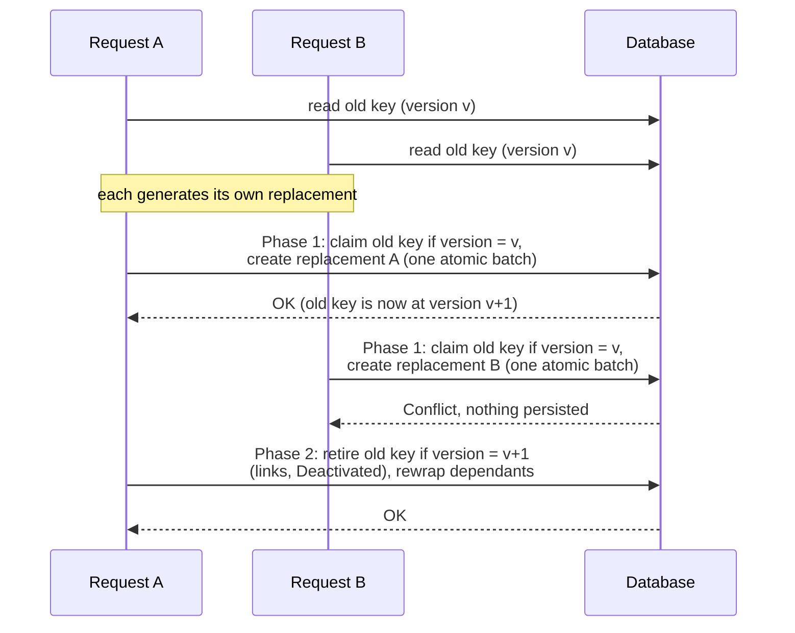

# Concurrent Re-Key and Conflicts

Two requests can try to rotate the same object at the same time: two operators
running `Re-Key`, a manual `Re-Key` racing the [auto-rotation
scheduler](auto_rotation_policy.md), or two KMS instances sharing one database
whose schedulers fire together. This page explains how the server detects the
race, what the losing request sees, and what you should do about it.

> For the rotation steps themselves, see [Key Rotation](index.md).

---

## The problem

Without protection, both requests would read the same old key, generate their
own replacement, and then write the old key's `ReplacementObjectLink`. The
second write silently overwrites the first one: the first replacement is
persisted but nothing points to it. It is an **orphan** key, and the keyset
history no longer shows it.

## The solution: an optimistic version lock

Every row of the `objects` table (and every object record in Redis-Findex)
carries a **`version`** counter. The server increments it on **every write** to
the object, whatever the operation: `Re-Key`, `SetAttribute`, a state change,
and so on. The column is added automatically on startup (see
[Database tables](../../configuration/database/tables.md)).

A rotation reads the old key together with its version `v`, and then only
commits writes that are **conditional on that version still being current**.
If anything else wrote to the key in the meantime, the condition fails and the
rotation is rejected with a `Conflict` error. No lock is held while the
replacement key is generated, so a slow rotation never blocks other requests.

## The two phases

1. **Phase 1, claim.** The old key is rewritten **unchanged**, conditional on
   version `v`, in the **same atomic batch** that creates the replacement
   object(s). The write bumps the version to `v + 1`. If another writer got
   there first, the whole batch is rejected and **nothing is persisted**, so
   the losing request leaves no orphan behind.
2. **Phase 2, retire.** The old key is updated with its `ReplacementObjectLink`
   and moved to `Deactivated` (when it was `Active`), conditional on version
   `v + 1`, the value left by the claim. Dependants wrapped by the old key are
   then re-wrapped. Any write to the old key between the two phases makes this
   step fail with `Conflict`; the server then deletes the replacement objects
   it created (best effort) so the failed request does not leave orphans
   either.

The same pipeline backs `Re-Key`, `Re-Key Key Pair` and `Re-Certify`, so all
three operations are protected.

!!! note
    Keys stored in an HSM have no version, so the check does not apply to them.
    HSM rotation falls back to an unconditional update. See
    [HSM Key Rotation](hsm.md).

## What the client sees

The losing request fails with a `Conflict` error. The error means the old key
was modified concurrently; it does not mean the rotation is impossible. How it
reaches the client depends on the protocol:

| Protocol                                                         | What the client receives                                                                                                                          |
| ---------------------------------------------------------------- | ------------------------------------------------------------------------------------------------------------------------------------------------- |
| REST endpoints (HTTP)                                            | HTTP status `409 Conflict`.                                                                                                                       |
| KMIP `RequestMessage` batch item (binary TTLV, socket server, JSON) | `Result Status` = `Operation Failed`, `Result Reason` = `General Failure`, and a `Result Message` starting with `Conflict:`. There is no 409 here. |

KMIP defines no result reason for an optimistic-lock failure, so a KMIP client
must recognise a lost race by the `Conflict:` prefix of the result message.

Before retrying a manual rotation, **look at the old key**:

- If it now has a `ReplacementObjectLink`, a concurrent rotation already
  replaced it. Use the replacement; do not rotate again, or you will create a
  second replacement.
- If it has no `ReplacementObjectLink`, the conflicting write was something
  else (for example a `SetAttribute`). The key is unchanged as far as rotation
  is concerned, and the request can be retried.

## What auto-rotation does

The scheduler does **not** retry a key that fails with `Conflict`. It logs an
`info` line, records no success or failure metric (a lost race is neither), and
moves to the next key. The scheduler itself is the retry:

- **A concurrent rotation won.** The winner moved the key to `Deactivated`, and
  the scheduler only selects `Active` keys with a positive rotation interval,
  so the key is never picked up again. Nothing is left to do.
- **Another write caused the conflict.** The key is still `Active` and still
  due, so the next check rotates it. The delay is at most
  `auto_rotation_check_interval_secs` (60 seconds minimum).

Any other error is still logged as a warning and counted as a failure.

## Backends

| Backend       | Where the version lives                          |
| ------------- | ------------------------------------------------ |
| SQLite        | `objects.version` column                         |
| PostgreSQL    | `objects.version` column                         |
| MySQL/MariaDB | `objects.version` column                         |
| Redis-Findex  | Field of the stored object record                |

All backends give the same guarantee: a conditional write whose version no
longer matches is rejected, and the batch it belongs to persists nothing.
