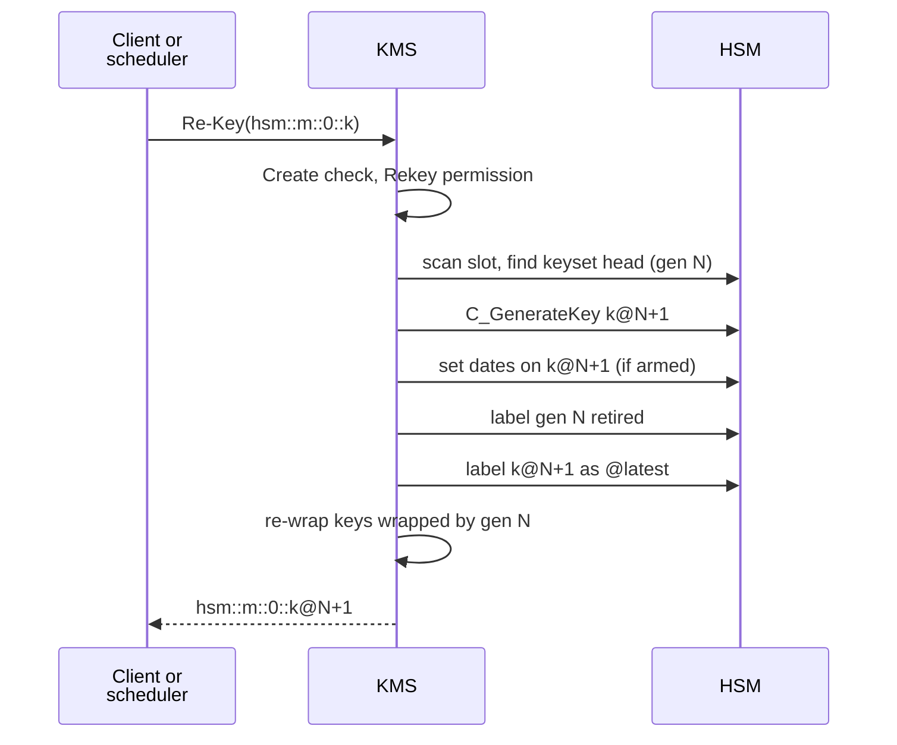

# HSM keysets explained

This page explains why HSM keysets work the way they do. The rules themselves are listed in the [HSM keysets reference](hsm_keysets_reference.md); the commands are in [How to rotate HSM keys](hsm_keysets_how_to.md).

## Why the token carries the keyset state

A SQL key stores its rotation state in KMIP attributes (`x-rotate-name`, `x-rotate-generation`, `x-rotate-interval`, …) next to the key in the database. An HSM key has no such place: a PKCS#11 object exposes a fixed set of attributes (`CKA_CLASS`, `CKA_KEY_TYPE`, `CKA_ID`, `CKA_LABEL`, `CKA_START_DATE`, `CKA_END_DATE`, …), and the KMS keeps no database row for it.

Two of these attributes are freely writable and fit the need:

- `CKA_LABEL`, a text field, carries the keyset name, the generation and the head marker;
- `CKA_START_DATE` and `CKA_END_DATE`, two dates, carry the rotation schedule.

Keeping the state on the token means the HSM is the single source of truth. A KMS node that starts against the HSM, or a second node sharing it, finds every keyset by scanning the slot; nothing can drift between a database and the token, and losing the KMS database does not lose the keyset structure. The cost is a slot scan to resolve a keyset, which the server caches for two seconds (see [RotateNameCache](../../configuration/object-cache.md#rotatenamecache)).

The same `CKA_LABEL` also carries the key's tags; the keyset label is stored inside the tag envelope, so both survive a rotation (see [HSM key labeling & tagging](../../hsm_support/tagging.md)).

## Why the keyset name is the full base UID

Two slots, or two HSM instances, can hold keys with the same local identifier. A keyset name such as `my-key` would then match keys on several slots, and a rotation could pick a key from the wrong one. The base UID `hsm::<model>::<slot>::<key_id>` embeds the instance and the slot, so it is unique without any central registry, and the server can scan only the slot named in the UID.

This is also why the key identifier appears twice in a label such as `hsm::0::k1::1::k1@latest`: the first occurrence is part of the keyset name, the second is the key identifier field that the label format always carries.

## Why the due rule needs a keyset label and both dates

`CKA_START_DATE` and `CKA_END_DATE` are standard PKCS#11 attributes: other applications on the same token may set them for their own purposes, an expiry date alone or a full validity period. If the scheduler rotated every key whose `CKA_END_DATE` had passed, or every key with both dates, it would rotate keys it never scheduled.

The KMS therefore treats a key as scheduled only when it finds the full pattern it writes itself: a keyset label in `CKA_LABEL`, plus both dates set at least one day apart. Dates alone are not enough, because another application can write both; the keyset label is the KMS's own marker. This is why arming auto-rotation through the KMS (`SetAttribute RotateInterval` > 0) also enrolls a key that is not yet in a keyset, and why disarming it clears only the dates. The interval is recovered as the difference between the two dates, which is how a rotation re-arms the new key with the same interval. Because PKCS#11 dates have no time of day, intervals are whole days, and an interval shorter than a day is refused: it would make the key due again on every tick.

Only the keyset head is rotated. A retired generation keeps its past `CKA_END_DATE`; checking for the head is what keeps a second tick on the same day from rotating the keyset again.

## Why retired generations are Deactivated for protection

After a SQL rotation the old key moves to the `Deactivated` state (see [Old key Deactivated after rotation](index.md#old-key-deactivated-after-rotation)): it can still process data (decrypt, verify) but no longer protect it (encrypt, sign, MAC). Without that rule, a client holding an old identifier would keep producing data under a key that was rotated out, for example because it was suspected of compromise.

A PKCS#11 object has no KMIP state to change, so the KMS derives it: any generation that is not the keyset head is treated as `Deactivated` for cryptographic operations. The result matches SQL keysets without writing anything to the token, and it does not depend on how the generation is addressed: `name@0`, `name@first` and `name@N` all hit the same check.

For the same reason a re-key must start from the head. Rotating an old generation would create a second generation N+1 next to the existing one and fork the keyset; the server refuses it when the caller names an old generation, and redirects only the unambiguous handles (the bare base UID and `@latest`) to the head.

## Why bare-name decryption needs wrong-key detection

Decrypt by a bare keyset name tries each generation, newest first, and keeps the first result that does not fail. That only works if decrypting with the wrong key fails. Authenticated modes (GCM, GCM-SIV, CCM, AEAD) and NIST key wrap check an integrity value, so a wrong key is always detected. Other block cipher modes return garbage instead: CTR and similar modes never fail, and CBC with PKCS#5 padding accepts a wrong key whenever the garbage happens to end with valid padding. RSA PKCS#1 v1.5 padding has the same weakness. For these modes the walk could return wrong plaintext as if it were correct, so the server refuses it and asks for the generation to be named. The rule applies to SQL keysets as well (see [Bare-name decryption and wrong-key detection](index.md#bare-name-decryption-and-wrong-key-detection)).

Verification is different: a wrong key yields `Invalid`, never a false `Valid`. So Signature Verify and MAC Verify by bare name keep walking until a generation answers `Valid`, and answer `Invalid` only when none does.

## Why the scheduler acts as an HSM admin

A PKCS#11 object has no KMIP owner. The KMS treats the HSM admins as the shared owners of all HSM keys (see [HSM keys and authorization](../../configuration/authorization.md#hsm-keys-and-authorization)), so the scheduler must act as one of them: it takes the first `hsm_admin` entry that is not the wildcard `*`, or `admin`.

The scheduler gets no shortcut: it goes through the same `Create` check as a manual re-key, because a rotation creates a key. When `[roles] crypto_officer_users` restricts creation (see [Privileged users](../../configuration/authorization.md#privileged-users)), the scheduler identity must be allowed to create; otherwise every scheduled rotation fails.

## What a rotation changes on the token

There is no transaction across the label writes: they happen one after the other (old head, new key, then for a key pair the old and new public keys). Until the new key is labelled, the old key remains the head; once it is, the new key is the head even if a later write, such as a public key label, fails. An interrupted rotation therefore leaves a new generation that may or may not be in use, and it blocks the next rotation to that generation number; see [Recover from an interrupted rotation](hsm_keysets_how_to.md#recover-from-an-interrupted-rotation).
