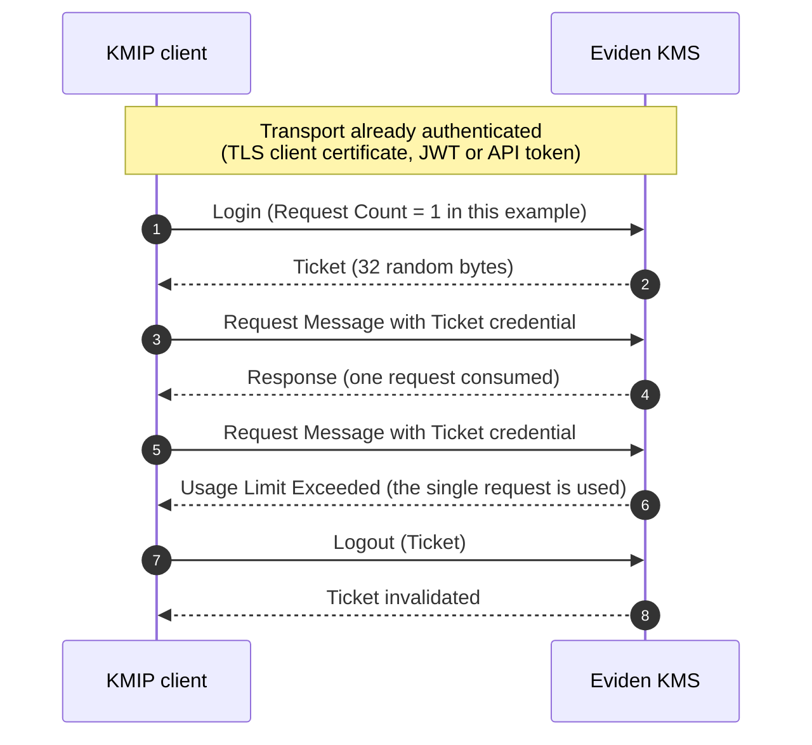
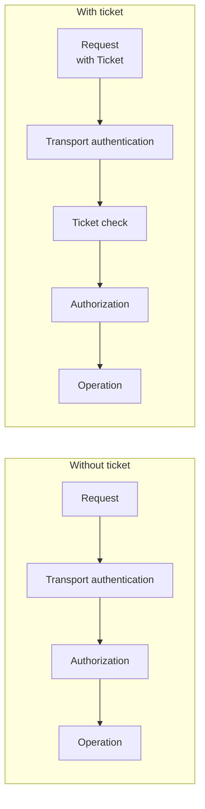
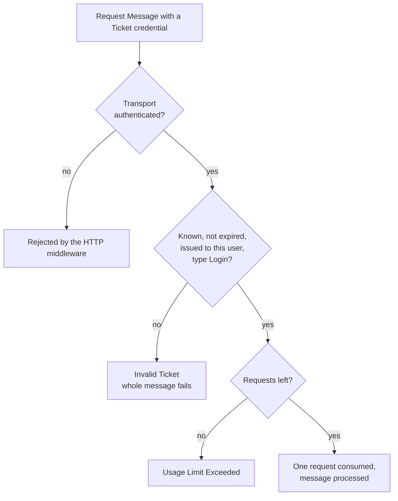
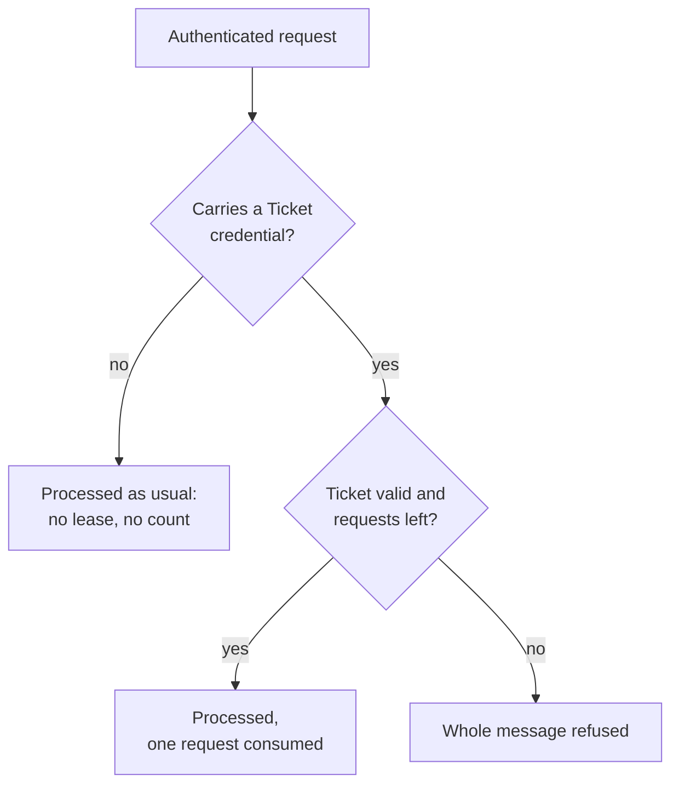

# KMIP Tickets: why and when

This page explains what a KMIP **ticket** is, what problem it addresses and what it does, and does
not, change in the Eviden KMS. For the exact payloads, limits and examples, see
[Login and Logout](_login.md).

## What is a ticket?

A ticket is a short-lived, opaque value that the server returns to a client that called the KMIP
**Login** operation (KMIP 2.1 §6.1.30). The client may then present it in the `Authentication` of
the header of later Request Messages, as a Credential of type `Ticket`. The **Logout** operation
(§6.1.31) invalidates it.

Using tickets is optional on both sides. A server may leave Login unsupported (it answers
`Operation Not Supported`), and a client that never calls Login sends the same messages as before.

## The interest of tickets

| Interest | How a ticket helps |
| -------- | ------------------ |
| Bounded lifetime | A ticket has a lease (1 hour by default, 24 hours at most). After it, the value is useless |
| Bounded usage | An optional Request Count limits how many Request Messages a ticket can authenticate |
| Revocation | Logout kills one ticket immediately, without touching the client's long-term credentials |
| Standard mechanism | Any KMIP 2.1 client that supports tickets works unchanged |

!!! note "Limits of the benefit in the Eviden KMS"
    The ticket is checked **in addition to** the transport authentication, never instead of it,
    and the server never requires one. The lease, the Request Count and Logout therefore only
    bind messages that carry the ticket. They do not restrict a client that omits it; see
    [When to use tickets](#when-to-use-tickets).

## Without and with a ticket

## A ticket adds a check, it does not replace authentication

The ticket grants no right. Ownership, access grants and roles apply exactly as without a ticket.

## What the server checks

An unknown, expired, foreign or wrong-type ticket gives the same `Invalid Ticket` answer, so a
caller cannot probe which tickets exist.

## When to use tickets

The server **never requires** a ticket. A request without a `Ticket` credential is processed
exactly as before, whether or not a ticket was issued to that user. The lease and the Request
Count therefore apply only to messages that carry the ticket: they are a limit that a client
chooses to apply to its own messages, not a restriction the server imposes on the client.

| Situation | Use tickets? | Why |
| --------- | ------------ | --- |
| Your KMIP 2.1 client, library or conformance suite performs Login and presents the ticket | Yes | The server supports the standard flow, so it works unchanged |
| Your own job or tool must fail closed after a lease or a number of messages, and it sends the ticket on every message | Yes | The server refuses the messages that exceed the lease or the Request Count. This is a self-imposed limit |
| You want to stop a compromised or untrusted client | No | It can omit the ticket. Revoke its certificate, JWT or API token instead |
| You want a client to hold fewer rights than its user | No | A ticket grants and removes no right, and Delegated Login is not supported. Use [ownership and access rights](../configuration/authorization.md) |
| The server runs without authentication | No | Every client is the same default user, so a ticket does not separate anyone |
| You need tickets across restarts or several server instances | No | They live in the memory of one process. After a restart the client gets `Invalid Ticket` and logs in again |

If neither of the first two rows applies to you, you do not need tickets.

What a ticket gives you, in short:

- **Interoperability:** KMIP 2.1 clients that run the Login/Logout flow, such as conformance
  vectors, work against the server.
- **Session hygiene:** a well-behaved client's own session is cut off by the lease, the Request
  Count or Logout.
- **User binding:** a ticket used by a different user than the one it was issued to fails with
  `Invalid Ticket`.

!!! warning "Not a security boundary"
    A ticket does not stop an attacker who holds the transport credentials (TLS client
    certificate, JWT or API token): that attacker is authenticated without it and can omit it.

!!! warning "A ticket is a bearer secret"
    Whoever holds the ticket and is authenticated by the transport as the same user can use it.
    It is not bound to the TLS session or to the source address. Do not log it.

## Real-life examples

Only the first example is a genuine need: the server never requires a ticket, so in the other
two the client chooses to limit itself.

| Example | Needed? | How the ticket is used |
| ------- | ------- | ---------------------- |
| A KMIP 2.1 conformance or interoperability suite (OASIS Login test cases such as TC-LOGIN-3-20, vendor test harnesses) | Yes | The harness calls Login, presents the Ticket in the request header, and expects `Usage Limit Exceeded` after the Request Count and `Invalid Ticket` after Logout or expiry. The KMS passes without change |
| A nightly batch job (for example re-wrapping keys) whose wrapper sends the ticket with every message | Optional, self-imposed | Login with a Request Count equal to the number of planned messages and a lease slightly longer than the job. A runaway loop gets `Usage Limit Exceeded` instead of continuing |
| An operator console or CLI session (an interactive tool run by an administrator) | Optional, self-imposed | Login with a short lease (for example 15 minutes) when the session opens, Logout when it closes. The tool refuses to continue after `Invalid Ticket` and asks the operator to log in again |

In the last two rows the limit is enforced only for messages that carry the ticket; revoke the
client's certificate or token to stop a client for real.

## Not supported

Delegated Login (rights-restricted tickets), Usage Limits (`Feature Not Supported`), the Date Time
form of Lease Time and Hashed Password credentials. Delegated Login would be the case where a
ticket carries fewer rights than its owner; today a ticket never does.

## See also

- [Login and Logout](_login.md): payloads, limits, examples and security review
- [KMIP support](support.md)
