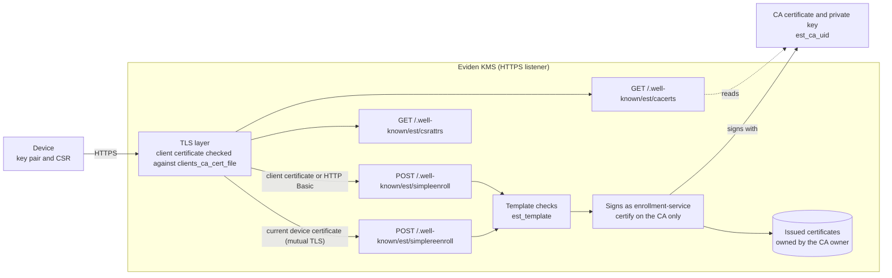
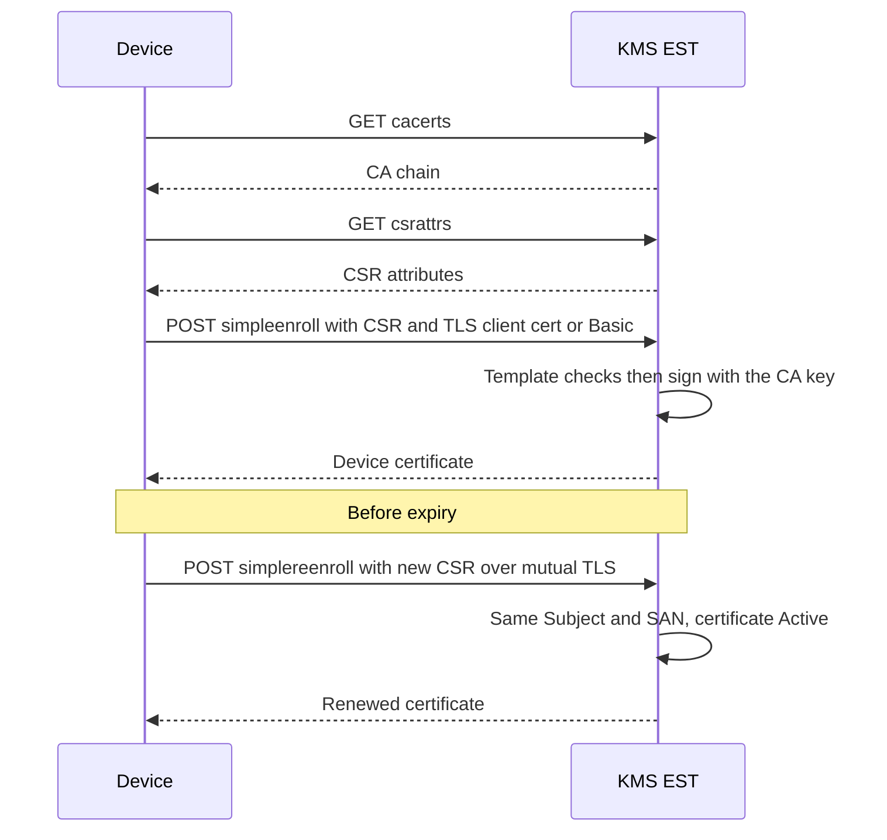

# Device enrollment with EST (RFC 7030)

**EST** (Enrollment over Secure Transport, [RFC 7030](https://www.rfc-editor.org/rfc/rfc7030)) lets
a device obtain and renew its X.509 certificate over HTTPS. It is the modern choice for IoT fleets,
network equipment and services. EST is **disabled by default**.

Before you start, complete the steps shared with SCEP on the
[Device enrollment overview](pki-enrollment.md): the
[prerequisites](pki-enrollment.md#before-you-start) and
[creating and delegating the CA](pki-enrollment.md#step-1-of-every-setup-create-the-ca-and-delegate-it).

## Architecture



## Endpoints

All routes answer `404` unless `est_enabled = true`.

| Route | Authentication | Request | Response | Description |
| --- | --- | --- | --- | --- |
| `GET /.well-known/est/cacerts` | None | None | `application/pkcs7-mime`, base64 | The CA chain, as a certs-only PKCS#7. Devices use it to trust the issuing CA. |
| `GET /.well-known/est/csrattrs` | None | None | `application/csrattrs`, base64 | What the CSR should contain. |
| `POST /.well-known/est/simpleenroll` | TLS client certificate, or HTTP Basic bootstrap credentials when `est_require_client_cert = false` | PKCS#10 CSR, base64 | `application/pkcs7-mime; smime-type=certs-only`, base64 | First enrollment: the CSR is checked against the template, then signed by the CA. |
| `POST /.well-known/est/simplereenroll` | The TLS client certificate being renewed | PKCS#10 CSR, base64, same Subject and SubjectAltName | `application/pkcs7-mime; smime-type=certs-only`, base64 | Renewal or key change. No shared secret is needed. |

## Configuration

Each setting is available in the configuration file, as a command-line flag and as an environment
variable; see [Server command line](../configuration/server_cli.md) for the exact spellings. The
interactive `cosmian_kms configure` wizard also asks about EST at the last step (it turns EST off
with a warning when no TLS certificate is configured).

| Setting (`[est]`) | Default | Meaning |
| --- | --- | --- |
| `est_enabled` | `false` | Serve the EST routes. When `false`, they answer `404`. |
| `est_ca_uid` | none | UID of the CA certificate. Required when EST is enabled. |
| `est_require_client_cert` | `true` | `true`: first enrollment only over mutual TLS. `false`: HTTP Basic bootstrap is also accepted. |
| `est_bootstrap_username`, `est_bootstrap_password` | none | Basic credentials; required when `est_require_client_cert = false`. The user name must not contain `:`; the password needs at least 8 characters (environment variable `KMS_EST_BOOTSTRAP_PASSWORD`). |
| `est_template` | none | Name of the `[templates.<name>]` section. **Required** when EST is enabled; see [Certificate templates](pki-enrollment.md#certificate-templates). |

Startup rules: with `est_require_client_cert = false` the server needs TLS; with
`est_require_client_cert = true` it needs TLS **and** `clients_ca_cert_file`. For renewals the
device certificate must be accepted by the TLS layer, so set `clients_ca_cert_file` to the CA
certificate used for enrollment.

## Tutorial: enroll your first device

In this tutorial a pretend device named `device1.iot.example` enrolls with a user name and
password, then renews its certificate. It reproduces what the project's automated EST test does
(`mise run test:est-interop`), so every command is known to work.

You will need, in addition to the [prerequisites](pki-enrollment.md#before-you-start):

- the CA from [Step 1](pki-enrollment.md#step-1-of-every-setup-create-the-ca-and-delegate-it),
  exported as `ca.crt`;
- [Go](https://go.dev/dl/), to install the `estclient` test client:

```sh
go install github.com/globalsign/est/cmd/estclient@v1.0.7
```

(The binary is written to `$(go env GOPATH)/bin/estclient`; add that directory to your `PATH`.)

### 1. Give the KMS a TLS certificate

If your KMS already serves HTTPS with a certificate your devices trust, skip this step. For the
tutorial, create a throw-away TLS authority and a server certificate for `127.0.0.1`:

```sh
openssl req -x509 -newkey rsa:2048 -nodes -days 2 -subj "/CN=EST TLS CA" \
  -keyout tls-ca.key -out tls-ca.crt
openssl req -newkey rsa:2048 -nodes -subj "/CN=127.0.0.1" -keyout tls.key -out tls.csr
printf 'subjectAltName=IP:127.0.0.1,DNS:localhost\n' > tls.ext
openssl x509 -req -in tls.csr -CA tls-ca.crt -CAkey tls-ca.key -CAcreateserial -days 2 \
  -extfile tls.ext -out tls.crt
```

!!! warning "Tutorial only"
    Use a certificate from your real PKI in production. This one expires in two days.

### 2. Enable EST in the server configuration

Add the following to your KMS configuration file (see
[Server configuration file](../configuration/server_configuration_file.md)); keep your existing
`[db]` and `[http]` sections. Replace the paths with the absolute paths of the files created above.

```toml
[tls]
tls_cert_file = "/path/to/tls.crt"
tls_key_file = "/path/to/tls.key"
# Devices renew by presenting their current certificate over mutual TLS:
# the TLS layer must therefore trust the enrollment CA.
clients_ca_cert_file = "/path/to/ca.crt"

[est]
est_enabled = true
est_ca_uid = "device-ca"
# false = devices may enroll the first time with the user name and password below.
est_require_client_cert = false
est_bootstrap_username = "bootstrap"
est_bootstrap_password = "bootstrap-secret"
est_template = "iot_device"

[templates.iot_device]
name = "iot_device"
min_rsa_key_bits = 2048
allowed_ekus = ["clientAuth"]
max_validity_days = 365
default_validity_days = 90
# Only names such as device1.iot.example are accepted ("\\." is a literal dot in TOML).
subject_cn_regex = "[a-z0-9-]+\\.iot\\.example"
# SANs are refused unless a pattern allows them; uncomment to accept DNS SANs.
# san_dns_regex = "[a-z0-9-]+\\.iot\\.example"
```

!!! warning "Pick a real password"
    `bootstrap-secret` is an example. Anyone who knows the bootstrap user name and password can
    enroll a device that matches the template.

Restart the KMS. If the configuration is unsafe, the server **refuses to start** and says why
(for instance EST with a password but without TLS).

### 3. Create the device key and CSR

On the device (here, your terminal):

```sh
openssl req -new -newkey rsa:2048 -nodes -subj "/CN=device1.iot.example" \
  -keyout dev1.key -out dev1.csr
```

`dev1.key` is the device's private key. It stays on the device.

### 4. Enroll

Replace `PORT` with the port of your KMS:

```sh
estclient enroll -server 127.0.0.1:PORT -explicit tls-ca.crt \
  -user bootstrap -pass bootstrap-secret \
  -csr dev1.csr -key dev1.key -out dev1.crt
```

`-explicit tls-ca.crt` tells the client which authority to trust for the KMS's TLS certificate.

### 5. Check the result

```sh
openssl verify -CAfile ca.crt dev1.crt
openssl x509 -in dev1.crt -noout -ext extendedKeyUsage
```

The first command confirms the certificate was signed by your CA. The second shows
`TLS Web Client Authentication`: the template added the `clientAuth` usage because the CSR did not
ask for any.

### 6. Renew

Before the certificate expires, the device creates a new key and CSR **with the same name** and
presents its current certificate. No password is involved:

```sh
openssl req -new -newkey rsa:2048 -nodes -subj "/CN=device1.iot.example" \
  -keyout dev1-new.key -out dev1-new.csr
estclient reenroll -server 127.0.0.1:PORT -explicit tls-ca.crt \
  -certs dev1.crt -key dev1.key -csr dev1-new.csr -out dev1-renewed.crt
openssl verify -CAfile ca.crt dev1-renewed.crt
```

`dev1-renewed.crt` has a new serial number. The new CSR must carry the same Subject and
SubjectAltName as the current certificate, which must have been issued by this CA and still be
`Active` (not revoked).

### 7. See the safety rules work

Each of these must **fail**:

- enrolling with a wrong password: refused;
- enrolling a CSR whose name is outside the template, for example
  `openssl req -new -newkey rsa:2048 -nodes -subj "/CN=evil.example.com" -keyout evil.key -out evil.csr`
  then `estclient enroll … -csr evil.csr -key evil.key`: refused with HTTP `422`, and a message
  saying the name does not match;
- renewing with a CSR for another name (`device2.iot.example`): refused with HTTP `400`.

You now have a working enrollment service. To bring real devices in, give them the KMS address,
the CA certificate (or its fingerprint) and the bootstrap credential, or provision them a client
certificate if you use mutual TLS for the first enrollment.

## Protocol flow



## Security notes

The shared [security model](pki-enrollment.md#security-model) applies. Specific to EST:

- **TLS is mandatory.** Bootstrap credentials and certificates travel over the HTTPS channel; the
  server refuses to start EST without TLS.
- **Enrolled certificates only renew themselves.** The KMS refuses them as a user identity on every
  login path (including a certificate signed by an enrolled one), but accepts them on
  `simplereenroll` for their own renewal.
- **`simpleenroll` with a client certificate.** A certificate issued by this CA must be active
  (not revoked or deactivated) and can only be enrolled again for the same Subject and
  SubjectAltName. A certificate that carries the enrollment marker but was issued elsewhere (the SCEP
  CA, an earlier key of this CA) is refused with `403`. The TLS layer does not check revocation of
  other client certificates (for example corporate ones accepted through `clients_ca_cert_file`).
- **Do not mix trust roles.** Setting `clients_ca_cert_file` to the enrollment CA is needed for
  renewal, but it also makes the TLS layer accept that CA's certificates for all clients of the
  listener. Prefer a dedicated listener or trust anchor for KMIP and API users where you can.

## Troubleshooting

Errors common to EST and SCEP are listed on the
[overview](pki-enrollment.md#troubleshooting).

| Symptom | Likely cause and fix |
| --- | --- |
| `404` on `/.well-known/est/…` | EST is disabled. Set `est_enabled = true` and restart. |
| The server refuses to start, mentioning TLS | EST with Basic credentials needs TLS; EST with `est_require_client_cert = true` needs TLS and `clients_ca_cert_file`. |
| HTTP `401` on `simpleenroll` | Wrong or missing bootstrap credentials, and no accepted client certificate. |
| HTTP `422` | The CSR breaks the template: name, SAN, key size, EKU or extension. The reply says which. |
| HTTP `400` on `simplereenroll` | The CSR's Subject or SubjectAltName differs from the current certificate. |
| HTTP `403` on `simplereenroll` or `simpleenroll` | The client certificate cannot be used for enrollment: not issued by this CA, expired, not `Active` (for example revoked), or enrolled elsewhere. The reply is a fixed message; the reason is in the server log. |
| HTTP `429` / `503` | Too many wrong credentials from this address, or too many enrollments in progress; wait for `Retry-After`. |

## Verifying the setup

`mise run test:est-interop` runs the globalsign `estclient` over TLS against a live KMS: `cacerts`,
`csrattrs`, `enroll`, mutual-TLS `reenroll`, and rejections.
