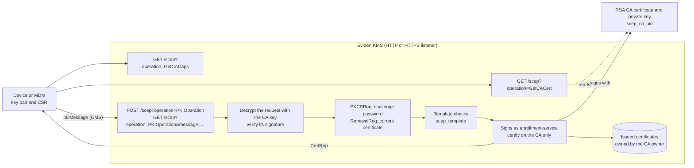
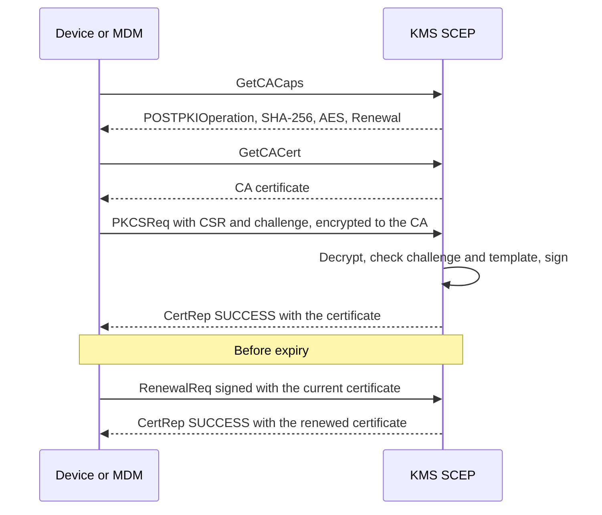

# Device enrollment with SCEP (RFC 8894)

**SCEP** (Simple Certificate Enrollment Protocol, [RFC 8894](https://www.rfc-editor.org/rfc/rfc8894))
is what Apple and Windows MDM products and many routers use to obtain and renew a certificate. It
works over HTTP or HTTPS and authenticates inside the signed and encrypted SCEP message rather than
at the HTTP level. SCEP is **disabled by default**.

Before you start, complete the steps shared with EST on the
[Device enrollment overview](pki-enrollment.md): the
[prerequisites](pki-enrollment.md#before-you-start) and
[creating and delegating the CA](pki-enrollment.md#step-1-of-every-setup-create-the-ca-and-delegate-it).
The CA must be **RSA**, because SCEP requests are encrypted to the CA public key.

## Architecture



## Endpoints

A single resource, `/scep`, dispatches on the `operation` query parameter. Every route is also
served under `/scep/pkiclient.exe`, because the Windows MDM (NDES-style) client appends that suffix
to the configured URL. No HTTP-level authentication is applied: it happens inside the SCEP message.
All routes answer `404` unless `scep_enabled = true`.

| Route | Authentication | Request | Response | Description |
| --- | --- | --- | --- | --- |
| `GET /scep?operation=GetCACaps` | None | None | `text/plain`: `POSTPKIOperation`, `SHA-256`, `AES`, `Renewal` | Capabilities the client must negotiate. |
| `GET /scep?operation=GetCACert` | None | None | `application/x-x509-ca-cert` (single CA) or `application/x-x509-ca-ra-cert` (chain) | The CA certificate the client encrypts its requests to. |
| `POST /scep?operation=PKIOperation` | Challenge password (`PKCSReq`), or signature by a current certificate of this CA (`RenewalReq`) | `application/x-pki-message` body | `application/x-pki-message` (`CertRep`) | Enrollment or renewal. Issuance is synchronous. |
| `GET /scep?operation=PKIOperation&message=<base64>` | Same as `POST` | Base64 `pkiMessage` in the query | `application/x-pki-message` (`CertRep`) | Same operation, for clients that cannot `POST`. |

`GetCert`, `GetCRL`, `CertPoll` and `GetNextCACert` are not implemented, and a `PENDING` answer is
never returned.

## Configuration

Each setting is available in the configuration file, as a command-line flag and as an environment
variable; see [Server command line](../configuration/server_cli.md) for the exact spellings. The
interactive `cosmian_kms configure` wizard also asks about SCEP at the last step.

| Setting (`[scep]`) | Default | Meaning |
| --- | --- | --- |
| `scep_enabled` | `false` | Serve `/scep`. |
| `scep_ca_uid` | none | UID of the **RSA** CA certificate. Required when SCEP is enabled. |
| `scep_challenge_password` | none | Shared secret for first enrollment, at least 8 characters (environment variable `KMS_SCEP_CHALLENGE_PASSWORD`). |
| `scep_allow_renewal_without_challenge` | `true` | Accept renewals signed by a current certificate without the challenge. |
| `scep_template` | none | Name of the `[templates.<name>]` section. **Required** when SCEP is enabled; see [Certificate templates](pki-enrollment.md#certificate-templates). |

## How-to: enable SCEP

Add to the server configuration:

```toml
[scep]
scep_enabled = true
scep_ca_uid = "device-ca"
scep_challenge_password = "<a long random secret>"
scep_allow_renewal_without_challenge = true
scep_template = "mdm_device"

[templates.mdm_device]
name = "mdm_device"
min_rsa_key_bits = 2048
allowed_ekus = ["clientAuth"]
max_validity_days = 365
default_validity_days = 90
subject_cn_regex = "[a-z0-9.-]+"
```

Restart the KMS, then check that SCEP answers (use `https://` if your KMS serves TLS):

```sh
curl -fsS "http://<kms-host>:<port>/scep?operation=GetCACaps"
```

The answer is exactly these four lines:

```text
POSTPKIOperation
SHA-256
AES
Renewal
```

In your MDM or router, set the SCEP URL to `http(s)://<kms-host>:<port>/scep`, the challenge
password to the value above, and **pin the CA certificate or its fingerprint** (see
[Security notes](#security-notes)).

How SCEP behaves:

- the first request (`PKCSReq`) must carry the challenge password;
- a renewal (`RenewalReq`) is signed with a certificate previously issued by this CA that is still
  valid and `Active`; it needs no challenge and must keep the same Subject and SubjectAltName.
  Set `scep_allow_renewal_without_challenge = false` to forbid it;
- `DES3` and `SHA-1` are not supported, so the client must negotiate `AES` and `SHA-256`.

## Protocol flow



!!! note "Client compatibility"
    The implementation is built for clients that honour `GetCACaps`. It is verified against the
    micromdm `scepclient` (whose stock build hard-codes single DES and must be built with
    AES-128-CBC; see `mise run test:scep-interop`) and against the native macOS 26.6 SCEP client
    (see `mise run test:scep-apple`). Renewal by the Apple client and Windows clients were not
    verified.

## Security notes

The shared [security model](pki-enrollment.md#security-model) applies. Specific to SCEP:

- **Use HTTPS, or pin the CA.** SCEP also works over HTTP (the server logs a warning at startup),
  but then `GetCACert` is not authenticated: a device must pin the CA certificate or its
  fingerprint out of band (for example in the MDM profile), otherwise an attacker on the network
  could substitute their own CA, and the AES-CBC envelope has no integrity protection.
- **The challenge password is shared.** It is the same for all devices and does not expire: make it
  long and random. Wrong challenges lock the client address out (`429`).
- **Replays and error replies.** A captured request cannot be replayed: a message that already
  authenticated (same signer, transaction ID and nonce) is refused for an hour. Every failure after
  the message is parsed is a `badRequest`, so the reply does not tell an undecryptable envelope from
  a wrong challenge. The transaction ID must be printable ASCII of at most 128 characters.
- **Enrolled certificates cannot log in to the KMS.** They can only sign their own `RenewalReq`.

## Troubleshooting

Errors common to EST and SCEP are listed on the
[overview](pki-enrollment.md#troubleshooting).

| Symptom | Likely cause and fix |
| --- | --- |
| `404` on `/scep` | SCEP is disabled. Set `scep_enabled = true` and restart. |
| `badRequest` reply | The request was refused: the CSR breaks the template (name, SAN, key size, EKU, extension), the challenge is wrong, or the message was replayed. The reply never says which (it would be an oracle); the server log does. |
| A client fails with a decryption or algorithm error | It uses single DES or SHA-1. Use a client that honours `GetCACaps` and negotiates `AES` and `SHA-256`. |
| A renewal or enrollment is refused right after a successful identical one | The message was replayed (same signer, transaction ID and sender nonce): generate a fresh nonce for every message. |
| HTTP `429` / `503` | Too many failed attempts from this address, or too many enrollments in progress; wait for `Retry-After`. |

## Verifying the setup

- `mise run test:scep-interop`: the micromdm `scepclient`: enrollment, challenge-less renewal and a
  wrong challenge.
- `mise run test:scep-apple` (macOS, interactive): installs a `com.apple.security.scep` profile
  with a `CAFingerprint` pin; you approve it in System Settings. It checks the Apple request
  (SHA-256, AES, RSA-2048, challenge) and the issued identity in the keychain, then stores the
  capture under `test_data/scep/apple/` for the CI test `apple_scep_fixtures_parse`.
