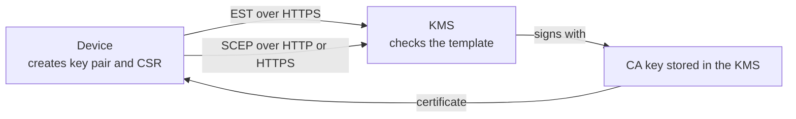

# Device enrollment: EST and SCEP

This page shows how to let devices (IoT sensors, routers, laptops and phones managed by an MDM)
obtain their own X.509 certificate from the KMS, **without an administrator issuing each one by
hand**.

The KMS supports two standard enrollment protocols, each described on its own page:

- **[EST](pki-enrollment-est.md)** ([RFC 7030](https://www.rfc-editor.org/rfc/rfc7030)), over HTTPS;
- **[SCEP](pki-enrollment-scep.md)** ([RFC 8894](https://www.rfc-editor.org/rfc/rfc8894)), over
  HTTP or HTTPS.

Both are **disabled by default**. This page covers what they share: vocabulary, choosing a protocol,
creating and delegating the CA, certificate templates and the security model.

| If you want to… | Go to |
| --- | --- |
| Understand the vocabulary | [The ideas in two minutes](#the-ideas-in-two-minutes) |
| Pick a protocol | [Which protocol should I use?](#which-protocol-should-i-use) |
| Prepare the CA (both protocols) | [Step 1 of every setup](#step-1-of-every-setup-create-the-ca-and-delegate-it) |
| Try it end to end, step by step | [EST tutorial](pki-enrollment-est.md#tutorial-enroll-your-first-device) |
| Serve an MDM or router | [How-to: enable SCEP](pki-enrollment-scep.md#how-to-enable-scep) |
| Restrict what devices can ask for | [Certificate templates](#certificate-templates) |
| Look up an endpoint or a setting | [EST endpoints](pki-enrollment-est.md#endpoints), [SCEP endpoints](pki-enrollment-scep.md#endpoints) |
| Understand the security choices | [Security model](#security-model) |
| Fix an error | [Troubleshooting](#troubleshooting) |

## The ideas in two minutes

| Term | Meaning |
| --- | --- |
| **CA** (certificate authority) | A certificate plus its private key, stored in the KMS, that signs the certificates handed to devices. The private key never leaves the KMS. |
| **CSR** (certificate signing request) | A small file a device creates with its own new key pair: "please certify this public key for this name". The device's **private key never leaves the device**. |
| **Enrollment** | The device sends its CSR to the KMS and receives a signed certificate back. |
| **EST** / **SCEP** | The two network protocols a device can use to do that. |
| **Template** | A set of rules the KMS applies to every CSR (allowed names, key sizes, certificate lifetime…). A CSR that breaks the rules is refused. |
| **Bootstrap credential** | A shared secret (EST: user name and password, SCEP: *challenge password*) that proves a device is allowed to enroll **for the first time**. |
| **Renewal** | Before its certificate expires, the device gets a new one by proving it already owns the old one. No shared secret is needed. |
| **`[enrollment-service]`** | A reserved internal KMS identity that signs on behalf of EST and SCEP. You give it the right to use your CA (nothing else). Nobody can log in as this identity. |



## Which protocol should I use?

| | EST | SCEP |
| --- | --- | --- |
| Age | Modern | Legacy |
| Transport | HTTPS only | HTTP or HTTPS |
| First enrollment is authorized by | A TLS client certificate, **or** a user name and password | A shared challenge password |
| Renewal is authorized by | The device's current certificate (mutual TLS) | A request signed with the device's current certificate |
| Typical clients | IoT fleets, network gear, services | Apple and Windows MDM, many routers |
| CA key type | RSA or EC | **RSA only** |
| Documentation | [EST](pki-enrollment-est.md) | [SCEP](pki-enrollment-scep.md) |

**Rule of thumb:** use EST whenever your devices support it; use SCEP when your MDM or router
only speaks SCEP.

## Before you start

You need:

- a running KMS and the `ckms` command-line tool connected to it as the user who will **own** the
  CA (see [Quick start](../quick_start.md));
- for EST, the KMS must be served over **TLS** (HTTPS), because credentials and certificates travel
  over that channel. See [TLS configuration](../configuration/tls.md);
- `openssl` to inspect certificates.

## Step 1 of every setup: create the CA and delegate it

Do this once, whatever protocol you choose.

### Create the CA

The CA is a self-signed certificate created with `ckms certificates certify`. For SCEP, the CA must
be RSA, because SCEP requests are encrypted to the CA public key. The following works for both
protocols:

```sh
cat > ca.ext <<'EOF2'
[ v3_ca ]
basicConstraints=critical,CA:TRUE
keyUsage=critical,keyCertSign,crlSign,digitalSignature,keyEncipherment
EOF2
ckms certificates certify --certificate-id device-ca --generate-key-pair --algorithm rsa2048 \
  --subject-name "CN=Device CA,O=ACME,C=FR" --days 3650 --certificate-extensions ca.ext
```

`device-ca` is the **unique identifier** (UID) of the CA certificate. You will put it in the server
configuration. The CA private key must be in the `Active` state (it is, right after this command).

Export the CA certificate; devices and tests use it to check what they receive:

```sh
ckms certificates export ca.crt --certificate-id device-ca --format pem
```

### Delegate the CA to the enrollment service

EST and SCEP issue certificates as the reserved identity `[enrollment-service]`. It has **no
right on anything** until you, the CA owner, give it `certify` on two objects: the CA
**certificate** and the CA **private key**.

First find the UID of the private key linked to the CA:

```sh
ckms attributes get -i device-ca -a LinkType -l private-key -o ca-links.json
cat ca-links.json
```

Copy the value of `PrivateKeyLink` from the output, then grant:

```sh
ckms access-rights grant "[enrollment-service]" -i device-ca certify
ckms access-rights grant "[enrollment-service]" -i <PrivateKeyLink value> certify
```

!!! note "Do not forget this step"
    Without these two grants, enrollment fails closed (devices receive an error) and the server
    logs a warning naming the CA and the grants it needs.

Two further cases:

- if `crypto_officer_users` is configured, a Crypto Officer must also grant it `create`
  (`ckms access-rights grant "[enrollment-service]" create`);
- if the CA private key is wrapped, also grant it `decrypt` on the wrapping key.

Do **not** grant it `get`, `export` or a Crypto Officer role: issuing certificates needs none of
them. Issued certificates are stored under the **CA owner**, who can list, revoke and destroy them
like any other certificate (see [Revocation & CRL distribution](pki-revocation.md)).
`default_username` and `crypto_officer_users` must not be set to `[enrollment-service]`: the server
refuses to start when EST or SCEP is enabled otherwise.

Then enable the protocol: [EST](pki-enrollment-est.md#configuration) or
[SCEP](pki-enrollment-scep.md#how-to-enable-scep).

## Certificate templates

A template is a set of rules applied to every CSR that arrives through an enrollment endpoint. It is
a TOML section `[templates.<name>]`, selected by `est_template` or `scep_template`.

**Start from the examples on the EST and SCEP pages**, then tighten them: the most useful setting is
`subject_cn_regex`, which limits the names a device can obtain. Regular expressions are
**anchored**: they must match the whole value.

```toml
[templates.iot_device]
min_rsa_key_bits = 2048
allowed_ec_curves = ["prime256v1"]
allowed_ekus = ["clientAuth"]
max_validity_days = 365
default_validity_days = 90
subject_cn_regex = "[a-z0-9-]+\\.iot\\.example"
san_dns_regex = "[a-z0-9-]+\\.iot\\.example"
san_email_regex = "[a-z0-9.]+@iot\\.example"
san_upn_regex = "[a-z0-9.]+@iot\\.example"
```

| Key | Default | Meaning |
| --- | --- | --- |
| `min_rsa_key_bits` | `2048` | Smallest accepted RSA key. Values below 2048 stop the server at startup. |
| `allowed_ec_curves` | `prime256v1`, `secp384r1`, `secp521r1` | Accepted elliptic curves. Must not be empty. |
| `allowed_ekus` | `clientAuth` | Allowed **extended key usages** (what the certificate may be used for), as names or dotted OIDs. Added automatically when the CSR asks for none. Must not be empty. |
| `max_validity_days` | `365` | Upper bound on a certificate's lifetime. |
| `default_validity_days` | `90` | Lifetime given to certificates, because neither protocol lets the device request one. |
| `subject_cn_regex` | none (any name) | Pattern the subject common name must match. |
| `san_dns_regex` | none | Pattern every DNS name in the subject alternative names must match. |
| `san_email_regex` | none | Same, for e-mail addresses. |
| `san_upn_regex` | none | Same, for Microsoft user principal names. |

When any SAN pattern is set, SAN types without a pattern are refused. Unknown keys, inconsistent
validity limits and the invalid values above are rejected **at startup**, so a typo cannot silently
weaken a template.

Every CSR goes through these checks:

- the device proves it owns the private key (proof of possession);
- key type and size, EKUs, subject name and SAN patterns, and validity (clamped to
  `max_validity_days`);
- the CSR may not ask for a CA certificate (`basicConstraints` `CA:TRUE`);
- only these extensions are accepted: `keyUsage` (without `keyCertSign` or `cRLSign`),
  `subjectAltName`, `extendedKeyUsage` and `basicConstraints`. Any other extension, a duplicated
  extension, or extensions sent in a form the KMS cannot verify is refused.

A violation is answered with HTTP `422` (EST) or a `badRequest` reply (SCEP).

**Without a template**, a baseline applies: RSA 2048 bits or more, or NIST P-256/P-384/P-521;
`clientAuth` only; no `CA:TRUE`; validity of at most 365 days; **any name is accepted**. Always
configure a template with `subject_cn_regex` for production.

## Security model

Protocol-specific notes are on the [EST](pki-enrollment-est.md#security-notes) and
[SCEP](pki-enrollment-scep.md#security-notes) pages.

**Why the CA is delegated to `[enrollment-service]`.** Devices are not KMS users. A dedicated
identity that nobody can log in as, and that holds only `certify` on one CA, limits what a bug or a
leaked secret can do.

**Enrolled certificates cannot log in to the KMS.** A device chooses its own name in its CSR. If
the KMS accepted such a certificate for API access, a device could enroll the name `admin` and
then act as `admin`. To prevent this, every certificate issued through EST or SCEP carries a
marker (a certificate policy with the OID `1.3.6.1.4.1.16376.9.2.1`), and the KMS refuses to treat
a marked certificate as a user identity on every login path, including the HTTPS and KMIP socket
client-certificate checks. It can still be used for the one thing it is for: renewing itself.

**Shared secrets.** The EST bootstrap password and the SCEP challenge password are shared by all
devices and do not expire. Make them long and random, keep them out of version control, and note
that the server has no lockout for wrong guesses: rate-limit the listener if it is exposed.

## Troubleshooting

Protocol-specific errors are listed on the [EST](pki-enrollment-est.md#troubleshooting) and
[SCEP](pki-enrollment-scep.md#troubleshooting) pages.

| Symptom | Likely cause and fix |
| --- | --- |
| The server refuses to start, mentioning a template | A template key is unknown, a limit is inconsistent, `min_rsa_key_bits` is below 2048, or a list is empty; or `est_template` / `scep_template` names a section that does not exist. |
| The server refuses to start, mentioning `[enrollment-service]` | `default_username` or `crypto_officer_users` uses that reserved name. Rename it. |
| Enrollment fails and the server log names the CA and the grants it needs | The [delegation step](#delegate-the-ca-to-the-enrollment-service) is missing: grant `certify` on the CA certificate and on its private key. |
| An enrolled certificate is refused when used against the KMS API | By design: see [Security model](#security-model). |
