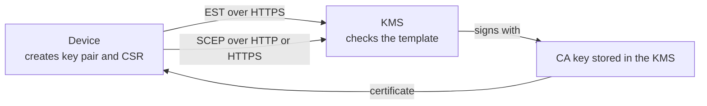
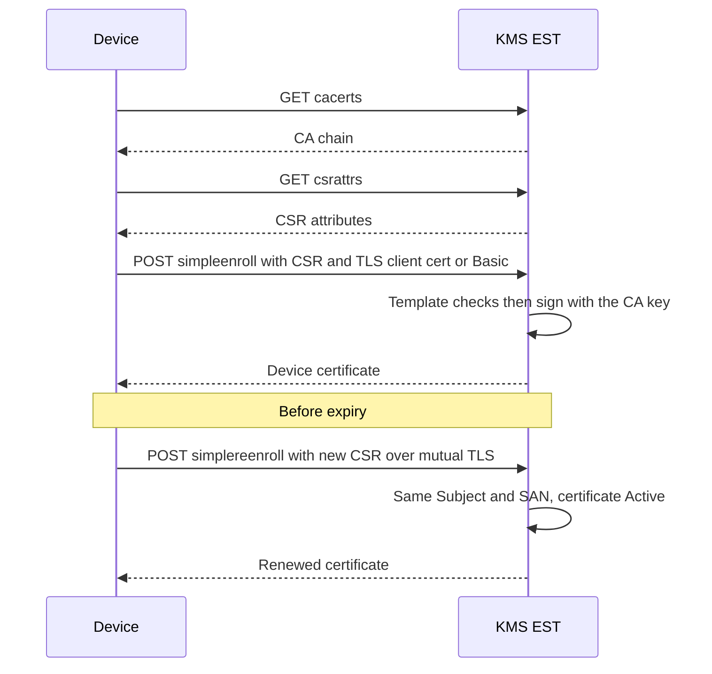
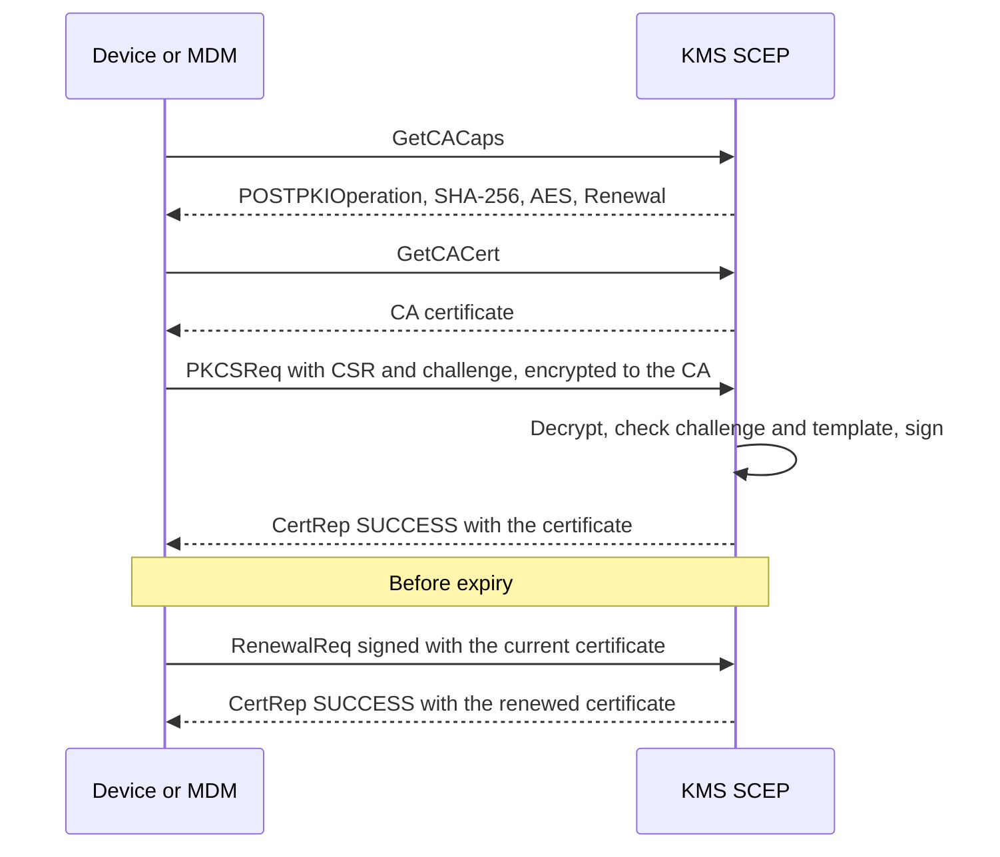

# Device enrollment: EST and SCEP

This page shows how to let devices (IoT sensors, routers, laptops and phones managed by an MDM)
obtain their own X.509 certificate from the KMS, **without an administrator issuing each one by
hand**.

The KMS supports two standard enrollment protocols: **EST**
([RFC 7030](https://www.rfc-editor.org/rfc/rfc7030)) and **SCEP**
([RFC 8894](https://www.rfc-editor.org/rfc/rfc8894)). Both are **disabled by default**.

Where to look:

| If you want to… | Go to |
| --- | --- |
| Understand the vocabulary | [The ideas in two minutes](#the-ideas-in-two-minutes) |
| Pick a protocol | [Which protocol should I use?](#which-protocol-should-i-use) |
| Try it end to end, step by step | [Tutorial: enroll your first device with EST](#tutorial-enroll-your-first-device-with-est) |
| Serve an MDM or router with SCEP | [How-to: enable SCEP](#how-to-enable-scep) |
| Restrict what devices can ask for | [Certificate templates](#certificate-templates) |
| Look up a setting or an endpoint | [Reference](#reference) |
| Understand the security choices | [Security model](#security-model) |
| Fix an error | [Troubleshooting](#troubleshooting) |

## The ideas in two minutes

| Term | Meaning |
| --- | --- |
| **CA** (certificate authority) | A certificate plus its private key, stored in the KMS, that signs the certificates handed to devices. The private key never leaves the KMS. |
| **CSR** (certificate signing request) | A small file a device creates with its own new key pair: "please certify this public key for this name". The device's **private key never leaves the device**. |
| **Enrollment** | The device sends its CSR to the KMS and receives a signed certificate back. |
| **EST** / **SCEP** | The two network protocols a device can use to do that. |
| **Template** | A set of rules the KMS applies to every CSR (allowed names, key sizes, certificate lifetime…). A CSR that breaks the rules is refused. |
| **Bootstrap credential** | A shared secret (EST: user name and password, SCEP: *challenge password*) that proves a device is allowed to enroll **for the first time**. |
| **Renewal** | Before its certificate expires, the device gets a new one by proving it already owns the old one. No shared secret is needed. |
| **`[enrollment-service]`** | A reserved internal KMS identity that signs on behalf of EST and SCEP. You give it the right to use your CA (nothing else). Nobody can log in as this identity. |



## Which protocol should I use?

| | EST | SCEP |
| --- | --- | --- |
| Age | Modern | Legacy |
| Transport | HTTPS only | HTTP or HTTPS |
| First enrollment is authorized by | A TLS client certificate, **or** a user name and password | A shared challenge password |
| Renewal is authorized by | The device's current certificate (mutual TLS) | A request signed with the device's current certificate |
| Typical clients | IoT fleets, network gear, services | Apple and Windows MDM, many routers |
| CA key type | RSA or EC | **RSA only** |

**Rule of thumb:** use EST whenever your devices support it; use SCEP when your MDM or router
only speaks SCEP.

## Before you start

You need:

- a running KMS and the `ckms` command-line tool connected to it as the user who will **own** the
  CA (see [Quick start](../quick_start.md));
- for EST, the KMS must be served over **TLS** (HTTPS), because credentials and certificates travel
  over that channel. See [TLS configuration](../configuration/tls.md);
- `openssl` to inspect certificates.

## Step 1 of every setup: create the CA and delegate it

Do this once, whatever protocol you choose.

### Create the CA

The CA is a self-signed certificate created with `ckms certificates certify`. For SCEP, the CA must
be RSA, because SCEP requests are encrypted to the CA public key. The following works for both
protocols:

```sh
cat > ca.ext <<'EOF2'
[ v3_ca ]
basicConstraints=critical,CA:TRUE
keyUsage=critical,keyCertSign,crlSign,digitalSignature,keyEncipherment
EOF2
ckms certificates certify --certificate-id device-ca --generate-key-pair --algorithm rsa2048 \
  --subject-name "CN=Device CA,O=ACME,C=FR" --days 3650 --certificate-extensions ca.ext
```

`device-ca` is the **unique identifier** (UID) of the CA certificate. You will put it in the server
configuration. The CA private key must be in the `Active` state (it is, right after this command).

Export the CA certificate; devices and tests use it to check what they receive:

```sh
ckms certificates export ca.crt --certificate-id device-ca --format pem
```

### Delegate the CA to the enrollment service

EST and SCEP issue certificates as the reserved identity `[enrollment-service]`. It has **no
right on anything** until you, the CA owner, give it `certify` on two objects: the CA
**certificate** and the CA **private key**.

First find the UID of the private key linked to the CA:

```sh
ckms attributes get -i device-ca -a LinkType -l private-key -o ca-links.json
cat ca-links.json
```

Copy the value of `PrivateKeyLink` from the output, then grant:

```sh
ckms access-rights grant "[enrollment-service]" -i device-ca certify
ckms access-rights grant "[enrollment-service]" -i <PrivateKeyLink value> certify
```

!!! note "Do not forget this step"
    Without these two grants, enrollment fails closed (devices receive an error) and the server
    logs a warning naming the CA and the grants it needs.

Two further cases:

- if `crypto_officer_users` is configured, a Crypto Officer must also grant it `create`
  (`ckms access-rights grant "[enrollment-service]" create`);
- if the CA private key is wrapped, also grant it `decrypt` on the wrapping key.

Do **not** grant it `get`, `export` or a Crypto Officer role: issuing certificates needs none of
them. Issued certificates are stored under the **CA owner**, who can list, revoke and destroy them
like any other certificate (see [Revocation & CRL distribution](pki-revocation.md)).
`default_username` and `crypto_officer_users` must not be set to `[enrollment-service]`: the server
refuses to start when EST or SCEP is enabled otherwise.

## Tutorial: enroll your first device with EST

In this tutorial a pretend device named `device1.iot.example` enrolls with a user name and
password, then renews its certificate. It reproduces what the project's automated EST test does
(`mise run test:est-interop`), so every command is known to work.

You will need, in addition to the prerequisites above:

- the CA from [Step 1](#step-1-of-every-setup-create-the-ca-and-delegate-it), exported as `ca.crt`;
- [Go](https://go.dev/dl/), to install the `estclient` test client:

```sh
go install github.com/globalsign/est/cmd/estclient@v1.0.7
```

(The binary is written to `$(go env GOPATH)/bin/estclient`; add that directory to your `PATH`.)

### 1. Give the KMS a TLS certificate

If your KMS already serves HTTPS with a certificate your devices trust, skip this step. For the
tutorial, create a throw-away TLS authority and a server certificate for `127.0.0.1`:

```sh
openssl req -x509 -newkey rsa:2048 -nodes -days 2 -subj "/CN=EST TLS CA" \
  -keyout tls-ca.key -out tls-ca.crt
openssl req -newkey rsa:2048 -nodes -subj "/CN=127.0.0.1" -keyout tls.key -out tls.csr
printf 'subjectAltName=IP:127.0.0.1,DNS:localhost\n' > tls.ext
openssl x509 -req -in tls.csr -CA tls-ca.crt -CAkey tls-ca.key -CAcreateserial -days 2 \
  -extfile tls.ext -out tls.crt
```

!!! warning "Tutorial only"
    Use a certificate from your real PKI in production. This one expires in two days.

### 2. Enable EST in the server configuration

Add the following to your KMS configuration file (see
[Server configuration file](../configuration/server_configuration_file.md)); keep your existing
`[db]` and `[http]` sections. Replace the paths with the absolute paths of the files created above.

```toml
[tls]
tls_cert_file = "/path/to/tls.crt"
tls_key_file = "/path/to/tls.key"
# Devices renew by presenting their current certificate over mutual TLS:
# the TLS layer must therefore trust the enrollment CA.
clients_ca_cert_file = "/path/to/ca.crt"

[est]
est_enabled = true
est_ca_uid = "device-ca"
# false = devices may enroll the first time with the user name and password below.
est_require_client_cert = false
est_bootstrap_username = "bootstrap"
est_bootstrap_password = "bootstrap-secret"
est_template = "iot_device"

[templates.iot_device]
name = "iot_device"
min_rsa_key_bits = 2048
allowed_ekus = ["clientAuth"]
max_validity_days = 365
default_validity_days = 90
# Only names such as device1.iot.example are accepted ("\\." is a literal dot in TOML).
subject_cn_regex = "[a-z0-9-]+\\.iot\\.example"
```

!!! warning "Pick a real password"
    `bootstrap-secret` is an example. Anyone who knows the bootstrap user name and password can
    enroll a device that matches the template.

Restart the KMS. If the configuration is unsafe, the server **refuses to start** and says why
(for instance EST with a password but without TLS).

### 3. Create the device key and CSR

On the device (here, your terminal):

```sh
openssl req -new -newkey rsa:2048 -nodes -subj "/CN=device1.iot.example" \
  -keyout dev1.key -out dev1.csr
```

`dev1.key` is the device's private key. It stays on the device.

### 4. Enroll

Replace `PORT` with the port of your KMS:

```sh
estclient enroll -server 127.0.0.1:PORT -explicit tls-ca.crt \
  -user bootstrap -pass bootstrap-secret \
  -csr dev1.csr -key dev1.key -out dev1.crt
```

`-explicit tls-ca.crt` tells the client which authority to trust for the KMS's TLS certificate.

### 5. Check the result

```sh
openssl verify -CAfile ca.crt dev1.crt
openssl x509 -in dev1.crt -noout -ext extendedKeyUsage
```

The first command confirms the certificate was signed by your CA. The second shows
`TLS Web Client Authentication`: the template added the `clientAuth` usage because the CSR did not
ask for any.

### 6. Renew

Before the certificate expires, the device creates a new key and CSR **with the same name** and
presents its current certificate. No password is involved:

```sh
openssl req -new -newkey rsa:2048 -nodes -subj "/CN=device1.iot.example" \
  -keyout dev1-new.key -out dev1-new.csr
estclient reenroll -server 127.0.0.1:PORT -explicit tls-ca.crt \
  -certs dev1.crt -key dev1.key -csr dev1-new.csr -out dev1-renewed.crt
openssl verify -CAfile ca.crt dev1-renewed.crt
```

`dev1-renewed.crt` has a new serial number. The new CSR must carry the same Subject and
SubjectAltName as the current certificate, which must have been issued by this CA and still be
`Active` (not revoked).

### 7. See the safety rules work

Each of these must **fail**:

- enrolling with a wrong password: refused;
- enrolling a CSR whose name is outside the template, for example
  `openssl req -new -newkey rsa:2048 -nodes -subj "/CN=evil.example.com" -keyout evil.key -out evil.csr`
  then `estclient enroll … -csr evil.csr -key evil.key`: refused with HTTP `422`, and a message
  saying the name does not match;
- renewing with a CSR for another name (`device2.iot.example`): refused with HTTP `400`.

You now have a working enrollment service. To bring real devices in, give them the KMS address,
the CA certificate (or its fingerprint) and the bootstrap credential, or provision them a client
certificate if you use mutual TLS for the first enrollment.

### The EST flow



## How-to: enable SCEP

SCEP is what Apple and Windows MDM products and many routers use. The setup is the same as for
EST: [create and delegate an RSA CA](#step-1-of-every-setup-create-the-ca-and-delegate-it), then:

```toml
[scep]
scep_enabled = true
scep_ca_uid = "device-ca"
scep_challenge_password = "<a long random secret>"
scep_allow_renewal_without_challenge = true
scep_template = "mdm_device"

[templates.mdm_device]
name = "mdm_device"
min_rsa_key_bits = 2048
allowed_ekus = ["clientAuth"]
max_validity_days = 365
default_validity_days = 90
subject_cn_regex = "[a-z0-9.-]+"
```

Restart the KMS, then check that SCEP answers (use `https://` if your KMS serves TLS):

```sh
curl -fsS "http://<kms-host>:<port>/scep?operation=GetCACaps"
```

The answer is exactly these four lines:

```text
POSTPKIOperation
SHA-256
AES
Renewal
```

In your MDM or router, set the SCEP URL to `http(s)://<kms-host>:<port>/scep`, the challenge
password to the value above, and **pin the CA certificate or its fingerprint** (see
[Security model](#security-model)).

How SCEP behaves:

- the first request (`PKCSReq`) must carry the challenge password;
- a renewal (`RenewalReq`) is signed with a certificate previously issued by this CA that is still
  valid and `Active`; it needs no challenge and must keep the same Subject and SubjectAltName.
  Set `scep_allow_renewal_without_challenge = false` to forbid it;
- `DES3` and `SHA-1` are not supported, so the client must negotiate `AES` and `SHA-256`;
- `GetCert`, `GetCRL`, `CertPoll` and `GetNextCACert` are not implemented, and issuance is
  synchronous (a `PENDING` answer is never returned).



!!! note "Client compatibility"
    The implementation is built for clients that honour `GetCACaps`. It is verified against the
    micromdm `scepclient` (whose stock build hard-codes single DES and must be built with
    AES-128-CBC; see `mise run test:scep-interop`) and against the native macOS 26.6 SCEP client
    (see `mise run test:scep-apple`). Renewal by the Apple client and Windows clients were not
    verified.

## Certificate templates

A template is a set of rules applied to every CSR that arrives through an enrollment endpoint. It is
a TOML section `[templates.<name>]`, selected by `est_template` or `scep_template`.

**Start from the examples above**, then tighten them: the most useful setting is
`subject_cn_regex`, which limits the names a device can obtain. Regular expressions are
**anchored**: they must match the whole value.

```toml
[templates.iot_device]
min_rsa_key_bits = 2048
allowed_ec_curves = ["prime256v1"]
allowed_ekus = ["clientAuth"]
max_validity_days = 365
default_validity_days = 90
subject_cn_regex = "[a-z0-9-]+\\.iot\\.example"
san_dns_regex = "[a-z0-9-]+\\.iot\\.example"
san_email_regex = "[a-z0-9.]+@iot\\.example"
san_upn_regex = "[a-z0-9.]+@iot\\.example"
```

| Key | Default | Meaning |
| --- | --- | --- |
| `min_rsa_key_bits` | `2048` | Smallest accepted RSA key. Values below 2048 stop the server at startup. |
| `allowed_ec_curves` | `prime256v1`, `secp384r1`, `secp521r1` | Accepted elliptic curves. Must not be empty. |
| `allowed_ekus` | `clientAuth` | Allowed **extended key usages** (what the certificate may be used for), as names or dotted OIDs. Added automatically when the CSR asks for none. Must not be empty. |
| `max_validity_days` | `365` | Upper bound on a certificate's lifetime. |
| `default_validity_days` | `90` | Lifetime given to certificates, because neither protocol lets the device request one. |
| `subject_cn_regex` | none (any name) | Pattern the subject common name must match. |
| `san_dns_regex` | none | Pattern every DNS name in the subject alternative names must match. |
| `san_email_regex` | none | Same, for e-mail addresses. |
| `san_upn_regex` | none | Same, for Microsoft user principal names. |

When any SAN pattern is set, SAN types without a pattern are refused. Unknown keys, inconsistent
validity limits and the invalid values above are rejected **at startup**, so a typo cannot silently
weaken a template.

Every CSR goes through these checks:

- the device proves it owns the private key (proof of possession);
- key type and size, EKUs, subject name and SAN patterns, and validity (clamped to
  `max_validity_days`);
- the CSR may not ask for a CA certificate (`basicConstraints` `CA:TRUE`);
- only these extensions are accepted: `keyUsage` (without `keyCertSign` or `cRLSign`),
  `subjectAltName`, `extendedKeyUsage` and `basicConstraints`. Any other extension, a duplicated
  extension, or extensions sent in a form the KMS cannot verify is refused.

A violation is answered with HTTP `422` (EST) or a `badRequest` reply (SCEP).

**Without a template**, a baseline applies: RSA 2048 bits or more, or NIST P-256/P-384/P-521;
`clientAuth` only; no `CA:TRUE`; validity of at most 365 days; **any name is accepted**. Always
configure a template with `subject_cn_regex` for production.

## Reference

### Server settings

Each setting is available in the configuration file, as a command-line flag and as an environment
variable; see [Server command line](../configuration/server_cli.md) for the exact spellings. The
interactive `cosmian_kms configure` wizard also asks about EST and SCEP at the last step (it turns
EST off with a warning when no TLS certificate is configured).

| Setting (`[est]`) | Default | Meaning |
| --- | --- | --- |
| `est_enabled` | `false` | Serve the EST routes. When `false`, they answer `404`. |
| `est_ca_uid` | none | UID of the CA certificate. Required when EST is enabled. |
| `est_require_client_cert` | `true` | `true`: first enrollment only over mutual TLS. `false`: HTTP Basic bootstrap is also accepted. |
| `est_bootstrap_username`, `est_bootstrap_password` | none | Basic credentials; required when `est_require_client_cert = false`. The user name must not contain `:`. |
| `est_template` | none (baseline) | Name of the `[templates.<name>]` section. |

| Setting (`[scep]`) | Default | Meaning |
| --- | --- | --- |
| `scep_enabled` | `false` | Serve `/scep`. |
| `scep_ca_uid` | none | UID of the **RSA** CA certificate. Required when SCEP is enabled. |
| `scep_challenge_password` | none | Shared secret for first enrollment. Must not be blank. |
| `scep_allow_renewal_without_challenge` | `true` | Accept renewals signed by a current certificate without the challenge. |
| `scep_template` | none (baseline) | Name of the `[templates.<name>]` section. |

### EST endpoints

| Route | Authentication | Purpose |
| --- | --- | --- |
| `GET /.well-known/est/cacerts` | none | The CA chain, as base64 PKCS#7 certificates |
| `GET /.well-known/est/csrattrs` | none | What the CSR should contain (`204` without a template) |
| `POST /.well-known/est/simpleenroll` | TLS client certificate, or HTTP Basic bootstrap | First enrollment |
| `POST /.well-known/est/simplereenroll` | TLS client certificate being renewed | Renewal or key change, no secret needed |

Startup rules for EST: with `est_require_client_cert = false` the server needs TLS; with
`est_require_client_cert = true` it needs TLS **and** `clients_ca_cert_file`. For renewals the
device certificate must be accepted by the TLS layer, so set `clients_ca_cert_file` to the CA
certificate used for enrollment.

### SCEP endpoint

`/scep` serves `GetCACaps`, `GetCACert` and `PKIOperation`, selected by the `operation` query
parameter (RFC 8894).

## Security model

**Why the CA is delegated to `[enrollment-service]`.** Devices are not KMS users. A dedicated
identity that nobody can log in as, and that holds only `certify` on one CA, limits what a bug or a
leaked secret can do.

**Enrolled certificates cannot log in to the KMS.** A device chooses its own name in its CSR. If
the KMS accepted such a certificate for API access, a device could enroll the name `admin` and
then act as `admin`. To prevent this, every certificate issued through EST or SCEP carries a
marker (a certificate policy with the OID `1.3.6.1.4.1.16376.9.2.1`), and the KMS refuses to treat
a marked certificate as a user identity on every login path, including the HTTPS and KMIP socket
client-certificate checks. It can still be used for the one thing it is for: renewing itself over
EST.

**Shared secrets.** The EST bootstrap password and the SCEP challenge password are shared by all
devices and do not expire. Make them long and random, keep them out of version control, and note
that the server has no lockout for wrong guesses: rate-limit the listener if it is exposed.

**Use TLS.** EST requires it. SCEP also works over plain HTTP, but then `GetCACert` is not
authenticated: a device must pin the CA certificate or its fingerprint out of band (for example in
the MDM profile), otherwise an attacker on the network could substitute their own CA.

**Do not mix trust roles.** Setting `clients_ca_cert_file` to the enrollment CA is needed for EST
renewal, but it also makes the TLS layer accept that CA's certificates for all clients of the
listener. Prefer a dedicated listener or trust anchor for KMIP and API users where you can.

## Troubleshooting

| Symptom | Likely cause and fix |
| --- | --- |
| `404` on `/.well-known/est/…` or `/scep` | The protocol is disabled. Set `est_enabled` or `scep_enabled` to `true` and restart. |
| The server refuses to start, mentioning TLS | EST with Basic credentials needs TLS; EST with `est_require_client_cert = true` needs TLS and `clients_ca_cert_file`. |
| The server refuses to start, mentioning a template | A template key is unknown, a limit is inconsistent, `min_rsa_key_bits` is below 2048, or a list is empty; or `est_template` / `scep_template` names a section that does not exist. |
| The server refuses to start, mentioning `[enrollment-service]` | `default_username` or `crypto_officer_users` uses that reserved name. Rename it. |
| Enrollment fails and the server log names the CA and the grants it needs | The [delegation step](#delegate-the-ca-to-the-enrollment-service) is missing: grant `certify` on the CA certificate and on its private key. |
| HTTP `401` on `simpleenroll` | Wrong or missing bootstrap credentials, and no accepted client certificate. |
| HTTP `422` (EST) or `badRequest` (SCEP) | The CSR breaks the template: name, SAN, key size, EKU or extension. The reply says which. |
| HTTP `400` on `simplereenroll` | The CSR's Subject or SubjectAltName differs from the current certificate. |
| HTTP `403` on `simplereenroll` | The certificate being renewed was not issued by this CA, is expired, or is not `Active` (for example revoked). |
| A SCEP client fails with a decryption or algorithm error | It uses single DES or SHA-1. Use a client that honours `GetCACaps` and negotiates `AES` and `SHA-256`. |
| An enrolled certificate is refused when used against the KMS API | By design: see [Security model](#security-model). |

## Verifying the setup

Three automated tests exercise real clients against a live KMS:

- `mise run test:est-interop`: the globalsign `estclient` over TLS: `cacerts`, `csrattrs`,
  `enroll`, mutual-TLS `reenroll`, and rejections.
- `mise run test:scep-interop`: the micromdm `scepclient`: enrollment, challenge-less renewal and a
  wrong challenge.
- `mise run test:scep-apple` (macOS, interactive): installs a `com.apple.security.scep` profile
  with a `CAFingerprint` pin; you approve it in System Settings. It checks the Apple request
  (SHA-256, AES, RSA-2048, challenge) and the issued identity in the keychain, then stores the
  capture under `test_data/scep/apple/` for the CI test `apple_scep_fixtures_parse`.
