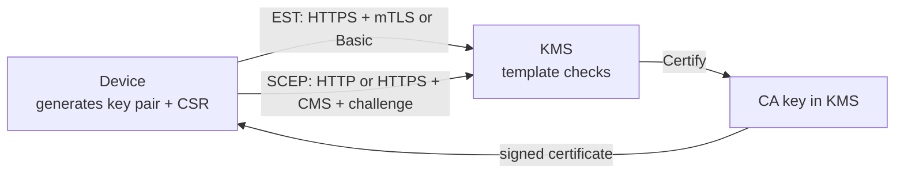
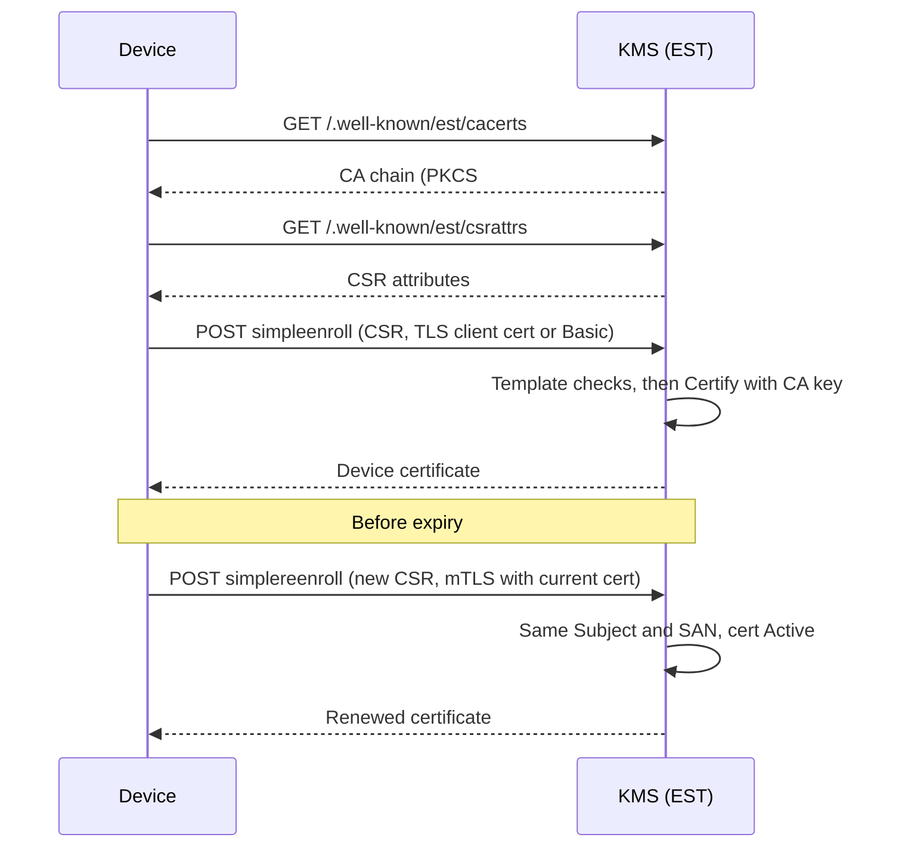
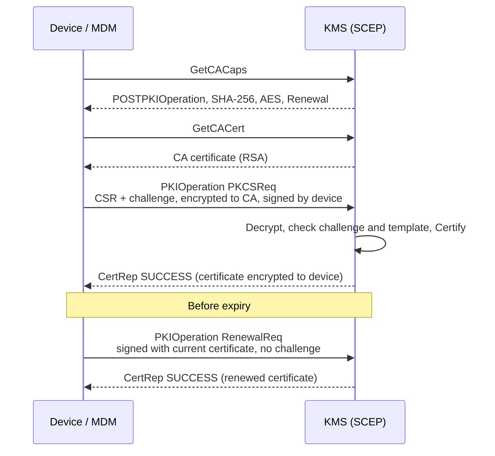

# Device enrollment: EST and SCEP

The KMS can issue certificates to IoT fleets and MDM-managed devices with two standard
enrollment protocols: **EST** ([RFC 7030](https://www.rfc-editor.org/rfc/rfc7030)) and
**SCEP** ([RFC 8894](https://www.rfc-editor.org/rfc/rfc8894)). Both issue through the same
`Certify` operation as the rest of the PKI, signed by a CA certificate stored in the KMS, and are
constrained by a **certificate template**. Both are disabled by default.

## Purpose

Both protocols let a device obtain an X.509 certificate without an operator in the loop: the device
generates its own key pair, sends a CSR, and receives a certificate signed by the CA. The private key
never leaves the device.

- **EST** (Enrollment over Secure Transport) is the modern choice: plain HTTPS, authentication by TLS
  client certificate (or HTTP Basic for bootstrap), and renewal authenticated by the current
  certificate. Typical for IoT fleets, network gear and services.
- **SCEP** (Simple Certificate Enrollment Protocol) is the legacy choice still required by MDM
  ecosystems (Apple, Windows Intune) and many routers. It runs over HTTP or HTTPS (served on the
  KMS listener). Requests are protected by CMS signing and encryption to the CA key, and initial
  enrollment is authorized by a shared challenge password. Over plain HTTP, `GetCACert` is
  unauthenticated: devices must pin the CA certificate or fingerprint out of band, otherwise an
  on-path attacker can substitute its own CA.



## Prerequisites

Create a CA with the KMS and note its certificate unique identifier. The CA private key must be
`Active`. For SCEP, the CA must be an RSA CA, since requests are encrypted to the CA public key.

```sh
cat > ca.ext <<'EOF2'
[ v3_ca ]
basicConstraints=critical,CA:TRUE
keyUsage=critical,keyCertSign,crlSign,digitalSignature,keyEncipherment
EOF2
ckms certificates certify --certificate-id device-ca --generate-key-pair --algorithm rsa2048 \
  --subject-name "CN=Device CA,O=ACME,C=FR" --days 3650 --certificate-extensions ca.ext
```

### Delegate the CA to the enrollment service identity

EST and SCEP issue certificates as the reserved identity `[enrollment-service]`, not as
`default_username`. No client can authenticate as this identity (it is rejected on every JWT,
mTLS, SPIRE and UI session path), and it holds no right until the CA owner delegates a CA to
it. Grant it `certify` on the CA certificate and on the CA private key:

```sh
ckms attributes get -i device-ca -a LinkType -l private-key   # prints the PrivateKeyLink UID
ckms access-rights grant "[enrollment-service]" -i device-ca certify
ckms access-rights grant "[enrollment-service]" -i <ca private key uid> certify
```

Without these grants, enrollment fails closed and the server logs a warning naming the CA and the
grants it needs. Also:

- when `crypto_officer_users` is configured, a Crypto Officer must grant it the `create` right
  (`ckms access-rights grant "[enrollment-service]" create`);
- when the CA private key is wrapped, grant it `decrypt` on the wrapping key.

Do not grant it `get`, `export` or a Crypto Officer role: issuance needs none of them. Issued
certificates are stored under the **CA owner**, who can list, revoke and destroy them as usual.
`default_username` and `crypto_officer_users` must not use the name `[enrollment-service]`;
the server refuses to start otherwise when EST or SCEP is enabled.

## Certificate templates

A template is a TOML section `[templates.<name>]` referenced by `est_template` / `scep_template`:

```toml
[templates.iot_device]
min_rsa_key_bits = 2048
allowed_ec_curves = ["prime256v1"]   # empty = any EC curve
allowed_ekus = ["clientAuth"]        # names or dotted OIDs; injected when the CSR has none
max_validity_days = 365
default_validity_days = 90
subject_cn_regex = "[a-z0-9-]+\\.iot\\.example"   # anchored: must match the whole value
san_dns_regex = "[a-z0-9-]+\\.iot\\.example"
```

Unknown keys in a template are rejected at startup, as are `min_rsa_key_bits` below 2048 and
inconsistent validity limits. Neither protocol carries a requested validity, so issued
certificates get `default_validity_days`. Checks applied to every CSR: proof of possession, key type and size, requested EKUs, no
`basicConstraints` `CA:TRUE`, subject CN and SAN patterns (when any SAN pattern is set, SAN types without a
pattern are refused), and validity clamped to `max_validity_days`. Violations answer
`422` (EST) or a `badRequest` `CertRep` (SCEP). Without a template, a baseline applies: RSA ≥ 2048,
no `CA:TRUE`, validity ≤ 365 days.

## EST

```toml
[est]
est_enabled = true
est_ca_uid = "<ca certificate uid>"
est_require_client_cert = true       # false enables the HTTP Basic bootstrap below
# est_bootstrap_username = "..."
# est_bootstrap_password = "..."
est_template = "iot_device"
```

| Route | Authentication | Purpose |
| --- | --- | --- |
| `GET /.well-known/est/cacerts` | none | CA chain as base64 certs-only PKCS#7 |
| `GET /.well-known/est/csrattrs` | none | CSR attributes (`204` without template) |
| `POST /.well-known/est/simpleenroll` | TLS client certificate, or HTTP Basic bootstrap | Initial enrollment |
| `POST /.well-known/est/simplereenroll` | TLS client certificate being renewed | Renewal / rekey, no secret needed |

EST must be served over TLS (RFC 7030). The KMS does not enforce this: with
`est_require_client_cert = false` on a plain-HTTP listener the Basic credentials travel in clear
text, and a warning is logged at startup. For re-enrollment the device certificate must be accepted by
the TLS layer: set `clients_ca_cert_file` to the EST CA certificate. Note that this enables mutual TLS
server-wide, so every device certificate also authenticates to the KMS API as the user named by its CN;
prefer a dedicated trust anchor for TLS client authentication where possible. The renewal CSR must
carry the same Subject and SubjectAltName as the certificate, which must be issued by the EST CA and
still `Active`. `/simpleenroll` applies the same identity rule when the client presents a certificate
issued by the EST CA.



## SCEP

```toml
[scep]
scep_enabled = true
scep_ca_uid = "<rsa ca certificate uid>"
scep_challenge_password = "<shared secret>"
scep_allow_renewal_without_challenge = true
scep_template = "iot_device"
```

`/scep` serves `GetCACaps` (`POSTPKIOperation`, `SHA-256`, `AES`, `Renewal`), `GetCACert` and
`PKIOperation`. An initial `PKCSReq` must carry the challenge password. A `RenewalReq` is signed
with a certificate previously issued by the SCEP CA that is within its validity period and `Active`
(not revoked); it needs no challenge and must keep the Subject and SubjectAltName of that
certificate. `DES3` and `SHA-1` are not supported: clients must negotiate `AES` and `SHA-256`.
The implementation is designed for clients that honour `GetCACaps`. It is verified against the micromdm
`scepclient`, whose stock build hard-codes single DES and needs AES-128-CBC selected (see
`mise run test:scep-interop`), and against the native macOS 26.6 SCEP client (profile payload), which
negotiates AES-128-CBC and SHA-256 with an RSA-2048 key (see `mise run test:scep-apple`). Renewal by
the Apple client and Windows clients were not verified.



Limitations: `GetCert`, `GetCRL`, `CertPoll` and `GetNextCACert` are not implemented, and issuance is
synchronous (`PENDING` is never returned).

## Verifying the setup

- `mise run test:scep-interop`: micromdm `scepclient` enrollment, challenge-less renewal and wrong
  challenge.
- `mise run test:scep-apple` (macOS, interactive): installs a `com.apple.security.scep` profile with
  a `CAFingerprint` pin; you approve it in System Settings. Checks the Apple request (SHA-256, AES,
  RSA-2048, challenge) and the issued identity in the keychain, then stores the capture under
  `test_data/scep/apple/` for the CI test `apple_scep_fixtures_parse`.
- `mise run test:est-interop`: globalsign `estclient` over TLS: `cacerts`, `csrattrs`,
  `enroll`, mTLS `reenroll` and rejections.
