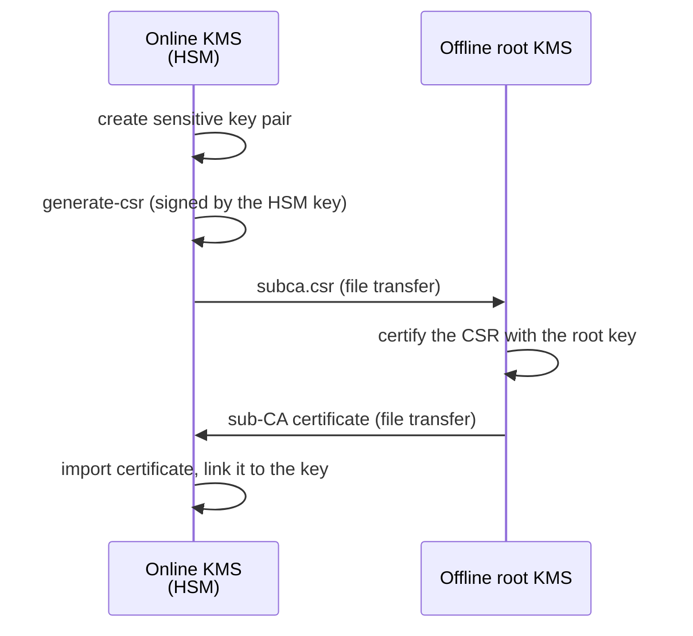

# Delegated sub-CA with an HSM-protected key

An online KMS can host a **delegated (sub) CA** whose private key never leaves the KMS
or its HSM, while the **root CA** stays on a separate, offline KMS. The online KMS
generates a PKCS#10 certificate signing request (CSR) for the sub-CA key; the offline
root signs it.



## 1. Create a non-extractable key on the online KMS

For an HSM key, use an `hsm::<slot>::<id>` identifier and `--sensitive`, so the key
cannot be exported from the HSM:

```bash
ckms rsa keys create --sensitive --size_in_bits 4096 hsm::0::subca
```

## 2. Generate the CSR

```bash
ckms certificates generate-csr \
  --private-key-id hsm::0::subca \
  --subject-name "C=FR, O=Acme, CN=Acme Sub CA" \
  --output-file subca.csr
```

The CSR is signed inside the KMS (for an HSM key, by the HSM through PKCS#11); for an HSM key the private key
is never loaded into the server. The caller needs the `Sign` permission on the key, not `Get`, and the
configured KMIP algorithm policy is enforced.
Web UI: **Certificates > Certs > Generate CSR**. REST: `POST /certificates/csr`.

An HSM key that is **extractable** is refused: create it with `--sensitive`.

### Generate the key pair and the CSR in one step

`--algorithm` creates the key pair first (same algorithm names as `ckms certificates certify --algorithm`; the ML-KEM key encapsulation algorithms cannot sign and are refused), then signs the CSR with its private key. Steps 1 and 2 become one command; the key pair is created in the HSM when the identifier is an `hsm::<slot>::<id>` one, and an HSM key pair must be `--sensitive`:

```bash
ckms certificates generate-csr \
  --algorithm nist-p384 --sensitive \
  --private-key-id hsm::0::subca \
  --subject-name "C=FR, O=Acme, CN=Acme Sub CA" \
  --output-file subca.csr
```

The command prints the private and public key ids. Without `--private-key-id` the server chooses the identifier of a database key pair. In the Web UI, choose **Generate a new key pair** on the same page, pick the algorithm, and tick **Generate the key pair in the HSM** to create it in the HSM.

The KMIP algorithm policy is checked before the key pair is created: an algorithm the policy refuses (for example `nist-p224` under the `DEFAULT` policy) leaves no key behind.

## 3. Sign the CSR on the offline root

```bash
ckms certificates certify \
  --certificate-signing-request subca.csr \
  --issuer-private-key-id <ROOT_KEY_ID> \
  --issuer-certificate-id <ROOT_CERT_ID> \
  --certificate-extensions subca_ext.cnf
```

with the following extension file (`subca_ext.cnf`):

```ini
[v3_ca]
basicConstraints = critical,CA:TRUE
keyUsage = critical,keyCertSign,crlSign
```

Export the signed sub-CA certificate from the offline KMS, and transfer it to the online KMS:

```bash
ckms certificates export --certificate-id <SUBCA_CERT_ID> -f pem subca.pem
```

## 4. Use the sub-CA

Import the signed certificate on the online KMS and link it to the HSM key
(`PrivateKeyLink`):

```bash
ckms certificates import -f pem -k hsm::0::subca subca.pem
```

The sub-CA can then issue certificates (`certify` with the sub-CA as issuer)
and CRLs (`generate-crl`): the signatures are computed by the HSM. Issuing certificates and signing CRLs with an
HSM CA key need the `Certify` permission on that key (HSM grants are per operation); `Sign` alone is not enough.

## Limits

- Certificate, CRL and OCSP signing with an HSM-resident issuer key support RSA, EC and (non-FIPS builds)
  Ed25519/Ed448 keys. ML-DSA and SLH-DSA HSM keys are not supported.
- RSA keys sign with `sha256WithRSAEncryption`. EC keys sign with the digest matching their curve
  (RFC 5480): `ecdsa-with-SHA256` for P-256, `ecdsa-with-SHA384` for P-384, `ecdsa-with-SHA512` for P-521.
  This applies to CSRs, certificates, CRLs and OCSP responses, whether the key is in the HSM or the database.
- `certify` accepts the identifier of an HSM private key (for example the ID placeholder after an HSM
  `create-key-pair` in a batch): it certifies the public key `<id>_pk`, which needs the `Certify` permission.
- The SCEP enrollment endpoint refuses a non-extractable HSM CA key (clear error, no fallback to an exported key).
  EST works, as it issues through `certify`.
- Automatic CRL regeneration (after a revocation and from the refresh cron) signs as the owner of the issuer
  certificate, whoever triggered it: for an `hsm::` key, that owner must be an HSM admin or hold a `Certify` grant
  on the key.

## Finding certificates by serial number

Every certificate created or imported now carries a system tag `_serial=<SERIAL_IN_UPPERCASE_HEX>`
(the format of `openssl x509 -noout -serial`), so operators can locate a certificate without
knowing KMIP:

```bash
ckms locate --tag _serial=0A1B2C3D
```
