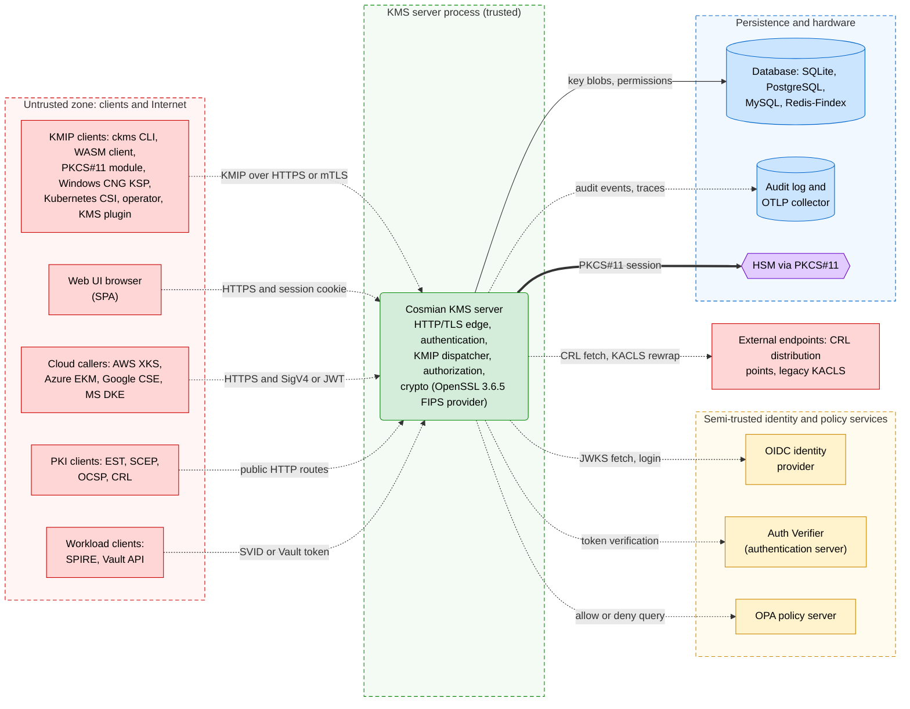
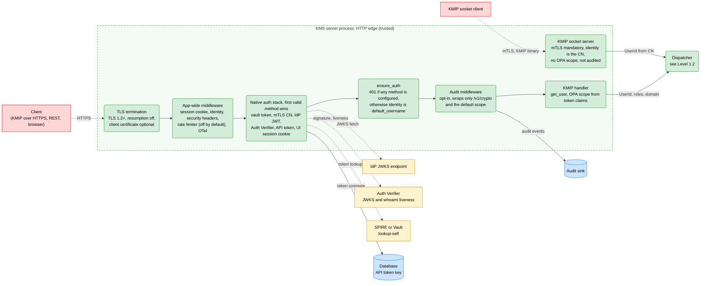
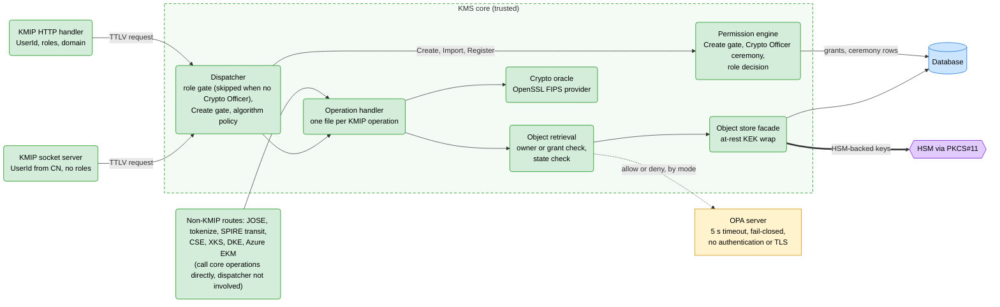
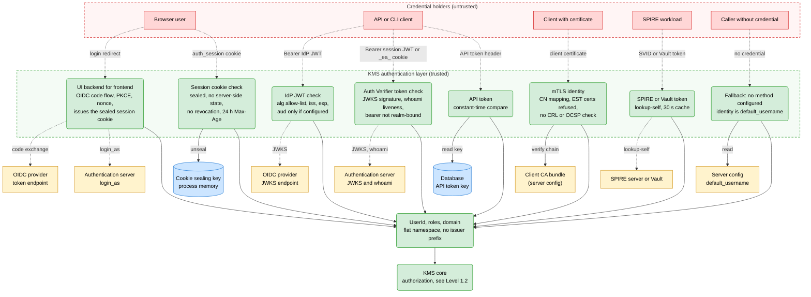
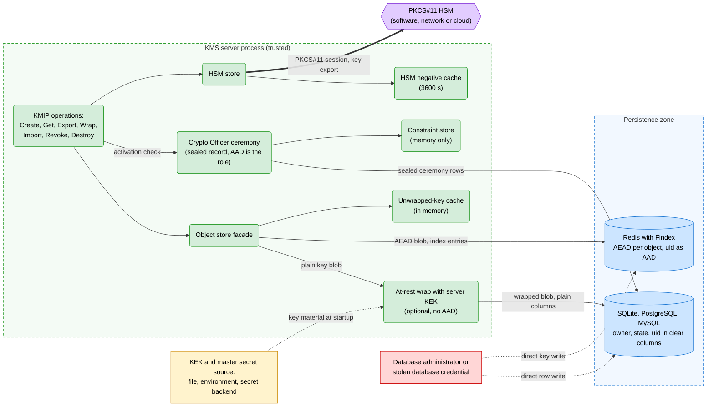
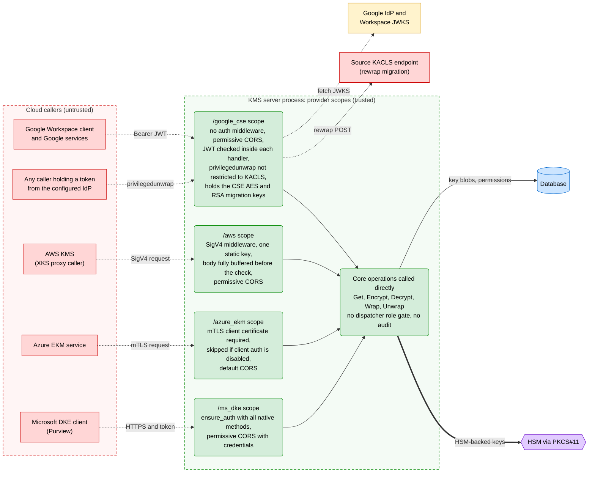
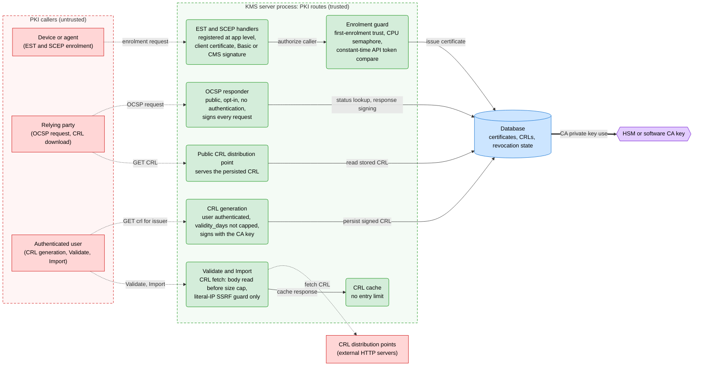
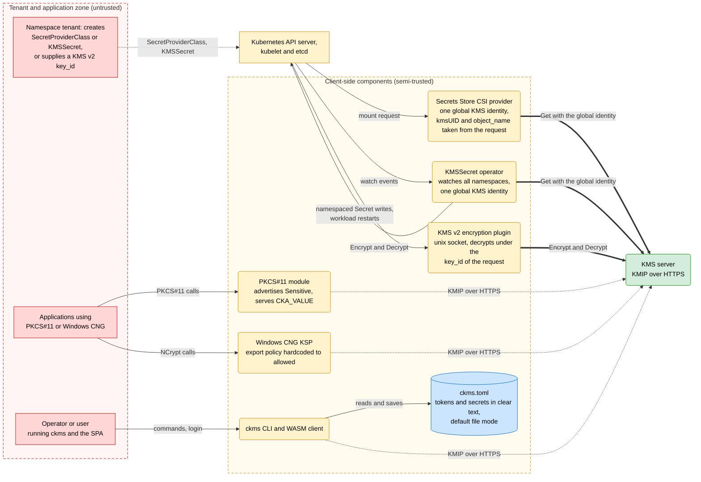
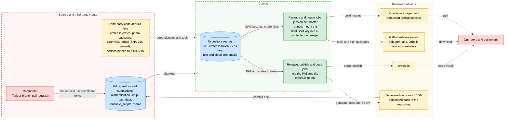

# Data Flow Diagram — Eviden KMS

**Analysis date**: 2026-11-14
**Scope**: Full repository, branch `rbac_rego` at commit `17926f40b` (PR #998, workspace version 5.29.0)
**Analyst**: AI Threat Model Analyst

The data flow diagrams are split by concern so that each one stays readable on a landscape page. Level 0 shows the system context. Level 1.1 to 1.3 follow a request from the network edge to the authorization chain. Levels 1.4 to 1.8 cover persistence, cloud provider routes, PKI routes, client-side components and the build pipeline. Trust boundary identifiers (TB1 to TB13) match `0-architecture.md`, and the last section maps every boundary to the diagrams and findings that concern it.

## Legend

| Element | Mermaid shape | Meaning |
| --- | --- | --- |
| Process | Rounded rectangle | Code that runs inside a trusted or semi-trusted component |
| External entity | Plain rectangle | A caller, a service or an actor outside the KMS process |
| Data store | Cylinder | Database, file, cache or secret store |
| HSM | Hexagon | PKCS#11 device or software token |
| Red fill, dashed red frame | Untrusted zone | Internet clients, tenants, third parties |
| Yellow fill | Semi-trusted | Identity and policy services, client-side components |
| Green fill | Trusted | KMS server process |
| Blue fill | Data store | Persistence |
| Purple fill | HSM | Hardware boundary |
| Dotted arrow | Trust boundary crossing | Data leaves one zone for another |
| Thick arrow | Key-bearing or mutually authenticated flow | HSM sessions, mTLS identity paths |

## Level 0 — System Context

## Level 1.1 — KMIP Request Flow: HTTP Edge and Authentication Pipeline

The HTTP listener applies the app-wide middleware, then the native authentication stack, then `ensure_auth`, then the optional audit middleware, and finally the KMIP handler. The KMIP socket server is a separate entry point: it requires mutual TLS, derives the identity from the certificate common name, and bypasses both the OPA scope and the audit middleware.

## Level 1.2 — KMIP Request Flow: Dispatcher, Authorization and Core

The dispatcher enforces the role gate and the Create gate, but only the KMIP entry points reach it. JOSE, tokenize, SPIRE transit, Google CSE, AWS XKS, Microsoft DKE and Azure EKM call core operations directly, so the role gate, the algorithm policy and the OPA scope do not apply to them. OPA is consulted from object retrieval and from the Create gate and fails closed.

## Level 1.3 — Authentication Methods and Identity Mapping

Every credential type converges on one flat `UserId` namespace: the identity string carries no issuer, realm or method prefix. A caller that can obtain a certificate, a JWT or a session whose identity string equals another user's identity string is that user. The last row of the authentication column is the fail-open fallback used when no method is configured.

## Level 1.4 — Persistence, At-Rest Protection and HSM Store

Key blobs reach the database through the object store facade. Wrapping with a server KEK is optional and carries no additional authenticated data. SQL backends keep the owner, state and uid in clear columns, so a party with database write access can rewrite them. Redis-Findex encrypts each object with the uid as associated data.

## Level 1.5 — Cloud Provider Routes (Google CSE, AWS XKS, Azure EKM, Microsoft DKE)

Each provider scope has its own authentication, CORS and audit wiring, and none passes through the KMIP dispatcher. The scopes call core operations directly, so the permission model that protects the KMIP interface is applied only through the per-object owner and grant checks inside those operations.

## Level 1.6 — PKI and Enrolment Routes (EST, SCEP, OCSP, CRL)

The OCSP responder and the CRL distribution point are public by design (RFC 6960 and RFC 5280). EST and SCEP are registered at application level and authenticate inside their handlers. The only outbound HTTP from the PKI code is the CRL fetch performed by Validate and Import.

## Level 1.7 — Client-Side Components and Kubernetes Integrations

The Kubernetes components and the desktop clients are separate trust domains that hold KMS credentials. The CSI provider and the KMSSecret operator each use one global KMS identity for every tenant, so tenant isolation is only as strong as the Kubernetes-side checks in front of them. The `ckms` configuration file holds tokens and secrets in clear text.

## Level 1.8 — Build, Release and Supply Chain

Third-party code enters at build time through crates.io, pnpm and the OpenSSL tarball, and through GitHub Actions pinned to full commit SHAs. The release and publish jobs hold long-lived repository secrets, and eight jobs run on self-hosted runners with the host SSH key mounted.

## Notes

### Trust boundary crossings and where they appear

| Boundary | Crossing | Diagram | Findings that concern it |
| --- | --- | --- | --- |
| TB1 | Network edge to HTTPS listener | Level 0, 1.1, 1.5, 1.6 | F-003, F-005, F-006, F-026, F-029, F-030 |
| TB2 | Network edge to KMIP socket server | Level 1.1 | F-015, F-040 |
| TB3 | Credential to identity (native authentication stack) | Level 1.1, 1.3 | F-001, F-004, F-014, F-015, F-020, F-022, F-024, F-033, F-034, F-036, F-046 |
| TB4 | Identity to authorization (dispatcher, role gate, object permissions) | Level 1.2 | F-003, F-008, F-009, F-010, F-022, F-031, F-037, F-038, F-039 |
| TB5 | KMS core to OPA | Level 1.2 | F-049 |
| TB6 | KMS core to database | Level 1.4 | F-007, F-019, F-027 |
| TB7 | KMS core to HSM | Level 1.4 | F-011 |
| TB8 | KMS to identity infrastructure (IdP, Auth Verifier, SPIRE or Vault) | Level 1.1, 1.3 | F-001, F-004, F-034, F-036 |
| TB9 | Cloud service to provider routes | Level 1.5 | F-002, F-005, F-013, F-026, F-035 |
| TB10 | KMS to outbound networks (CRL distribution points, legacy KACLS) | Level 1.5, 1.6 | F-025, F-032, F-041 |
| TB11 | Kubernetes tenants to cluster components to KMS | Level 1.7 | F-021, F-023, F-044 |
| TB12 | User host to KMS (CLI, PKCS#11, CNG, configuration files) | Level 1.7 | F-017, F-028, F-043, F-045 |
| TB13 | Source to CI to released artifacts | Level 1.8 | F-012, F-016, F-047, F-048 |

### Unusual flows worth noting

- **The KMIP socket server is a second entry point with weaker policy coverage.** It maps the certificate common name to a `UserId` and calls `handle_ttlv_bytes` directly. The role gate applies, but no OPA scope is installed and the audit middleware is not involved.
- **Non-KMIP routes bypass the dispatcher.** JOSE, tokenize, SPIRE transit, Google CSE, AWS XKS, Microsoft DKE and Azure EKM call core operations directly, so the role gate and the algorithm policy (`kmip.policy_id`) do not run for them. Object-level owner and grant checks still apply inside the operations that have them.
- **A session cookie of the Auth Verifier is a bearer token for the KMS.** The signed JWT stored behind an Auth Verifier session is accepted by the KMS bearer path. That is what makes the unauthenticated `/sessions` API of the Auth Verifier a KMS-level risk (F-001).
- **The `/v1/auth/{tail}` route of the SPIRE and Vault scope is an unauthenticated proxy** to a fixed Auth Verifier host. The host is fixed and dot segments are filtered, so it is recorded as a clean control and not as a finding.
- **The only outbound HTTP originating from request handling** is the CRL fetch of Validate and Import, the legacy KACLS POST of the Google CSE rewrap, the JWKS and token-endpoint calls of the authentication layer, and the OPA query. The OPA query carries no authentication and no TLS.
- **Secrets that live in process memory or configuration:** the XKS SigV4 secret, the CSE AES key and RSA migration key, the session sealing key, the API token key (stored in the database) and the OIDC client secrets. They are not drawn as separate flows.

### Not drawn

The deb and rpm packaging assets, the HSM vendor loaders under `crate/hsm/` and the Vault-compatible transit and PKI facade are listed in `0-architecture.md` but are not drawn separately. The monitoring stack under `monitoring/` is a development aid and appears only as an unverified hardening note (R-17) in the appendix of `3-findings.md`. The STRIDE matrix in `2-stride-analysis.md` covers the modelled components.
